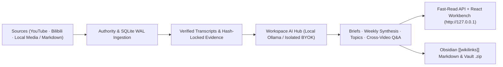

# Intelligence · YouTube Intelligence Agent

**Public Beta (`v0.1.0`) · License: [Apache-2.0](LICENSE) · Local-First · Evidence-Grounded**

一个**本地优先、反幻觉、可回溯原始时间轴证据**的多源知识情报工作台（支持 **YouTube · Bilibili · 本地音视频 / Markdown**）。

A **local-first, evidence-grounded** multi-source intelligence workspace turning long-form videos (**YouTube**, **Bilibili**, local `.mp4`/`.wav`/`.mp3`/`.m4a`, and `.md`/`.txt` notes) into auditable insights, weekly briefs, topic evolution timelines, cross-video cited Q&A, and Obsidian `[[wikilinks]]` knowledge graphs.

---

## Why This Is Not Another LLM Summary Wrapper · 为什么不只是“视频总结套壳”

| Capability · 核心能力 | Black-Box Summary Wrapper | **Intelligence (`youtube-intel`)** |
|---|---|---|
| **Multi-Source Ingestion · 多源输入** | Single YouTube URLs only | **YouTube + Bilibili (`BV...`) + Local Media + Markdown/Text** unified in one library |
| **Anti-Hallucination & Citations · 反幻觉可溯源** | Unverified prose paragraphs | Hash-locked source transcripts + clickable `[E1]..[En]` **timestamped verbatim evidence** |
| **Honest Degradation · 诚实边界** | Fabricates timestamps or fakes text on missing captions | Explicit metadata-only preview notices; `.md`/`.txt` omits fake `[00:00]` timestamps; missing speech model links directly to setup |
| **Signal-to-Noise Filtering · 信噪比过滤** | Treats 30s teasers like 1h lectures | Auto-folds sub-180s promotional `#shorts` into a collapsible drawer while protecting `>180s` technical talks |
| **Synthesis & Knowledge Output · 体系化沉淀** | One-off isolated summaries | **Home Weekly Brief + Topic Evolution Timelines + Cross-Video Grounded Q&A + Obsidian `[[wikilinks]]` `.zip` Vault** |
| **Privacy & Cost Control · 隐私与成本** | Uploads data to hosted SaaS by default | **Zero telemetry**, SQLite WAL local persistence, free **Local Ollama** default + isolated **BYOK** (DeepSeek / OpenAI / Kimi), **zero silent cloud spend** |

---

## Architecture · 架构概览



---

## Offline Demo Quickstart · 离线体验模式 (`demo`)

先在联网环境完成一次性冷安装与前端构建（`uv sync` + `npm ci && npm run build`）；完成后即可在**完全断网环境**下用一条命令于隔离目录（`.var/demo-showcase`）启动带合成回放样例数据的 Web 工作台（默认中文界面，可在设置页切换中/英文）。

> **诚实说明 · Synthetic Replay Notice**: `youtube-intel demo` 演示模式内置 **6 条合成多源样例与 `demo-replay` 模板回放回答器**，用于无模型/无外网环境验证交互链路，不代表真实大模型的跨视频理解上限；日常连接本机 Ollama 或云端 BYOK 模型请使用下方 `serve-api` 入口。

```bash
# Step A (One-time setup, requires network): Install deps & build frontend
uv sync
cd frontend && npm ci && npm run build && cd ..

# Step B (100% offline runtime launch): Start single-port Demo UI + API
uv run youtube-intel demo
```

打开浏览器访问 / Open in browser: **http://127.0.0.1:8765/**

> Demo 命令行选项与目录安全规则 / Options & Directory Safety:
> - `uv run youtube-intel demo --port 8877` — 自定义端口 / custom port
> - `uv run youtube-intel demo --reset` — 仅重置带有 `.demo-showcase-v1.json` 归属标记的演示数据，不会删除用户自有文件
> - 首次运行遇到**非空且无演示标记**的目录会直接安全退出拒绝覆写 / Refuses non-empty unknown directories without touching user files

---

## Platform Support Matrix · 平台支持矩阵

| Platform · 平台 | Dependency Install (`uv sync`) | Offline Demo (`demo`) & Daily Server (`serve-api`) | Offline Media Transcription (`mac-whisper`) |
|---|---|---|---|
| **macOS (Apple Silicon)** | Supported (Python 3.12) | **Verified** | Supported via `uv sync --extra mac-whisper` |
| **macOS (Intel) & Linux** | Supported (Python 3.12) | **Supported** (POSIX CI tested on Ubuntu 24.04 + Python 3.12) | Excluded from base install (`--extra mac-whisper` skipped) |
| **Windows 11 / 10 (WSL2)** | Supported inside WSL2 | **Supported via WSL2** | Excluded from base install |
| **Native Windows (non-WSL)** | Base `uv sync` resolves without `mlx-whisper` | **Blocked at runtime** (`fcntl` advisory locks require POSIX/WSL2) | Unsupported |

---

## Daily Local-First / BYOK Usage · 日常真实使用方式

### 1. Choose Your AI Backend · 选择 AI 引擎
- **Local Free (Recommended · 零费用本机运行)**: Install [Ollama](https://ollama.com/), pull a local model (e.g. `ollama pull qwen3.5:9b` or `qwen2.5:7b`), and configure/verify it on `#Settings`.
- **Cloud BYOK (可控自带密钥 + 零静默后台扣费)**: Choose DeepSeek, OpenAI, Kimi, or OpenAI-compatible HTTPS endpoints on `#Settings`. API keys are stored in OS Keychain / isolated secret stores; **background auto-sync (`_auto_sync_loop`) strictly blocks BYOK cloud calls and only runs local models**, snapshot restores revoke prior cloud endpoint authorization until re-confirmed, and an explicit daily cloud call cap (`cloud_daily_call_limit`, default 30) enforces reservations before outbound requests.
- **Optional Apple Silicon Offline Transcription (`mac-whisper`)**:
  ```bash
  uv sync --extra mac-whisper
  ```

### 2. Initialize & Run Your Workspace · 初始化并启动日常服务

```bash
# 1. Copy example configs (never commit personal config/secrets)
cp config/settings.example.yaml config/settings.yaml
cp config/channels.example.yaml config/channels.yaml

# 2. Check environment readiness (read-only)
uv run youtube-intel doctor

# 3. Serve the fast-read API + built frontend on one loopback port
uv run python -m youtube_intel serve-api \
  --database .var/owner/state.sqlite3 \
  --port 8765 \
  --web-dir frontend/dist
```

---

## Release Posture · 当前发布状态说明

`GET /api/v1/system` exposes live posture metadata transparently:

| Track · 模块 | Status · 状态 | Scope · 边界说明 |
|---|---|---|
| **Core Workspace AI Hub & Workbench** | **`PUBLIC_BETA`** | YouTube / Bilibili / local `.md` ingestion, Ollama & BYOK briefs, Weekly Brief, Topic Evolution, Cross-Video Grounded Q&A, Obsidian `.zip` export, Backup/Restore validation. |
| **Governed Multi-Model Deep Analysis (`TASK-016`)** | **`EXPERIMENTAL`** | Legacy sealed multi-model audit route stays fail-closed unless explicitly qualified & enabled by the operator; disabled by default and never triggers silent charges. |

治理决策与检查记录详见 [docs/RELEASE_CHECKLIST.md](docs/RELEASE_CHECKLIST.md) 与 [docs/operations.md](docs/operations.md)。

---

## Testing & Verification · 本地研发与测试命令

```bash
# Backend lint, strict typing, and integration tests
uv run --frozen ruff check src tests
uv run --frozen mypy src
uv run --frozen python -m pytest tests/integration/test_workspace_intelligence_hub.py tests/integration/test_public_beta_demo_showcase.py tests/e2e/test_po_demo.py -q

# Frontend production build + Vitest suite
cd frontend && npm run build && npx vitest run
```

---

## License & Third-Party Dependency Boundary · 开源协议与第三方依赖边界

- **First-party source code**: Licensed under the **Apache License, Version 2.0** (see [LICENSE](LICENSE) and [NOTICE](NOTICE)).
- **Unbundled third-party runtime packages**: Source, `sdist`, and `wheel` artifacts do **not** vendor or redistribute runtime dependencies, CLI tools, or model weights. Operators install runtime dependencies separately in their own environment (e.g. `yt-dlp` and its transitive dependency `mutagen` [GPL-2.0-or-later], `ffmpeg`, `Ollama`, optional `mlx-whisper`, and pre-provisioned `o200k_base.tiktoken`); see [docs/THIRD_PARTY_NOTICES.md](docs/THIRD_PARTY_NOTICES.md) and [docs/SBOM.md](docs/SBOM.md).
