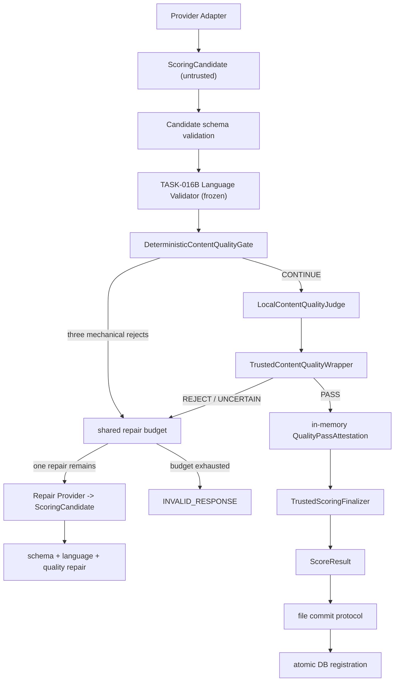

# TASK-016C Content Quality Interface Design — Round 4

- 状态：`PROPOSED / INDEPENDENT DESIGN REVIEW REQUIRED`
- 决策依据：[ADR-025](decisions/ADR-025-content-quality-layer-scope-boundary.md)
- 稳定基线：`task-016b-complete-accepted`
- 实现授权：尚未生效；本设计通过独立审查后才能创建 Implementer task card

## 1. 设计目标与不可绕过的不变量

在不修改 TASK-016B Language Validator 和 `ScoreResult` 公共字段的前提下，建立以下
不变量：

1. Provider Adapter 只能返回 `ScoringCandidate`；
2. `TrustedScoringFinalizer` 是唯一 `ScoreResult` 构造入口；
3. 每个成功结果绑定一份具体 candidate/input/Judge identity 的 Quality PASS
   attestation；
4. primary、repair 和 cache recovery 都经过相同 Finalizer；
5. cache hit 零 Judge 调用，恢复从既有事实重算 derived verification view；
6. primary 与 repair 的 Judge 各最多一次，崩溃未知状态不得重调；
7. `REJECT` / `UNCERTAIN` 不进入正式 scoring Artifact 或 cache；
8. 无新依赖、无数据库 migration、无外部知识或网络 fallback。

## 2. 模块与数据流



Cache recovery 不直接反序列化可信 `ScoreResult`：

```text
persisted structured payload + raw attestation envelope
  -> untrusted ScoringCandidate reconstruction
  -> provenance / hash / attestation validation
  -> TrustedScoringFinalizer
  -> fresh trusted ScoreResult instance
```

这里读取的历史 Artifact/ProviderCall 可以来自先前成功的 atomic commit；读取不是当前执行
的新成功写入。当前 cache recovery 仍须在 Finalizer 成功前保持只读，不能提前返回 hit、
完成当前调用或推进 stage。

## 3. ScoringCandidate 与 Provider contract

```python
class ScoringCandidate(FrozenDomainModel):
    score: float
    reason: str
    topics: tuple[str, ...]
    should_summarize: bool
    dimensions: ScoreDimensions | None = None

class ScoringCandidateProvider(Protocol):
    def score_candidate(self, value: ScoringInput) -> ScoringCandidate: ...
```

`ScoringCandidate` 只承载模型可提出的业务字段，不含：

- provider、model、output language；
- scoring/quality prompt 或 schema version；
- request/candidate/input hash；
- quality status/confidence/evidence；
- Artifact 或 ProviderCall identity。

Adapter 严格解析 candidate schema，但这不赋予可信结果身份。任何 Provider 实现返回
`ScoreResult` 都是接口违约。

该 wrapper 必须与现有业务契约精确兼容：score 保持 `float` 的原有精度，dimensions 保持
`ScoreDimensions | None`，reason/topics/should_summarize 的类型、约束和含义不变。不得
新增、删除、重命名或收窄 `ScoreResult` 业务字段。

ADR-025 明确 supersede `docs/SYSTEM_DESIGN.md` 现有
`ScoringProvider.score(ScoringInput) -> ScoreResult` 语义；新接口固定为
`score_candidate(ScoringInput) -> ScoringCandidate`。这是契约替换，不是同时保留两个
可信入口。

## 4. ContentQualityInput 与 evidence

```python
class ContentQualityInput(FrozenDomainModel):
    scoring_request_hash: str
    candidate_hash: str
    output_language: Literal["zh-CN", "en"]
    reason: str
    topics: tuple[str, ...]
    evidence_registry: tuple[ScoringEvidence, ...]
    policy_version: Literal["content-quality-policy-v1"]

class ScoringEvidence(FrozenDomainModel):
    evidence_id: str
    source: Literal[
        "TITLE", "DESCRIPTION", "TRANSCRIPT_HEAD",
        "TRANSCRIPT_BODY", "TRANSCRIPT_TAIL"
    ]
    excerpt: str
```

应用从当前有界 `ScoringInput` 建 registry；Judge 只能返回已有 `evidence_id`。应用按
canonical JSON 计算：

```text
candidate_hash = sha256(canonical ScoringCandidate)
quality_input_hash = sha256(canonical ContentQualityInput without derived hash)
```

Registry 必须稳定排序、去重、受总字符上限约束。Judge 不能返回 excerpt、URL、路径、
timestamp、provider/model/digest、版本或 request hash。

## 5. Deterministic Safety Gate

```python
class DeterministicGateReason(str, Enum):
    EMPTY_CONTENT = "EMPTY_CONTENT"
    CONTROL_CHARACTER_INVALID = "CONTROL_CHARACTER_INVALID"
    EXACT_REPETITION = "EXACT_REPETITION"

class DeterministicGateDecision(str, Enum):
    CONTINUE = "CONTINUE"
    REJECT = "REJECT"

class DeterministicGateResult(FrozenDomainModel):
    decision: DeterministicGateDecision
    reason: DeterministicGateReason | None

class DeterministicContentQualityGate(Protocol):
    def evaluate(self, value: ContentQualityInput) -> DeterministicGateResult: ...
```

合法组合只有：

| decision | reason |
|---|---|
| `CONTINUE` | `None` |
| `REJECT` | 三个固定 reason 之一 |

Gate 不能 `PASS`，不能产生 confidence/evidence，也不能执行 identifier、acronym、技术词、
品牌、产品、token 数量、大小写、POS 或 dependency 判断。

以下必须 `CONTINUE`：

```text
API SDK GPT LLM
Docker Kubernetes Terraform
General Dynamics Corporation
Amazon Connect Salesforce
```

### 5.1 固定 normalization 与检测顺序

处理 `reason` 的唯一顺序：

1. 严格 UTF-8/Unicode 解码；失败属于 candidate schema invalid；
2. 原始 decoded reason 扫描控制字符；
3. 若通过，才执行 EXACT_REPETITION 的 ASCII trim/LF split；
4. 不执行任何其他 normalization。

Control scan：

```text
reject: Unicode General Category Cc
allow exceptions: TAB U+0009, LF U+000A
always reject: NULL U+0000, ZERO WIDTH SPACE U+200B, BOM U+FEFF
```

`U+200B`/`U+FEFF` 不是 `Cc`，所以是显式附加拒绝。CR `U+000D` 仍为 `Cc` 且不在例外
中，必须拒绝；输入必须使用 LF。

EXACT_REPETITION：

```python
trimmed = reason.strip("\t\n\v\f\r ")
segments = [segment for segment in trimmed.split("\n") if segment != ""]
reject = any(left == right for left, right in pairwise(segments))
```

比较是精确 code-point equality。禁止 casefold、lowercase、标点 normalization、Unicode
normalization、tokenization、NLP、segment 二次 trim 或非相邻比较。

## 6. Local Judge response

### 6.1 有限枚举

```python
class ContentQualityStatus(str, Enum):
    PASS = "PASS"
    REJECT = "REJECT"
    UNCERTAIN = "UNCERTAIN"

class ContentQualityConfidence(str, Enum):
    LOW = "LOW"
    MEDIUM = "MEDIUM"
    HIGH = "HIGH"

class ContentQualitySignal(str, Enum):
    IDENTIFIER_ONLY = "IDENTIFIER_ONLY"
    ENTITY_ONLY = "ENTITY_ONLY"
    LOW_INFORMATION = "LOW_INFORMATION"
    MINIMAL_CLAIM_PRESENT = "MINIMAL_CLAIM_PRESENT"
    MINIMAL_CLAIM_MISSING = "MINIMAL_CLAIM_MISSING"
    GROUNDING_PRESENT = "GROUNDING_PRESENT"
    GROUNDING_INSUFFICIENT = "GROUNDING_INSUFFICIENT"
    JUDGE_UNAVAILABLE = "JUDGE_UNAVAILABLE"
    JUDGE_INVALID_RESPONSE = "JUDGE_INVALID_RESPONSE"

class ContentQualityReason(str, Enum):
    IDENTIFIER_ONLY = "IDENTIFIER_ONLY"
    ENTITY_ONLY = "ENTITY_ONLY"
    LOW_INFORMATION = "LOW_INFORMATION"
    MINIMAL_CLAIM_MISSING = "MINIMAL_CLAIM_MISSING"
    GROUNDING_INSUFFICIENT = "GROUNDING_INSUFFICIENT"
    JUDGE_UNAVAILABLE = "JUDGE_UNAVAILABLE"
    JUDGE_INVALID_RESPONSE = "JUDGE_INVALID_RESPONSE"
```

Deterministic reasons 不出现在 Judge 枚举；identifier/entity 也不出现在 deterministic
枚举。这个类型分离防止职责漂移。

### 6.2 不可信响应

```python
class ContentQualityJudgeResponse(FrozenDomainModel):
    status: ContentQualityStatus
    decision_confidence: ContentQualityConfidence
    grounding_confidence: ContentQualityConfidence
    usefulness_confidence: ContentQualityConfidence
    signals: tuple[ContentQualitySignal, ...]
    reason: ContentQualityReason | None
    evidence_ids: tuple[str, ...]
```

严格禁止未知字段、自由文本 diagnostics、重复 signal/ID、registry 外 ID、模型自报
provenance 和任意 float confidence。

### 6.3 固定运行配置

```text
provider: ollama
model: trusted current local_scoring.model
model_digest: trusted current local_scoring.expected_model_digest
policy_version: content-quality-policy-v1
prompt_version: content-quality-prompt-v1
schema_version: content-quality-result-v1
temperature: 0
stream: false
think: false
tools: none
```

只允许既有 loopback transport。模型缺失、digest mismatch、超时、响应超限、非法 JSON
或任何 transport 不确定性统一成为 `UNCERTAIN`；禁止 download、pull 或 network fallback。

## 7. ContentQualityResult 与合法组合矩阵

```python
class ContentQualityDecisionSource(str, Enum):
    DETERMINISTIC_GATE = "DETERMINISTIC_GATE"
    LOCAL_JUDGE = "LOCAL_JUDGE"

class ContentQualityResult(FrozenDomainModel):
    schema_version: Literal["content-quality-result-v1"]
    policy_version: Literal["content-quality-policy-v1"]
    prompt_version: Literal["content-quality-prompt-v1"]
    status: ContentQualityStatus
    decision_source: ContentQualityDecisionSource
    decision_confidence: ContentQualityConfidence
    grounding_confidence: ContentQualityConfidence
    usefulness_confidence: ContentQualityConfidence
    signals: tuple[ContentQualitySignal, ...]
    reason: DeterministicGateReason | ContentQualityReason | None
    evidence_ids: tuple[str, ...]
    candidate_hash: str
    quality_input_hash: str
    scoring_request_hash: str
    judge_provider: Literal["ollama"] | None
    judge_model: str | None
    judge_model_digest: str | None
```

应用 wrapper 从 canonical mapping 重新构造该对象。合法矩阵：

| source | status | confidence | reason | signals/evidence |
|---|---|---|---|---|
| Gate | `REJECT` | decision=`HIGH`; grounding/usefulness=`LOW` | 三个 deterministic reason 之一 | signals 为空；evidence 为空；Judge identity 全空 |
| Judge | `PASS` | decision=`HIGH`; grounding>=`MEDIUM`; usefulness>=`MEDIUM` | `None` | 必含 `MINIMAL_CLAIM_PRESENT`、`GROUNDING_PRESENT`；至少 1 个合法 evidence ID；无负向 signal |
| Judge | `REJECT`：identifier/entity/low-information/minimal-claim | decision=`HIGH`; grounding in {`LOW`,`MEDIUM`}; usefulness=`LOW` | 对应四个内容拒绝 reason 之一 | 必含与 reason 同名的负向 signal；不得同时声明冲突正向 signal |
| Judge | `REJECT`：grounding | decision=`HIGH`; grounding=`LOW`; usefulness in {`LOW`,`MEDIUM`,`HIGH`} | `GROUNDING_INSUFFICIENT` | 必含同名 signal；不得含 `GROUNDING_PRESENT` |
| Judge | `UNCERTAIN` | 三项全部=`LOW` | `GROUNDING_INSUFFICIENT`、`JUDGE_UNAVAILABLE` 或 `JUDGE_INVALID_RESPONSE` | 必含同名 signal；不得含 `PASS` 所需的完整正向 signal 对 |

额外不变量：

- Judge 路径三项 identity 必须全部非空并来自可信配置；Gate 路径必须全部为空；
- `PASS` evidence ID 唯一且全部属于当前 registry；
- `REJECT` 的 grounding/usefulness confidence 必须精确符合上表对应分支，不接受其他
  组合；
- unknown enum、空 hash、非 64 位小写 hex、超限集合全部拒绝；
- `model_copy(update=...)`、`model_construct()` 或 subclass instance 只有经过 canonical
  mapping/JSON 重建并再次验证才可进入 wrapper；instance identity 不被信任。

## 8. Quality PASS attestation

```python
class QualityAttemptRole(str, Enum):
    PRIMARY = "PRIMARY"
    REPAIR = "REPAIR"

class QualityPassAttestation(FrozenDomainModel):
    attestation_schema: Literal["quality-pass-attestation-v1"]
    status: Literal[ContentQualityStatus.PASS]
    candidate_hash: str
    quality_input_hash: str
    scoring_request_hash: str
    policy_version: Literal["content-quality-policy-v1"]
    scoring_schema_version: str
    scoring_prompt_version: str
    quality_schema_version: Literal["content-quality-result-v1"]
    quality_prompt_version: Literal["content-quality-prompt-v1"]
    judge_provider: Literal["ollama"]
    judge_model: str
    judge_model_digest: str
    judge_operation: Literal["local-content-quality-v1"]
    judge_request_hash: str
    attempt_role: QualityAttemptRole
    decision_confidence: Literal[ContentQualityConfidence.HIGH]
    grounding_confidence: Literal[
        ContentQualityConfidence.MEDIUM, ContentQualityConfidence.HIGH
    ]
    usefulness_confidence: Literal[
        ContentQualityConfidence.MEDIUM, ContentQualityConfidence.HIGH
    ]
    evidence_ids: tuple[str, ...]
    attestation_hash: str
```

`attestation_hash` 是除自身外 canonical payload 的 SHA-256。它首先是内存中的可信
Finalizer 输入；此时不得注册 Artifact、完成 ProviderCall 或建立 cache hit。创建与提交
步骤：

1. wrapper 获得合法 `ContentQualityResult(PASS)`；
2. 应用从当前 registry 和可信 config 重新计算所有字段；
3. 计算 canonical attestation hash；
4. 调用 `TrustedScoringFinalizer`；
5. Finalizer 成功后构造 raw envelope 与 structured bytes；
6. 按第 11.3 节将 raw/structured 写入同 filesystem 临时文件、fsync、校验并原子 promote；
7. fsync parent directory，重新打开 final files 并验证类型、路径、长度和 hash；
8. 单一 Repository transaction 原子登记 raw/structured Artifact、attestation 绑定、
   scoring/Judge ProviderCall completion 和 stage completion；不写独立 cache identity。

## 9. TrustedScoringFinalizer

```python
class TrustedScoringContext(FrozenDomainModel):
    scoring_request_hash: str
    provider: str
    model: str
    model_digest: str
    output_language: Literal["zh-CN", "en"]
    scoring_prompt_version: str
    scoring_schema_version: str

class TrustedScoringFinalizer(Protocol):
    def finalize(
        self,
        *,
        candidate: ScoringCandidate | Mapping[str, object],
        context: TrustedScoringContext | Mapping[str, object],
        quality_input: ContentQualityInput | Mapping[str, object],
        attestation: QualityPassAttestation | Mapping[str, object],
    ) -> ScoreResult: ...
```

Finalizer 总是：

1. 从 mapping 重建 candidate/context/input/attestation，拒绝 unchecked instance；
2. 重跑 candidate schema 与 TASK-016B language invariant；
3. 重算 candidate、quality input 和 attestation hash；
4. 验证当前 policy/prompt/schema/provider/model/digest；
5. 验证 PASS confidence、evidence registry 与 Judge operation；
6. 使用 candidate 业务字段和可信 context 新建 `ScoreResult`。

Provider、Judge、Repository、Artifact reader、cache recovery 和 Runtime 其他模块不得直接
调用 `ScoreResult(...)`、`ScoreResult.model_validate*` 或 unchecked copy/construct 作为
可信结果。实现 Review 应以静态调用点扫描证明唯一入口。

Finalizer 本身是纯领域终结边界：不写文件、不写 DB、不完成 ProviderCall。它成功前只能
存在内存 candidate、quality result 和 attestation。

## 10. Judge operation、attempt state 与恢复

```python
class QualityJudgeOperationInput(FrozenDomainModel):
    scoring_request_hash: str
    attempt_role: QualityAttemptRole
    candidate_hash: str
    quality_input_hash: str
    policy_version: str
    prompt_version: str
    schema_version: str
    judge_provider: str
    judge_model: str
    judge_model_digest: str
```

其 canonical hash 是 `judge_request_hash`；provider operation 固定为
`local-content-quality-v1`。PRIMARY 与 REPAIR 使用不同 role，因此 identity 不同。
one-shot wrapper 必须先调用 Repository 的只读查询。record 不存在时才可 reserve 并外部
调用；live PENDING 只能等待或停止；expired PENDING 只允许在完整 PASS raw envelope 与
promoted files 已被独立验证后，以 `VerifiedPromotedFiles` 进入专用 recovery 分支，绝不在
acquired takeover 后调用 Judge。不得把通用 reserve 对 expired `PENDING` /
`FAILED_RETRYABLE` 的 takeover 语义用于质量 Judge。

| ProviderCall state | 恢复动作 | 是否调用 Judge |
|---|---|---:|
| missing | 原子 reserve 后调用 | 1 |
| live `PENDING` | 报告 in progress / fail-closed | 0 |
| expired `PENDING` + 完整验证的 deterministic PASS promoted files | 原子 recovery claim 后登记 | 0 |
| expired `PENDING` 且无完整 PASS promoted files | 结果未知，fail-closed；禁止 reclaim 调用 | 0 |
| `FAILED_RETRYABLE` / `FAILED_FINAL` | role 已消费；fail-closed | 0 |
| `SUCCEEDED` + 完整 PASS attestation | 恢复 PASS | 0 |
| `SUCCEEDED` + 非 PASS / 缺失或矛盾 artifact | integrity failure | 0 |

Primary 明确 REJECT/UNCERTAIN 后才可进入唯一 repair。Primary 外部调用后崩溃形成 PENDING
时，不得推测结果，也不得调用 repair，因为不能证明 primary 判定已完成。需要人工启动新
产品操作 identity，而不是自动重复当前 attempt。

## 11. Artifact 与 cache

### 11.1 外部兼容

- `ScoreResult` shape 不变；
- `SCORING_STRUCTURED` 仍是 canonical ScoreResult JSON；
- SQLite Schema、`ArtifactKind` 与 migration 不变；
- `ScoringOutcome.result` 仍为 Finalizer 返回的 ScoreResult。

### 11.2 Raw envelope

最终 `SCORING_RAW` 使用固定 `scoring-raw-content-quality-v1` envelope：

```json
{
  "envelope_schema": "scoring-raw-content-quality-v1",
  "final_provider_response": "<bounded raw response>",
  "validated_quality_pass_decision": { "status": "PASS", "...": "finite fields only" },
  "quality_pass_attestation": { "...": "quality-pass-attestation-v1" }
}
```

`SCORING_STRUCTURED` producer version 固定为
`scoring-structured-content-quality-v1`。Raw/structured key 和 content hash 仍绑定当前
scoring identity；raw envelope 的 attestation 又绑定具体 candidate 与 Judge operation。
最终 scoring ProviderCall 和 PASS Judge ProviderCall 可以引用同一 composite raw Artifact；
二者 operation identity 独立，且共用的 provider/model/digest 必须精确等于当前固定本地
配置。若未来 Judge 与 scoring 使用不同 provider/model，该复用不再成立，必须先修订 ADR。

### 11.3 Artifact file commit protocol

Finalizer 成功后，应用准备 raw/structured 的 deterministic key、canonical bytes、长度与
SHA-256，并严格执行：

```text
same-filesystem operation-scoped temporary write
  -> fsync temporary file
  -> verify temporary byte length and SHA-256
  -> no-clobber atomic rename/promote to deterministic final path
  -> fsync affected parent directory
  -> re-open final regular file and verify controlled path/length/SHA-256
```

两个文件分别执行，但必须都在同一个受控 DATA filesystem，且全部 final verification 通过后
才能进入 SQLite transaction。Temporary name 必须绑定 operation identity、request hash 和
随机不可预测 component，并使用 exclusive create；禁止跟随 symlink、跨 filesystem rename、
覆盖式 `replace` 或接收任意调用方路径。

Final path 已存在时绝不覆盖或删除。只有它与本次 deterministic key/operation 归属一致，
是受控根内普通文件，并且长度/hash 与本次计划完全相同，才可视为同 operation 的幂等
promote；否则 fail-closed。已被其他 operation 或不同 Artifact key 索引的文件，即使 hash
相同也不得据为己有。

### 11.4 Atomic DB registration boundary

文件协议完成后，调用唯一 atomic registration API：

```python
class TrustedScoringPersistence(Protocol):
    def commit_finalized_scoring(
        self,
        *,
        finalized: ScoreResult,
        raw_artifact: ArtifactWrite,
        structured_artifact: ArtifactWrite,
        quality_attestation: QualityPassAttestation,
        scoring_call: ProviderCallCompletion,
        quality_call: ProviderCallCompletion,
        stage: ScoringStageCompletion,
        final_file_verification: tuple[VerifiedPromotedArtifact, ...],
    ) -> ScoringOutcome: ...
```

该方法必须先验证 proof 与 final 文件仍一致，再在单一 SQLite transaction 内登记两份
Artifact、两份 Provider completion、raw envelope 的 attestation 绑定和 stage。现有 Schema
可复用，但现有一次只完成一个 ProviderCall 的 API 不足，实施需增加 Repository 方法而不
修改表结构。SQLite 只能登记已 promote、parent fsync 且 hash-verified 的 final 文件；事务
提交前，这些文件没有 Artifact/cache 身份。

### 11.5 Derived cache verification view

`ScoringCacheIdentity` 仅作为不可持久化的运行时 derived verification view：

```python
class DerivedScoringCacheView(NamedTuple):
    scoring_request_hash: str
    scoring_provider_call_request_hash: str
    quality_provider_call_request_hash: str
    raw_artifact_key: str
    raw_artifact_version: str
    raw_artifact_hash: str
    structured_artifact_key: str
    structured_artifact_version: str
    structured_artifact_hash: str
    quality_attestation_hash: str
    quality_policy_version: str
    scoring_schema_version: str
    scoring_prompt_version: str
    quality_schema_version: str
    quality_prompt_version: str
    judge_provider: str
    judge_model: str
    judge_model_digest: str
```

它每次从两份 ProviderCall、两份 Artifact 记录和文件、producer metadata、raw envelope 的
Quality PASS attestation 以及当前 trusted config 重算。Repository 不得提供
`put_cache_identity`，也不得新增 cache table/row/Artifact/file 或 migration。只有完整 view
与当前请求逐字段相等，且 Finalizer 重新验证成功，才返回 cache hit。

### 11.6 Cache recovery matrix

| 情形 | 结果 | Judge calls |
|---|---|---:|
| derived view 的 ProviderCall、Artifact、producer metadata、attestation 与当前 config 完全匹配 | cache hit；Finalizer 重建 | 0 |
| 旧 cache 无 attestation | cache miss，旧物保留，以当前新 identity 计算 | 按新请求预算 |
| policy/prompt/schema/model/digest 版本变化 | cache miss；新 Judge identity | 按新请求预算 |
| raw/structured hash、candidate/input/attestation hash 不一致 | integrity failure，停止 | 0 |
| 当前 Judge identity 为 PENDING/FAILED | fail-closed，禁止通过 cache miss 重调 | 0 |
| Judge call SUCCEEDED 但 response artifact 不指向同一 attested raw envelope | integrity failure | 0 |

Cache hit 必须重新验证 attestation 并调用 Finalizer，但绝不调用 Judge。旧文件、Artifact 与
ProviderCall 均保留审计，不覆盖、不删除、不回写为当前成功。

### 11.7 Crash/restart matrix

| crash 点 | restart 行为 |
|---|---|
| tmp write/fsync 前后 | 只可识别并清理当前 operation 的 orphan tmp；其他 tmp/final 均不动 |
| raw 或 raw+structured promote 后、DB commit 前 | 文件不是 Artifact/cache；按 deterministic identity 重验后继续缺失 promote 或 DB registration，Judge=0 |
| SQLite transaction 内 | 依赖 transaction 全回滚或全提交；重新查询完整关系，不补写部分行 |
| DB commit 后 | 重新读取 Artifact/files/calls/attestation，重算 derived view；全部匹配才 hit，Judge=0 |

Promoted orphan 恢复只允许在对应 ProviderCall 的 operation identity 已存在且可被原子恢复
claim 时进行；live owner 不得被抢占。Raw envelope 必须足以重建 candidate、attestation 和
canonical structured bytes。任一文件缺失、symlink/非普通文件、路径逸出、version/length/
hash 不符或 ProviderCall identity 矛盾均 fail-closed，不调用 Judge，不删除已有 final 文件。
自动删除范围永远只限当前 operation 明确拥有的 orphan temporary files。

## 12. Repair/finalize event contract

primary PASS 的事件顺序固定为：

```text
CANDIDATE_PRIMARY
LANGUAGE_PRIMARY
QUALITY_PRIMARY
ATTESTATION_PRIMARY
FINALIZE
FILE_COMMIT_PROTOCOL
ATOMIC_DB_REGISTRATION
```

`CANDIDATE_*` 事件包含 Provider DTO 的严格 schema parsing；schema invalid 时事件失败并
进入共享 repair，不会产生 language/quality/attestation。

需要 repair 的事件顺序固定为：

```text
CANDIDATE_PRIMARY
LANGUAGE_PRIMARY
QUALITY_PRIMARY
REPAIR
CANDIDATE_REPAIR
LANGUAGE_REPAIR
QUALITY_REPAIR
ATTESTATION_REPAIR
FINALIZE
FILE_COMMIT_PROTOCOL
ATOMIC_DB_REGISTRATION
```

任何 `FINALIZE` 提前、quality 重复调用、跳过 repair language、或在 finalization 之前
产生 `SCORING_RAW` / `SCORING_STRUCTURED` / response_artifact_id / ProviderCall SUCCESS /
cache hit 都是契约错误。

## 13. 错误与安全日志

对外复用现有 `INVALID_RESPONSE`、`PROVIDER_UNAVAILABLE`、`TRANSIENT_NETWORK`；不扩展
DB enum。安全码可包含：

```text
CONTENT_QUALITY_REJECTED
CONTENT_QUALITY_UNCERTAIN
CONTENT_QUALITY_JUDGE_UNAVAILABLE
CONTENT_QUALITY_JUDGE_INVALID
CONTENT_QUALITY_ATTESTATION_INVALID
CONTENT_QUALITY_ATTEMPT_UNKNOWN
```

不得记录 candidate reason/topics、evidence excerpt、Transcript、prompt/response、路径、
URL、Cookie、token、Key 或异常原文。

## 14. 演进约束

- v1 不新增依赖；
- signal/reason/policy/prompt/schema 或 attestation 变化必须版本化并失效旧 cache；
- 若需要可查询的独立 quality Artifact 或 cryptographic authenticity，另开 ADR 与 migration；
- Local Deep Analysis 为 `TBD / UNASSIGNED`；TASK-016C 不得顺便实现；
- 本文件只冻结接口，不授权编码、真实 Ollama、网络、Cloud、Router、Weekly 或数据库变化。
