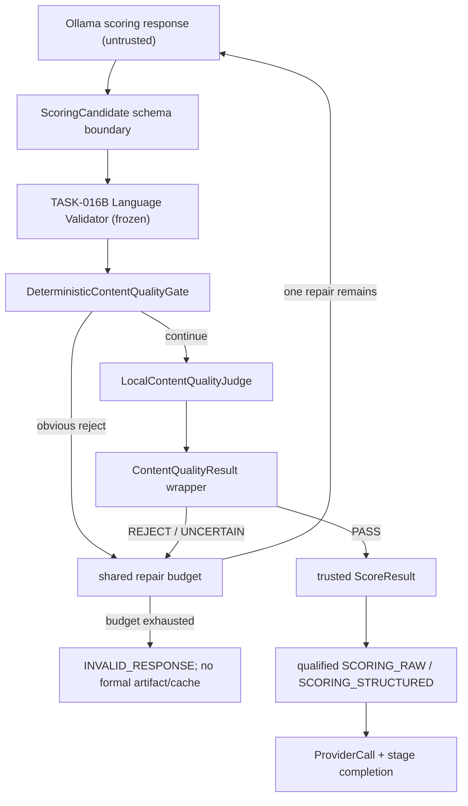

# TASK-016C Content Quality Interface Design

- 状态：`PROPOSED / REVIEW REQUIRED`
- 决策依据：[ADR-025](decisions/ADR-025-content-quality-layer-scope-boundary.md)
- 稳定基线：`task-016b-complete-accepted`
- 实现授权：尚未生效；本文件通过 Design Review 后才可生成 Implementer task card

## 1. 设计目标

在不修改 TASK-016B Language Validator 和 `ScoreResult` 公共字段的前提下，为每个
schema-valid、language-valid 的评分候选建立独立内容质量门禁。接口必须保证：

1. 模型响应在质量 `PASS` 前仍是不可信 candidate；
2. 明显垃圾由确定性门禁处理，复杂语义由固定本地 Judge 处理；
3. Judge 不能伪造 provenance 或引用评分输入之外的 evidence；
4. `REJECT` / `UNCERTAIN` 不进入正式 Artifact 或 cache；
5. 版本、model digest 和 policy 任一变化都会产生新的 request identity；
6. 不新增数据库 migration 或外部服务。

## 2. 模块边界



`ScoringCandidate` 是 Adapter/application 私有 DTO，不是新的公共 Provider contract。
它只承载现有模型可返回的业务字段：score、reason、topics、should_summarize、dimensions。
provider/model/version/request hash/output language 继续由应用补充。

## 3. 稳定领域枚举

### 3.1 ContentQualityStatus

```python
class ContentQualityStatus(str, Enum):
    PASS = "PASS"
    REJECT = "REJECT"
    UNCERTAIN = "UNCERTAIN"
```

- `PASS`：存在最小 claim，且当前输入 evidence 足以支持；允许构造可信 `ScoreResult`。
- `REJECT`：有确定、有限的拒绝原因；触发共享一次 repair。
- `UNCERTAIN`：Judge、证据或判定不足；与 `REJECT` 一样 fail-closed 并触发 repair。

### 3.2 ContentQualityConfidence

```python
class ContentQualityConfidence(str, Enum):
    HIGH = "HIGH"
    MEDIUM = "MEDIUM"
    LOW = "LOW"
```

它是本地质量判断置信度，不是事实概率。`PASS` 只允许 `HIGH | MEDIUM`；
`UNCERTAIN` 必须是 `LOW`。不得使用任意 float 或模型自报概率。

### 3.3 ContentQualitySignal

v1 固定信号：

```text
IDENTIFIER_ONLY
ENTITY_ONLY
LOW_INFORMATION
MINIMAL_CLAIM_PRESENT
MINIMAL_CLAIM_MISSING
GROUNDING_PRESENT
GROUNDING_INSUFFICIENT
REPETITIVE_OUTPUT
JUDGE_UNAVAILABLE
JUDGE_INVALID_RESPONSE
```

这些是内容质量类别，不是品牌或实体事实标签。实现不得通过增加品牌/产品名扩展该枚举。

### 3.4 ContentQualityRejectionReason

```text
IDENTIFIER_ONLY
ENTITY_ONLY
LOW_INFORMATION
MINIMAL_CLAIM_MISSING
GROUNDING_INSUFFICIENT
REPETITIVE_OUTPUT
JUDGE_UNAVAILABLE
JUDGE_INVALID_RESPONSE
```

`PASS` 的 rejection reason 必须为空；`REJECT` / `UNCERTAIN` 必须有一个固定 reason。

### 3.5 ContentQualityDecisionSource

```text
DETERMINISTIC_GATE
LOCAL_JUDGE
```

确定性门禁只能产生 `REJECT / DETERMINISTIC_GATE`；`PASS` 和 `UNCERTAIN` 只能来自
`LOCAL_JUDGE`。该字段避免把“配置了 Judge”误写成“实际调用了 Judge”。

## 4. 输入契约

### 4.1 ContentQualityInput

```python
class ContentQualityInput(FrozenDomainModel):
    scoring_request_hash: str       # 64 lowercase hex
    candidate_hash: str             # canonical ScoringCandidate JSON hash
    output_language: Literal["zh-CN", "en"]
    reason: str                     # already schema/language validated
    topics: tuple[str, ...]          # already bounded by scoring schema
    evidence_registry: tuple[ScoringEvidence, ...]
    policy_version: Literal["content-quality-policy-v1"]
```

构造规则：

- `candidate_hash` 由应用对 canonical candidate JSON 计算，Judge 不提供；
- `reason/topics` 不得包含模型响应 envelope、异常、路径或 provider diagnostics；
- registry 只来自当前 `ScoringInput` 已有的标题、受限 description 和 TranscriptSample；
- registry 的总字符上限不得超过当前 ScoringInput 已经批准的本地内容上限；
- registry 项稳定排序，重复 excerpt 去重。

### 4.2 ScoringEvidence

```python
class ScoringEvidence(FrozenDomainModel):
    evidence_id: str                # app-derived stable opaque ID
    source: Literal[
        "TITLE", "DESCRIPTION", "TRANSCRIPT_HEAD",
        "TRANSCRIPT_BODY", "TRANSCRIPT_TAIL"
    ]
    excerpt: str                    # exact substring of current bounded input
```

应用构建 registry 并在 Judge 返回后补全/验证引用。Judge 只能返回 `evidence_id`；不得
返回 excerpt、timestamp、URL、路径、provider/model 或自由 diagnostics。

## 5. 两层接口

### 5.1 DeterministicContentQualityGate

```python
class DeterministicGateDecision(str, Enum):
    CONTINUE = "CONTINUE"
    REJECT = "REJECT"

class DeterministicGateResult(FrozenDomainModel):
    decision: DeterministicGateDecision
    signals: tuple[ContentQualitySignal, ...]
    rejection_reason: ContentQualityRejectionReason | None

class DeterministicContentQualityGate(Protocol):
    def evaluate(self, value: ContentQualityInput) -> DeterministicGateResult: ...
```

该 Gate：

- 只处理无语义歧义的退化结构；
- 可以 `REJECT`，不能直接 `PASS`；
- 不读取配置外文件、不调用模型、不写 Artifact；
- 不维护品牌、公司、产品或开放式技术词表；
- 对 `Amazon Connect General Dynamics Corporation` 等复杂样例必须 `CONTINUE` 给
  Judge，而不是冒充品牌识别器。

### 5.2 LocalContentQualityJudge

```python
class ContentQualityJudgeResponse(FrozenDomainModel):
    status: ContentQualityStatus
    confidence: ContentQualityConfidence
    signals: tuple[ContentQualitySignal, ...]
    rejection_reason: ContentQualityRejectionReason | None
    evidence_ids: tuple[str, ...]

class LocalContentQualityJudge(Protocol):
    def judge(self, value: ContentQualityInput) -> ContentQualityJudgeResponse: ...
```

Judge response 是不可信输入，必须拒绝未知字段、重复枚举/ID、自由文本、空白 ID、超限
集合和 registry 外引用。`PASS` 至少要求：

- `MINIMAL_CLAIM_PRESENT`；
- `GROUNDING_PRESENT`；
- 至少一个 registry 中的 evidence ID；
- confidence 为 `HIGH` 或 `MEDIUM`；
- rejection reason 为空；
- 不含拒绝/不可用信号。

Judge 运行配置固定为：

```text
provider: ollama
model: current trusted local_scoring.model (fixed for the request)
model_digest: current local_scoring.expected_model_digest
prompt_version: content-quality-prompt-v1
schema_version: content-quality-result-v1
temperature: 0
stream: false
think: false
tools: none
```

模型预检和请求只复用既有 loopback 安全边界。任何自动下载、远程地址、cloud tag、动态
prompt 或网络 fallback 都是接口违约。

## 6. 可信结果契约

```python
class ContentQualityResult(FrozenDomainModel):
    schema_version: Literal["content-quality-result-v1"]
    policy_version: Literal["content-quality-policy-v1"]
    prompt_version: Literal["content-quality-prompt-v1"]
    status: ContentQualityStatus
    decision_source: ContentQualityDecisionSource
    confidence: ContentQualityConfidence
    signals: tuple[ContentQualitySignal, ...]
    rejection_reason: ContentQualityRejectionReason | None
    evidence_ids: tuple[str, ...]
    candidate_hash: str
    scoring_request_hash: str
    judge_provider: Literal["ollama"]
    judge_model: str
    judge_model_digest: str
```

只有应用可构造该对象。确定性拒绝路径直接从已验证的 Gate result 封装；Judge 路径按
以下步骤封装：

1. 重新验证 `ContentQualityInput`；
2. 严格解析 Judge response（确定性拒绝时不适用）；
3. 验证所有 evidence IDs 属于当前 registry；
4. 以可信配置补充 provider/model/digest/version/hash；
5. 重新执行跨字段不变量，包括 decision source 与 status 的合法组合。

`judge_provider/model/digest` 始终绑定当前质量 policy 的固定配置；只有
`decision_source=LOCAL_JUDGE` 才表示实际进行了 Judge 调用。

禁止 unchecked `model_copy(update=...)` 或 `model_construct()` 结果进入 Runtime、Artifact
或 cache；边界函数必须从 canonical mapping/JSON 重建并验证。

## 7. Repair 与调用预算

每个 scoring request 只有一个共享 repair budget：

| 主候选结果 | 行为 | Judge calls |
|---|---|---:|
| schema/language invalid | repair；repair 后跑全部门禁 | 0 或 1 |
| deterministic REJECT | repair；不调用 Judge | 0 |
| Judge REJECT/UNCERTAIN | repair；repair 后跑全部门禁 | 最多 2 |
| PASS | 构造 ScoreResult 并持久化 | 1 |

repair candidate 失败后不得再次 repair。Judge call 计数由应用层维护，任何路径不得超过
2；恢复路径也必须从已持久化 request state 得知 repair 是否已消费，不能因重启重置预算。

## 8. Artifact / cache 接口

### 8.1 不变的外部形状

- `ScoreResult` 字段与校验不变；
- `SCORING_STRUCTURED` 文件仍为 canonical `ScoreResult` JSON；
- `ScoringOutcome.result` 仍为 `ScoreResult`；
- SQLite Schema、`ArtifactKind` 和 migration 不变。

### 8.2 PASS metadata

成功 Artifact 使用按 kind 区分的固定 producer version，例如：

```text
SCORING_RAW: scoring-raw-content-quality-v1
SCORING_STRUCTURED: scoring-structured-content-quality-v1
```

这些值只表示同一最终候选已通过 ADR-025 v1 门禁。完整 identity 进入 scoring
normalized input hash：

```json
{
  "content_quality": {
    "policy_version": "content-quality-policy-v1",
    "prompt_version": "content-quality-prompt-v1",
    "schema_version": "content-quality-result-v1",
    "judge_provider": "ollama",
    "judge_model": "<trusted current model>",
    "judge_model_digest": "<trusted current sha256 digest>"
  }
}
```

ProviderCall 的现有 prompt/schema columns 继续记录 scoring prompt/schema；quality identity
作为 normalized input 的一部分参与现有 request hash，不复用或改写字段语义。

### 8.3 Recovery

cache hit 必须满足：

- scoring request/provider/model/output language/prompt/schema 全部匹配；
- quality identity 全部匹配；
- raw/structured Artifact ID、key、path、hash、provider/model 全部匹配；
- raw/structured producer version 分别精确为当前 qualified version；
- `ScoreResult` 重新执行 schema 与 TASK-016B language invariant。

旧 Artifact、旧 producer version 或缺少 quality identity 时：保留旧文件和索引，返回
cache miss，重新 Provider compute。不得把 provenance mismatch 变成当前 cache hit，也
不得删除审计材料。

## 9. 错误与日志

对外继续使用现有 `INVALID_RESPONSE`、`PROVIDER_UNAVAILABLE`、`TRANSIENT_NETWORK`
等 `AppError`；不扩展 DB enum。安全 diagnostics 可记录：

```text
CONTENT_QUALITY_REJECTED
CONTENT_QUALITY_UNCERTAIN
CONTENT_QUALITY_JUDGE_UNAVAILABLE
CONTENT_QUALITY_JUDGE_INVALID
```

不得记录 candidate reason、topics、evidence excerpt、Transcript、模型原始响应、路径、
URL、Cookie、token、Key 或异常原文。

## 10. 兼容与演进

- v1 不新增依赖；复用现有 Ollama transport、Pydantic 和 hashing。
- v1 不对外承诺 deterministic/Judge 的内部信号排序之外的实现细节。
- 新增 signal、policy、prompt 或 schema 必须升级版本并失效旧 cache。
- 如果未来需要长期持久化完整 quality result，应新建 ADR 和 migration；不能把它伪装成
  `SCORING_RAW`、`ANALYSIS_*` 或其他既有 Artifact kind。
- Local Deep Analysis 的新任务号由主控另行决定；TASK-016C 不能顺便实现它。
