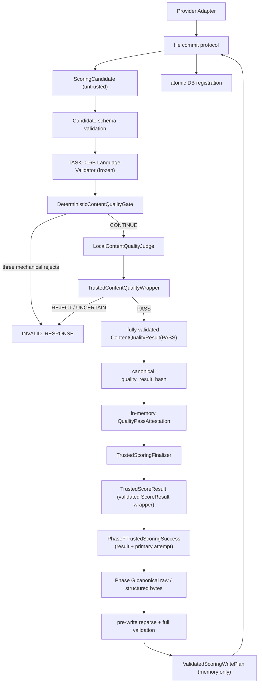

# TASK-016C Content Quality Interface Design — Phase F Round 3 Alignment

- 状态：Phase E 已 `APPROVED`；Phase F 为 `DESIGN READY / IMPLEMENTATION NOT AUTHORIZED`。
  [Phase F Round 3 Amendment](TASK-016C-PHASE-F-RUNTIME-INTEGRATION-AMENDMENT.md) 对 F–I
  的阶段归属、legacy isolation 与 `TrustedScoringFinalizer` 输出合同具有优先级。
- 决策依据：[ADR-025](decisions/ADR-025-content-quality-layer-scope-boundary.md)
- 稳定基线：`task-016b-complete-accepted`
- 实现授权：尚未生效；本设计通过独立审查后才能创建 Implementer task card

## 1. 设计目标与不可绕过的不变量

在不修改 TASK-016B Language Validator 和 `ScoreResult` 公共字段的前提下，建立以下
不变量：

1. Provider Adapter 的唯一业务 DTO 是 `ScoringCandidate`；F-facing transport/parser envelope 只能是
   untrusted `PrimaryScoringAttempt`，不得返回 `ScoreResult`；
2. `TrustedScoringFinalizer` 是唯一内部 `ScoreResult` 构造入口，且只输出
   `TrustedScoreResult`；
3. 每个成功结果绑定完整 validated `ContentQualityResult(PASS)` 的 canonical hash，以及
   具体 candidate/input/Judge identity 的 Quality PASS attestation；
4. F 的 PRIMARY success 必须同时保留 request-bound、untrusted `PrimaryScoringAttempt`；
   `TrustedScoreResult` 仍是唯一 trusted business result；
5. Phase F 只允许 PRIMARY 经 Finalizer；repair/retry/recovery/budget 属于 H，cache recovery
   属于 I；
6. G 才拥有 pre-write、文件和 DB registration；I 的合法 cache hit 不调用 Judge；
7. `REJECT` / `UNCERTAIN` 不进入正式 scoring Artifact 或 cache；
8. Finalizer 后、任何文件写入前，最终 raw/structured bytes 必须经完整 pre-write validation，
   且只有纯内存 `ValidatedScoringWritePlan` 能进入 writer；
9. 无新依赖、无数据库 migration、无外部知识或网络 fallback。

## 2. 模块与数据流



Cache recovery 不直接反序列化可信 `ScoreResult`：

```text
persisted structured payload + raw attestation envelope
  -> untrusted ScoringCandidate reconstruction
  -> full ContentQualityResult + provenance / hash / attestation / ProviderCall validation
  -> TrustedScoringFinalizer
  -> fresh TrustedScoreResult
```

这里读取的历史 Artifact/ProviderCall 可以来自先前成功的 atomic commit；读取不是当前执行
的新成功写入。当前 cache recovery 仍须在 Finalizer 成功前保持只读，不能提前返回 hit、
完成当前调用或推进 stage。

## 3. ScoringCandidate 与 Provider contract

```python
class ScoringCandidate(FrozenDomainModel):
    score: float
    reason: str
    topics: tuple[str, ...]
    should_summarize: bool
    dimensions: ScoreDimensions | None = None

class ScoringCandidateProvider(Protocol):
    def primary_attempt(self, value: ScoringInput) -> PrimaryScoringAttempt: ...
```

`ScoringCandidate` 只承载模型可提出的业务字段，不含：

- provider、model、output language；
- scoring/quality prompt 或 schema version；
- request/candidate/input hash；
- quality status/confidence/evidence；
- Artifact 或 ProviderCall identity。

Adapter 严格解析 candidate schema，并以同一 bounded raw HTTP response 创建 untrusted
`PrimaryScoringAttempt`，但这不赋予可信结果身份。任何 Provider 实现返回 `ScoreResult` 都是
接口违约。

该 wrapper 必须与现有业务契约精确兼容：score 保持 `float` 的原有精度，dimensions 保持
`ScoreDimensions | None`，reason/topics/should_summarize 的类型、约束和含义不变。不得
新增、删除、重命名或收窄 `ScoreResult` 业务字段。

ADR-025 明确 supersede `docs/SYSTEM_DESIGN.md` 现有
`ScoringProvider.score(ScoringInput) -> ScoreResult` 语义；新接口固定为
`primary_attempt(ScoringInput) -> PrimaryScoringAttempt(candidate=ScoringCandidate)`。这是契约替换，
不是同时保留两个可信入口。

### 3.1 Phase F raw continuation contract

```python
class PrimaryScoringAttempt:
    """Opaque, untrusted, PRIMARY-only and memory-only continuation."""

    scoring_input_normalized_hash: str
    scoring_request_hash: str
    candidate: ScoringCandidate
    candidate_hash: str
    provider: str
    model: str
    model_digest: str
    attempt_role: Literal["PRIMARY"]
    final_raw_response: str  # bounded complete decoded Provider HTTP JSON response

class PhaseFTrustedScoringSuccess:
    """Memory-only pair; only result is a trusted business value."""

    trusted_result: TrustedScoreResult
    primary_attempt: PrimaryScoringAttempt
    scoring_request_hash: str  # sealed copy; must equal primary_attempt value
    candidate_hash: str         # sealed copy; must equal recomputed attempt candidate hash
```

两者均不是 Pydantic restore/JSON/Artifact/cache/ProviderCall 类型。attempt 的 hash 必须复用
`build_scoring_request_identity()`，而 `final_raw_response` 必须是 candidate 所来自的 bounded、严格
UTF-8 decoded 完整 Provider HTTP JSON response。它不是 `payload["response"]`、截断文本或
重新序列化 JSON；G 只能以该 string 的 UTF-8 encode 取得 raw envelope bytes。

F seam 必须重算 `candidate_hash`，并将 attempt candidate 与传给 Finalizer 的 candidate 精确绑定。
Finalizer 不读取或信任 raw string：它仍独立重建 candidate/input/quality DTO 并验证 capabilities；
F helper 只可将已交叉验证的 `attempt.candidate` 传入 Finalizer。success aggregate 不赋予 raw 任何
trusted business 或 persistence 身份。aggregate 必须 exact-type/private-sentinel mint；G 先验证该
capability，再重算并比较它封存的 request/candidate hash。任何 F-G-H boundary 均不得 return 或 accept
bare `ScoreResult`；未来 G 若需 structured bytes，只能由另行授权的 sealed serializer 从 wrapper 直接
产出 bytes，不能向 caller unwrap `ScoreResult`。

## 4. ContentQualityInput 与 evidence

```python
class ContentQualityInput(FrozenDomainModel):
    scoring_request_hash: str
    candidate_hash: str
    output_language: Literal["zh-CN", "en"]
    reason: str
    topics: tuple[str, ...]
    evidence_registry: tuple[ScoringEvidence, ...]
    policy_version: Literal["content-quality-policy-v1"]

class ScoringEvidence(FrozenDomainModel):
    evidence_id: str
    source: Literal[
        "TITLE", "DESCRIPTION", "TRANSCRIPT_HEAD",
        "TRANSCRIPT_BODY", "TRANSCRIPT_TAIL"
    ]
    excerpt: str
```

应用从当前有界 `ScoringInput` 建 registry；Judge 只能返回已有 `evidence_id`。应用按
canonical JSON 计算：

```text
candidate_hash = sha256(canonical ScoringCandidate)
quality_input_hash = sha256(canonical ContentQualityInput without derived hash)
```

Registry 必须稳定排序、去重、受总字符上限约束。Judge 不能返回 excerpt、URL、路径、
timestamp、provider/model/digest、版本或 request hash。

## 5. Deterministic Safety Gate

```python
class DeterministicGateReason(str, Enum):
    EMPTY_CONTENT = "EMPTY_CONTENT"
    CONTROL_CHARACTER_INVALID = "CONTROL_CHARACTER_INVALID"
    EXACT_REPETITION = "EXACT_REPETITION"

class DeterministicGateDecision(str, Enum):
    CONTINUE = "CONTINUE"
    REJECT = "REJECT"

class DeterministicGateResult(FrozenDomainModel):
    decision: DeterministicGateDecision
    reason: DeterministicGateReason | None

class DeterministicContentQualityGate(Protocol):
    def evaluate(self, value: ContentQualityInput) -> DeterministicGateResult: ...
```

合法组合只有：

| decision | reason |
|---|---|
| `CONTINUE` | `None` |
| `REJECT` | 三个固定 reason 之一 |

Gate 不能 `PASS`，不能产生 confidence/evidence，也不能执行 identifier、acronym、技术词、
品牌、产品、token 数量、大小写、POS 或 dependency 判断。

以下必须 `CONTINUE`：

```text
API SDK GPT LLM
Docker Kubernetes Terraform
General Dynamics Corporation
Amazon Connect Salesforce
```

### 5.1 固定 normalization 与检测顺序

处理 `reason` 的唯一顺序：

1. 严格 UTF-8/Unicode 解码；失败属于 candidate schema invalid；
2. 原始 decoded reason 扫描控制字符；
3. 若通过，才执行 EXACT_REPETITION 的 ASCII trim/LF split；
4. 不执行任何其他 normalization。

Control scan：

```text
reject: Unicode General Category Cc
allow exceptions: TAB U+0009, LF U+000A
always reject: NULL U+0000, ZERO WIDTH SPACE U+200B, BOM U+FEFF
```

`U+200B`/`U+FEFF` 不是 `Cc`，所以是显式附加拒绝。CR `U+000D` 仍为 `Cc` 且不在例外
中，必须拒绝；输入必须使用 LF。

EXACT_REPETITION：

```python
trimmed = reason.strip("\t\n\v\f\r ")
segments = [segment for segment in trimmed.split("\n") if segment != ""]
reject = any(left == right for left, right in pairwise(segments))
```

比较是精确 code-point equality。禁止 casefold、lowercase、标点 normalization、Unicode
normalization、tokenization、NLP、segment 二次 trim 或非相邻比较。

## 6. Local Judge response

### 6.1 有限枚举

```python
class ContentQualityStatus(str, Enum):
    PASS = "PASS"
    REJECT = "REJECT"
    UNCERTAIN = "UNCERTAIN"

class ContentQualityConfidence(str, Enum):
    LOW = "LOW"
    MEDIUM = "MEDIUM"
    HIGH = "HIGH"

class ContentQualitySignal(str, Enum):
    IDENTIFIER_ONLY = "IDENTIFIER_ONLY"
    ENTITY_ONLY = "ENTITY_ONLY"
    LOW_INFORMATION = "LOW_INFORMATION"
    MINIMAL_CLAIM_PRESENT = "MINIMAL_CLAIM_PRESENT"
    MINIMAL_CLAIM_MISSING = "MINIMAL_CLAIM_MISSING"
    GROUNDING_PRESENT = "GROUNDING_PRESENT"
    GROUNDING_INSUFFICIENT = "GROUNDING_INSUFFICIENT"
    JUDGE_UNAVAILABLE = "JUDGE_UNAVAILABLE"
    JUDGE_INVALID_RESPONSE = "JUDGE_INVALID_RESPONSE"

class ContentQualityReason(str, Enum):
    IDENTIFIER_ONLY = "IDENTIFIER_ONLY"
    ENTITY_ONLY = "ENTITY_ONLY"
    LOW_INFORMATION = "LOW_INFORMATION"
    MINIMAL_CLAIM_MISSING = "MINIMAL_CLAIM_MISSING"
    GROUNDING_INSUFFICIENT = "GROUNDING_INSUFFICIENT"
    JUDGE_UNAVAILABLE = "JUDGE_UNAVAILABLE"
    JUDGE_INVALID_RESPONSE = "JUDGE_INVALID_RESPONSE"
```

Deterministic reasons 不出现在 Judge 枚举；identifier/entity 也不出现在 deterministic
枚举。这个类型分离防止职责漂移。

### 6.2 不可信响应

```python
class ContentQualityJudgeResponse(FrozenDomainModel):
    status: ContentQualityStatus
    decision_confidence: ContentQualityConfidence
    grounding_confidence: ContentQualityConfidence
    usefulness_confidence: ContentQualityConfidence
    signals: tuple[ContentQualitySignal, ...]
    reason: ContentQualityReason | None
    evidence_ids: tuple[str, ...]
```

严格禁止未知字段、自由文本 diagnostics、重复 signal/ID、registry 外 ID、模型自报
provenance 和任意 float confidence。

### 6.3 固定运行配置

```text
provider: ollama
model: trusted current local_scoring.model
model_digest: trusted current local_scoring.expected_model_digest
policy_version: content-quality-policy-v1
prompt_version: content-quality-prompt-v1
schema_version: content-quality-result-v1
temperature: 0
stream: false
think: false
tools: none
```

只允许既有 loopback transport。模型缺失、digest mismatch、超时、响应超限、非法 JSON
或任何 transport 不确定性统一成为 `UNCERTAIN`；禁止 download、pull 或 network fallback。

## 7. ContentQualityResult、canonical hash 与合法组合矩阵

```python
class ContentQualityDecisionSource(str, Enum):
    DETERMINISTIC_GATE = "DETERMINISTIC_GATE"
    LOCAL_JUDGE = "LOCAL_JUDGE"

class ContentQualityResult(FrozenDomainModel):
    schema_version: Literal["content-quality-result-v1"]
    policy_version: Literal["content-quality-policy-v1"]
    prompt_version: Literal["content-quality-prompt-v1"]
    status: ContentQualityStatus
    decision_source: ContentQualityDecisionSource
    decision_confidence: ContentQualityConfidence
    grounding_confidence: ContentQualityConfidence
    usefulness_confidence: ContentQualityConfidence
    signals: tuple[ContentQualitySignal, ...]
    reason: DeterministicGateReason | ContentQualityReason | None
    evidence_ids: tuple[str, ...]
    candidate_hash: str
    quality_input_hash: str
    scoring_request_hash: str
    judge_provider: Literal["ollama"] | None
    judge_model: str | None
    judge_model_digest: str | None
```

应用 wrapper 从 canonical mapping 重新构造该对象。合法矩阵：

| source | status | confidence | reason | signals/evidence |
|---|---|---|---|---|
| Gate | `REJECT` | decision=`HIGH`; grounding/usefulness=`LOW` | 三个 deterministic reason 之一 | signals 为空；evidence 为空；Judge identity 全空 |
| Judge | `PASS` | decision=`HIGH`; grounding>=`MEDIUM`; usefulness>=`MEDIUM` | `None` | 必含 `MINIMAL_CLAIM_PRESENT`、`GROUNDING_PRESENT`；至少 1 个合法 evidence ID；无负向 signal |
| Judge | `REJECT`：identifier/entity/low-information/minimal-claim | decision=`HIGH`; grounding in {`LOW`,`MEDIUM`}; usefulness=`LOW` | 对应四个内容拒绝 reason 之一 | 必含与 reason 同名的负向 signal；不得同时声明冲突正向 signal |
| Judge | `REJECT`：grounding | decision=`HIGH`; grounding=`LOW`; usefulness in {`LOW`,`MEDIUM`,`HIGH`} | `GROUNDING_INSUFFICIENT` | 必含同名 signal；不得含 `GROUNDING_PRESENT` |
| Judge | `UNCERTAIN` | 三项全部=`LOW` | `GROUNDING_INSUFFICIENT`、`JUDGE_UNAVAILABLE` 或 `JUDGE_INVALID_RESPONSE` | 必含同名 signal；不得含 `PASS` 所需的完整正向 signal 对 |

额外不变量：

- Judge 路径三项 identity 必须全部非空并来自可信配置；Gate 路径必须全部为空；
- `PASS` evidence ID 唯一且全部属于当前 registry；
- `REJECT` 的 grounding/usefulness confidence 必须精确符合上表对应分支，不接受其他
  组合；
- unknown enum、空 hash、非 64 位小写 hex、超限集合全部拒绝；
- `model_copy(update=...)`、`model_construct()` 或 subclass instance 只有经过 canonical
  mapping/JSON 重建并再次验证才可进入 wrapper；instance identity 不被信任。

### 7.1 完整 PASS canonical binding

唯一规则：

```python
validated = ContentQualityResult.model_validate(untrusted_mapping)
validated = validate_content_quality_cross_fields(validated)
normalized = normalize_validated_quality_result(validated)
validated_normalized = ContentQualityResult.model_validate(normalized)

quality_result_json = canonical_json(
    validated_normalized.model_dump(mode="json")
)
quality_result_hash = sha256(quality_result_json.encode("utf-8")).hexdigest()
```

`canonical_json` 复用当前 scoring/analysis 已有规则：`ensure_ascii=False`、`sort_keys=True`、
`separators=(",", ":")`，然后 UTF-8 编码。`normalize_validated_quality_result` 只将已验证
signals 按枚举值排序去重、evidence IDs 按稳定 ID 排序去重；不得丢弃或选择字段。第二次
validation 确保 normalization 没有破坏合法矩阵。

Hash 必须来自完整 `model_dump(mode="json")`，覆盖第 7 节模型的每个 canonical 字段，包括
schema/policy/prompt version、status、decision source、三项 confidence、完整 signals、
rejection reason（字段 `reason`）、evidence bindings、candidate/input/request hashes 和 Judge
provenance。禁止维护手写 PASS 字段子集。Unchecked object 即使类型看似正确，也必须先按
Mapping/JSON 重建、执行 model/domain validation 和完整矩阵 validation，才能参与 hash。

## 8. Quality PASS attestation

```python
class QualityAttemptRole(str, Enum):
    PRIMARY = "PRIMARY"
    REPAIR = "REPAIR"

class QualityPassAttestation(FrozenDomainModel):
    attestation_schema: Literal["quality-pass-attestation-v1"]
    status: Literal[ContentQualityStatus.PASS]
    candidate_hash: str
    quality_input_hash: str
    quality_result_hash: str
    scoring_request_hash: str
    policy_version: Literal["content-quality-policy-v1"]
    scoring_schema_version: str
    scoring_prompt_version: str
    quality_schema_version: Literal["content-quality-result-v1"]
    quality_prompt_version: Literal["content-quality-prompt-v1"]
    judge_provider: Literal["ollama"]
    judge_model: str
    judge_model_digest: str
    judge_operation: Literal["local-content-quality-v1"]
    judge_request_hash: str
    attempt_role: QualityAttemptRole
    decision_confidence: Literal[ContentQualityConfidence.HIGH]
    grounding_confidence: Literal[
        ContentQualityConfidence.MEDIUM, ContentQualityConfidence.HIGH
    ]
    usefulness_confidence: Literal[
        ContentQualityConfidence.MEDIUM, ContentQualityConfidence.HIGH
    ]
    evidence_ids: tuple[str, ...]
    attestation_hash: str
```

`attestation_hash` 是除自身外 canonical payload 的 SHA-256。Attestation 不是第二套 PASS
decision：既有 confidence/evidence 字段只是与完整 result 的精确 mirror binding，不能重新
解释、覆盖或补写 result 的 signals/confidence/reason。`quality_result_hash` 必须等于第 7.1
节从完整 validated PASS result 得到的 hash。Attestation 首先是内存中的 Finalizer 输入；
此时不得注册 Artifact、完成 ProviderCall 或建立 cache hit。创建与提交步骤：

1. wrapper 从 untrusted mapping/JSON 重建并完整验证 `ContentQualityResult(PASS)`；
2. 按第 7.1 节 normalization、再次 validation 并计算 `quality_result_hash`；
3. 应用从完整 result、当前 registry 和可信 config 构造 attestation，验证全部 mirror/binding；
4. 计算 canonical attestation hash；
5. 调用 `TrustedScoringFinalizer`；
6. Finalizer 成功后构造 raw envelope 与 structured bytes；
7. 按第 11.3 节重新解析和完整验证最终 bytes，并创建内存
   `ValidatedScoringWritePlan`；
8. 按第 11.4 节仅凭该 plan 将 raw/structured 写入同 filesystem 临时文件、fsync、校验并
   原子 promote；
9. fsync parent directory，重新打开 final files 并验证类型、路径、长度和 hash；
10. 单一 Repository transaction 原子登记 raw/structured Artifact、attestation 绑定、
   scoring/Judge ProviderCall completion 和 stage completion；不写独立 cache identity。

## 9. TrustedScoringFinalizer

```python
# TrustedScoringContext 是 RuntimeOperations private mint 的 opaque、non-Pydantic capability；
# Mapping/JSON/fixture/caller settings 均不能创建它。

class TrustedScoringFinalizer(Protocol):
    def finalize(
        self,
        *,
        candidate: ScoringCandidate | Mapping[str, object],
        scoring_input: ScoringInput | Mapping[str, object],
        quality_input: ContentQualityInput | Mapping[str, object],
        quality_result: ContentQualityResult | Mapping[str, object],
        attestation: QualityPassAttestation | Mapping[str, object],
        quality_operation: QualityJudgeOperationInput | Mapping[str, object],
        quality_authority: QualityProvenanceAuthority,
        scoring_context: TrustedScoringContext,
    ) -> TrustedScoreResult: ...
```

Finalizer 总是：

1. 从不可信值重建 candidate/input/quality result/attestation/quality operation，拒绝 unchecked
   instance；在读取字段前 exact-type 验证 opaque `quality_authority` 与 `scoring_context`，两者
   不接受 Mapping/JSON/fixture；
2. 重跑 candidate schema 与 TASK-016B language invariant；
3. 对 quality result 重跑 model/domain validation、status=`PASS` 与完整 PASS matrix；
4. 对完整 normalized result 重算 `quality_result_hash`，要求等于 attestation 字段；
5. 重算 candidate、quality input 和 attestation hash；
6. 验证当前 policy/prompt/schema/provider/model/digest；
7. 验证 result 与 attestation 的 confidence/evidence mirror、candidate/input binding；
8. 验证 quality call 的 operation/request hash/provider/model/prompt/schema 与 result、
   attestation、当前 trusted config 全部一致；
9. 使用 candidate 业务字段和可信 context 新建内部 `ScoreResult`，并封装为
   `TrustedScoreResult`。

任一步不一致都 fail-closed：不得构造 `TrustedScoreResult`、进入文件提交协议、完成任一
ProviderCall、产生 response_artifact_id 或返回 cache hit。

Provider、Judge、Repository、Artifact reader、cache recovery 和 Runtime 其他模块不得直接
调用 `ScoreResult(...)`、`ScoreResult.model_validate*` 或 unchecked copy/construct 作为
可信结果。实现 Review 应以静态调用点扫描证明唯一入口。

Finalizer 本身是纯领域终结边界：不写文件、不写 DB、不完成 ProviderCall。它成功前只能
存在内存 candidate、quality result 和 attestation。bare `ScoreResult` 只能存在于
`LEGACY / EXTERNAL COMPATIBILITY BOUNDARY`；不得升级回 wrapper，且 Phase F-G-H 不授权
任何 internal unwrap。

## 10. Judge operation、attempt state 与恢复

```python
class QualityJudgeOperationInput(FrozenDomainModel):
    scoring_request_hash: str
    attempt_role: QualityAttemptRole
    candidate_hash: str
    quality_input_hash: str
    policy_version: str
    prompt_version: str
    schema_version: str
    judge_provider: str
    judge_model: str
    judge_model_digest: str

class QualityJudgeProviderCallIdentity(FrozenDomainModel):
    request_hash: str
    operation: Literal["local-content-quality-v1"]
    provider: Literal["ollama"]
    model: str
    prompt_version: Literal["content-quality-prompt-v1"]
    schema_version: Literal["content-quality-result-v1"]
```

两层 identity 固定为：

```python
judge_normalized_input_hash = sha256(
    canonical_json(
        validated_quality_judge_operation_input.model_dump(mode="json")
    ).encode("utf-8")
).hexdigest()  # H1

judge_request_hash = build_provider_request_hash(
    operation="local-content-quality-v1",
    normalized_input_hash=judge_normalized_input_hash,
    provider=trusted_judge_provider,
    model=trusted_judge_model,
    prompt_version=quality_prompt_version,
    schema_version=quality_schema_version,
)  # H2
```

H1 是 validated `QualityJudgeOperationInput` 的 normalized-input identity；H2 是 ADR-003
ProviderCall primary key。H1 仅作为现有 builder 的 `normalized_input_hash` 输入，不能写入
`ProviderCall.request_hash`。H1 与 H2 语义不同且正常预期不相等。

Finalizer 从 candidate/input/result/attestation/trusted config 重建
`QualityJudgeOperationInput`，重算 H1，再通过既有 builder 重算 H2；传入的
`QualityJudgeProviderCallIdentity` 只是待验证的当前 reservation identity，不能自报 H1/H2。

PRIMARY 与 REPAIR 都固定使用 `operation="local-content-quality-v1"`；`attempt_role` 已在
Layer 1 输入内，因此两个 role 各自产生稳定不同的 H1/H2，不需要临时 operation 名或修改
builder。冻结 equality：

```text
attestation.judge_request_hash
  == quality_call.request_hash
  == DerivedScoringCacheView.quality_provider_call_request_hash
  == H2
```

`build_provider_request_hash` 的 operation/normalized-input/provider/model/prompt/schema 六维
canonical list + SHA-256 语义保持不变，ADR-003 不修改。

one-shot wrapper 必须以 H2 调用 Repository 的只读查询。Restart 从相同可信输入重建 H1/H2；
unknown reservation 继续绑定原 H2，不得生成替代 request hash。record 不存在时才可 reserve 并外部
调用；live PENDING 只能等待或停止；expired PENDING 只允许在完整 PASS raw envelope 与
promoted files 已被独立验证后，以 `VerifiedPromotedFiles` 进入专用 recovery 分支，绝不在
acquired takeover 后调用 Judge。不得把通用 reserve 对 expired `PENDING` /
`FAILED_RETRYABLE` 的 takeover 语义用于质量 Judge。

| ProviderCall state | 恢复动作 | 是否调用 Judge |
|---|---|---:|
| missing | 原子 reserve 后调用 | 1 |
| live `PENDING` | 报告 in progress / fail-closed | 0 |
| expired `PENDING` + 完整验证的 deterministic PASS promoted files | 原子 recovery claim 后登记 | 0 |
| expired `PENDING` 且无完整 PASS promoted files | 结果未知，fail-closed；禁止 reclaim 调用 | 0 |
| `FAILED_RETRYABLE` / `FAILED_FINAL` | role 已消费；fail-closed | 0 |
| `SUCCEEDED` + 完整 PASS attestation | 恢复 PASS | 0 |
| `SUCCEEDED` + 非 PASS / 缺失或矛盾 artifact | integrity failure | 0 |

Primary 明确 REJECT/UNCERTAIN 后才可进入唯一 repair。Primary 外部调用后崩溃形成 PENDING
时，不得推测结果，也不得调用 repair，因为不能证明 primary 判定已完成。需要人工启动新
产品操作 identity，而不是自动重复当前 attempt。

## 11. Artifact 与 cache

### 11.1 外部兼容

- `ScoreResult` shape 不变；
- `SCORING_STRUCTURED` 仍是 canonical ScoreResult JSON；
- SQLite Schema、`ArtifactKind` 与 migration 不变；
- `ScoringOutcome.result` 的 legacy 形状不构成 trusted pipeline 输入；G cutover 后的新
  persisted path 只接受 `TrustedScoreResult`。

### 11.2 Raw envelope

最终 `SCORING_RAW` 使用固定 `scoring-raw-content-quality-v1` envelope：

```json
{
  "envelope_schema": "scoring-raw-content-quality-v1",
  "final_provider_response": "<only PrimaryScoringAttempt.final_raw_response>",
  "scoring_candidate": { "...": "complete untrusted candidate business fields" },
  "finalized_scoring_binding": { "...": "trusted ScoreResult identity and business binding" },
  "validated_quality_pass_decision": { "status": "PASS", "...": "complete ContentQualityResult" },
  "quality_pass_attestation": { "...": "quality-pass-attestation-v1" },
  "provenance": { "...": "required request/config/producer/call identities" }
}
```

Phase G 的 planner 只接受 `PhaseFTrustedScoringSuccess`，并且 raw-envelope source 只能为其
`primary_attempt.final_raw_response`。它必须重新验证 request/candidate identity、trusted result
business binding 与 quality attestation；不得 provider recall，不得接受 caller、cache 或 legacy
Artifact 替代 raw，且 `TrustedScoreResult` 单独不足以构造 raw envelope。

`validated_quality_pass_decision` 必须包含足以从 untrusted JSON 完整重建第 7 节模型的全部
canonical 字段，不得保存 PASS 摘要。Recovery 顺序固定为：raw envelope -> reconstruct
ContentQualityResult -> full model/domain validation -> PASS matrix -> normalization + canonical
hash -> compare attestation `quality_result_hash` -> verify ProviderCall identity -> Finalizer。
Artifact content SHA-256 只证明 envelope bytes 与 Artifact record 一致；它不能代替 result 的
语义完整性 binding `quality_result_hash`。

`scoring_candidate`、`finalized_scoring_binding` 与 `provenance` 是 pre-write 交叉验证所需的
完整受版本化字段，不得由 serializer 省略或用 summary 替代。它们必须分别绑定 Finalizer
输入/输出、当前 scoring request/config、raw/structured producer version，以及 scoring/Judge
ProviderCall identities；字段的 canonical 形状在实现规格中冻结，不能接受自由 metadata。

`SCORING_STRUCTURED` producer version 固定为
`scoring-structured-content-quality-v1`。Raw/structured key 和 content hash 仍绑定当前
scoring identity；raw envelope 的 attestation 又绑定具体 candidate 与 Judge operation。
最终 scoring ProviderCall 和 PASS Judge ProviderCall 可以引用同一 composite raw Artifact；
二者 operation identity 独立，且共用的 provider/model/digest 必须精确等于当前固定本地
配置。若未来 Judge 与 scoring 使用不同 provider/model，该复用不再成立，必须先修订 ADR。

### 11.3 Pre-write validation 与 `ValidatedScoringWritePlan`

Finalizer 成功后，应用从同一可信输入一次性构造最终 canonical raw envelope bytes、
canonical structured `ScoreResult` bytes，以及两份预期 `ArtifactWrite` metadata。构造完成
不代表可以写盘；必须先把**最终将要写入的 exact bytes**送入唯一 pre-write planner：

```python
class TrustedScoringWriteProvenance:
    scoring_context: TrustedScoringContext
    scoring_provider_call_request_hash: str
    quality_policy_version: str
    quality_prompt_version: str
    quality_schema_version: str
    judge_provider: str
    judge_model: str
    judge_model_digest: str
    judge_request_hash: str  # H2
    attempt_role: QualityAttemptRole
    candidate_hash: str
    quality_input_hash: str
    raw_producer_version: str
    structured_producer_version: str

class ValidatedScoringWritePlan:
    """Opaque, immutable, process-memory-only capability; not serializable."""

    finalized: ScoreResult
    quality_result: ContentQualityResult
    quality_attestation: QualityPassAttestation
    quality_result_hash: str
    raw_bytes: bytes
    structured_bytes: bytes
    raw_artifact: ArtifactWrite
    structured_artifact: ArtifactWrite
    raw_expected_length: int
    raw_expected_sha256: str
    structured_expected_length: int
    structured_expected_sha256: str
    scoring_call_identity: ProviderCallIdentity
    quality_call_identity: QualityJudgeProviderCallIdentity
    current_provenance: TrustedScoringWriteProvenance

class TrustedScoringWritePlanner(Protocol):
    def prepare(
        self,
        *,
        finalized: ScoreResult,
        candidate: ScoringCandidate | Mapping[str, object],
        quality_input: ContentQualityInput | Mapping[str, object],
        quality_result: ContentQualityResult | Mapping[str, object],
        quality_attestation: QualityPassAttestation | Mapping[str, object],
        raw_bytes: bytes,
        structured_bytes: bytes,
        raw_artifact: ArtifactWrite,
        structured_artifact: ArtifactWrite,
        scoring_call_identity: ProviderCallIdentity,
        quality_call_identity: QualityJudgeProviderCallIdentity,
        current_provenance: TrustedScoringWriteProvenance | Mapping[str, object],
    ) -> ValidatedScoringWritePlan: ...

class TrustedScoringArtifactWriter(Protocol):
    def write_and_promote(
        self,
        plan: ValidatedScoringWritePlan,
    ) -> tuple[VerifiedPromotedArtifact, ...]: ...
```

上面的 class 只表达接口约束；实现必须让 plan 成为 opaque/branded immutable capability，只有
`TrustedScoringWritePlanner.prepare` 能创建。它不是 Pydantic restore target，不接受
`model_construct` / unchecked copy，不可 JSON 化、写 DB、写 Artifact、写 cache、跨进程恢复
或被调用方自行伪造。Writer 只能接收 plan，不能接收散装 bytes/metadata 参数。

Planner 在任何 temporary-file create/write 之前，严格按以下顺序验证：

1. 严格 UTF-8/JSON 解析最终 raw bytes，要求固定 envelope schema 和完整 decision；
2. 从 raw decision 重建 `ContentQualityResult`，重跑 model/domain validation、normalization 与
   PASS matrix；
3. 重算 `quality_result_hash`，要求等于 raw attestation、传入 attestation 和传入完整 result；
4. 核对 candidate/quality-input hash、evidence binding、signals、三项 confidence、decision
   source、Judge operation/provider/model/digest/H2，以及 scoring request/config provenance；
5. 核对 raw envelope 中的最终 provider response 与 finalized candidate/ScoreResult binding；
6. 严格解析 structured bytes，并从 untrusted mapping 经唯一可信验证路径重建
   `ScoreResult`；核对其业务字段及 provider/model/output-language/prompt/schema provenance
   与 `finalized` 和 `current_provenance`；
7. 对 raw/structured 各自 canonical reserialize，要求 byte-for-byte 等于传入最终 bytes；
8. 最后计算两份 expected length/SHA-256，并要求 `ArtifactWrite` 的 deterministic
   key/path/version/producer/content metadata 与 bytes、身份和当前配置完全一致。

Raw envelope 若只有 PASS summary、缺少 decision，或任一 signals/confidence/evidence/
source/candidate/input/Judge/provenance 字段被篡改，均在此拒绝。Structured payload 若无法
完整重建可信 `ScoreResult`，或其 request/provider/model/language/prompt/schema/binding 任一
不一致，也在此拒绝。只有 raw 与 structured 全部通过，才创建 plan。

显式 serializer bug 场景必须 fail-closed：Finalizer 已验证 Decision A + Attestation A，
但 serializer 写出 Decision B + Attestation A 时，Planner 必须在 result hash/full-decision
binding 处拒绝。此时不得创建 plan，不得调用 writer，不得创建 tmp，不得占用 final path，
也不得产生 Artifact、ProviderCall completion、`response_artifact_id`、stage 或 cache hit。
Plan 创建成功后的 tmp write/fsync/verify 失败继续严格采用第 11.4/11.8 节既有
operation-scoped cleanup/crash 规则；promote 后 DB registration 失败继续采用 orphan-final
recovery。Pre-write boundary 不修改、放宽或替代这些 Round 4 语义。

### 11.4 Artifact file commit protocol

取得 `ValidatedScoringWritePlan` 后，writer 使用 plan 中已冻结的 raw/structured bytes、
deterministic key、metadata、长度与 SHA-256，并严格执行：

```text
same-filesystem operation-scoped temporary write
  -> fsync temporary file
  -> verify temporary byte length and SHA-256
  -> no-clobber atomic rename/promote to deterministic final path
  -> fsync affected parent directory
  -> re-open final regular file and verify controlled path/length/SHA-256
```

两个文件分别执行，但必须都在同一个受控 DATA filesystem，且全部 final verification 通过后
才能进入 SQLite transaction。Temporary name 必须绑定 operation identity、request hash 和
随机不可预测 component，并使用 exclusive create；禁止跟随 symlink、跨 filesystem rename、
覆盖式 `replace` 或接收任意调用方路径。

Final path 已存在时绝不覆盖或删除。只有它与本次 deterministic key/operation 归属一致，
是受控根内普通文件，并且长度/hash 与本次计划完全相同，才可视为同 operation 的幂等
promote；否则 fail-closed。已被其他 operation 或不同 Artifact key 索引的文件，即使 hash
相同也不得据为己有。

### 11.5 Atomic DB registration boundary

文件协议完成后，调用唯一 atomic registration API：

```python
class TrustedScoringPersistence(Protocol):
    def commit_finalized_scoring(
        self,
        *,
        write_plan: ValidatedScoringWritePlan,
        scoring_call: ProviderCallCompletion,
        quality_call: ProviderCallCompletion,
        stage: ScoringStageCompletion,
        final_file_verification: tuple[VerifiedPromotedArtifact, ...],
    ) -> ScoringOutcome: ...
```

该方法只接受已经执行过 pre-write validation 的 opaque plan。它必须防御性地确认 final files
存在并重新打开，复核 controlled path/type/length/hash/`ArtifactWrite` metadata，并要求两份 completion 的 operation /
request/provider/model identity、raw envelope 的 attestation/result hashes、finalized result 和
当前 provenance 全部等于 plan；随后在单一 SQLite transaction 内登记两份 Artifact、两份
Provider completion、raw envelope 的 attestation 绑定和 stage。该 DB 边界允许再次解析
final bytes 作为 defense in depth，但不得成为首次或唯一的完整 result validation，也不得在
没有 `PREWRITE_VALIDATE` 与 `WRITE_PLAN_CREATED` 证据时接受散装等价参数。现有 Schema
可复用，但现有一次只完成一个 ProviderCall 的 API 不足，实施需增加 Repository 方法而不
修改表结构。SQLite 只能登记已 promote、parent fsync 且 hash-verified 的 final 文件；事务
提交前，这些文件没有 Artifact/cache 身份。

### 11.6 Derived cache verification view

`ScoringCacheIdentity` 仅作为不可持久化的运行时 derived verification view：

```python
class DerivedScoringCacheView(NamedTuple):
    scoring_request_hash: str
    scoring_provider_call_request_hash: str
    quality_provider_call_request_hash: str
    raw_artifact_key: str
    raw_artifact_version: str
    raw_artifact_hash: str
    structured_artifact_key: str
    structured_artifact_version: str
    structured_artifact_hash: str
    quality_result_hash: str
    quality_attestation_hash: str
    quality_policy_version: str
    scoring_schema_version: str
    scoring_prompt_version: str
    quality_schema_version: str
    quality_prompt_version: str
    judge_provider: str
    judge_model: str
    judge_model_digest: str
```

它每次从两份 ProviderCall、两份 Artifact 记录和文件、producer metadata、raw envelope 的
完整 validated quality result、Quality PASS attestation 以及当前 trusted config 重算。
Result canonical hash、attestation `quality_result_hash` 与 view `quality_result_hash` 必须三者
相等；同时必须满足本节冻结的 H2 equality。Repository 不得提供
`put_cache_identity`，也不得新增 cache table/row/Artifact/file 或 migration。只有完整 view
与当前请求逐字段相等，且 Finalizer 重新验证成功，才返回 cache hit。

### 11.7 Cache recovery matrix

| 情形 | 结果 | Judge calls |
|---|---|---:|
| derived view 的 ProviderCall、Artifact、producer metadata、完整 result/attestation 与当前 config 完全匹配 | cache hit；Finalizer 重建 | 0 |
| 旧 cache 无 attestation | cache miss，旧物保留，以当前新 identity 计算 | 按新请求预算 |
| policy/prompt/schema/model/digest 版本变化 | cache miss；新 Judge identity | 按新请求预算 |
| raw/structured hash、candidate/input/result/attestation hash 不一致 | integrity failure，停止 | 0 |
| 当前 Judge identity 为 PENDING/FAILED | fail-closed，禁止通过 cache miss 重调 | 0 |
| Judge call SUCCEEDED 但 response artifact 不指向同一 attested raw envelope | integrity failure | 0 |

Cache hit 必须重新验证 attestation 并调用 Finalizer，但绝不调用 Judge。旧文件、Artifact 与
ProviderCall 均保留审计，不覆盖、不删除、不回写为当前成功。

Legacy envelope 缺少完整 quality result/hash/attestation 是普通 miss；当前 envelope 的
result 缺失、非法、非 PASS、PASS matrix 失败，或 signals/reason/source/confidence/evidence/
hash 被篡改属于 integrity failure。两者都不得通过调用 Judge 修补原历史 identity。

### 11.8 Crash/restart matrix

| crash 点 | restart 行为 |
|---|---|
| pre-write validation 前后 | 丢弃内存状态；无 tmp/final/DB 状态可恢复 |
| tmp write/fsync 前后 | 只可识别并清理当前 operation 的 orphan tmp；其他 tmp/final 均不动 |
| raw 或 raw+structured promote 后、DB commit 前 | 文件不是 Artifact/cache；按 deterministic identity 重验后继续缺失 promote 或 DB registration，Judge=0 |
| SQLite transaction 内 | 依赖 transaction 全回滚或全提交；重新查询完整关系，不补写部分行 |
| DB commit 后 | 重新读取 Artifact/files/calls/attestation，重算 derived view；全部匹配才 hit，Judge=0 |

Promoted orphan 恢复只允许在对应 ProviderCall 的 operation identity 已存在且可被原子恢复
claim 时进行；live owner 不得被抢占。Raw envelope 必须足以重建 candidate、attestation 和
canonical structured bytes。任一文件缺失、symlink/非普通文件、路径逸出、version/length/
hash 不符或 ProviderCall identity 矛盾均 fail-closed，不调用 Judge，不删除已有 final 文件。
自动删除范围永远只限当前 operation 明确拥有的 orphan temporary files。

## 12. Phase G/H future repair/finalize event contract（非 Phase F 授权）

Phase F 的事件止于 `FINALIZE`，且 PRIMARY 失败即 fail-closed。以下 `SERIALIZE` 之后的
持久化事件属于 G；`REPAIR`、共享预算与 unknown-state recovery 属于 H；本节不授权它们。

primary PASS 的事件顺序固定为：

```text
CANDIDATE_PRIMARY
SCHEMA_PRIMARY
LANGUAGE_PRIMARY
QUALITY_PRIMARY
ATTESTATION_PRIMARY
FINALIZE
SERIALIZE
PREWRITE_VALIDATE
WRITE_PLAN_CREATED
TMP_WRITE
FILE_FSYNC
VERIFY
PROMOTE
DIR_FSYNC
FINAL_VERIFY
DB_REGISTER
```

`CANDIDATE_*` 表示收到不可信 Provider DTO，`SCHEMA_*` 表示完成严格 schema parsing；schema
invalid 时，在 H 已授权时才可进入共享 repair；Phase F 直接 fail-closed，不会产生
language/quality/attestation。`SERIALIZE` 只能构造内存
bytes；在 `PREWRITE_VALIDATE` 和 `WRITE_PLAN_CREATED` 成功前不得进入 `TMP_WRITE`。

需要 repair 的事件顺序固定为：

```text
CANDIDATE_PRIMARY
SCHEMA_PRIMARY
LANGUAGE_PRIMARY
QUALITY_PRIMARY
REPAIR
CANDIDATE_REPAIR
SCHEMA_REPAIR
LANGUAGE_REPAIR
QUALITY_REPAIR
ATTESTATION_REPAIR
FINALIZE
SERIALIZE
PREWRITE_VALIDATE
WRITE_PLAN_CREATED
TMP_WRITE
FILE_FSYNC
VERIFY
PROMOTE
DIR_FSYNC
FINAL_VERIFY
DB_REGISTER
```

任何 `FINALIZE` 提前、quality 重复调用、跳过 repair language、或在 finalization 之前
产生 `SCORING_RAW` / `SCORING_STRUCTURED` / response_artifact_id / ProviderCall SUCCESS /
cache hit 都是契约错误。任何 pre-write validation 失败还必须证明 `TMP_WRITE`、`PROMOTE`、
`DB_REGISTER` 均未发生，DATA 中无本 operation 的 tmp/final path occupation。

## 13. 错误与安全日志

对外复用现有 `INVALID_RESPONSE`、`PROVIDER_UNAVAILABLE`、`TRANSIENT_NETWORK`；不扩展
DB enum。安全码可包含：

```text
CONTENT_QUALITY_REJECTED
CONTENT_QUALITY_UNCERTAIN
CONTENT_QUALITY_JUDGE_UNAVAILABLE
CONTENT_QUALITY_JUDGE_INVALID
CONTENT_QUALITY_ATTESTATION_INVALID
CONTENT_QUALITY_ATTEMPT_UNKNOWN
```

不得记录 candidate reason/topics、evidence excerpt、Transcript、prompt/response、路径、
URL、Cookie、token、Key 或异常原文。

## 14. 演进约束

- v1 不新增依赖；
- signal/reason/policy/prompt/schema 或 attestation 变化必须版本化并失效旧 cache；
- 若需要可查询的独立 quality Artifact 或 cryptographic authenticity，另开 ADR 与 migration；
- Local Deep Analysis 为 `TBD / UNASSIGNED`；TASK-016C 不得顺便实现；
- 本文件只冻结接口，不授权编码、真实 Ollama、网络、Cloud、Router、Weekly 或数据库变化。
