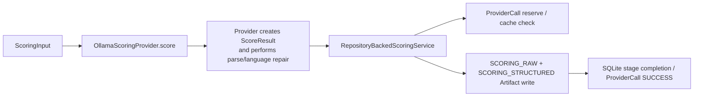

# TASK-016C Phase F — Runtime Integration Amendment

## 状态

`DESIGN READY / IMPLEMENTATION NOT AUTHORIZED`。

本 Amendment 以 Phase E 已批准链为前提：`2c11faf` → `8aa9f0b` →
`94c5dac` → `1293d87` → `9b92946`。它只重新定义后续实施顺序和
provider/runtime 契约；不修改 ADR-024 的 Language Validator 边界，也不授权任何代码。

## 1. Phase F 新定义

Phase F 是 **Candidate-only Runtime Composition**：让生产组合层能够按下列
可信顺序运行一条无持久化的评分准备链。

```text
ScoringInput
  -> candidate-only provider attempt (untrusted)
  -> candidate schema + frozen language validation
  -> deterministic quality gate
  -> local quality Judge
  -> QualityPassAttestation
  -> TrustedScoringFinalizer
  -> TrustedScoreResult (memory only)
```

Phase F 不写 Artifact、不预留或完成 ProviderCall、不更新 cache、不推进 SCORING stage，
也不让 `RuntimeOperations.process` 切换到没有原子持久化保护的新写入路径。正式的
runtime stage cutover 属于 Phase G：它将 trusted result 接到 pre-write validation、
文件提交协议与原子 DB registration 后才可以发生。

这将此前 master plan 中的 `PREWRITE_VALIDATE / ValidatedScoringWritePlan` 明确移至
**Phase G**。Phase H 保留 reliability（primary/repair budget、crash/recovery、corruption
handling），Phase I 保留 derived cache recovery 与 production hardening 的验收前置设计；
任何更改必须在各自 amendment 获批后进行。

## 2. 当前运行链（调查事实）



`RuntimeOperations.scoring_stage()` 直接构造 `RepositoryBackedScoringService`。该 service
调用 `OllamaScoringProvider.score()`，随后可预留 ProviderCall、读写 cache、写 raw/structured
Artifact 并完成 pipeline stage。故任何在 `ScoreResult` 之后补接 Quality 的方案都会让
未通过 Quality 的内容先进入可信持久化边界，违反 ADR-025。

## 3. 目标可信运行链

```mermaid
flowchart LR
  I["ScoringInput"] --> A["Ollama candidate transport"]
  A --> C["UntrustedScoringAttempt\n(candidate + ephemeral raw bytes)"]
  C --> L["schema + frozen Language Validator"]
  L --> G["Deterministic Gate"]
  G --> J["Local Content Quality Judge"]
  J --> Q["ContentQualityResult(PASS)"]
  Q --> T["QualityPassAttestation"]
  T --> F["TrustedScoringFinalizer"]
  F --> S["TrustedScoreResult"]
  S -. "Phase G only" .-> W["pre-write + atomic persistence"]
```



`UntrustedScoringAttempt` 是 Phase F 内部值对象：包含一次 provider response 的候选及仅供
后续已授权 raw envelope 使用的短生命周期原始响应。它不是 Artifact、cache entry、
ProviderCall completion 或 `ScoreResult`。任一 schema/language/gate/Judge/attestation/finalizer
失败均返回安全 `INVALID_RESPONSE`，并丢弃该 attempt 的 raw 内容。

## 4. Provider Contract（Q1、Q2）

Provider **不得继续返回 `ScoreResult`**。Phase F 的最小新边界为：

```python
class CandidateScoringProvider(Protocol):
    def primary_attempt(self, scoring_input: ScoringInput) -> UntrustedScoringAttempt: ...
    def repair_attempt(
        self,
        *,
        prior: UntrustedScoringAttempt,
        scoring_input: ScoringInput,
    ) -> UntrustedScoringAttempt: ...
```

- `primary_attempt` 与 `repair_attempt` 只解析 `ScoringCandidate` 的业务字段；不得创建
  `ScoreResult`、attestation、Artifact、cache 或 ProviderCall。
- 修复预算由 Phase F orchestrator 持有：primary candidate 经 language/quality 失败后，最多
  一次 repair；repair 也失败则 fail-closed。Provider 不再自行决定“已经合格”。
- Ollama endpoint、loopback-only URL guard、固定 model/digest、固定 prompt、请求体、timeouts、
  stream/think/tools 限制和 transport 错误清洗必须保持原行为。此 Amendment 不授权重写
  Ollama 网络调用或改变模型行为。

**Phase F 需要最小修改 `providers/ollama.py`。** 该修改仅把现有 parsing/repair 编排从
`ScoreResult` 返回边界拆为 candidate attempts；不得改变网络 transport、安全 guard、下载行为
（仍禁止下载）、模型选择或远程 fallback。若实现发现无法在该文件内保持这些不变量，必须停止并
提交新的 Amendment，不能以 adapter monkey-patch 或双重可信入口规避。

## 5. ScoreResult 所有权（Q3）

`TrustedScoringFinalizer` 是唯一的 `ScoreResult` 创建者。其输出的
`TrustedScoreResult` 是唯一允许进入 Phase G–I trusted pipeline 的对象。

- `ScoringCandidate`、provider raw response、Mapping、JSON、缓存/Artifact 恢复物和裸
  `ScoreResult` 都是不可信输入；
- Provider、quality Judge、repair、RepositoryBackedScoringService、runtime caller 均不得
  创建或接受可信 `ScoreResult`；
- 兼容期的旧 `OllamaScoringProvider.score()` 与 `RepositoryBackedScoringService.score()`
  只能作为未迁移 legacy path 保留，不得被新的 Phase F composition 调用；Phase G stage
  cutover 后必须删除或 fail-closed 该生产入口，具体变更需另行授权。

## 6. 持久化边界（Q4）

Phase F 中下列对象不接受任何 Candidate 或裸 `ScoreResult`：Artifact writer、ProviderCall
completion、cache writer/reader、SQLite stage completion。它们也不接受 `TrustedScoreResult`
**写入**，因为 Phase F 尚未实现 final-byte pre-write validation。

Phase G 的唯一输入将是 `TrustedScoreResult`，并在临时文件、fsync、hash、promote、directory
fsync 和 SQLite transaction 前产生 immutable `ValidatedScoringWritePlan`。Phase I cache recovery
只可重建 untrusted materials，再经同一 Finalizer 返回新的 wrapper；它不得反序列化为可信 hit。

## 7. 迁移策略

1. **F（本 Amendment）**：新增 candidate-only provider 与纯内存 orchestrator/composition seam；
   以 Fake transport 验证 primary → language → quality → repair → finalizer 事件顺序；不切换
   `RuntimeOperations.scoring_stage`，避免尚未具备原子持久化时造成生产数据语义倒退。
2. **G**：设计并实现 canonical raw/structured envelope、pre-write reparse、write plan 和
   atomic persistence；在完整故障矩阵通过后，单独授权切换 `RuntimeOperations.scoring_stage`。
3. **H**：把 at-most-once repair/Judge budget、crash unknown-state 和 corruption failure handling
   接入已切换的 runtime flow。
4. **I**：实现 derived cache verification/recovery，并确认历史 legacy cache 要么隔离、要么当作
   miss；不进行未验证的历史数据转换。

任何阶段都不迁移或删除既有 DB 数据；旧 records 留存审计，不能被写成 trusted cache hit。

## 8. Phase F 最小授权范围

### Allowed files（未来 Implementer 授权）

- `src/youtube_intel/providers/ollama.py`：仅 candidate attempt return contract 与既有 parser 的
  最小拆分；
- `src/youtube_intel/scoring.py`：纯内存 candidate/quality/finalizer orchestrator 与现有接口的
  明确隔离；
- `src/youtube_intel/runtime.py`：从已验证 AppConfig 注入 Phase E authorities 和新 composition
  seam，但不得切换持久化 stage；
- `src/youtube_intel/quality.py`：仅消费既有 Quality capability/Finalizer 的最小 glue；
- 对应 unit/integration tests、TASK-016C handoff 和经批准的 task/prompt 文件。

### Forbidden files / actions

- `state.py`、任何 schema/migration、DB/Artifact/cache implementation、filesystem protocol、
  ProviderCall persistence；
- config/CLI/Language Validator、cloud/router/weekly、依赖、`pyproject.toml`、`uv.lock`；
- 网络、真实 Ollama、模型 download、cloud fallback、真实 Vault、凭据；
- 直接修改/清理 legacy 数据、merge/rebase/squash/amend/rewrite history。

## 9. Test Strategy

实施前的 task card 必须冻结 TDD矩阵：

1. Provider primary/repair 返回 `ScoringCandidate` + ephemeral raw material，永不返回或构造
   `ScoreResult`；parser、loopback guard、prompt/model/digest 和 safe error 行为回归不变。
2. 完整 Fake path：`candidate-primary → schema → language → gate → Judge-primary → attestation →
   finalizer`；quality/language failure 才可触发最多一次 repair；repair failure 为
   `INVALID_RESPONSE`。
3. Candidate/quality/attestation/context/request hash 任一篡改，及 Mapping/JSON/subclass/copy/pickle
   spoof，全部 fail-closed，且无 Artifact、ProviderCall SUCCESS、cache hit 或 response artifact ID。
4. `RuntimeOperations` 只能经 runtime-owned authority 注入 orchestration seam；不得以 caller config、
   provider output、fixture、cache 或 Artifact 铸造 context。
5. 旧 `RepositoryBackedScoringService` 不被新 seam 调用；Phase F 不更改其 DB/Artifact 行为。
6. focused + full pytest、mypy、Ruff、offline build、security scan 和 diff check；无网络/真实模型。

## 10. 风险与独立审查重点

- provider 内部 repair 移出后，必须证明恰好一次预算仍受控，且 raw primary content 不会在失败时
  留给 persistence；
- phase labels 改动不得被误解为 Phase G/H/I 已获授权或现有 CLI 已切换；
- 保持 legacy direct-score path 的时间窗口是迁移风险：它只可供现有未迁移生产路径使用，不能被
  新 trusted pipeline 复用或声明为已满足 ADR-025；
- Phase F 不能达到 Production Ready。Production readiness 需要至少 G–I、真正独立 review、
  integration、持久化/恢复故障测试与现有公开分发 No-Go 的独立关闭。

## 结论

`DESIGN READY / IMPLEMENTATION NOT AUTHORIZED`。本 Amendment 需要独立架构审查后，才能
生成 Phase F Implementer authorization；在此之前不得修改 `providers/ollama.py`、`scoring.py`、
`runtime.py` 或任何持久化边界。
