# Intelligence 用户使用手册

> 简体中文 · 面向完全不懂编程的普通用户
> 版本：0.1.0（2026-10-10 实测）· 本文所有截图均来自真实运行的产品

---

## 目录

1. [Intelligence 是什么](#1-intelligence-是什么)
2. [第一次使用](#2-第一次使用)
3. [添加 YouTube 视频](#3-添加-youtube-视频)
4. [关注 YouTube 频道](#4-关注-youtube-频道)
5. [导入 Bilibili 视频](#5-导入-bilibili-视频)
6. [导入本地文件](#6-导入本地文件)
7. [查看 Content（内容）](#7-查看-content内容)
8. [查看字幕与摘要](#8-查看字幕与摘要)
9. [理解 Evidence（证据）](#9-理解-evidence证据)
10. [提炼 Intelligence（洞察）](#10-提炼-intelligence洞察)
11. [使用 Topic（主题）](#11-使用-topic主题)
12. [配置本地模型](#12-配置本地模型)
13. [配置云端模型](#13-配置云端模型)
14. [修改语言](#14-修改语言)
15. [备份与恢复](#15-备份与恢复)
16. [常见问题](#16-常见问题)
17. [当前已知限制](#17-当前已知限制)

---

## 1. Intelligence 是什么

**Intelligence 是一个"本地优先"的个人智能知识工作台**。它帮助你：

- **持续关注**你感兴趣的信息来源（如 YouTube 频道）；
- **采集内容**（视频、字幕、本地文件），自动**转写、摘要**并保留**证据**；
- 从内容中**提炼长期有价值的洞察**；
- 围绕主题**持续积累和演化认知**。

它的四个核心概念：

| 概念 | 作用 | 通俗解释 |
|------|------|----------|
| **Following（关注）** | 持续关注的信息来源 | 就像订阅一个频道 |
| **Content（内容）** | 采集、转写、摘要和证据 | 整理好的素材库 |
| **Intelligence（洞察）** | 从内容中提炼的长期价值 | 值得记住的结论 |
| **Topic（主题）** | 围绕主题积累认知 | 按主题归档洞察 |

**产品原则**：
- Following → Content 是**基础能力**：默认帮你整理内容。
- Content → Intelligence 是**可选能力**：你可以选择进一步提炼洞察。
- **默认本地处理**：你的数据保存在本机，不会未经授权调用付费云端模型。

**最重要的承诺：证据始终可追溯。** 每一条内容、每一个摘要、每一条洞察，都能找到它来自哪段原始材料。

---

## 2. 第一次使用

第一次打开 Intelligence，你会看到三步引导，说明这个工具的核心用途。

**第 1 步：欢迎与定位**

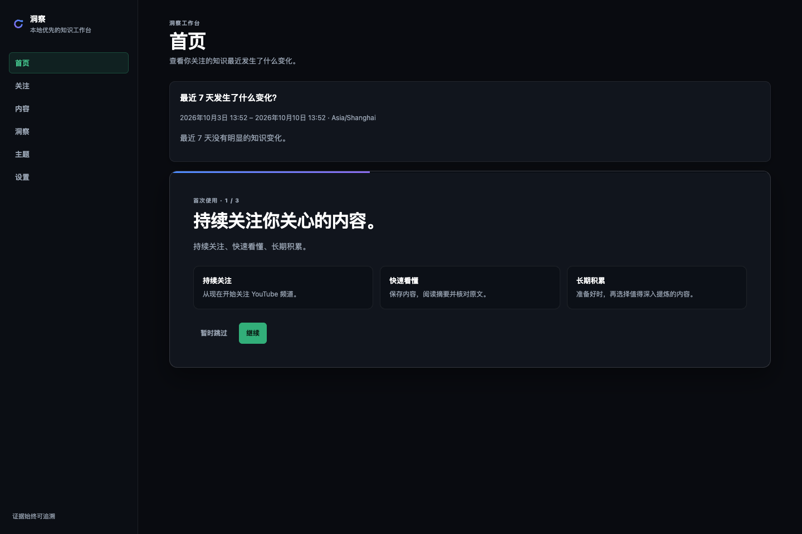

页面上说明了这是一款"本地优先的知识工作台"，点击 **继续** 进入下一步。

**第 2 步：理解"关注 → 内容 → 洞察"**

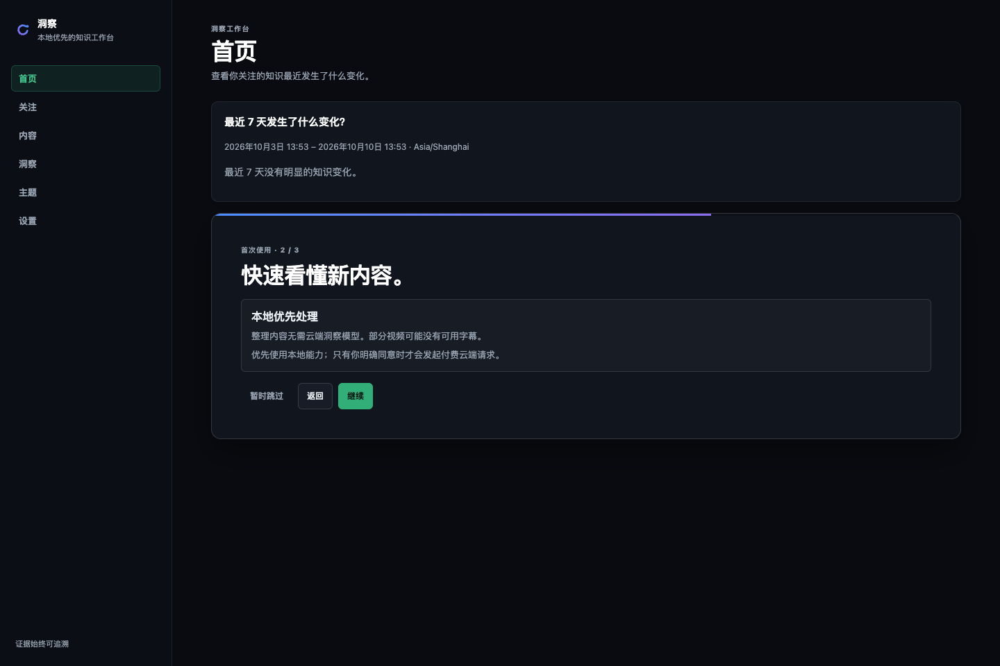

**第 3 步：了解"证据始终可追溯"**

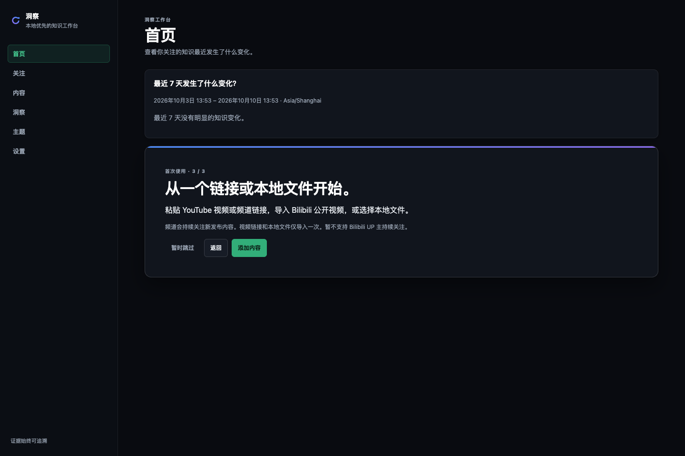

**完成引导**

点击 **添加内容** 完成引导，进入"关注"页面。

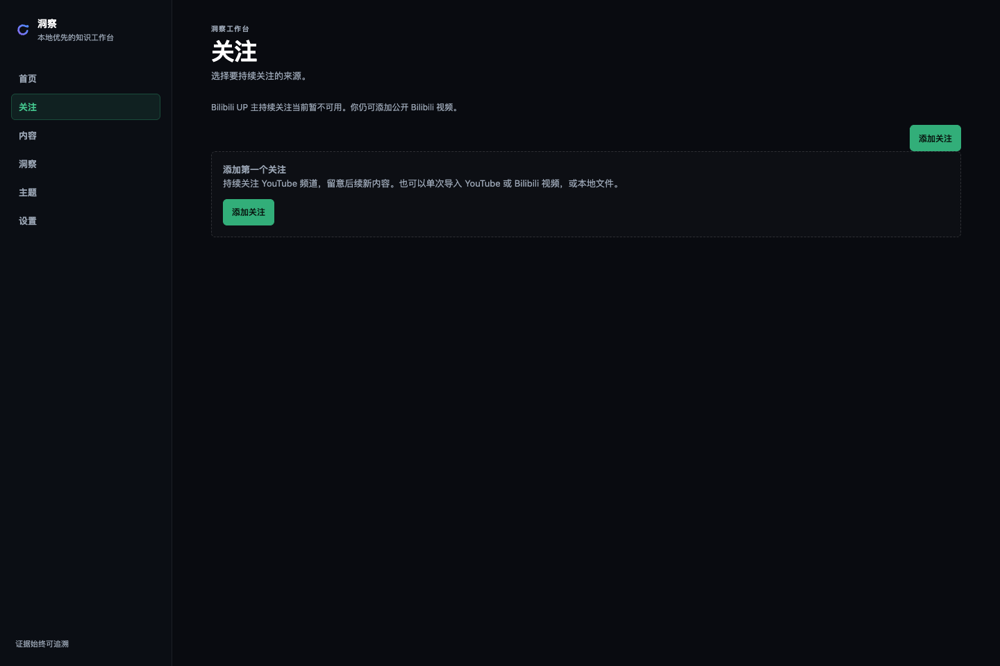

此时页面还是空的，提示你"选择要持续关注的来源"。左侧是导航栏：

| 导航 | 功能 |
|------|------|
| 首页 | 最近 7 天你关注的知识发生了什么变化 |
| 关注 | 管理你持续关注的来源 |
| 内容 | 阅读已采集的内容、字幕与处理记录 |
| 洞察 | 查看提炼出的长期洞察 |
| 主题 | 按主题归档和浏览洞察 |
| 设置 | 语言、兴趣、模型、备份等 |

**重新打开后的状态**：关闭浏览器再打开，你的关注、内容、设置都会保留（数据保存在本机）。

> 说明：本手册演示环境已添加了示例关注与内容；你首次使用时会看到类似的空状态页面。

---

## 3. 添加 YouTube 视频

可以**单次导入**一条 YouTube 视频，不关注频道。

**操作步骤**：

1. 点击右上角 **添加关注**（或关注页的 **添加关注** 按钮），打开添加对话框。

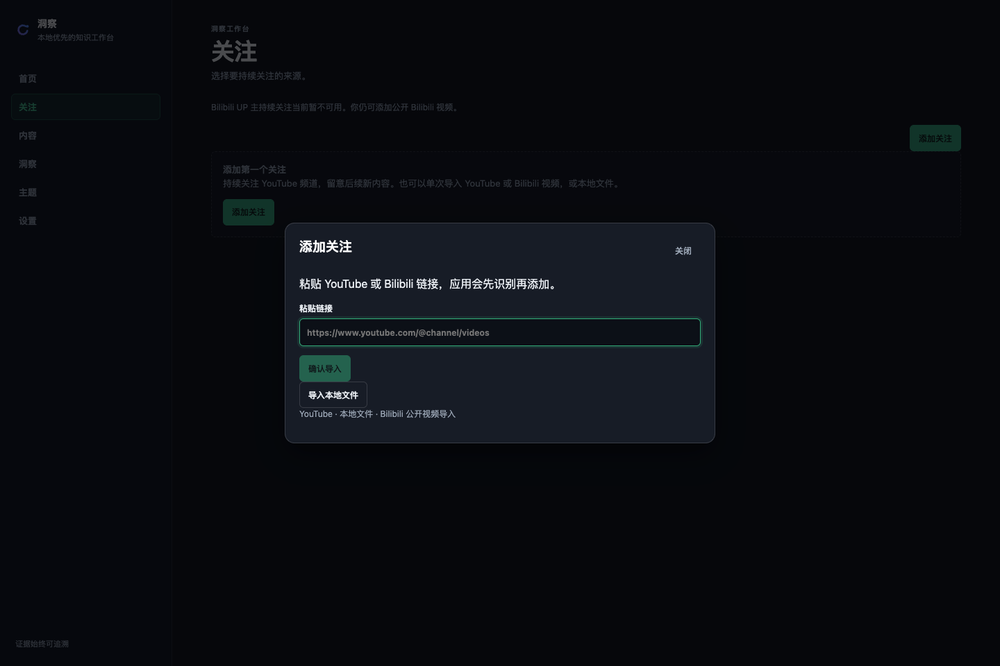

2. 在输入框中粘贴 **YouTube 视频链接**，例如：
   `https://www.youtube.com/watch?v=aircAruvnKk`

3. 系统会识别链接并显示视频信息（标题、频道）。

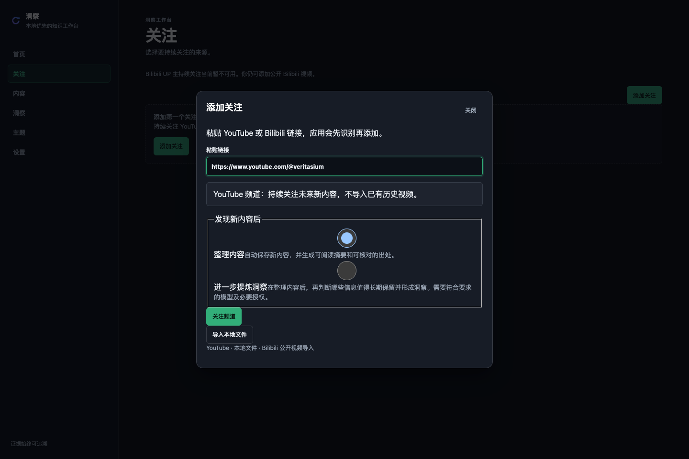

4. 点击 **添加** 确认导入。导入成功后，内容会自动进入后台处理（获取字幕、生成摘要）。

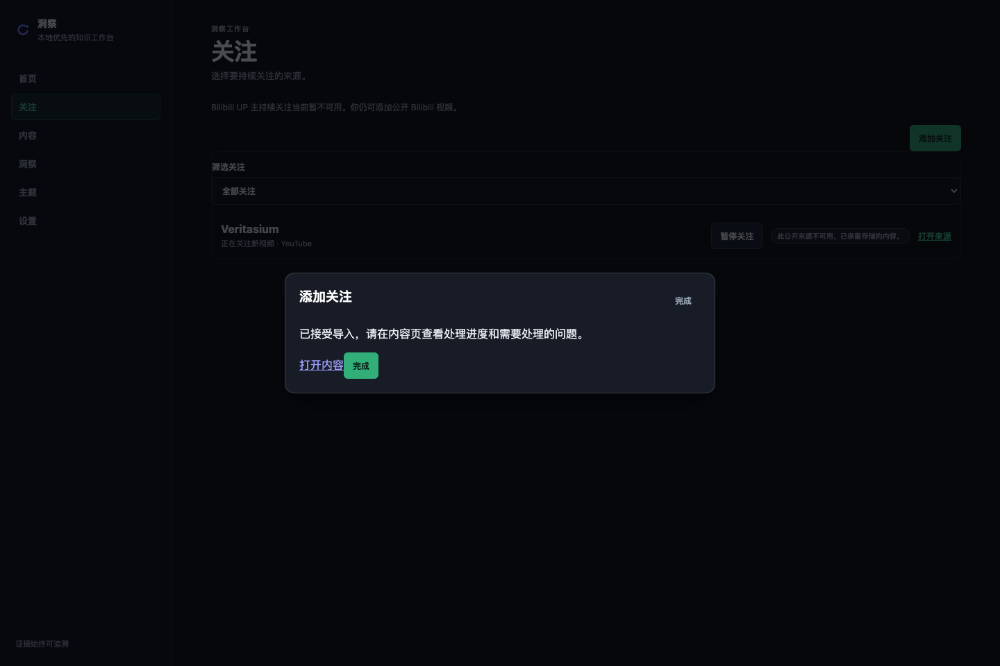

**预期结果**：
- 视频出现在 **内容** 列表中；
- 处理完成后显示"已完成"；
- 打开详情页可以看到字幕、摘要和证据。

---

## 4. 关注 YouTube 频道

持续关注一个频道，之后自动检查该频道的新视频。

**操作步骤**：

1. 打开 **添加关注** 对话框，粘贴 **YouTube 频道主页链接**，例如：
   `https://www.youtube.com/@Veritasium`

2. 系统识别出频道名称。

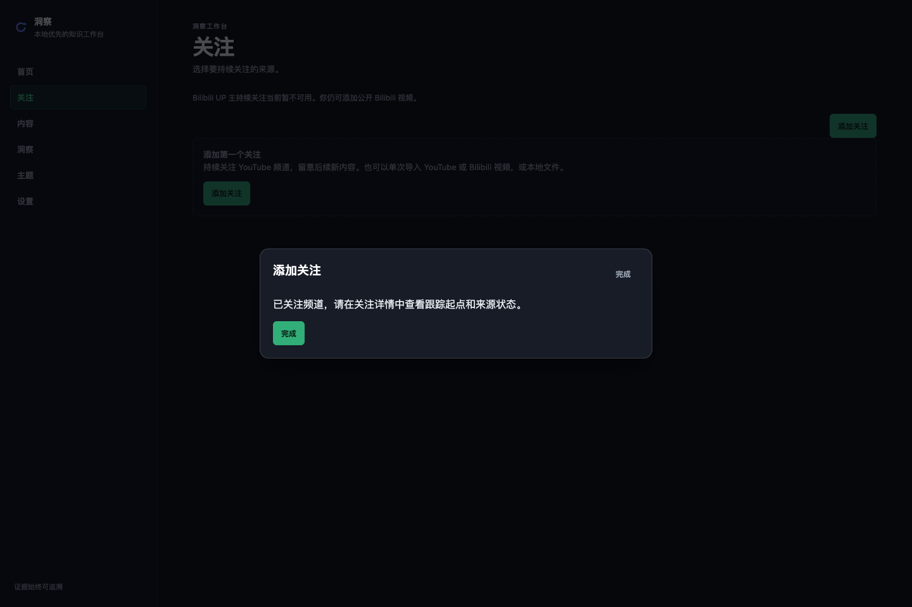

3. 点击 **添加**，频道出现在"关注"列表，状态为"正在关注新视频 · YouTube"。

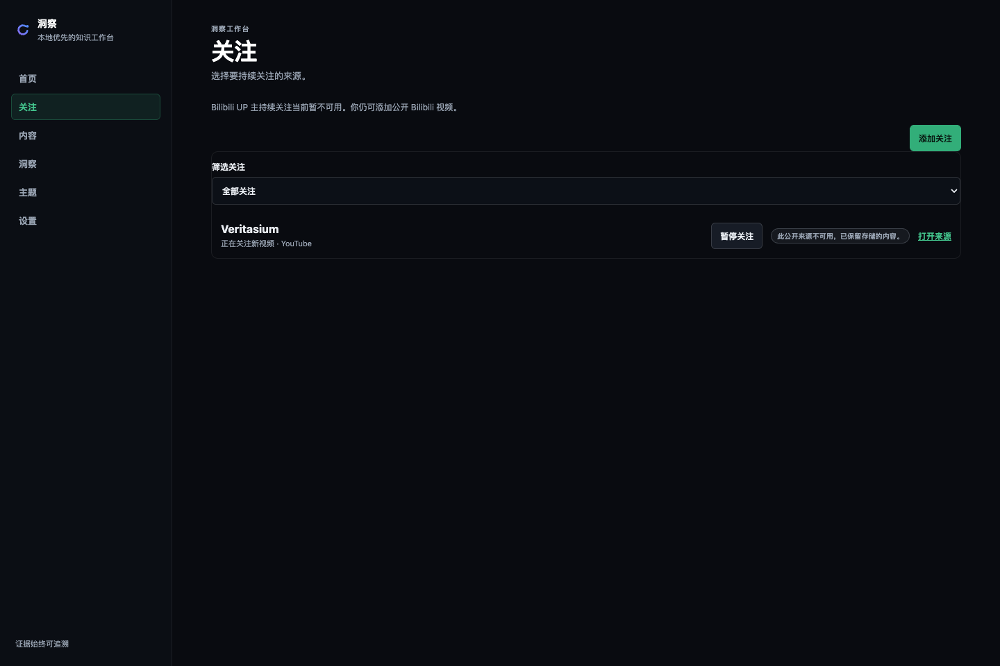

**关注后的操作**：

- **暂停关注**：点击频道卡片上的 **暂停关注**，频道状态变为"关注已暂停"，已有内容仍然保留。

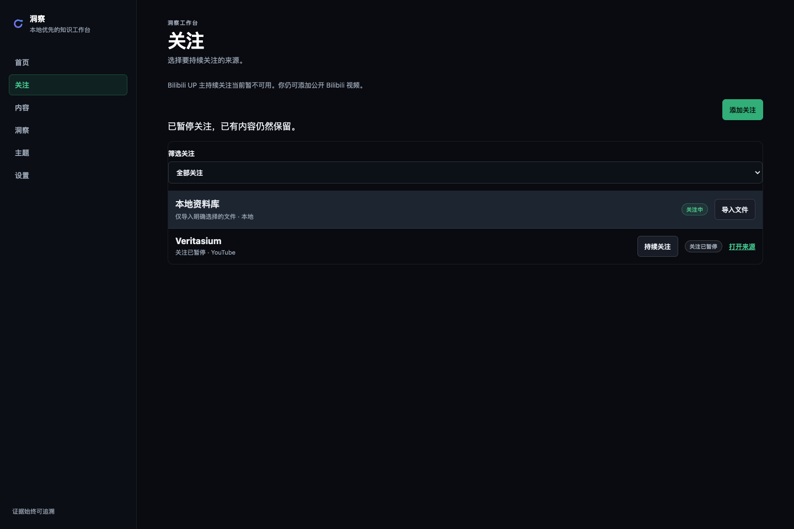

- **恢复关注**：点击 **持续关注**，频道恢复"正在关注新视频"。

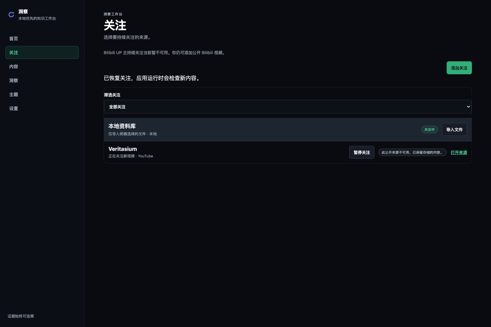

**自动检查**：应用会定期自动检查已关注的频道是否有新视频（也可以点击页面上的"检查更新"立即检查）。

> 提示：如果某个公开来源暂时不可访问，页面会如实提示"此公开来源不可用，已保留存储的内容"，不会删除你已有的内容。

---

## 5. 导入 Bilibili 视频

可以**单次导入**一条公开的 Bilibili 视频。

**操作步骤**：

1. 打开 **添加关注** 对话框，粘贴 Bilibili 视频链接，例如：
   `https://www.bilibili.com/video/BV1GJ411x7h7`

2. 点击 **添加** 导入。

**预期结果**：
- 视频出现在 **内容** 列表中；
- 如果该视频没有可用的字幕，状态会如实显示"字幕不可用"，而不会编造内容。

> 注意：当前版本**不支持持续关注 Bilibili UP 主**（添加对话框中有明确提示）。你可以添加公开 Bilibili 视频，但无法自动跟踪 UP 主的新视频。
> 本手册撰写时，部分 Bilibili 视频的字幕获取受源站限制，导入后可能显示"字幕不可用"。

---

## 6. 导入本地文件

可以导入本机的文本、音频或视频文件。

**支持的格式**：
- 文本：`.txt`、`.md`（Markdown）
- 音频：`.m4a` 等常见格式
- 视频：`.mp4` 等常见格式

**操作步骤**：

1. 在 **关注** 页面找到 **本地资料库**，点击 **导入文件**。

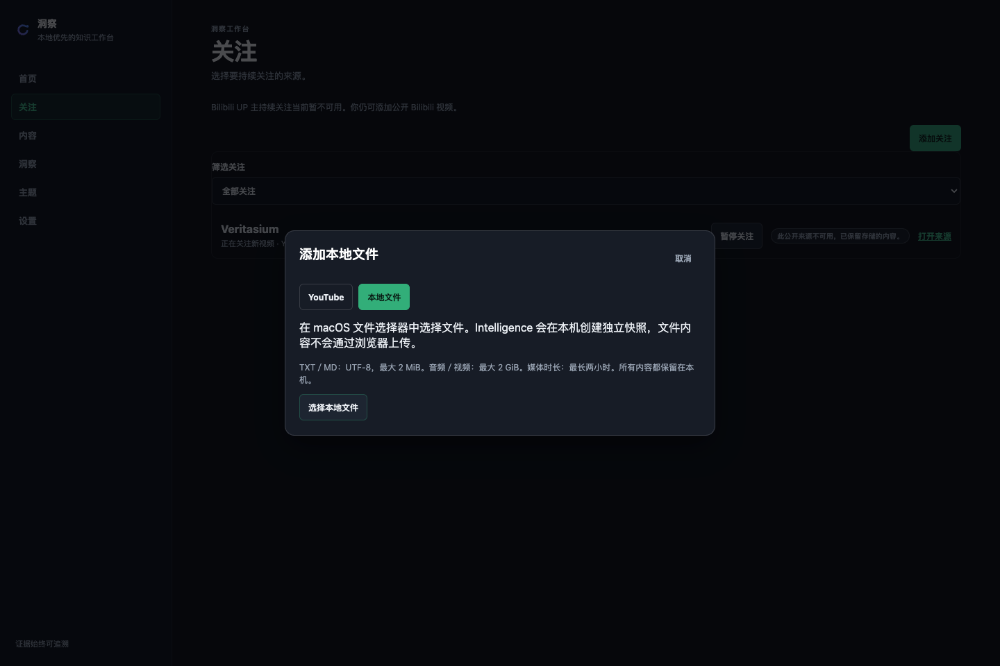

2. 系统打开系统的文件选择窗口（Native File Picker），选择你的文件。

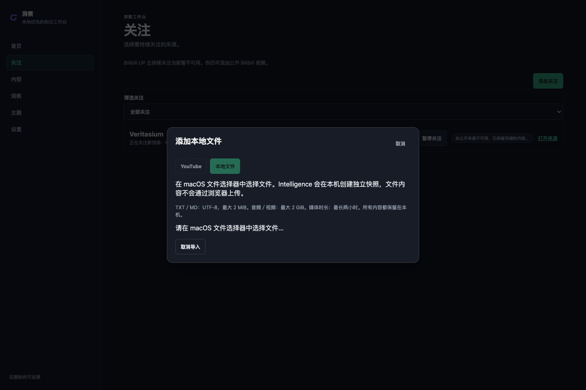

对话框中说明了文件格式与大小限制：**TXT/MD 最大 2 MiB，音频/视频最大 2 GiB，媒体时长最长两小时**。选择不支持的文件时，系统会显示明确的错误提示并拒绝导入。

**导入后的状态**：

- **文本文件**（TXT/MD）：直接整理为内容，可阅读原文。
- **音频/视频文件**：显示"待转写"，应用会尝试使用本地转写能力生成字幕。打开该内容的详情页可以看到转写进度。

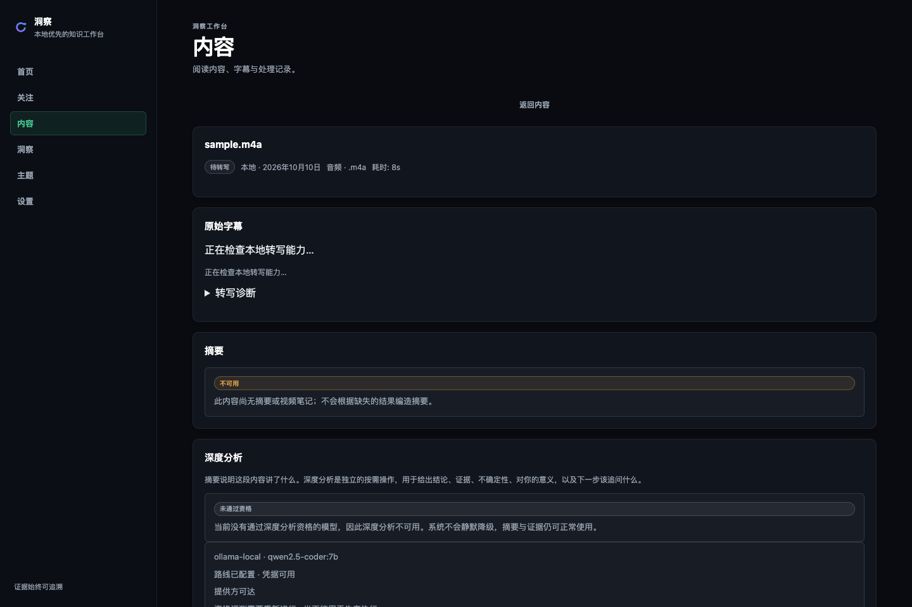

> 注意：本地转写依赖一个约 1.6 GB 的语音识别模型。如果模型尚未配置，音频/视频会保持"待转写"状态，页面会如实说明"正在检查本地转写能力"与原因，不会假装已经转写成功。

**大文件**：导入有明确的大小上限（文本与媒体文件各有上限），超过限制会拒绝并提示。

---

## 7. 查看 Content（内容）

所有采集到的内容都汇总在 **内容** 页面。

**列表**：每条内容显示标题、来源（频道/本地文件）、时间和处理状态。

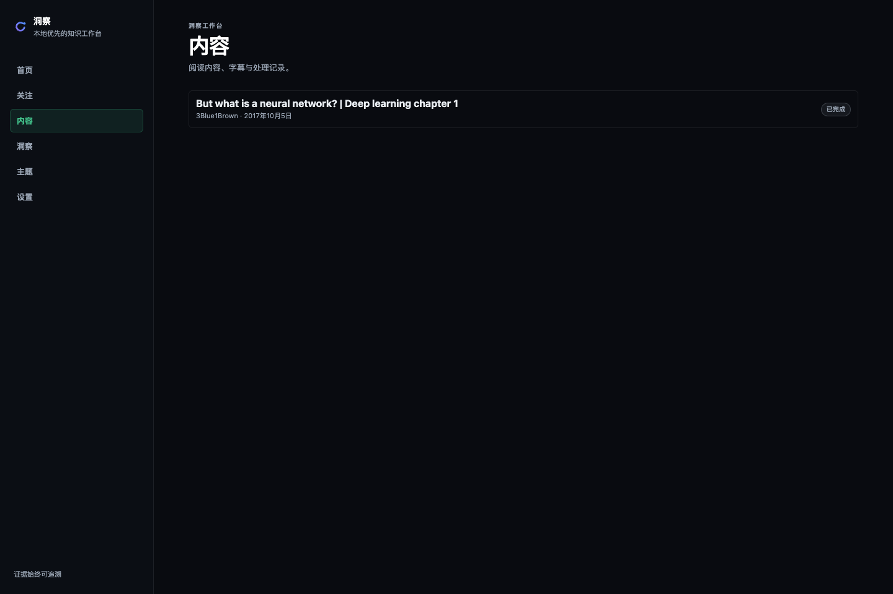

**处理状态说明**：

| 状态 | 含义 |
|------|------|
| 已完成 | 字幕与摘要已整理完成 |
| 待转写 | 音频/视频正在等待转写（或转写能力不可用） |
| 字幕不可用 | 源没有可用字幕，如实提示 |
| 处理中 | 正在获取字幕或生成摘要 |

**打开详情**：点击任意内容条目，进入详情页。

详情页包含：视频信息（标题、频道、发布时间）、**打开原始来源** 链接、**关注此频道** 快捷入口、**原始字幕**、**来源位置/溯源信息**（证据）等。

---

## 8. 查看字幕与摘要

在内容详情页可以查看**原始字幕**与**摘要**。

**原始字幕**：逐段显示带时间戳的字幕文本，对应视频的具体时间段。

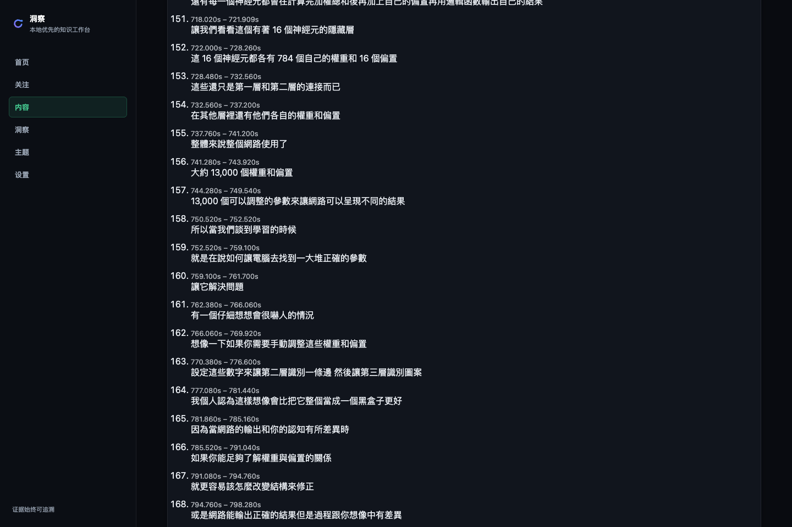

**来源位置与溯源信息**：每段字幕都标明它在视频中的时间位置，并显示对应的证据文件哈希与日期——这就是"证据始终可追溯"的体现。

**摘要**：系统基于字幕整理的结构化摘要（关键点）。如果内容没有字幕或尚未整理完成，摘要区域会如实显示"不可用"，并说明"此内容尚无摘要或视频笔记；不会根据缺失的结果编造摘要"。

**处理记录**：详情页底部显示该内容的处理历史（例如"原始字幕：已完成""来源信息：已完成"）。

---

## 9. 理解 Evidence（证据）

**Evidence（证据）是 Intelligence 的核心信任机制**：任何结论都能追溯到原始材料。

在内容详情页，你会看到：

- **来源位置**：证据在原始视频中的时间段（例如 `16:53-18:26`）；
- **溯源信息**：证据文件的哈希值与日期；
- **打开原始来源对应时间点**：点击可直接跳转到原视频对应的时间。

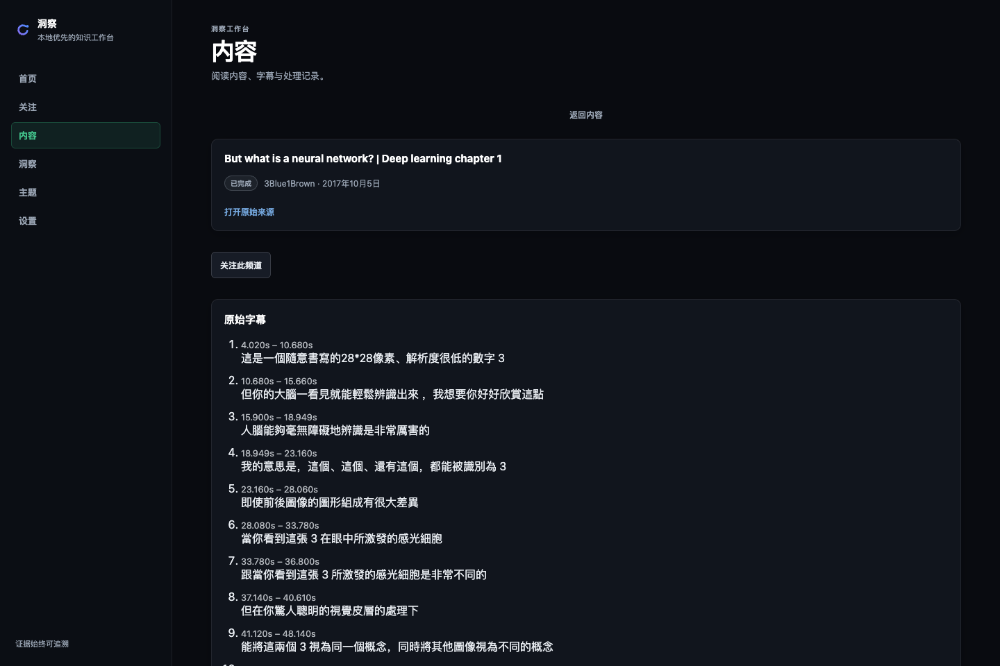

证据的意义：
- **不编造**：系统不会根据缺失的内容编造摘要或洞察；
- **可核验**：每条洞察都引用原始证据，你可以回看原文验证；
- **可追溯**：从洞察 → 证据 → 原始材料，链路完整。

---

## 10. 提炼 Intelligence（洞察）

在内容详情页的"洞察处理结果"区域，可以手动触发提炼：点击 **提炼为洞察**。

**处理过程**：系统使用你配置的本地模型分析内容与证据，判断是否有值得长期保留的新洞察。

**两种结果**：

1. **发现新洞察**：生成洞察条目，可在 **洞察** 页面查看，并关联到主题。
2. **无新洞察**：如实显示"已完成，未产生新洞察"——说明分析已完成，但本次内容没有形成值得长期保留的新结论。

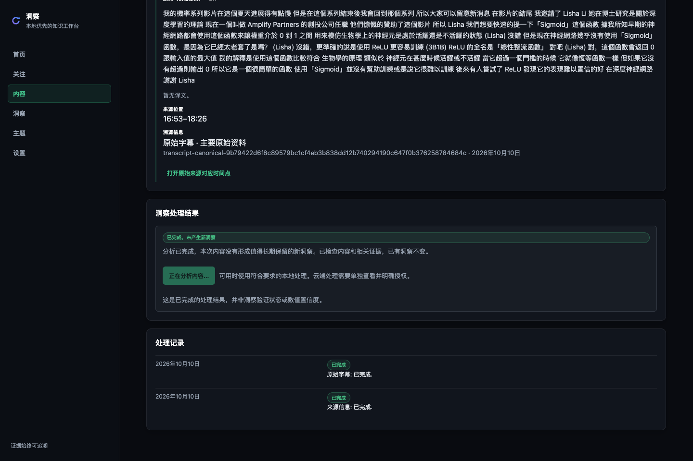

**洞察页面**：所有提炼出的洞察汇总在这里。

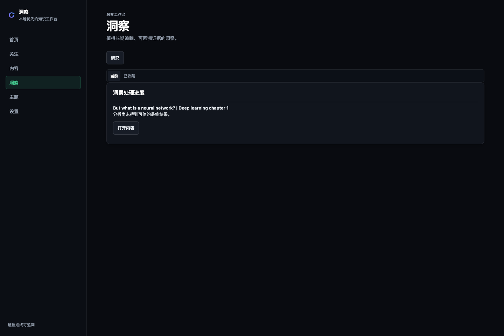

**洞察处理进度**：如果内容正在分析，洞察页面会显示"分析尚未得到可信的最终结果"，可点击"打开内容"回到详情页查看。

> 提示：提炼洞察是**可选**操作。不提炼也不影响内容整理。未配置合格模型时，页面会明确提示"云端洞察需要配置凭据并授权"，不会偷偷使用付费服务。

---

## 11. 使用 Topic（主题）

**主题**用于把洞察按主题归档，持续积累认知。

- **主题列表**：在 **主题** 页面查看所有主题。

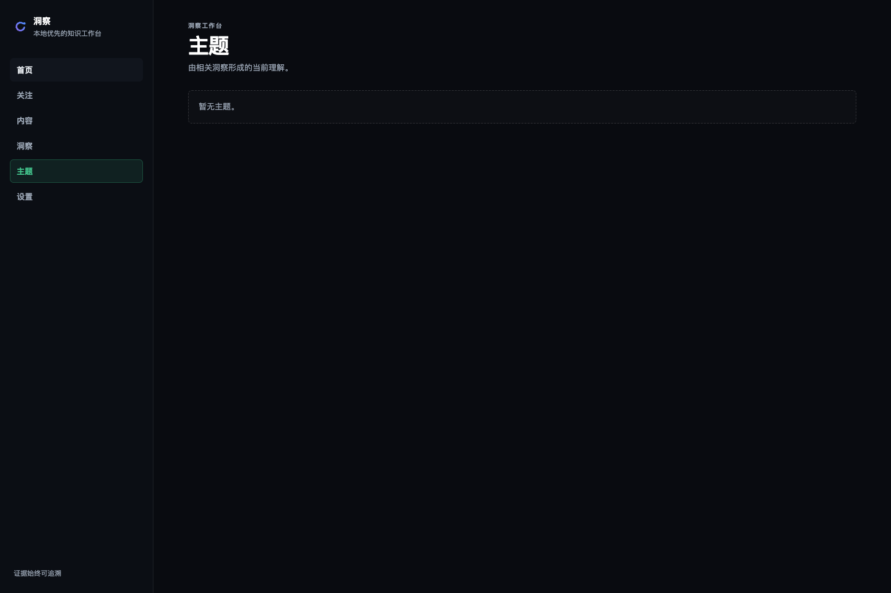

- **主题详情**：点击主题进入详情，可以看到该主题下关联的洞察与可信证据。

> 说明：主题关联的是**已提炼的洞察**。在产生第一条洞察之前，主题页面会保持空状态，这是正常现象。本手册撰写时演示环境尚未产生可关联的洞察，因此主题详情暂以空状态呈现。

---

## 12. 配置本地模型

Intelligence 默认使用**本地模型**完成内容整理与洞察提炼，你的数据不出本机。

**查看当前模型**：打开 **设置 → 模型与处理准备**。

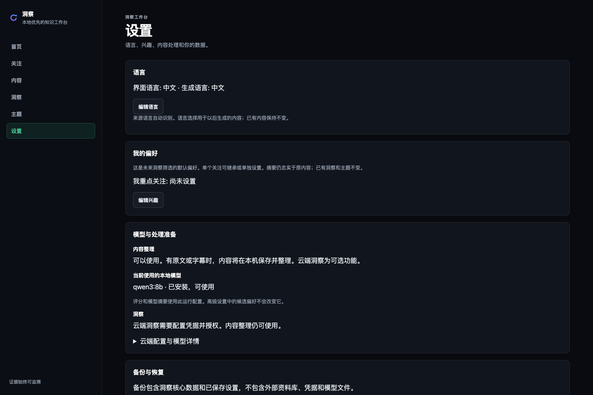

**当前使用的本地模型**区域显示：
- 模型名称（例如 `qwen3:8b`）；
- 状态（"已安装，可使用" 或 "就绪需要关注"）。

**配置要求**：
- 本地模型通过 Ollama 等本机服务提供；
- 系统会校验模型的**精确标识（digest）**，只使用匹配的模型——这是安全机制，防止意外使用其他模型处理你的数据；
- 模型未就绪时，内容整理与洞察提炼会如实提示不可用，不会静默降级。

**在设置页的"模型与处理准备"中展开"云端配置与模型详情"**，可以看到模型连接状态与可用模型列表（只读）。

> 提示：安装本地模型需要一定的技术准备（安装 Ollama 并拉取指定模型）。对于不想配置模型的用户，核心的内容整理功能依然可用；只有"提炼洞察"等模型功能会提示不可用。

---

## 13. 配置云端模型

云端模型是**可选**能力，用于更高质量的洞察提炼。

**在设置页的"洞察"区域**，当前状态会明确说明：

- 未配置凭据时：**"云端洞察需要配置凭据并授权。内容整理仍可使用。"**

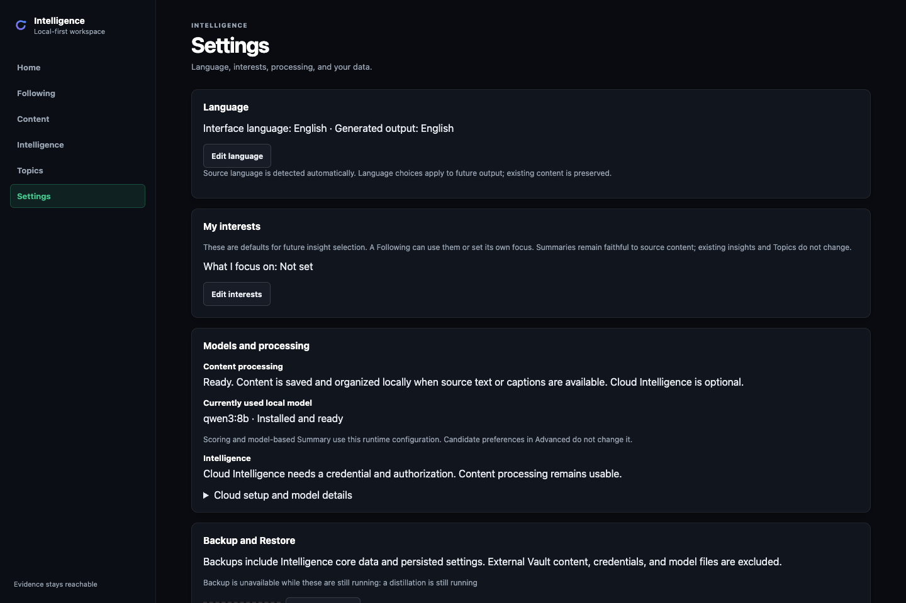 *（英文界面示例）*

**使用规则**：
- 云端处理**需要你为每一次请求明确授权**（产品原则：不得未经授权自动调用付费云模型）；
- 凭据值**永远不会**在界面中显示；
- 即使不配置云端模型，内容整理、字幕、摘要等基础能力完全不受影响。

> 本手册撰写时，演示环境未配置云端凭据，因此云端洞察显示"需要配置凭据并授权"是正常的诚实反馈。

---

## 14. 修改语言

可以修改**界面语言**与**生成内容的语言**（中文或英文）。

**操作步骤**：

1. 打开 **设置** 页面，找到 **语言** 区域。

2. 点击 **编辑语言**。

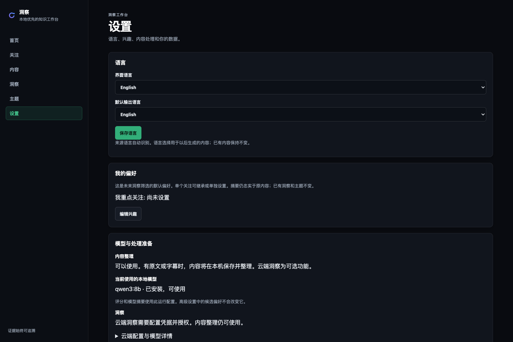

3. 选择 **界面语言** 与 **默认输出语言**（默认输出语言影响以后生成的摘要/洞察的语言）。

4. 点击 **保存语言**。

**切换为英文后的设置页**：

**切回中文**：再次点击 **编辑语言（Edit language）**，选择中文并保存。

**说明**：
- 来源语言自动识别；
- 语言选择只影响**以后**生成的内容，已有内容保持不变；
- 界面语言保存在当前浏览器配置中，重启应用后仍有效。

---

## 15. 备份与恢复

**备份内容**：备份包含洞察核心数据与已保存设置；不包含外部资料库、凭据和模型文件。

**创建备份**：

1. 打开 **设置 → 备份与恢复**。

2. 点击 **创建备份**，系统生成一个备份文件（`.zip`），列出备份中的内容统计（关注数、内容数、证据数等）。

**备份前检查**：如果有内容正在处理（例如提炼任务仍在执行），页面会提示"以下工作尚未结束，暂时无法备份"，等处理完成后即可备份。这是为了保证备份数据的一致性。

**选择备份（恢复）**：点击 **选择备份** 可从备份文件恢复数据。恢复完成后需要重新打开应用。

> 说明：本手册撰写时，演示环境已完成一次真实备份（372 KB，含 3 个关注、5 条内容、20 条证据）。恢复流程的界面与创建备份在同一区域。

---

## 16. 常见问题

**Q1：我的数据存在哪里？**
A：默认保存在你本机的数据目录中（本地优先）。凭据值永远不会被显示。

**Q2：添加的视频一直没有字幕/摘要？**
A：检查内容详情页的状态提示。如果显示"字幕不可用"或"待转写"，说明源没有可用字幕，或本地转写模型尚未配置。系统不会编造内容，这是如实反馈。

**Q3：点击"提炼为洞察"后一直显示处理中？**
A：提炼需要本地模型参与。如果模型未就绪，会显示等待状态；请检查设置中的"当前使用的本地模型"是否"已安装，可使用"。云端洞察则需要先配置凭据并逐次授权。

**Q4：浏览器后退/前进按钮没有反应？**
A：旧版本存在此问题，本手册对应版本已修复：点击浏览器后退/前进按钮，或直接在地址栏修改 # 后的路径，都会正确切换页面。

**Q5：为什么不能持续关注 Bilibili UP 主？**
A：当前版本暂不支持 Bilibili UP 主持续关注，但可以单次导入公开 Bilibili 视频。这是当前已知限制，界面中有明确提示。

**Q6：如何修改语言？**
A：设置 → 语言 → 编辑语言，选择界面语言与输出语言并保存。

**Q7：备份时提示"暂时无法备份"？**
A：说明有内容正在处理（如提炼任务执行中）。等处理完成后再创建备份即可。

**Q8：可以删除内容吗？**
A：当前版本的内容管理与处理记录聚焦于采集、整理与提炼。请在设置与界面中查看可用的管理操作；本文档对应的体验版本以添加、关注、整理、提炼为主。

---

## 17. 当前已知限制

以下是本手册撰写时（2026-10-10）实测发现的限制，均如实记录：

| 限制 | 表现 | 说明 |
|------|------|------|
| **本地音频/视频转写依赖模型** | 导入的音频/视频显示"待转写" | 需要约 1.6 GB 的本地语音识别模型（mlx-whisper）。模型未配置时，转写能力检查会如实报告"暂不可用" |
| **Bilibili 字幕可能不可用** | 导入的 Bilibili 视频显示"字幕不可用" | 部分 Bilibili 视频无公开网页字幕，或受源站访问限制 |
| **Bilibili UP 主持续关注暂不可用** | 添加对话框明确提示 | 当前版本支持单次导入公开 Bilibili 视频，不支持持续关注 UP 主 |
| **云端洞察需要凭据与逐次授权** | 设置页明确提示"需要配置凭据并授权" | 产品原则：不自动调用付费云模型 |
| **2 GiB 大文件导入未实测** | — | 本手册撰写环境的磁盘空间不足以生成 2 GiB 测试文件；导入存在明确的文件大小上限 |
| **主题需先有洞察** | 主题页面为空 | 主题归档的是已提炼的洞察；产生第一条洞察前主题为空是正常现象 |
| **转写与提炼需要模型就绪** | 状态提示"等待模型/转写能力检查中" | 模型未就绪时系统如实提示，不会静默降级 |

---

## 附：验证说明

本手册所有截图均来自真实运行的产品（隔离测试环境，与正式数据完全隔离）：

- 界面：`http://127.0.0.1:5588/`（测试实例）
- 后端：`http://127.0.0.1:5589/`（测试实例）
- 数据：独立测试数据目录，未接触任何正式数据

验证级别说明：
- **GUI VERIFIED**：通过真实界面操作并截图（本手册绝大多数路径）
- **API VERIFIED**：通过产品后端 API 验证（如 Bilibili 导入、备份创建）
- **BLOCKED**：因环境限制未能实测（如 2 GiB 大文件、本地转写模型）

详细的产品体验报告、问题清单与修复记录见同一目录下的：
- `EXPLORATION_REPORT.md`（完整产品体验报告）
- `ISSUES_FOUND.md`（发现的问题、修复与验证证据）
- `UNRESOLVED_ISSUES.md`（尚未解决的问题）
- `FINAL_REPORT.md`（最终交付报告）
