# 01｜当前产品全面基线审计报告（Phase 1 Product Baseline Audit）

- **审计日期**：2026-11-26（Asia/Shanghai）
- **审计代码基线**：`origin/main` (`f7b97134a9fafd3e8e447851a4237bdc66f7e60e`，PR #50 已合流)
- **分支**：`antigravity/autonomous-product-evolution-20261126`
- **审计方式**：启动真实后端 + 生产构建前端，通过真实 Chromium 在**全新空状态工作区** (`127.0.0.1:8798`) 与**填充示例工作区** (`127.0.0.1:8799`) 下操作全部核心页面与交互，分别验证桌面端 (`1440x900`) 与移动端 (`390x844`)，并直接核查源码与实机截图。

---

## 一、运行环境健康基线

| 检查项 | 127.0.0.1:8798（全新空状态） | 127.0.0.1:8799（6 条 Curated Demo） |
|---|---|---|
| Console Errors / Page Errors | `0` | `0` |
| HTTP >=400 请求 | `0` | `0`（含 `POST /api/v1/workspace-ai/research/ask` 返回 `200`） |
| 本地推理与转写检测 | Ollama 可达（`qwen3.5:9b` 等 12 个模型）、`yt-dlp` / `ffmpeg` 就绪 | 离线 Demo 回放模式隔离运行，不读写真实用户凭据 |
| 桌面端 (`1440x900`) 横向溢出 | 无页面级溢出 | 无页面级溢出，部分弹框/粘性栏存在内部排版裁剪 |
| 移动端 (`390x844`) 横向溢出 | 未全量复测 | 主体无整页滚动条，但**顶部导航栏在 390px 被严重截断**（`Topics` 被裁成 `Topi`，`Settings` 完全溢出屏幕外） |

---

## 二、真实产品能力盘点：已成熟能力 vs 仅停留在“工程原语”的能力

| 维度 | 当前状态 | 真实观察证据 |
|---|---|---|
| **多源摄入与离线防失效底座** | **已成熟（核心壁垒）** | 同时打通 YouTube（视频/频道）、Bilibili（公开 BV 无需 VPN）与本地文件（`.md`/`.txt`/音视频），字幕与原文落盘本地 SQLite 并锁定内容哈希。源码见 `../../../src/youtube_intel/`。 |
| **可信引用核验与防幻觉护栏** | **底座极强，但表达极度工程化** | 后端具备 `EXACT_SUPPORTED` / `HEURISTIC_ONLY` / `PARTIAL_PRUNED` / `REFUSED_INSUFFICIENT_EVIDENCE` 严格核验；但前端直接向普通用户暴露 `Fail-Closed 策略`、`离线合成样例回放`、`新洞察尚未达到已确认的验证状态` 等测试/开发词汇。 |
| **Obsidian 双链与知识包导出** | **已成熟且一致性高** | 单篇视频、周报、主题、跨视频研究均有 `复制双链笔记`、`下载 .md`、可折叠 `[[wikilinks]] / MOC` 预览与 Vault `.zip` 导出。 |
| **全局快捷键与主题语言切换** | **已成熟** | `⌘K` 命令面板分组清晰响应快；Obsidian Dark 与 Warm Paper Light 双主题对比度扎实；中英双语实时切换顺滑。 |
| **跨视频深度问答 (`#Research`)** | **交互可用但命中/演示逻辑脆弱** | 在 `8799` Demo 全库仅 5–6 篇内容下，问 `"本地优先 AI 工具如何兼顾零边际成本和可信引用？"`（[E2][E3] 均有直接原话）仍触发 `REFUSED_INSUFFICIENT_EVIDENCE`；预置会话出现重复复读（同一句连续出现 3 次）；同时存在“AI 跨视频深度问答”与“传统无模型手动证据包”两套概念冲突的入口。 |
| **知识变化与每日回访理由 (`#Home`)** | **偏“静态周报卡片”，缺动态决策流** | 7 天变化面板因 Demo 时间固定在 11/18 而直接显示空；双栏桌面布局右侧仅 2 个置顶主题卡片，下方留大片空白；每张洞察卡重复大段验证免责声明，缺少“未读必看分诊 / 今日最值得看什么 / 频道新更新对比”。 |
| **内容阅读器 (`#Content/:id`)** | **工作台结构好，但动作过载** | 抽屉式 `原文与溯源资料` 保持主读区干净且 `Esc` 焦点恢复正确；但顶部按钮堆叠 10 个操作入口、本地 Markdown 笔记误出 `YouTube` 按钮、`ReaderMediaStage` 显示黑框无关键帧预览、移动端首屏被 9 行按钮占满。 |
| **主题演化 (`#Topics`)** | **原型感较重** | `当前理解` 只是 3 条标题分号拼接，要点全部机械重复 `高优切口：` 前缀，演化流与时间线重复罗列相同 3 条视频。 |
| **新手冷启动 (`8798`)** | **路径断裂** | `FirstRunOnboarding` 受同一 host `localStorage` 标志影响或被跳过后，无“重新打开新手引导”入口，`#Onboarding` 路由直接跳回空首页；空首页缺少“一键加载演示案例体验 / 1 分钟粘贴首条链接示例”。 |

---

## 三、核心任务流实机截图与诊断

### 1. 新用户首次打开 (`8798` 空状态 & 添加入口)

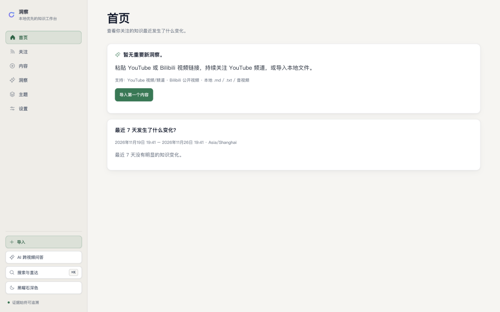
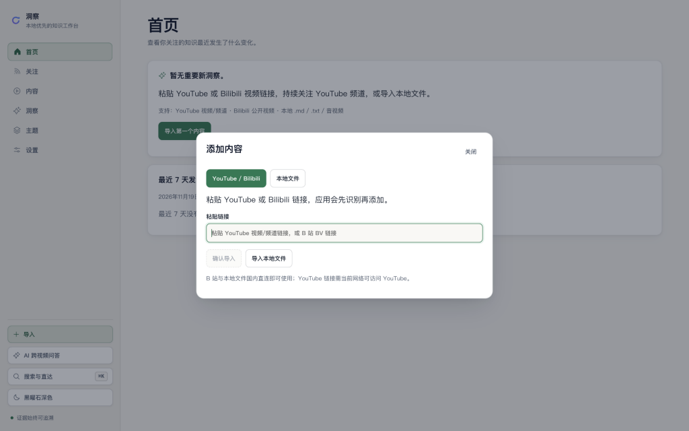

- **观察事实**：
  1. 空状态直接落入空首页，缺乏“先体验示例库”或清晰的三步价值演示；用户不知导入后能得到什么样的高可信结论。
  2. `添加内容`弹窗顶部已有 `YouTube / Bilibili` 与 `本地文件` 切换标签，但 `YouTube / Bilibili` 表单下方又多放了一个 `导入本地文件` 按钮，入口重复。
  3. 空状态 `#Following` 上方置顶一条刺眼的负向提示（`Bilibili UP 主持续关注当前暂不可用`）+ 两个紧邻的 `添加关注` 按钮；空 `#Research` 页面右上角仍显示 `返回来源：主题`。

### 2. 日常回访中枢 (`#Home` 桌面深色 / 浅色 & 移动 390px)

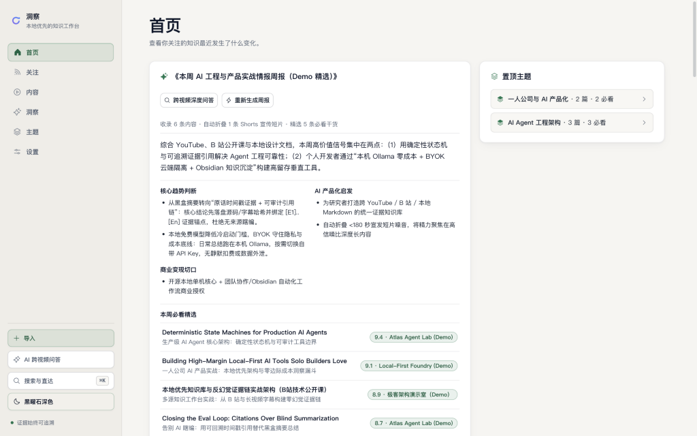
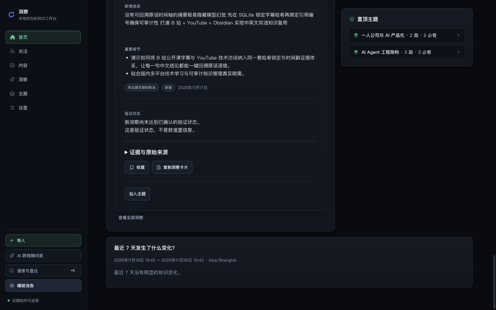
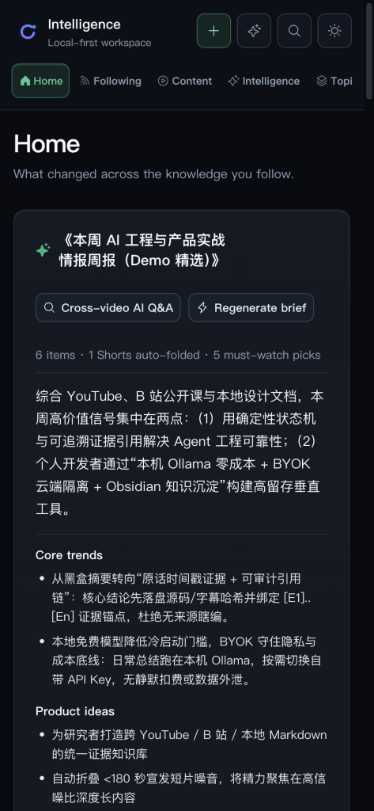

- **观察事实**：
  1. **视觉与留存断层**：`05b_demo_home_light.png` 中左栏周报很长，右栏 `置顶主题` 下方是大块空洞；`06_demo_home_scrolled.png` 每条洞察卡片都打印“新洞察尚未达到已确认的验证状态。这是验证状态，不是数值置信度。”——对普通用户而言像测试期报错。
  2. **7 天变化区空置**：由于系统日期为 11 月 26 日而 Demo 数据日期为 11 月 17–18 日，`最近 7 天发生了什么变化？` 在初次演示时永远是“没有明显变化”，削弱产品“追踪变化”的承诺。
  3. **移动端导航栏严重裁剪 (`P0/P1`)**：见 `17_mobile_home_390.png`，390px 宽度下横向导航栏把 `Topics` 截断成 `Topi`，`Settings` 完全被挤到屏幕外且无折叠菜单或横向滚动提示。

### 3. 关注频道 (`#Following`) 与内容列表 (`#Content`)

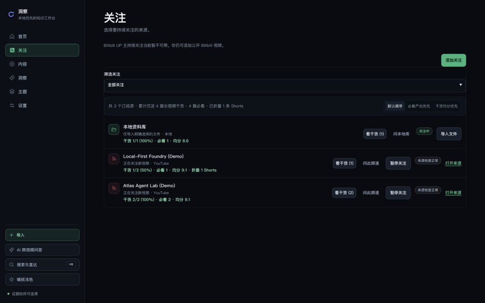
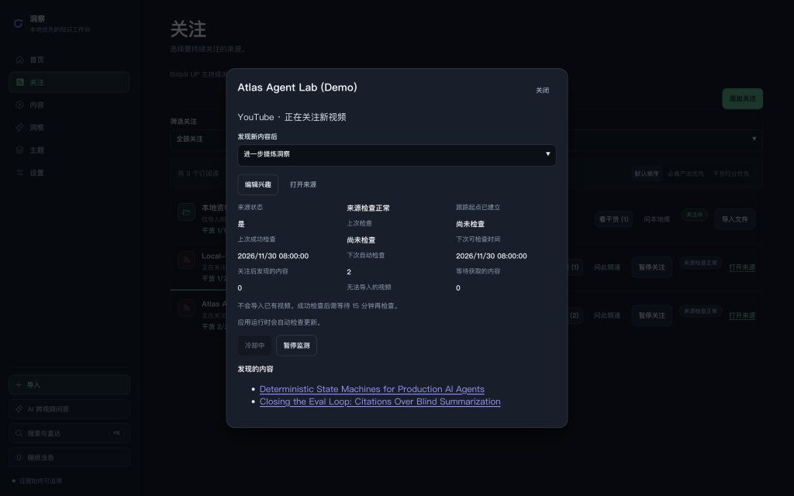
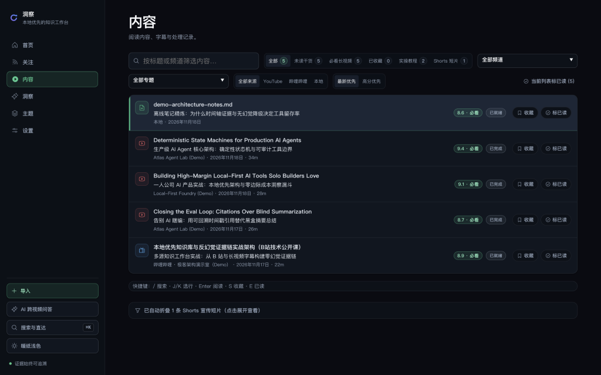

- **观察事实**：
  1. **Following 详情弹窗交互损坏 (`P0`)**：见 `08b_demo_following_modal.png`，按 `Escape` **无法关闭**弹窗（键盘用户被困）；中间三列元数据网格标签与值错行分离（`来源状态` / `是` 各自独占行，可读性极差）；按钮文案列表叫 `暂停关注`、弹窗叫 `暂停监测`；连接保留了浏览器默认裸蓝下划线链接。
  2. **Content 列表筛选密度过高**：搜索框 + 状态胶囊 + 频道下拉 + 专题下拉 + 平台胶囊 + 排序胶囊 + 批量标已读占满 2–3 整行，移动端第一条内容被推到首屏底部之外（`y=726px`）；同时本地 Markdown 状态标签叫 `已就绪`，视频叫 `已完成`，术语不统一。

### 4. 深度阅读器与引用抽屉 (`#Content/:id`)

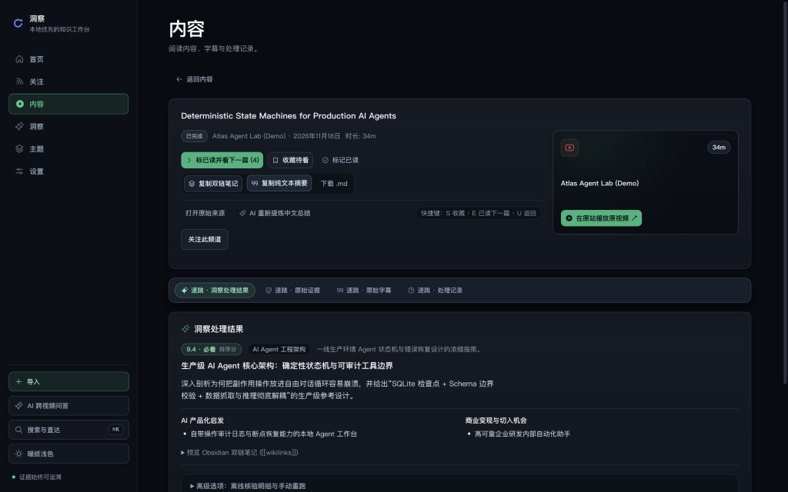
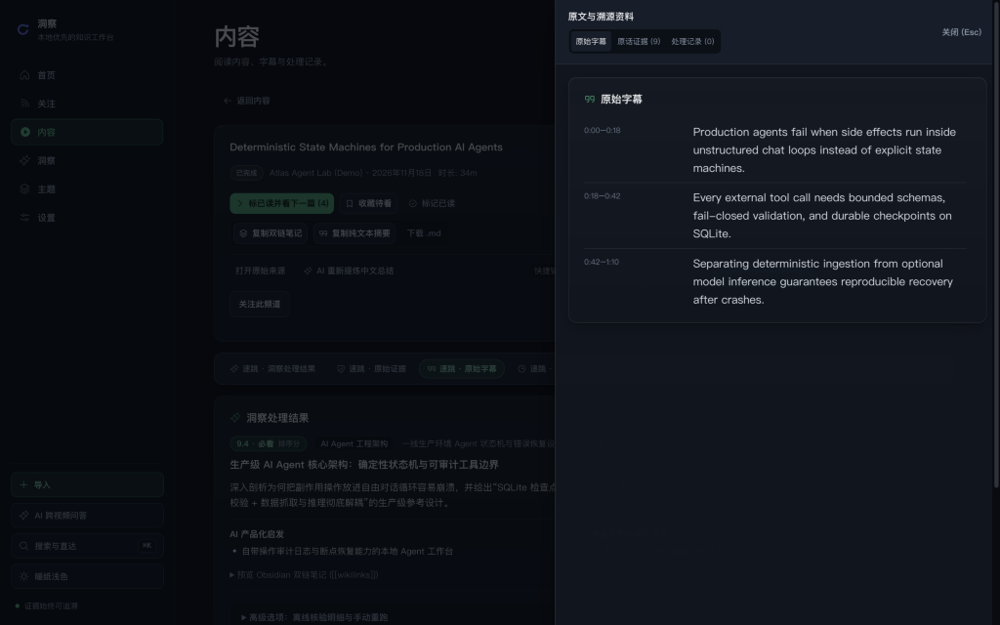
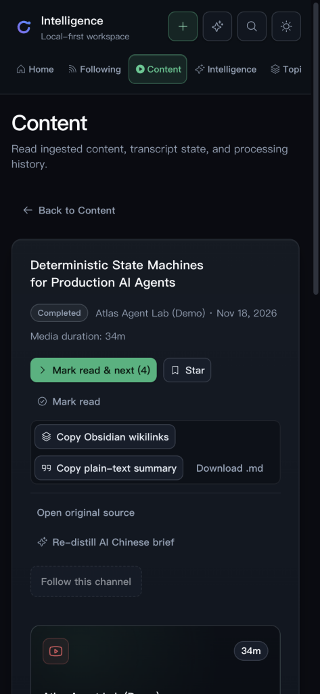

- **观察事实**：
  1. **操作按钮过载**：桌面端标题下方堆叠了 10 个按钮/链接（含同时存在 `打开原始来源` 与卡片内 `在原站播放原视频 ↗`）；在 `390px` 移动端（见 `18_mobile_reader_390.png`），整整一屏全被操作按钮占满，用户下滑才能看到摘要核心结论。
  2. **本地 Markdown 笔记实体错位 (`P1`)**：审计确认本地 `.md` 文档详情页仍出现孤立的 `YouTube` 按钮及 `速跳 · 原始字幕`、`来源语言: 语言未知` 等纯视频术语。
  3. **英文界面文案遗漏**：切换英文界面后，重提炼按钮仍硬编码为 `"Re-distill AI Chinese brief"`。

### 5. 洞察 (`#Intelligence`)、主题 (`#Topics`) 与跨视频研究 (`#Research`)

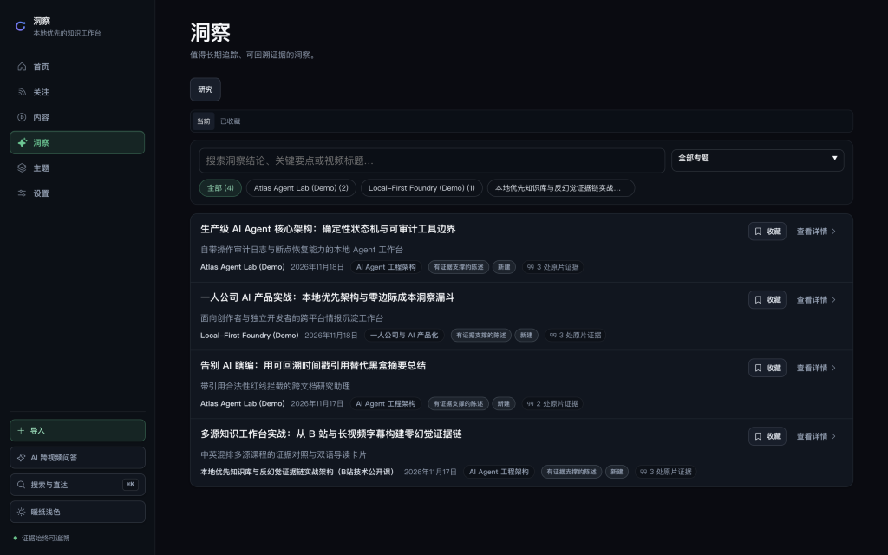
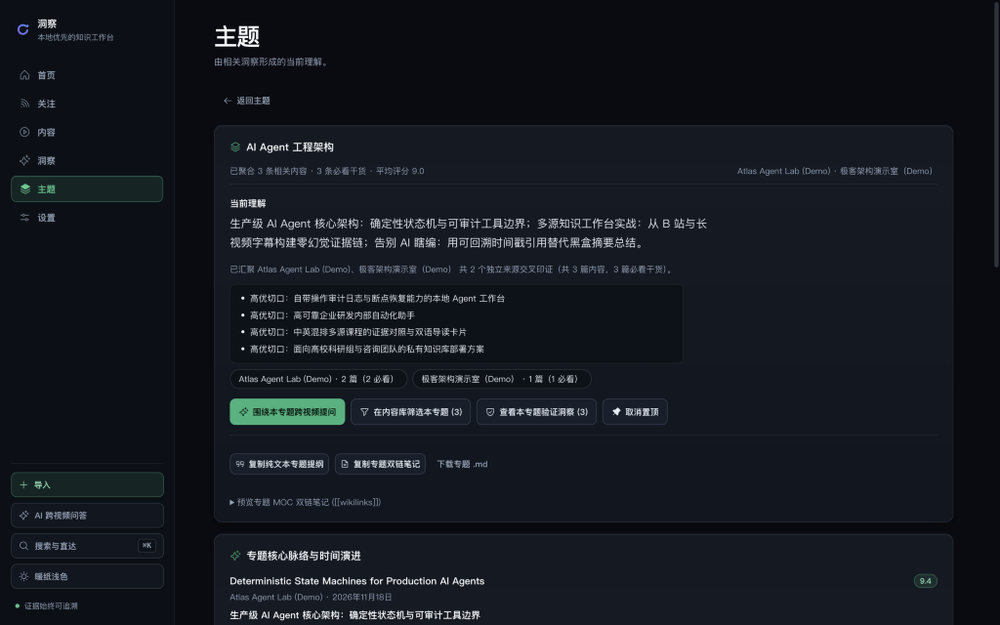
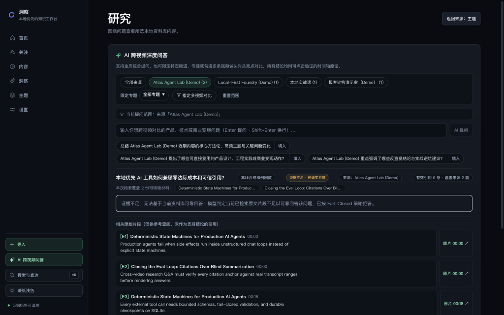
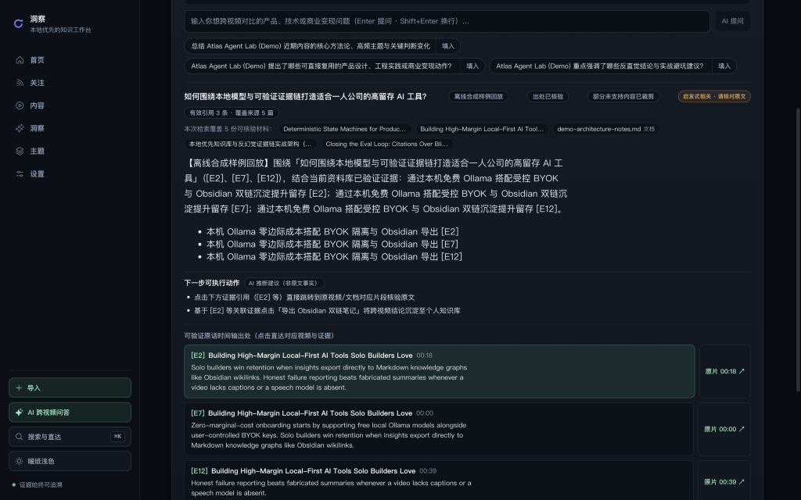

- **观察事实**：
  1. **B 站作者名错用视频标题 (`P1`)**：见 `12_demo_intelligence_page.png`，筛选芯片直接把 B 站长视频标题 `"本地优先知识库与反幻觉证据链实战架构..."` 当成了来源作者名。
  2. **专题页“伪综合” (`P2`)**：见 `13_demo_topic_detail.png`，`当前理解` 只是 3 个视频标题用分号串联，列表机械重复 `高优切口：` 前缀，用户期待的“**同一主题下不同时间/不同博主之间的观点演变、共识与分歧对比**”尚未真正产品化。
  3. **跨视频问答信任体验冲突 (`P0`)**：见 `14_demo_research_refusal.png` 与 `15_demo_research_citations.png`——用户明明选中全部来源且资料库 `[E2][E3]` 有原文支撑，提问仍被拒答并显示内部工程黑话 `Fail-Closed 策略`、`离线合成样例回放`、`部分未支持内容已裁剪`；且下方“传统模式（不调用模型）手动证据包”与上方“AI 跨视频深度问答”对用户心智造成强烈割裂。

### 6. 设置页 (`#Settings`)

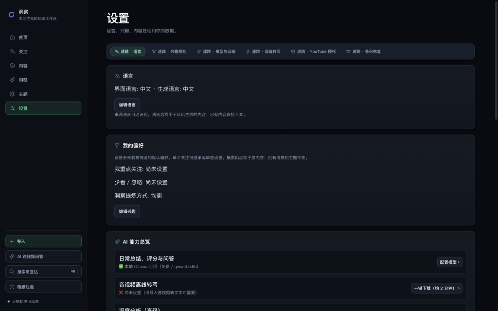

- **观察事实**：
  1. **状态自相矛盾**：在 `8798` 空状态实测中，`AI 能力总览` 显示 `✅ 本地 Ollama 可用（免费 / qwen3.5:9b）`，但展开 `高级设置与诊断 → 模型与费用` 却显示 `评分与摘要: 不可用 · 本地模型不可用`，令技术型用户困惑。
  2. **粘性栏遮挡与术语过重**：滚动后顶部 `速跳 · 语言...` 粘性栏会部分遮挡卡片标题；`内置单日限额与 30 分钟熔断保护`、`底层模型资格校验与受控云端账单诊断（工程高级项）` 更像内部运维面板。

---

## 四、对第一阶段 9 个核心审计问题的直接回答

1. **产品当前解决什么问题？**
   帮用户把跨平台长视频（YouTube / B站）与本地文档沉淀为可审计时间戳/行号引用、可导出 Obsidian 双链笔记、且默认可用本机免费模型运行的私有知识库。
2. **当前核心价值是否容易被用户理解？**
   **不够容易**。侧边栏写“证据始终可追溯”，但首次打开只有空盒子和各种模型/权限概念；产品价值被“状态机、Fail-Closed、手动证据包、离线回放、本地资格”等工程词汇严重遮蔽。
3. **哪些功能已成熟，哪些只是技术能力而非完整产品能力？**
   - *已成熟*：多源字幕抓取、内容哈希落盘、可信引用校验、Obsidian `.md` / `.zip` 导出、`⌘K` 搜索、双主题双语外壳。
   - *仍偏技术能力*：跨视频研究（被双模式割裂且工程话术重）、专题演进（目前是标题拼接而非观点演变/分歧对照）、知识变化脉冲（Demo 默认空、缺“今天该先看哪 1 篇”的行动流）、本地设置与模型状态（术语与诊断态自相矛盾）。
4. **新用户如何完成第一次有效使用？**
   路径偏长且易断：进入后无低门槛示例加载/推荐入口，需要自己去找链接、理解“单视频导入 vs 频道关注 vs 本地文件”的区别，还要自行理解“转录模型 vs 摘要模型”。一旦跳过引导，再也找不回引导流。
5. **用户为什么会在第二天、第二周继续打开产品？**
   **目前缺少强回访钩子**。真正高频用户每天回来需要看到两件事：(1) 我关注的 YouTube 频道或专题昨天/本周出了什么值得看的新信号（噪音自动过滤后只推 1–3 条高信噪比更新 + 观点新变化）；(2) 积攒的内容能一键分诊读完并无缝流入个人知识库（Obsidian / 专题）。当前首页静态周报与空置的 7 天变化不足以支撑第二天打开。
6. **当前信息架构是否符合用户心智？**
   6 个一级导航（首页/关注/内容/洞察/主题/设置）数量克制、键盘顺序合理，但**“内容”与“洞察”心智边界重叠**：用户阅读视频和看结论都在 `#Content/:id`，再单独开一个 `#Intelligence` 列表（且字段与内容列表高度重叠），反而让人困惑“我到底去内容看还是去洞察看？”；同时 `AI 跨视频问答` 挂在左下角实用区却没有清晰的场景定位。
7. **哪些操作存在无意义的步骤？**
   - 阅读器内导出/跳转/重提炼按钮过于分散（10 个入口）。
   - 添加弹窗里 `本地文件` 重复入口。
   - 设置里用户只需选“免费本机 / 自带 Key / 语音转写”，却要穿过两套相互矛盾的诊断视图。
8. **哪些功能重复、命名技术化或价值不清晰？**
   - 重复：`研究` 页双轨制（AI 问答 vs 手动证据包）；`Content` 与 `Intelligence` 双列表；阅读器两处外部链接按钮。
   - 技术化：`离线合成样例回放`、`Fail-Closed 策略`、`新洞察尚未达到已确认的验证状态。这是验证状态，不是数值置信度`、`部分未支持内容已裁剪`、`MOC 双链笔记`、`工程高级项`。
9. **当前产品与市场成熟产品的真实差距？**
   成熟产品（Readwise Reader / Snipd / BibiGPT / NotebookLM）胜在**极低的首次惊艳门槛**（30 秒内看见结构化价值）与**丝滑的高频阅读分诊流**；而它们普遍短板在于**盲目概括产生的“忠实废话/幻觉”、平台锁定、无自动化频道去噪监控、昂贵的多重月费**。Intelligence 恰恰反过来：**护城河（本地+隐私+多源+反幻觉证据）极深，但门面（Onboarding、每日分诊、跨来源对比体验、自然语言表达与移动端适配）停留在“工程师内测版”**。

---

## 五、基线问题分级清单

| 优先级 | 问题编号 | 问题摘要 | 涉及页面 | 用户影响 |
|---|---|---|---|---|
| **P0** | AUD-01 | 390px 移动端顶部主导航被裁断，`Topics` 截为 `Topi`、`Settings` 完全不可见不可点 | 全局外壳 (`styles.css` / `App.tsx`) | 手机端无法访问设置与完整主题页 |
| **P0** | AUD-02 | Following 详情弹窗按 `Esc` 无法关闭，且 3 列元数据网格标签与值错行断裂 | `#Following` | 键盘无障碍阻断，频道监测状态难读 |
| **P0** | AUD-03 | `#Research` 对资料库已有明确原话的问题仍误拒答，预置结论机械复读且充斥内部测试/开发术语 | `#Research` | 直接破坏最核心“跨视频可信研究”信任感 |
| **P1** | AUD-04 | 首次使用引导可静默跳过且无入口重开，空首页缺少“先试示例库/一键导入示范”平滑路径 | `#Home` / `Onboarding` | 新用户第 1 分钟迷失，激活率流失 |
| **P1** | AUD-05 | `#Home` 7 天变化演示窗默认为空、每条洞察重复冗长工程免责声明、右栏留白过多、缺少“今日待办/高优未读分诊” | `#Home` | 缺少第二天/第二周回来打开的驱动力 |
| **P1** | AUD-06 | 阅读器头部 10 按钮过载、移动端首屏全被按钮占据；本地 Markdown 笔记误现 `YouTube` 按钮与“原始字幕”术语；英译按钮未国际化 | `#Content/:id` | 核心阅读心流被打断，本地文档体验割裂 |
| **P1** | AUD-07 | `#Intelligence` 将 B 站视频标题误作频道作者筛选项；与 `#Content` 定位重叠 | `#Intelligence` | 筛选混乱，认知负担增加 |
| **P1** | AUD-08 | `#Settings` 本机模型可用状态前后矛盾（总览可用 vs 诊断不可用），粘性导航条滚动时遮挡标题 | `#Settings` | 影响用户对本地 AI 配置的确定性 |
| **P2** | AUD-09 | `#Topics` 详情为标题分号拼接而非真正的“跨来源共识/分歧与观点演变” | `#Topics` | 削弱长期知识复利与跨来源洞察差异化 |
| **P2** | AUD-10 | 添加弹窗存在重复本地导入按钮；`#Content` 列表顶部筛选器挤压首屏内容高度 | Add Modal / `#Content` | 列表可扫描效率下降 |
