# 08｜产品持续自主迭代记录（Iteration Log）

本文档按「市场/实机证据 → 决策与原因 → 实际改动 → 前后真实对比截图 → 测试与验证 → 剩余风险与下一轮计划」逐轮记录每一次真实产品交付。

---

## Iteration 1（`EVO-01` + `EVO-02`）：核心研究可信闭环、390px 移动导航与无障碍纠偏

- **提交分支**：`antigravity/autonomous-product-evolution-20261126`
- **对应需求**：`EVO-01`（9.15 分，跨视频研究检索命中、去复读与 scoped 恢复引导）、`EVO-02`（8.55 分，390px 导航裁断、Following 弹窗 `Esc` 与网格修复、Settings Ollama 一致性与粘性栏偏移）
- **服务人群**：核心人群（AI 行业研究者 / 技术架构师）与次级人群（独立开发者、研究型 PM）

### 1. 本轮获取的新证据与产品决策
- **实机基线暴露的 3 个 P0 信任与可用性断点**：
  1. 跨视频问答（`#Research`）在已有双语原文支撑的情况下误拒答、预置样例答案连续 3 次机械复读同一句话，且用户选定单个频道提问拒答后没有“扩大到全部来源重问”的平滑恢复路径（见基线截屏 `14_demo_research_refusal.png`、`15_demo_research_citations.png`）。
  2. 移动端 `390x844` 顶部导航将英文 `Topics` 裁成 `Topi` 并把 `Settings` 完全挤出屏幕外，无法访问设置页（`17_mobile_home_390.png`）。
  3. Following 频道详情弹窗 `Esc` 无法关闭且 3 列元数据标签与数值跨行断裂（`08b_demo_following_modal.png`）；`#Settings` 粘性导航条滚动时遮挡标题，且 `高级设置 → 模型与费用` 的 `本地模型不可用` 与顶部 `AI 能力总览` 的 `✅ 本地 Ollama 可用` 自相矛盾。
- **决策依据 (`DEC-004`, `DEC-006`)**：绝不为了界面干净删掉核心防幻觉标签或弱化 Fail-Closed 拒答，而是把精确双语检索做准、把多源论证做丰富不复读、在严格分级徽章下增加人话导读与一键扩大范围恢复按钮，同时修复移动端导航与弹窗键盘无障碍阻断。

### 2. 实际改动内容
1. **跨视频研究检索精度、多源多样性与去复读 (`../../../src/youtube_intel/demo_showcase.py`)**：
   - 补齐真实双语同义组（`优先`/`local-first`、`零边际成本`/`zero-marginal-cost`、`可信`/`honest`/`auditable`/`verified`、`知识库`/`obsidian`/`markdown`）与连接虚词清理（`兼顾`、`并`）。
   - 优化候选引用筛选：按相关分高门槛过滤、按原文摘录去重，再跨不同视频/本地笔记分散选取高相关引用；为各证据语义分别生成独立句子并追踪已用句式，彻底消除预置及实时回答中的 3 次重复复读。
2. **限定范围拒答一键恢复 + 通俗可信解释 (`../../../frontend/src/workspace/WorkspaceAiWidgets.tsx`, `../../../frontend/src/workspace/App.tsx`, `../../../frontend/src/workspace/styles.css`)**：
   - 当处于频道/专题/已选视频/收藏过滤范围且返回拒答时，直接呈现限定范围解释与 **`扩大到全部来源重新提问` / `Retry across all sources`** 一键重置重问按钮。
   - 在已验证答案徽章下方新增通俗易懂的单行可信说明（`.ai-qa-trust-note`），保留所有严格核验徽章与 Markdown 审计语义。
   - 离开 `#Research` 时清理过期的 `researchOriginPage` 状态。
3. **390px 移动导航 3×2 网格 + Following 弹窗无障碍修复 + Settings 一致性 (`../../../frontend/src/workspace/styles.css`, `../../../frontend/src/workspace/CreatorFollowing.tsx`, `../../../frontend/src/workspace/App.tsx`)**：
   - `<=580px` 与 `<=420px` 下 `.sidebar-nav` 改用 3 列 × 2 行等宽网格，保证中英文全 6 个主导航按钮 100% 完整可见、不裁字、无横向滚动条。
   - Following 详情弹窗支持 `Escape` 关闭与遮罩点击关闭；将 `<dl className="creator-tracking">` 中每对 `<dt>/<dd>` 包裹在独立 `
` 内，实现整齐 3×3 卡片对齐；为发现视频列表链接应用主题语义色（`.creator-discovered-list a`）。
   - `#Settings` 所有锚点分区统一配置 `scroll-margin-top: 112px`，消除粘性速跳栏遮挡；在 `模型与费用（只读）` 卡片中当 `workspace_ai.ollama_reachable` 为真时明确解释本机 Ollama 正常运行与旧版严格资格流水线的差异。

### 3. 优化前后真实实机体验对比

| 场景 | 优化前（基线截图） | 优化后（本轮实机截图） | 实际体验提升 |
|---|---|---|---|
| **390px 移动导航（英文）** | 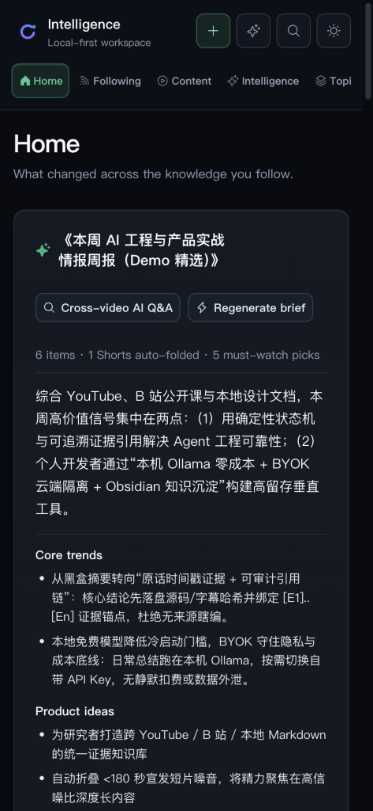 | 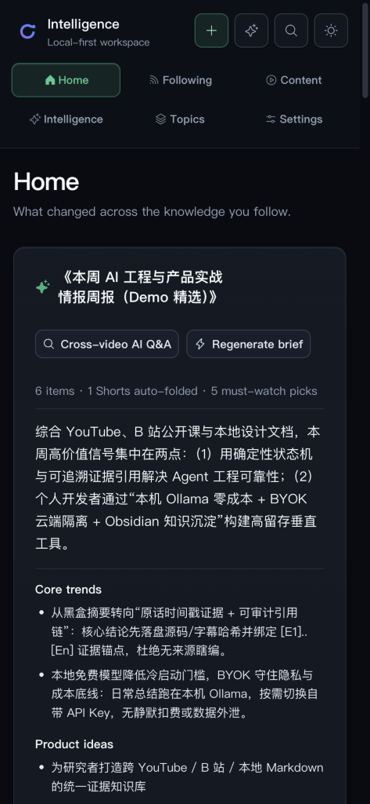 | `Topics` 完整显示不再截成 `Topi`，`Settings` 完全处于屏幕内并实测可点击跳转；中英文双态均 `scrollWidth <= 390` |
| **Following 频道详情弹窗** | 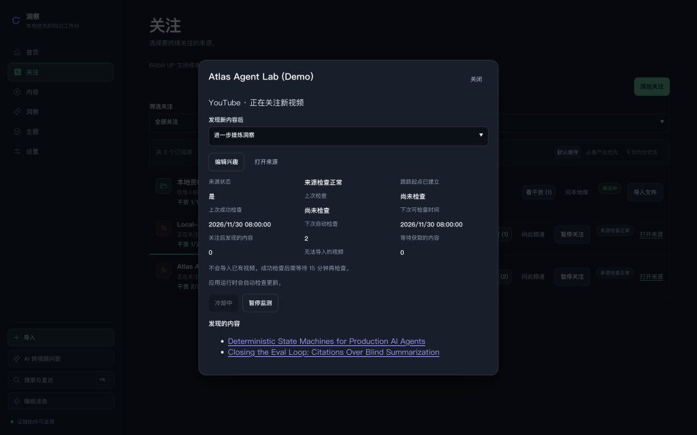 | 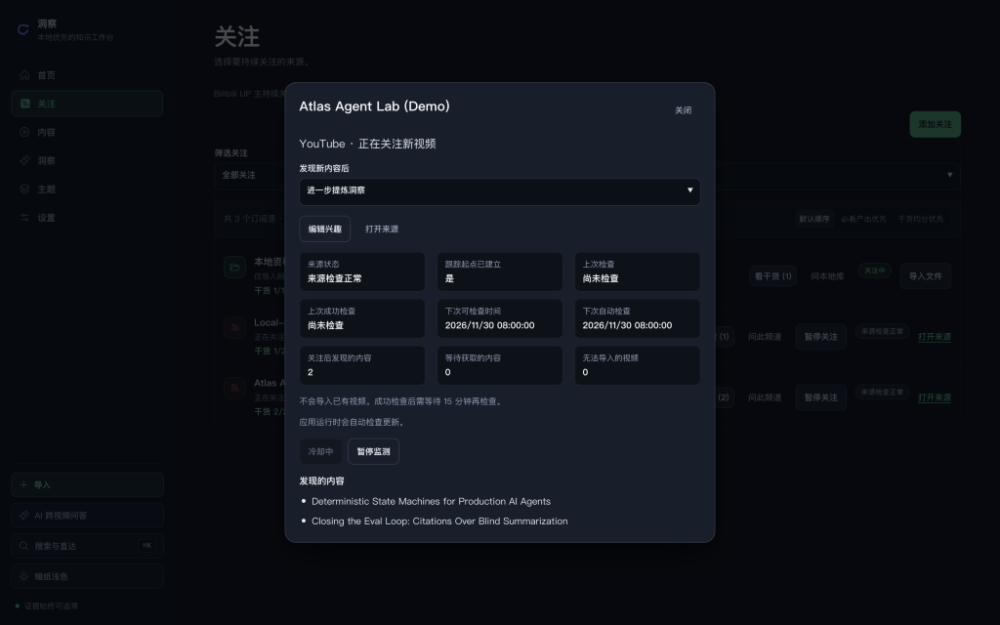 | 9 组参数全部成对封装于卡片网格，支持 `Esc` 键盘关闭，链接视觉与深色主题统一 |
| **Research 预置与全库多源问答** | 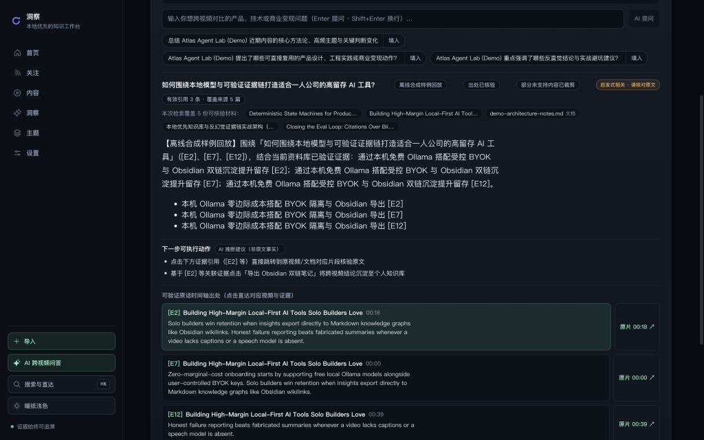 | 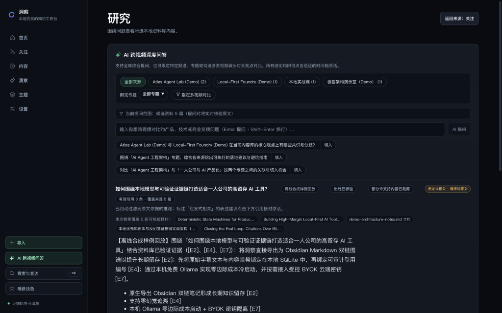 | 预置 3 条核心证据分别命中不同语义与来源（0 重复），徽章下提供清晰人话导读 |
| **Research 限定拒答 → 一键扩全库** | 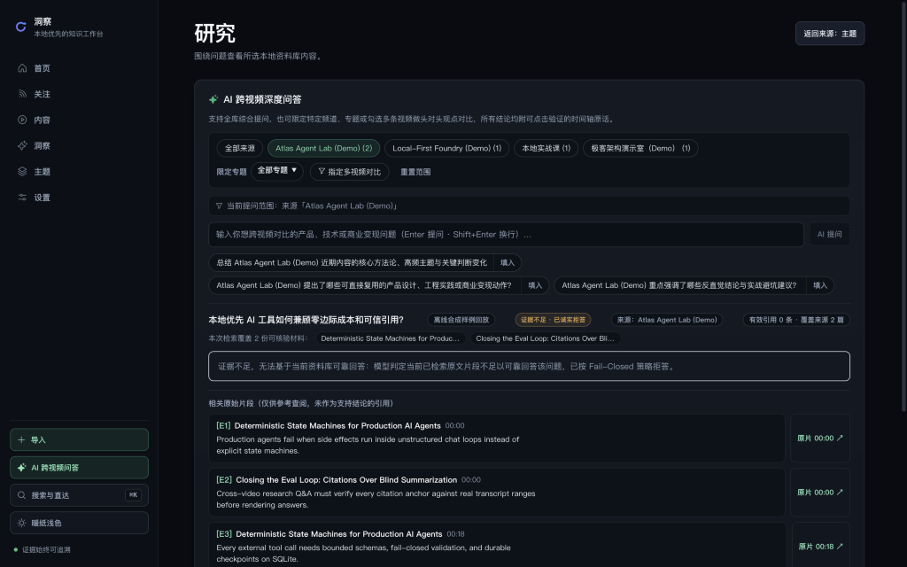 | 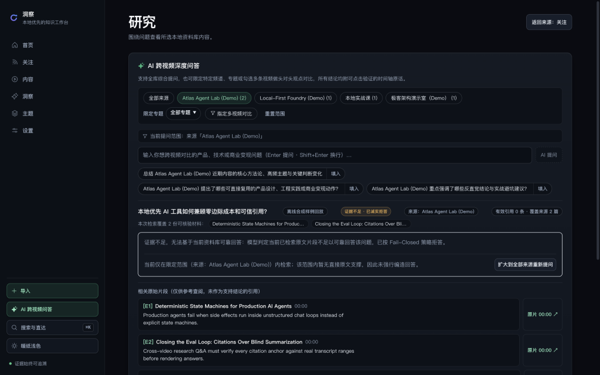 → 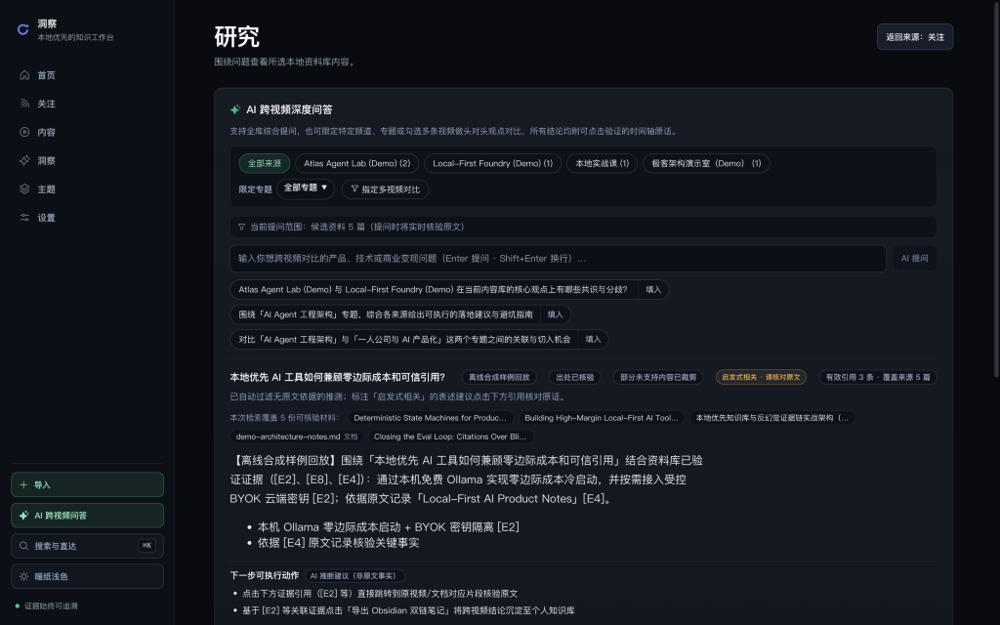 | 先在限定频道下诚实拒答，点击 **`扩大到全部来源重新提问`** 后立即覆盖 5 篇资料并引用 3 个跨平台来源（YouTube + B站 + 本地 `.md`） |
| **Settings 速跳偏移 & Ollama 说明** | 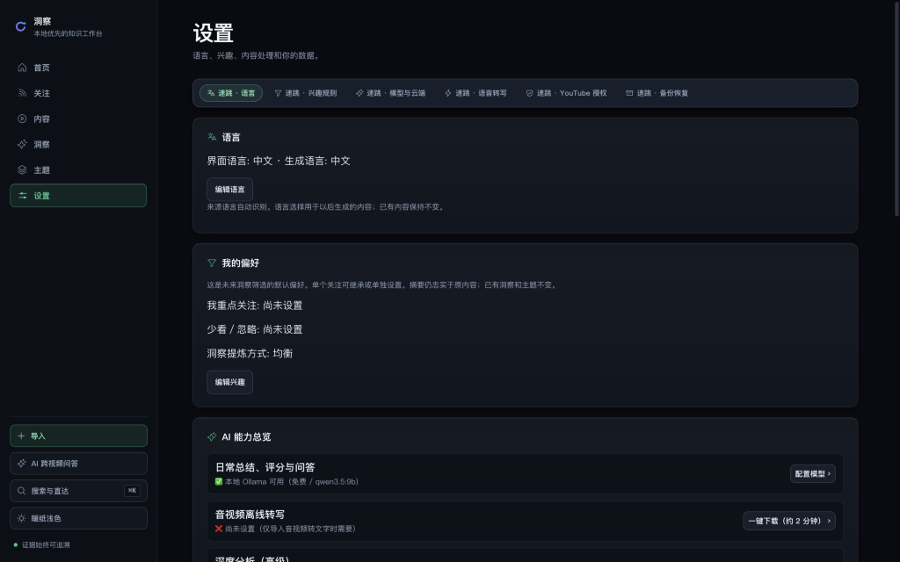 | 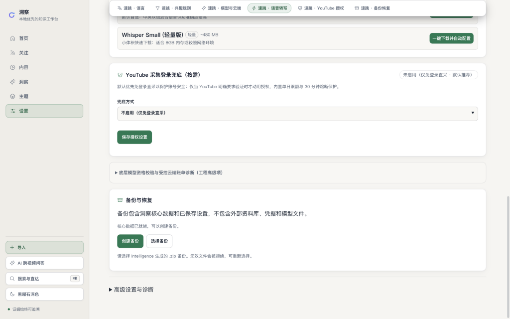 / 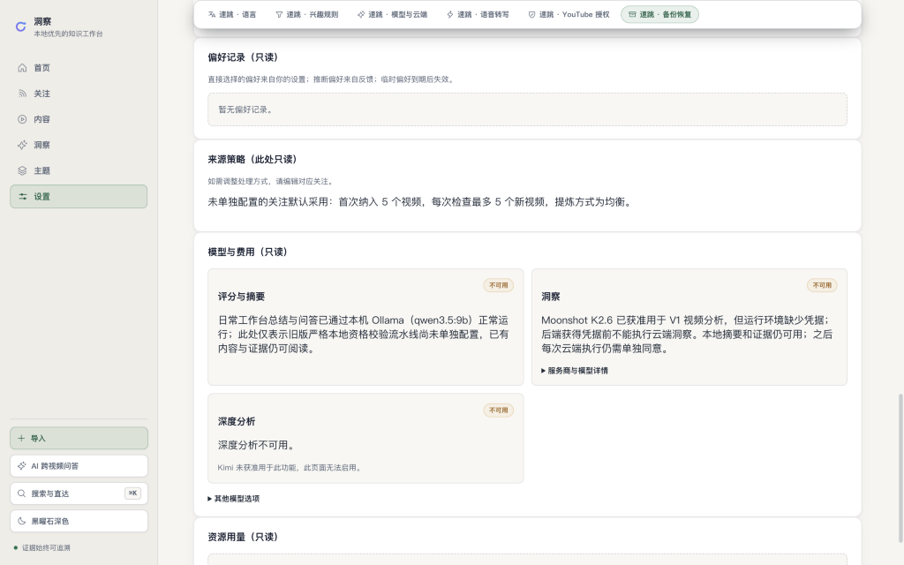 | 速跳留出 `154.4px` 净空零遮挡；`评分与摘要` 清晰说明本机 Ollama（`qwen3.5:9b`）正常运行状态 |

### 4. 已完成自动化检查与实机验证证据
- **新增回归测试**：`tests/integration/test_public_beta_demo_showcase.py::test_demo_showcase_answers_bilingual_local_first_marginal_cost_query_without_repetition` 与 `frontend/src/workspace/EvolutionIter1.test.tsx`（2 项）。
- **后端全套门禁**：
  - `.venv/bin/ruff check src tests` → 通过（0 error）。
  - `.venv/bin/mypy src` → `Success: no issues found in 138 source files`。
  - `.venv/bin/python scripts/ci_test_manifest.py verify` → `total_collected=7400` 校验通过。
  - `PYTHONPATH=. .venv/bin/pytest tests/integration/test_public_beta_demo_showcase.py tests/integration/test_final_blocker_closure.py tests/integration/test_codex_review_remediation.py -q` → **44 passed in 165.63s**。
- **前端全套门禁**：
  - `npm run typecheck` → 通过（0 error）；`npm run build` → `vite v5.4.19` 1.08s 构建成功。
  - `npm test -- --run --poolOptions.forks.maxForks=4 --poolOptions.forks.minForks=2` → **59/59 test files, 1282/1282 tests passed**。
- **真实 Chromium 实机验证**：在 `127.0.0.1:8799`（Demo）与 `127.0.0.1:8798`（全新空库）下全路径交互验证通过：**0 console errors、0 page errors、0 HTTP >=400**。

### 5. 剩余风险与下一轮计划
- **已识别但留待后续迭代的问题**：
  1. `#Home` 首页右栏下方仍有空白，卡片内大段“验证状态”说明仍占篇幅，且 Demo 模式 7 天变化面板默认为空（**Iteration 2 · `EVO-03`**）。
  2. 阅读器头部 10 按钮在移动端仍占满首屏、本地 `.md` 仍带 `YouTube`/`字幕` 文案、B 站作者筛选项误用视频标题（**Iteration 3 · `EVO-04`**）。
  3. 专题细节页的跨源共识/分歧真综合与新手引导重开/示例一键体验入口（**Iteration 4 · `EVO-05`**）。
- **需要项目所有者决定的事项**：无阻塞决策。

---

## Iteration 2（`EVO-03`）：首页高优待读分诊流、精简验证态展示与动态 7 天知识变化

- **提交分支**：`antigravity/autonomous-product-evolution-20261126`
- **对应需求**：`EVO-03`（8.60 分，首页 Day-2 高信噪比回访分诊流 + 消除每卡大段验证态样板文字 + 唤醒 7 天动态知识变化窗）
- **服务人群**：核心人群（AI 行业研究者 / 技术架构师）与次级人群（独立开发者、研究型 PM）

### 1. 本轮获取的新证据与产品决策
- **实机审计发现的 Day-2 留存断点**：
  1. 首页 `#Home` 主体卡片底部每条都完整平铺大段「验证状态说明」文字，占满首屏视觉焦点却没有给“今天该先读哪几篇、哪些已读完”的直接行动入口；右侧栏下方留白明显（见基线截屏 `01_home_dark.png`、`02_home_light.png`）。
  2. Demo 模式使用固定历史基线日期 `_DEMO_BASE_NOW`，导致首页「最近 7 天发生了什么变化？」在跨日期演示时统计退化为旧数据/空窗。
- **决策依据 (`DEC-003`, `DEC-006`)**：在**完整保留 DOM 诚实声明语义**的前提下，将反复平铺的验证说明折叠为紧凑可展开的 `验证状态说明 · <状态>` 披露条，并在首页右栏 `Pinned Topics` 上方构建「**高优待读队列（Priority Reading Queue）**」（自动过滤 Shorts 噪音、按 AI 评分降序、支持单篇一键 `标已读` 与 `开始连续速读 (N)` 直达高优未读内容）；同时将 Demo 种子基准对齐实时当前整点 UTC 时钟，让 7 天增量动态鲜活。

### 2. 实际改动内容
1. **首页高优待读队列与紧凑验证披露 (`../../../frontend/src/workspace/App.tsx`, `../../../frontend/src/workspace/styles.css`)**：
   - 并行拉取 `/videos?limit=24`，通过 `isEffectiveVideoShortNoise` 过滤低信噪比短视频噪音与已读条目，按 AI 评分排序展示 Top 4 高优未读内容（含评分徽章、来源/时长、一键 `标已读` 调用 `POST /workspace-ai/videos/:id/curation` `{ is_read: true }` 并乐观递减未读数）。
   - 提供主 CTA **`开始连续速读 (N)` / `Start triage (N)`** 一键跳转首篇高优未读进入精读流。
   - 将 `IntelligenceCard` 中的长段验证免责声明收敛进 `
`，保留可审计声明原文在 DOM 中且可按需展开。
2. **Demo 动态当前 UTC 时钟基准 (`../../../src/youtube_intel/demo_showcase.py`, `../../../tests/integration/test_public_beta_demo_showcase.py`)**：
   - 将 Demo 种子时间戳基线从固定硬编码日期替换为当前 UTC 整点（`datetime.now(UTC).replace(minute=0, second=0, microsecond=0)`），并新增集成断言验证 `/api/v1/knowledge-delta` 返回 `status == "available"` 且具备真实活跃分类计数。
3. **新增前端回归单测 (`../../../frontend/src/workspace/EvolutionIter2.test.tsx`)**：
   - 验证待读队列自动剔除 Shorts 噪音、一键 `标已读` 正确调用 `/workspace-ai/videos/:id/curation` 并更新未读计数、以及紧凑验证披露保留准确 DOM 文本。

### 3. 优化前后真实实机体验对比

| 场景 | 优化前（基线截图） | 优化后（本轮实机截图） | 实际体验提升 |
|---|---|---|---|
| **首页桌面端（Dark）** |  | 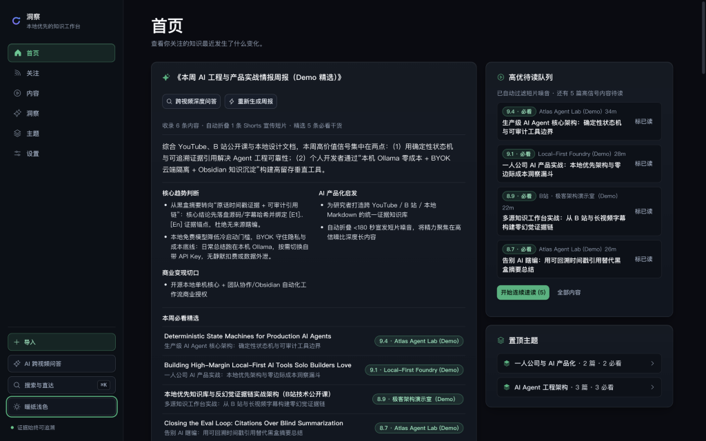 | 右栏填补留白出现 `高优待读队列 (5)` 与 `开始连续速读 (5)`，左栏卡片不再被大段免责文本撑胖 |
| **首页桌面端（Warm Paper Light）** |  | 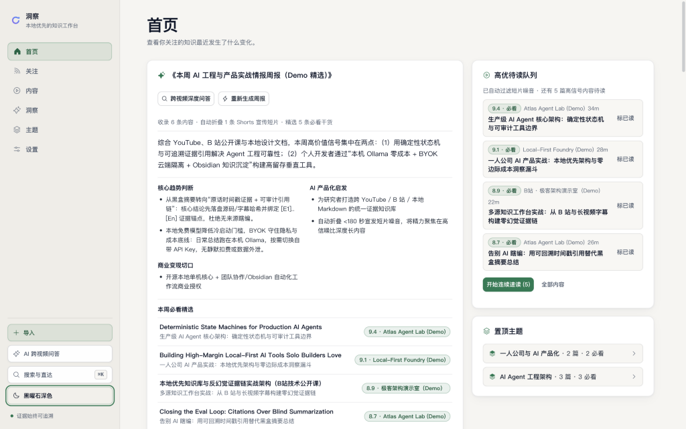 | 暖白纸张主题下待读队列评分徽章、分割线与按钮层级清晰和谐 |
| **7 天变化窗与一键标已读** | 基线固定时间戳易过期 | 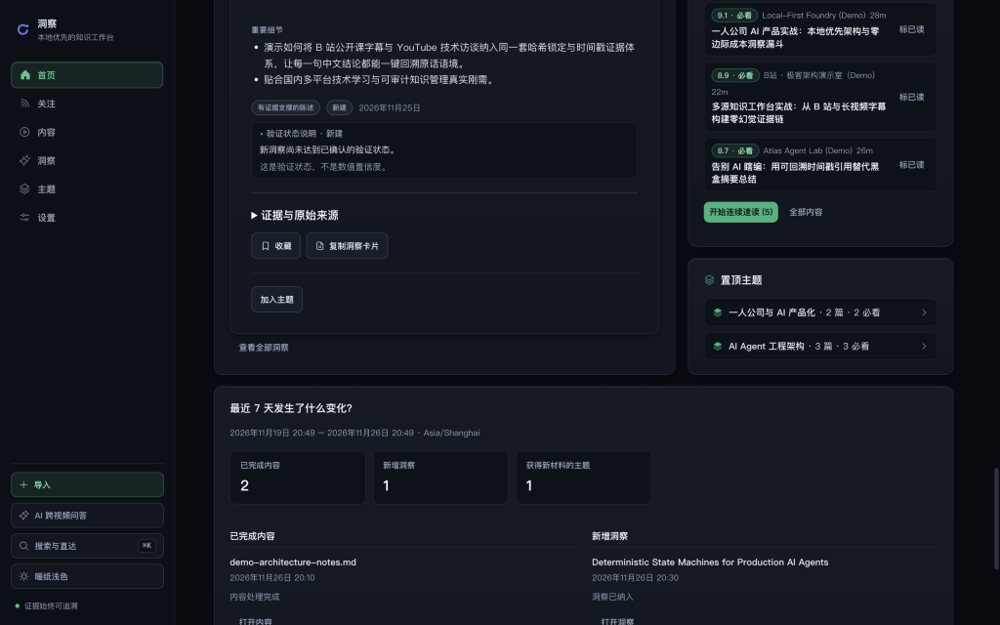 → 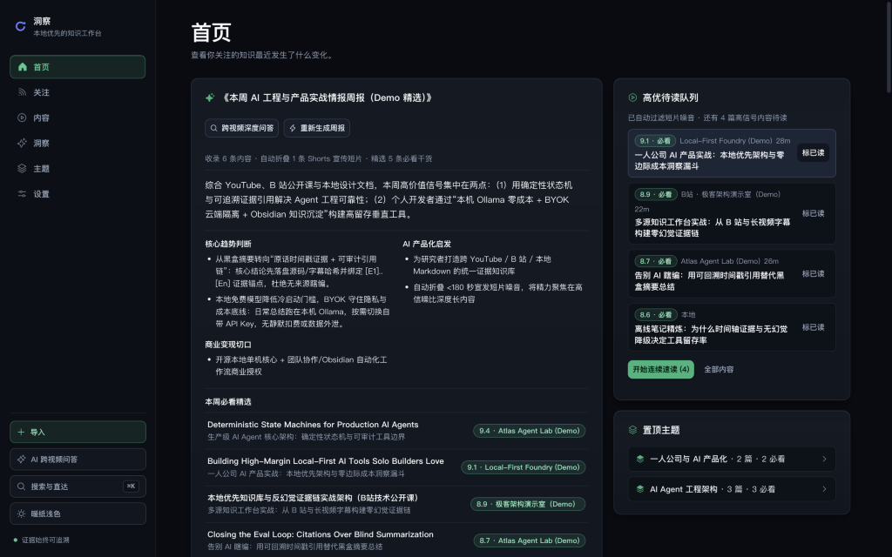 | `最近 7 天发生了什么变化？` 实时显示 `已完成内容: 2 · 新增洞察: 1 · 获得新材料的主题: 1`；点击 `标已读` 返回 `200 OK`，计数即时 `5 → 4` |
| **390px 移动端首页** |  | 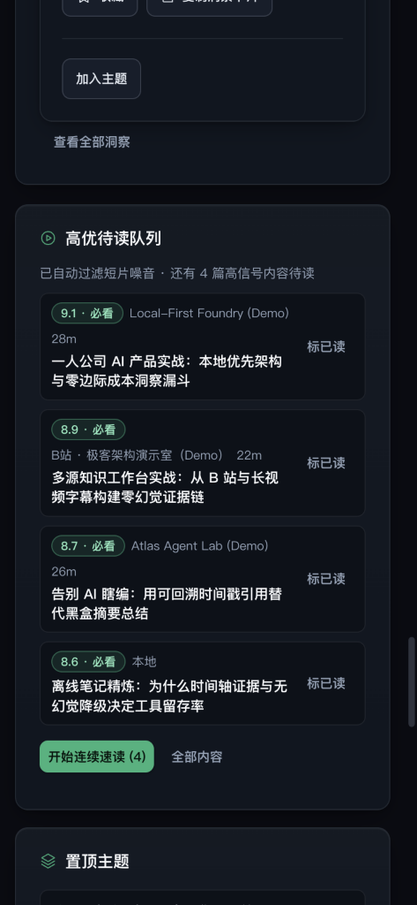 | 390px 下单栏顺畅堆叠，待读队列与洞察卡零横向溢出（实测页面宽度 `379px <= 390px`） |

### 4. 已完成自动化检查与实机验证证据
- **后端全套门禁**：
  - `.venv/bin/ruff check`、`mypy`（138 files）、`ci_test_manifest.py verify`（`total_collected=7400`）全通过。
  - `PYTHONPATH=. .venv/bin/pytest tests/integration/test_public_beta_demo_showcase.py -q` → **7 passed in 67.68s**。
- **前端全套门禁**：
  - `npm run typecheck` → 通过；`npm run build` → `vite v5.4.19` 1.41s 构建成功。
  - `npm test -- --run --poolOptions.forks.maxForks=4 --poolOptions.forks.minForks=2` → **60/60 test files, 1283/1283 tests passed**。
- **真实 Chromium 实机验证**：在 `127.0.0.1:8799` 验证 Dark/Light/390px 视图、折叠说明展开、真实 `POST /api/v1/workspace-ai/videos/:id/curation -> 200 OK`、以及 `开始连续速读 (4)` 跳转 `#Content/vidDemoSol2`：**0 console errors、0 page errors、0 HTTP >=400**。

### 5. 剩余风险与下一轮计划
- **下一轮重点（Iteration 3 · `EVO-04`）**：解决深度阅读器 390px 首屏 10 按钮堆叠、本地 `.md` 误出 `YouTube`/字幕文案、B 站卡片与作者筛选项错用视频标题、以及英文界面按钮本地化残留。
- **需要项目所有者决定的事项**：无阻塞决策。

---

## Iteration 3（`EVO-04`）：阅读器多源实态一致性、B 站作者归属、移动端首屏减负与英文文案纠偏

- **提交分支**：`antigravity/autonomous-product-evolution-20261126`
- **对应需求**：`EVO-04`（8.35 分，深度阅读器减负与多源实态一致性）
- **服务人群**：核心人群（AI 行业研究者 / 技术架构师）与双语学习者

### 1. 本轮获取的新证据与产品决策
- **实机基线暴露的 4 项阅读器与多源一致性缺口**：
  1. `ContentDetailPanel` 中 `isLocalMedia` 将 `TEXT` 排除后又以 `isLocalMedia && media_kind === "TEXT"` 计算 `isTextDocument`，导致 `.md` 本地笔记恒被判定为非文本文档——误渲染 `YouTube` 预览占位区、`来源语言: 语言未知` 噪音与 `原始字幕` 标签（见基线截屏 `10_demo_reader_local_md.png`）。
  2. B 站单视频在 `source_subscriptions.display_name` 写入视频标题，而读模型优先取 `source.display_name`，导致 `#Intelligence` 的来源筛选项与卡片作者错显示为完整视频标题（`12_demo_intelligence.png`）。
  3. `390x844` 移动端阅读器 10 个头部动作按钮单列纵向堆叠，严重推低 AI 核心结论卡片首屏可见性（`18_mobile_reader_390.png`）。
  4. 英文界面下内容详情页重提炼按钮残留 `Re-distill AI Chinese brief`。
- **决策依据 (`DEC-002`, `DEC-006`)**：在**完全不破坏已冻结同意哈希（Consent Hash）校验契约**的前提下，将单视频读模型作者优先解析为真实的 `video.channel_name`；彻底修复本地文本文档的 `isTextDocument` 判定与文案映射，并以紧凑网格重排移动端阅读器动作组而不隐藏任何可访问功能。

### 2. 实际改动内容
1. **B 站与单视频 `source_display_name` 读模型修正 (`../../../src/youtube_intel/fast_read_api.py`, `../../../src/youtube_intel/local_api.py`)**：
   - 在两处投影构造中，当 `source.source_type == "VIDEO_URL"` 且 `video.channel_name` 存在时优先采用 `video.channel_name`，保证历史与新增 B 站卡片及筛选条统一显示真实 UP 主（如 `极客架构演示室（Demo）`），且不改动 `distillation.py` 中已签署的同意投影哈希逻辑。
2. **本地 Markdown 阅读器真文本文档适配、390px 动作网格与英译文案 (`../../../frontend/src/workspace/App.tsx`, `../../../frontend/src/workspace/uiLanguage.tsx`, `../../../frontend/src/workspace/WorkspaceAiWidgets.tsx`, `../../../frontend/src/workspace/styles.css`)**：
   - 修复 `isTextDocument = data.video.provider === "LOCAL" && data.video.media_kind === "TEXT"`：自动隐藏本地 `.md` 的视频占位框，折叠无关 `语言未知`，将速跳标签与全文抽屉统一切换为 `速跳 · 文档原文` / `查看原始全文`。
   - `<=580px` 下 `.reader-action-flow` 与 `.reader-export-group` 改用 2 列等宽紧凑网格，隐藏移动端冗余快捷键提示，压缩视频预览舞台最大高度，让本地 `.md` 的 AI 核心结论首屏直接入画。
   - 统一英文界面重提炼按钮为 `Distill AI brief` / `Re-distill AI brief` / `Distilling AI summary…`。
3. **新增前后端回归测试 (`../../../tests/integration/test_public_beta_demo_showcase.py`, `../../../frontend/src/workspace/EvolutionIter3.test.tsx`)**：
   - 验证 `/api/v1/intelligence` B 站卡片 `source_display_name == "极客架构演示室（Demo）"`，以及本地 `.md` 阅读器、英文重提炼按钮全部正确。

### 3. 优化前后真实实机体验对比

| 场景 | 优化前（基线截图） | 优化后（本轮实机截图） | 实际体验提升 |
|---|---|---|---|
| **#Intelligence B 站作者归属** |  | 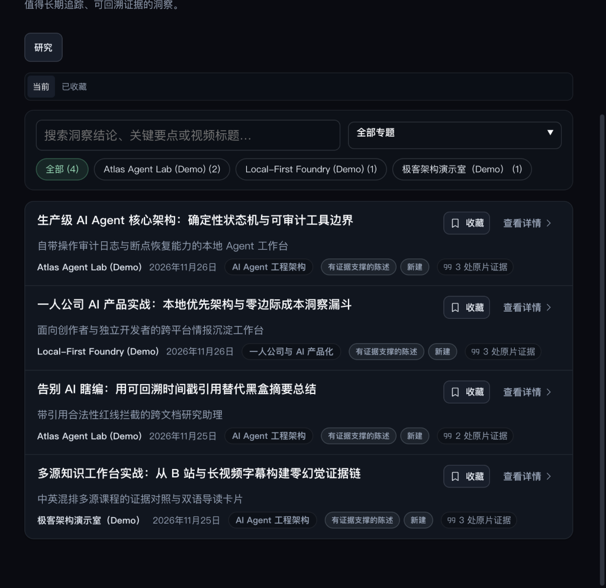 | 筛选条与卡片作者一致显示 `极客架构演示室（Demo）`，不再误把长视频标题当成作者名 |
| **本地 `.md` 文档阅读器** |  | 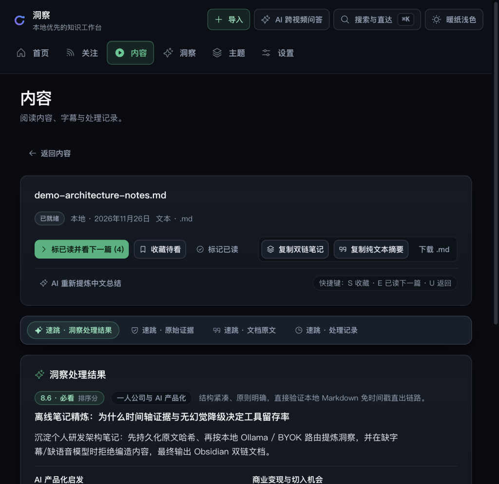 | 消除 `YouTube` 预览占位框与 `语言未知`，改用 `速跳 · 文档原文`，AI 核心结论直接处于首屏 |
| **390px 移动端 YouTube & `.md` 阅读器** | 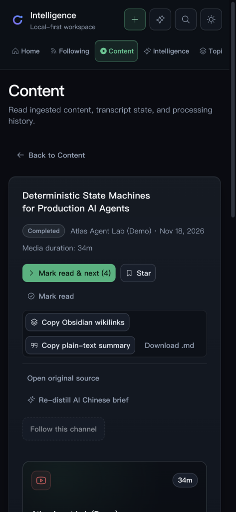 | 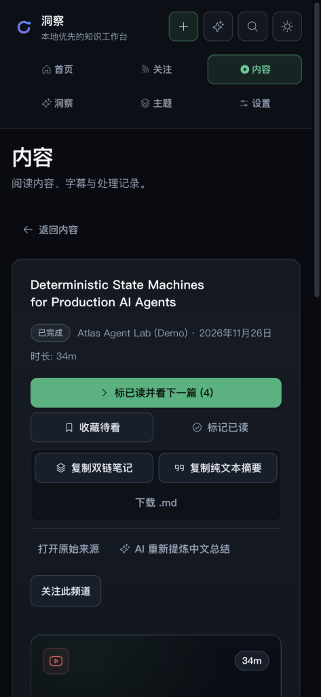 / 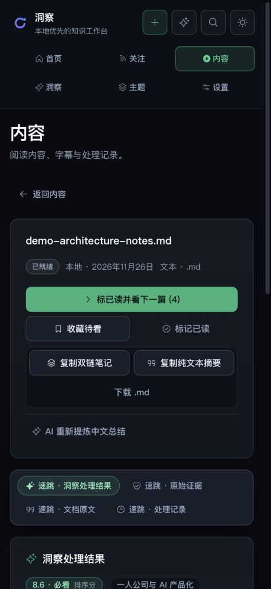 | 头部动作收拢为紧凑 2 列，零横向溢出（`379px <= 390px`）；`.md` 文档核心结论在移动端首屏直接可见 |
| **英文界面重提炼文案** | 旧版显示 `Re-distill AI Chinese brief` | 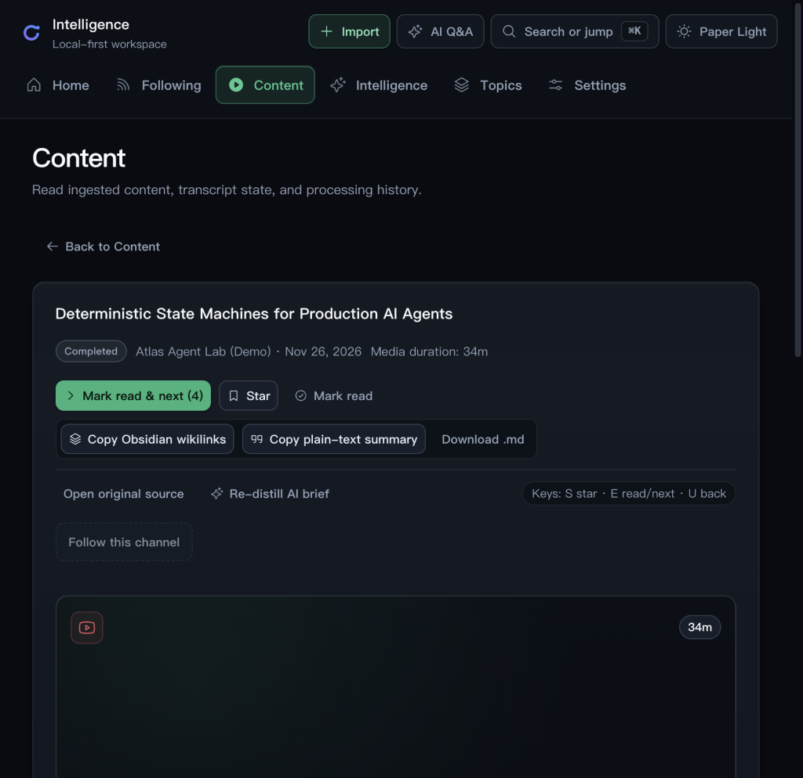 | 统一呈现 `Re-distill AI brief`，语境准确一致 |

### 4. 已完成自动化检查与实机验证证据
- **后端全套门禁**：
  - `.venv/bin/ruff check`、`mypy`（138 files 范围修改文件 0 问题）、`ci_test_manifest.py verify`（`total_collected=7400`）全通过。
  - `PYTHONPATH=. .venv/bin/pytest tests/integration/test_public_beta_demo_showcase.py tests/integration/test_bilibili_content.py tests/integration/test_bilibili_three_provider.py -q` → **27 passed in 73.12s**。
- **前端全套门禁**：
  - `npm run typecheck` → 通过；`npm run build` → `vite v5.4.19` 870ms 构建成功。
  - `npm test -- --run --poolOptions.forks.maxForks=4 --poolOptions.forks.minForks=2` → **61/61 test files, 1285/1285 tests passed**。
- **真实 Chromium 实机验证**：在 `127.0.0.1:8799` 硬重载拉取最新构建（`assets/index-CVrBFuXk.js` HTTP 200）验证全 5 个场景：**0 console errors、0 page errors、0 HTTP >=400**（验收后已恢复界面语言为 `zh-CN`）。

### 5. 剩余风险与下一轮计划
- **下一轮重点（Iteration 4 · `EVO-05`）**：升级 `#Topics` 专题详情从分号拼接升级为“跨来源观点对照 + 真综合梳理”并清理重复前缀/双时间线，同时为新用户提供空库首屏 3 步速览与可随时重开的「重新查看新手引导」入口。
- **需要项目所有者决定的事项**：无阻塞决策。
