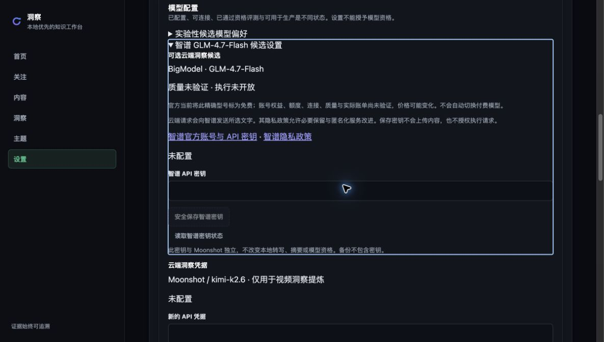
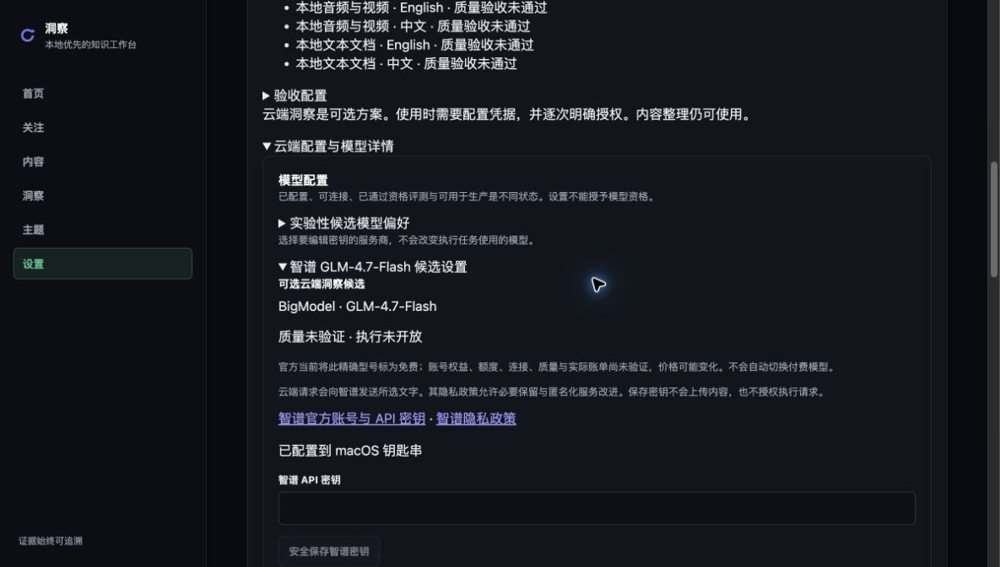

# 智谱候选设置：整合及真实隔离入口

仅配置工程已接受；模型仍NOT_VERIFIED/预算CLOSED，整个Goal及正式main未采用。作者e9f790a8+f9a8cdba，经独立最终5bdbf53b APPROVE，原d778 REJECT与两个P2/旧前端时序失败全部保留。Root整合34ca19f/be1ea11/53b79f2后src/frontend/tests逐字等f9，478个源码/测试/SQL/界面文件在检查前后相同。

Root检查：122源码编译、TypeScript通过；4完整后端文件115PASS64.34s；完整前端1075PASS/41files20.67s；Production build53modules/546ms。原旧DA时序文件未改，早期1065+1FAIL与一次整文件17PASS不是本次完整通过的替代。原作者115/1075、独审115/1075及静态检查为各自独立证据，不能相加为覆盖量。

Root新QA目录为 `.var/end-to-end-user-readiness/bigmodel-settings-real-api-20261027`，仅复制此前公开/合成隔离资料库，用SQLite backup建立新81表/19DATA；仅副本vault_root改指副本，不测试/重置正式owner。实际LocalApi6179与frontend6178启动，worker未启动、所有socket出站拒绝、已知API变量仅在本进程移除，旧provider显式NoCredentials，BigModel仅可信注入固定QA Keychain namespace。未把真实key写入文件、env或日志，未请求模型。

真实macOS Chrome/Cua打开 `http://127.0.0.1:6178/#Settings/models/bigmodel`：页面自动展开两级候选设置并聚焦；服务商/精确模型、隐私、免费条件未验证、资格未通过/执行关闭、未配置、空password、禁用保存均实际可见。新GET仅返回provider/model/configured/source/qualification/budget六字段：false/NONE/NOT_VERIFIED/CLOSED。全部81表每行及19DATA在打开后与初始副本完全相等，Backup仍ready。旧Moonshot区域也保留各自标签，未切换活动生产provider。

截图来自真实Native QA store尚为空时的实际API页面，SHA256 `9ad5695c9fee9c0885b8828b0eaa170f701d189a976bcceff338fdef20d02d15`，没有假造已配置或合格状态。Root整合检查汇总 `root-settings-integration-result.json` SHA256 `ff5f3f849ee016c48a6955b684912f8c64d4f06bfaab003d3708e7e687abf74b`；初始/打开后逐表逐文件快照、metadata JSON、服务启动日志在同QA目录。

此时已通过专用本机页面请求用户本人输入并点击保存，不在聊天收密钥；live tab1689883978已markHandoff。API PID44125/session28040、Vite PID44173/session5838特意保持供本次手动输入，均仅loopback；没有启动正式产品。等待本人完成通知再只核对configured标志和已清空状态，不读取/输出secret。页面手动输入期间不自动切换标签、刷新、截图或读AX密码字段，避免干扰或记录草稿。

后续仍需State只读快照修复/独审、固定GLM传输累计复审、免费账户实际条件、冻结公开输入/profile/语义标准及一次派发资格，随后普通Content→模型洞察→保存/主题/Evidence→重启→完整BackupRestore及最终全套回归/安全采用。当前保存入口绝不自动执行、付费或授资格。

## 2026-10-28续验：本人保存与单一服务商输入区

上文为10月27日初始记录。用户随后亲自在专用隔离页保存密钥；Root仅查六字段 metadata，确认 configured=true/source=KEYCHAIN/qualification=NOT_VERIFIED/budget=CLOSED，没有读出密钥。保存前后81表全部行和19个DATA逐项相等。State56与transport a7/007组合经5af独审接受并已整合；它们不授予模型质量资格。

后续真实页面暴露的多服务商草稿可见性问题由92059a1修复，91fa87f独审APPROVE，Root整合c119d18/9471e24。当前一次只挂载所选服务商密码区，切换、折叠、离开清理草稿；旧服务商存量密钥和执行配置不变。Root完整前端1084PASS/42文件20.20s，TypeScript/build通过，后端源码仍逐字等e495910。实际Chrome重载接受版本，确认只展开智谱、旧Moonshot折叠，已保存状态保留。浏览器曾显示masked未提交字段，未读取其值或推断来源；Root仅清空未保存字段、未提交或删除密钥，再截图记录真实已配置状态。应用不承诺控制浏览器自身自动填充。

截图SHA256 `122b79d3ed4aaa9697ce69d397e580069a5368aa92b0a25ed54a31c4dc2190b6`。QA的 `root-editor-isolation-result.json` 保留完整检查日志hash、AX差分误判说明及81表/19DATA一致性；没有把AX差分中缺失的旧文本当成产品故障。当前真实BigModel模型调用仍0；下一步仅固定单个公开视频诊断，具体出站内容与防重放包独审通过后才由Root执行，任何结果停止，不能据此宣布全部可用或采用main。
