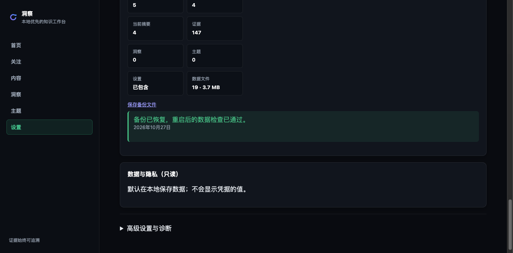

# 无密钥云端预览：真实 GUI 与恢复验收

结论：**本次界面片段通过并进入隔离候选；整个 Goal 尚未完成，也未采用到正式 main。** 新内容无法进入预览的 P1 已真实复现、修复、独审及复验。没有认证云调用、模型质量通过、费用或私人内容上传。

## 固定源码与环境

- 后端：已独审 bcb2df474a687395b3aa26732241502bc6c094af，Root 整合3fe6751，四个相关后端文件本轮未变，Schema41。
- 界面：7353e7ad3f07aa725c4913569ff54d24c4ebd233 + 修复06046cd1dc6b7ae2d82e35d82a12ff309b636667；独立最终审查018178e82bcd5276ed4dd4092a7b1a61c07b7462。Root整合c987a2e/3104a71/3757808，src/frontend/tests与作者最终字节相等。
- 真实 macOS 有窗口 Chrome，agent-browser；前端6178、实际 LocalApiApplication6179，非模拟 API。复制此前公开/合成隔离存量建立新数据库；未打开正式 owner 数据。
- 明确 NoCredentials，进程移除相关云密钥变量、禁止所有 socket 出站连接、不启动后台 worker。不授模型资格，不运行转写或模型生成。本轮不是正常后台 worker 或正式部署验收。
- 核心存量：79张SQL表、4份Content/4份当前摘要/147份Evidence、0洞察/0主题、19个物理DATA文件。历史失败与取消记录保留。

## 实际发现和修复

旧7353虽然187项行为检查通过，但实际新内容 IwglW_hIL_g 为 NOT_PROCESSED、manual_intelligence_eligible=true、字幕及摘要AVAILABLE，本地NOT_QUALIFIED/CONFIGURATION_REQUIRED使提炼按钮禁用。预览又只在WAITING_MODEL出现，普通用户无入口；没有通过API伪造等待来掩盖。实际DTO及SHA、初始独审、P1补充84b118a均保留。

060只增加“新鲜NOT_PROCESSED且后端明确manual eligible”的公开YouTube预览入口，保留原WAIT入口。两种语言真实状态回归先RED后GREEN；本地按钮、云端确认、LOCAL/BILIBILI拒绝与后端授权均未放开。独立最终189PASS及17个条件反例通过。

## 真实操作结果

| 操作 | 实际结果 |
|---|---|
| 从内容列表打开真实已整理公开视频 | 字幕、摘要及原Evidence可读；本地提炼仍禁用；无需创建等待即可看到预览入口 |
| 打开、准备无密钥预览 | 真实API返回实际provider/model、5份规范证据、任务上下文、输出8192上限、费用UNKNOWN；缺凭据和费用规则明确提示，确认按钮禁用 |
| 键盘及滚动后鼠标操作 | 可打开/准备/关闭，不调用模型；没有绕过disabled控制 |
| 进入设置、浏览器返回原内容 | 内容保留；旧预览/同意状态清除；重新准备才可再审核 |
| 320×900视口 | 正常展开和准备；文档宽305≤320，无横向溢出，确认仍禁用；已保存真实截图 |
| 关闭预览并检查全部数据 | 79表每一行及19个DATA的相对路径、长度、SHA均与预览前一致 |
| 界面创建、点击可见保存链接下载ZIP | 实际875164字节、21成员；SHA256 `efd829cd62b87be01ae7e22f3be69b2bb67f7c78023ed083f4ff2343b693126a` |
| 界面选择同ZIP、检查、输入RESTORE并确认 | 正常stage和确认；服务自动重建运行时，页面被动重连，显示“备份已恢复，重启后的数据检查已通过。” |
| 恢复后数据与状态 | 所有79表每行及19个DATA完全相等，integrity=ok、FK空；旧取消仍CANCELLED，新内容仍NOT_PROCESSED，没有任务或洞察复活 |
| readiness | 请求进行中曾短暂DATABASE_UNAVAILABLE，恢复中MAINTENANCE_ACTIVE；操作完成后ready=true、last_restore=APPLIED。没有绕过安全检查或无条件显示可备份 |

本次无其他真实未完成任务；不能从此样例推断有RUNNING/未知执行时也允许备份。零调用等待取消、其他任务继续阻塞及重启保护的既有真实证据继续保留，本轮没有人为创建等待来重复声称成功。

完整逐表逐文件快照、真实DTO、下载/恢复记录、九张原始截图、源码SHA清单及清理记录在 `.var/end-to-end-user-readiness/cloud-preview-real-api-20261026/`，最终 `actual-gui-result-060.json` SHA256为 `3ed0f1f7cce250ae9c8244d832a3812b470e6f64f7fa97ea45e8ad8e395968fb`。截图日期目录保留首次准备的26日命名，本次完成于27日。

早期自动化存在不匹配文字等待、未先滚动的点击/下载，以及状态SPAN定位错误；全部保留，不算产品通过。之后按真实DOM刷新定位、显式滚动、键盘及有界工具调用完成上述操作；没有修改DOM状态、数据或执行权限来制造成功。所有本次浏览器、6178/6179自有服务已停止，数据证据保留；Codex、Jimmm及正式产品未关闭或重配。

## 检查和后续门禁

Root整合后重新运行3个完整前端文件：**189PASS/10.65s**；TypeScript PASS；生产构建52模块/532ms；diff检查PASS。独审最终189PASS/10.45s及TS/build551ms；这些是定向检查，不替代最后完整回归。手册MD/HTML补真实预览/阻断/恢复图示，保留原17章和旧图。

新BigModel Schema42审计候选896/2bf尚被独审退回，未合入Root或正式数据；标量类型/时间已修，但直接claim入口仍在独立修复。免费GLM账号、适配、额度/费用策略、真实质量及保存/主题完整正向链未通过。本地洞察资格仍未开放；旧M12历史资格保留，但本轮缺凭据和费用策略，不可调用。仍需完成这些工作、最终全套回归及安全拓扑/正式数据保护，才能考虑main采用。

## 同日后续：已审 Schema42 的真实恢复

在此前 Schema41 界面验收之后，审计链896/2bf/df57已获独立最终ccd66 APPROVE，Root整合到 `523bff80d343949f57159b94e10ed1c4328144e5`。前文“42未接受”是当时历史状态；以下是后续实际结果，不改写原失败与退回记录。

正常启动迁移41→42已核对：仅增加两张空审计表及迁移注册，旧业务数据和19DATA不变。沿用同一隔离公开/合成资料库，在真实macOS有窗口浏览器、实际API和前端完成创建备份→保存链接下载→选择同ZIP→检查预览→输入RESTORE→确认恢复并重启→自动重连。未使用模拟API或绕过Backup判断。

- ZIP为877908字节、21成员，SHA256 `dcfe68c8b89b297261f515e7d3762caf287e3180df070a674925b440f9c9e773`。
- 全部81张表每行、全部19DATA路径/长度/hash，与创建前逐项完全相同；integrity=ok、FK空。两张新provider审计表仍为空，无本次模型调用或伪造使用量。
- 恢复结果APPLIED，ID `9bcebd3d8b86415782a4e447816e60b3`，完成时间 `2026-10-27T07:44:59Z`；ready=true、reasons=[]、restore_pending=false，界面“创建备份”重新可用，并明确显示重启数据检查通过。
- 旧aircAruvnKk的原WAITING_MODEL/count0 checkpoint及独立CANCELLED_BEFORE_MODEL_INVOCATION记录都保留，不能把原checkpoint状态误读为取消复活。旧QoXRfTb7ves的REJECTED_OUTPUT/count1也保留，没有清除真实执行历史。
- NoCredentials、所有socket出站拒绝、worker未启动仍保持；此项证明存储/界面恢复，不能冒充正常后台模型链或GLM质量/账号/费用验证。正式owner/main未触及。
- 仅关闭本次自有浏览器与核验过的6178/6179服务；Codex/Jimmm不动。服务正常打印两次ready，证明恢复后运行时自动重建。

原始逐表/逐文件快照、页面状态、API结果、ZIP和截图都保留在同一QA目录；汇总 `schema42-actual-gui-result.json` SHA256 `4f38474a68af5ba47fbab1751e3f05f786cf942d72ed98323452f4a73625316b`。两个误猜的只读状态URL曾返回404，随后读取源码的实际 `/api/v1/backup-restore/status` 验证；首次截图未包含下方成功消息，滚动到实际消息后补拍。错误定位不计作产品通过，也没有重复恢复或修改数据。

后续仍为固定GLM资格用适配、专属隔离设置、免费政策与真实公开样例；所有模型质量门槛不变，正式采用及最终完整回归尚未完成。

手册补充检查：新增第83张截图已由真实恢复界面拍摄并目检；HTML83图片引用/锚点检查无缺失。尝试复验完整手册渲染时，agent-browser0.27.0与当前Chrome156两次在open返回正确标题后，后续命令却读到about:blank/0图（一次file、一次本机HTTP），doctor7PASS仍未解释；已停止重复尝试并保留 `manual83-browser-tool-failure.json`、原空白截图，不能称83图动态渲染通过。此前82图完整真实渲染记录继续作为历史证据。仅本次自有手册会话及静态服务已收掉，没有操作其它浏览器或应用。

后续已使用不同浏览控制完成最小实证：Cua Chrome extension新建专用临时页实际打开同一HTTP手册，完整AX共30976字符、83张image，新增恢复图为AX863；点击定位后真实截图确认新图、说明与图注完整可读，FAQ下一章可见，没有横向挤出。证明保存在 `manual83-cua-render-proof.json`，工具对话保留真实画面。没有重试同一agent-browser失败方式或删除错误证据，也未声称重新逐张检查旧82图naturalWidth；旧82全图记录、当前83静态引用检查与新图真实渲染分别保留。仅自有临时页及6186服务已关闭，后续核心GUI可使用已实证的浏览控制。
