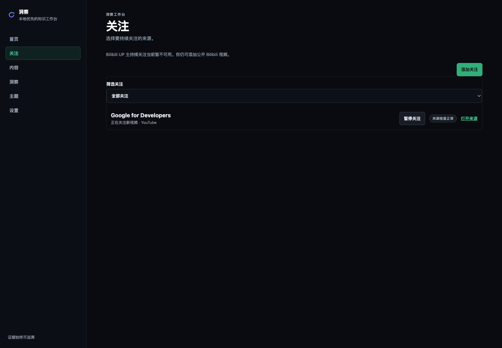
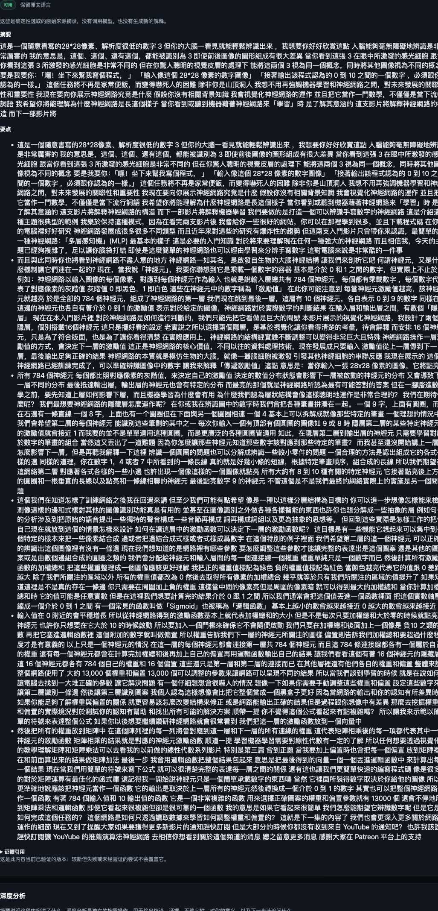
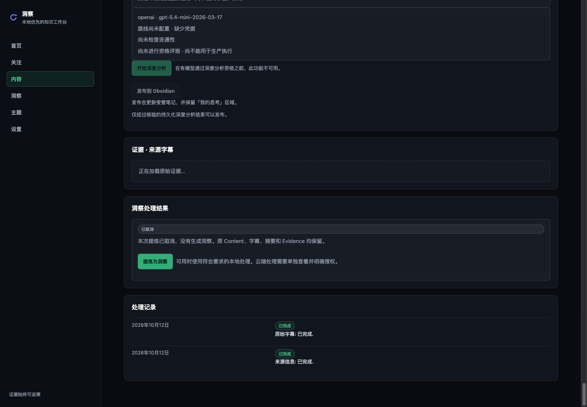

# 普通用户完整链路整改：进行中

本页是可恢复的工程进度，**不是“全部链路可用”的验收或发布报告**。

## 当前续作状态（2026-10-13，候选 c5da5e8）

- 页面读取恢复已独立审查并整合。真实 headful Chrome 中，仅停止自有隔离 API 5929，页面明确显示“本地服务暂时不可用”；重启同一服务后点击“重新加载页面数据”恢复原内容，完整请求记录全部为 GET，零提交重放。见 PAGE_READ_REAL_GUI_EVIDENCE.json 及 page-read-service-unavailable.png / page-read-recovered.png。
- 旧字幕429安全终止的原 P1 已返修，正规 ProviderCallRecord/DispatchRecord 解析和混合批次原子负控独立通过。独立 APPROVE b9bb62c/审查3d63b4 已整合，受影响86测试通过。普通隔离 idle worker 自动终止两条精确旧请求，保留原错误、计数、hash，无费用；真实设置页显示可备份。见 RETIRED_SUBTITLE_REAL_GUI_EVIDENCE.json；这不证明原 raw 丢失 P1 已解决。
- ExistingSourceForm 全局偏好读失败明确显示失败、只读手动重试、保留草稿，未知继承不可提交。独立 APPROVE 和完整379前端/TS/build通过，已整合08e02e2。普通真实 GUI 可达性仍须验证，不能冒充真实页面已验收。
- 原字幕 DATA4→3 的 FAIL 保持。用户已批准 first-plain capture，并明确批准 NATIVE_RAW_CAPTURE_ADDENDUM.md 精确补充至最多两份真实接受 capture。独立 writer 继续实现 precommit durable hash；原测试的零重复读取及未知 raw 拒绝不放宽，完整恢复验收仍OPEN。
- 用户已批准固定 qwen3.5:9b-q4_K_M 下载与隔离资格验收。官方原 manifest56671c2…和全部blob大小/hash通过；本地 wrapper仅附加同原manifest的reference，原字段/层不变，见 MODEL_REPLACEMENT_INSTALL_RECEIPT.json。尚未执行推理，不授生产资格；研究 harness 冻结与预输出审查继续。已安装8b仍不合格。长内容容量和滚动字幕重复仍OPEN。
- 正式 main/origin-main/served 仍 73ee7e747b4461b9de8a201d6b47669eb3913d1a，正式工作树干净；本轮没有修改 owner 数据或正式配置，也未发布候选。

基线/main/origin-main（本轮只读核验）：`73ee7e747b4461b9de8a201d6b47669eb3913d1a`。
当前已独立审查的界面提交：`7302f244e6326616c2b1ec72d0ad5f026d21cecb`。
正式产品仍为 `http://127.0.0.1:5488/`；本轮隔离产品为 5898/5899，独立 DB/DATA/config/Vault，无凭据。

## 本轮已验证的真实操作

| 操作 | 实际证据 | 边界 |
|---|---|---|
| 首次使用及跳过 | 本机 headful Chrome 的 3 步引导与设置入口 | 未宣称模型已合格 |
| 关注 Google for Developers | 正常产品表单，真实公开 Feed 建立 HEALTHY 基线 | 从现在关注，历史视频 0 导入 |
| 暂停/恢复关注 | 真实详情操作与持久化状态 | 没有删除或重置跟踪起点 |
| 自动公开检查 | 2026-10-12T10:08:19Z 自动检查成功，verified frontier 更新 | 当时没有新发布视频，未宣称新内容发现成功 |
| YouTube 单视频导入 | `aircAruvnKk` 真实来源信息与 231 条字幕，原文摘录和 Evidence 可读 | 这是已有字幕获取，不是声学转写或模型摘要 |
| 等待洞察与取消 | 正常 Content 提炼入口，WAITING_MODEL，invocation_count=0；用户取消 | 不产生洞察、云调用或费用，checkpoint/ledger 保留 |
| 真实 Backup/Restore | 界面创建、下载、预览、确认、重启，2 次恢复 | 71 表/3 DATA 文件完全一致，取消记录不复活 |

最早两个公开 Feed 404 保留于私有 `public-feed-probe.json`；后续真实 HTTP 200 只证明恢复，无法断言此前是哪一端临时失败。原传输、身份验证、无 Cookie 与冷却规则保持；未加入未经验证的 fallback。

## 本轮修复与检查

1. SOURCE_EXCERPTS 是不翻译的原文摘录，原中文内容显示的 `en-US` 是旧生成语言元数据，界面已改为“保留原文语言”；模型摘要仍显示自身语言。两种 UI 语言的复现测试先失败，再修复通过。没有改写历史摘要或来源证据。
2. Backup 的 DISTILLATION_ACTIVE 包含等待任务，改为“有一个提炼任务尚未结束”，避免声称 WAITING_MODEL 正在执行模型。readiness、取消权限和禁用条件不变。中英文复现测试先失败，再通过。

前端完整 Vitest：**338 / 22 文件通过**；TypeScript、production build、git diff --check 通过。
后端关注/后台调度/Backup 完整相关文件：**144 通过**，1 个既有 duplicate ZIP fixture warning。
最初后端命令缺 PYTHONPATH 导致收集 ImportError，保留原日志；补 `PYTHONPATH=src` 后通过，没有安装依赖或改工具链。
独立只读审查：APPROVE；独立 App.test.tsx **128 项通过**，恢复前后 JSON 独立比较相等，无新增 P0/P1/P2。审查者没有冒充重跑本机 GUI或完整后端。既有 React act 测试警告保留。

## 当前 OPEN

- READINESS-02：已获具体批准，在独立 `end-to-end-user-readiness-asr` 进行冻结声学整改与真实资格验收。既有 FAILED 不覆写。
- READINESS-03：已冻结 6 个样例及语义规则，哈希见 INTELLIGENCE_FROZEN_CORPUS.sha256。前 5 项是明确标注的受控合成来源输入，最后一项是真实公开字幕；输出必须是真实 qwen3:8b，正常证据绑定/ledger/资格 seam，不启用生产布尔值。
- 模型资格通过前，不宣称本地视频可转写或本地洞察可正常生成。正向保存、主题、来源回跳仍需真实 admitted Intelligence 验证。
- 支持范围内全入口、错误/重启/恢复矩阵与最终全量回归、统一图文手册、最终独立审查及具体正式采用批准尚未完成。

声学和洞察重量推理互斥；不改 Schema/依赖/凭据/正式配置/owner 数据。仅新增用户精确批准的固定官方9b权重，不付费上云、不自动合 main。历史记录以下保持当时状态。

## 实际截图与恢复校验

机器可比较恢复哈希见 `RESTORE_EVIDENCE.json`。包含取消记录的第二次恢复前后 SHA256 均为 `1f00a065ca4280f4c2473b1dfd9917474468266d2a7ed6b97680fe457273a458`。

## 断点续作记录（2026-10-12 晚）

- 当前候选新增 b398ae2（Metadata 成功不遮蔽字幕任务）、3745bc4（排除 tlang 翻译轨道并隔离 v2 缓存）、706ad4f（本地严格双分支标记）。独立审查代码 APPROVE；相关 292 + 19 + 16 项通过。
- 真实 v3 正向生成、持久化和一调用成功，但独立语义审查 FAIL：讲者“seems”被写成确定成果，来源误归属用户，重要信息在 filtered_noise 重复。原响应、结果和失败全部保留，不授生产资格。
- ff78028 修复独立视频到期重试被全局恢复为 PENDING 后无来源任务执行而永久“读取中”：共享只读 Content job 选择，普通 Retry 可重新提交 Source Run，未改 job/Backup安全状态。复现 2 项先失败；扩展相关 63 项通过，Ruff/strict mypy3/diff 通过；独立审查进行中。真实 Sasha Rush 视频重启后正常显示 Retry，点击后同一字幕任务真实 SUCCEEDED、原始字幕 AVAILABLE，摘要整理待最终核对。
- 0eeb288 v4 补 sealed 来源名与通用归属/不确定性/字段分类提示，预输出独立 APPROVE，原 v1/v2 语义门槛和输入 SHA 不变。12 项测试、Ruff/mypy/diff 通过。实际输出正在验收，协议成功不等于资格。
- ASR 独立候选 2fbc4ab：真实产品任务 17/17 通过（14 正向 +3 FAILED/零 decoder 调用/无 authority 负控）；新 Python 普通 factory 读取机器 PASSED；14 字幕/摘要/Evidence 重启和真实 Backup/Restore 精确一致，恢复端不继承模型/机器资格。独立审查和 full backend 尚未最终完成，未整合或正式激活。

正式 main/served 仍 73ee7e7，owner 数据/配置未写。所有支持流程、真实 UI 模型正向链路、最新完整回归/图文手册/最终正式采用仍 OPEN，不宣称用户现在可以验收完成版本。

## 最新断点：真实 ASR 界面与恢复通过，洞察仍 OPEN

- 已整合经独立审查 APPROVE 的 ASR 5 个提交，当前候选 `b861de3d96ad14f72ecad2a824f5f7dac07e42e2`。原完整后端 4033 PASS/1 既有资产先决条件 skip/2 warnings；后续 126 focused PASS、strict mypy102/Ruff/diff PASS。root 整合检查 52 PASS，当前 tuple 与 PASSED 机器记录精确相同。
- 在真正普通 factory 构建的隔离产品 5908/5909 上，新导入 `ordinary-ui-video.mp4` 后通过界面点击开始转写；真实 Whisper 产生 4 个带时间的原文字幕、摘要和 5 个 Evidence。没有用 fake capability 或付费云。新导入经普通 API，未改 Native Picker 的前次真实 GUI/APFS 证据复用；不能说本次新跑了 Native Picker。
- 界面创建/下载/预览/确认恢复/真实重启成功。71 表/78 DATA 文件全量内容与恢复前精确一致；SHA256 `e39def13783d38f86371a7c92ba2dc3597f729b9a4d169dcba3175f8144d45f2`，integrity OK。见 `ASR_GUI_RESTORE_EVIDENCE.json`。机器模型设置不进入可移植备份；独立作者已验证新恢复端不能继承模型资格。
- ff78028 独立审查 APPROVE，真实公开字幕重试结束但 json3 无可信时间轴，尚缺摘要/Evidence，不能视为完成。用户已明确批准 `CAPTION_REPAIR_PROPOSAL.md`；独立实现正在验证原子补全、失败回滚/恢复/重试，未整合未正式写入。
- v4 英文/中文及 v5 英文洞察输出均语义 FAIL（过度确定/错误归属；v4 中文还输出英文），原始响应保留。原 frozen 输入、语义门槛没有改。不能因协议 SUCCEEDED 判资格。
- 已冻结 `INTELLIGENCE_NATIVE_THINKING_V6_EXPERIMENT.json`，预输出独立 review APPROVE；仅研究 transport 改已安装模型支持的 think=true，其余参数不变。这是研究 profile，不授生产权力；若成功须有正式版本绑定与全套真实资格再验收。英文真实样例执行中。
- 正式 main/served 仍 `73ee7e747b4461b9de8a201d6b47669eb3913d1a`，工作树 clean；正式配置、凭据、owner 数据未改。本轮最终全量回归、模型洞察正向全链路、统一手册与发布均未完成。

## 2026-10-13 续作：字幕复审与实际模型门禁

- 普通界面重试 IwglW_hIL_g 得到真实字幕，任务 SUCCEEDED；原 JSON3 没有可信时间轴，仍缺 Summary/Evidence，未把“有文字”当整理完成。截图 `screenshots/iwgl-native-caption-without-timing.png`。原生 VTT 安全补全候选 HEAD217dcc4 正在独立复审，尚未整合。
- v6-v10 实际模型均未通过冻结语义标准。v7超出输出预算、v9严格引用拒绝、v10协议一调用成功但独立语义 REJECT：错误 PREDICTION 分类、将来源主观探索比较扩写成一般人机能力结论。全部原始响应保留，没有重试择优、修补输出或翻转生产资格。
- READINESS-03 来源上下文最小修复在独立 tree `readiness-source-context` 进行：缺 subscription display_name 时使用真实持久化 video.channel_name，仍须输入 hash绑定及独立审查，不代表模型合格。
- 找到另一个 Backup 阻塞：已退休政策的旧字幕429 FAILED_RETRYABLE记录不再有现行producer重试，仍非终态。具体提案 `RETIRED_SUBTITLE_FAILURE_PROPOSAL.md` 待批准；尚未实现，Backup原保护检查未绕过。
- 真正公开关注网络失败后普通 Retry 已恢复 HEALTHY，未发现新发布内容，未声称正向新内容发现通过。截图 `screenshots/following-recovered-retry.png`。
- 正式main/served仍73ee7e7；本轮完整回归、真实字幕GUI修复/恢复、洞察资格和保存/主题链路仍OPEN，不能交用户作为已全部可用版本。

## 2026-10-13 新实测返修与完整回归

- 真实 Sasha 与 Iwgl 正常Content Retry均 ORGANIZED，严格原生时间/摘要摘录/Evidence可读，旧SUCCEEDEDJob与错误history保留。Sasha有2406 nativecues、114canonical coverage Evidence；vtt原始滚动重复完整保留，界面与摘录重复可读性仍待审视。
- fresh normal import→真实GUI创建/下载/选择zip/预览/RESTORE/重启反馈成功，但独立全文件比对FAIL：71表一致，DATA4→3，firstJSON3未登记Artifact因正常manifest规则不进备份。NATIVE_CAPTIONS_GUI_RESTORE_EVIDENCE.json及截图保留FAIL，独立审查确认producerP1；不改Backup、不弱化断言，返修保留raw索引。
- 全后端 fbe0e2b：4092 passed /1既有o200k资产先决条件skip /2既有warnings，915.67秒；Ruff全src/tests/scripts PASS，strict mypy全102files PASS。字幕整合相关276PASS，root frontend346PASS；page-recovery独立候选359PASS，未整合未实测新recover按钮。
- v11 fixed native thinking sampler实际EN完整SUCCEEDED/1调用，但独立语义REJECT(P1>=3)，仍虚构20–100+同时搜索、一般human3ideas、人类水平能力并混IMO与猜想。真实来源名称已correct，不能代替其他语义条件。停止8b该方法重复调参，生产false。MODEL_REPLACEMENT_PROPOSAL.md是待具体批准的一份固定候选权重隔离下载/验收计划，不会自行下载或升级。
- 用户已明确批准 RETIRED_SUBTITLE_FAILURE_PROPOSAL 精确隔离终止/并发/恢复范围，独立READINESS-RETIRED-SUBTITLES开始，尚未整合；root旧429 Backup阻塞仍保留。
- 长内容正常提炼真实422/普通界面只泛称检查模型。现行Evidence>20先failclosed，Sasha114条不会偷偷送入8192ctx；≤20单长cue/总inputtoken无完整性门禁仍是将来采用前OPEN。需要正规长内容链路和真实readiness解释，不静默截断。
- main/origin-main/served73ee7e7仍未动；本轮所有支持流程、模型正向保存/主题/来源、本轮图文手册及最终采用仍未完成。

## 2026-10-13 额度中断后续作记录

- 正式树/main/origin-main经实际ls-remote再次核对均73ee7e7，工作树干净；候选未发布。
- root c5da5e8完整后端4152 PASS /1既有资产先决条件skip /2 warnings /969.28秒，全Ruff与strict mypy102 PASS；证据BACKEND_FULL_C5_CHECKPOINT.json已持久化。后续raw/UI切片仍须整合后检查，不能把本基线视作最终回归。
- 已接受Qwen35预输出独立APPROVE（40合同测试/静态PASS），仅research脚本和冻结资料整合05844e1/56695f8；root合同40 PASS。首例real-deepthink-en在原冻结worktree执行prepare-only成功，0网络/0模型调用；sealed input和runtime provenance待独立复核，production仍false。
- RAW writer b957eb5及ASR状态文案d198a0a均已提交停写，独立审查中，尚未整合。保留原raw DATA4→3 FAIL；不能提前称Backup/Restore已解决。
- RAW相关严格回滚路径另复现旧current-policy FAILED_RETRYABLE及未索引derived canonical持续阻塞备份，超本次已批raw捕获范围，风险OPEN，正在只读确定精确恢复方案；不擅自删文件或绕Backup。
- Local内容提炼缺口、长内容容量、rolling字幕重复、真实新内容发现及最终图文手册/全回归/发布仍OPEN；用户暂不能收到“全部链路已通”的验收版本。

## 2026-10-13 独立审查与首例真实9b结果

- RAW delta独立APPROVE b957eb5/caab711（408相关测试/static/identityPASS）已整合d377c42/7ff4ae6，root188 PASS。ASRcopy独立APPROVE d198a0a/04f5040（独立386full42focused/TSbuild）已整合da01968/9b6575e，root386full/TSbuild/Ruff/mypy102 PASS。root当前完整backend进行中，未提前报告最终PASS。
- qwen35首例prepared及runtime固定签名实现支持均独立批准（e1a4a6f，静态不是语义资格），一次实际执行SUCCEEDED/1invoke/1generation/914input476output tokens/约33秒，随后独立语义FAIL dd367be9（4个P1：事实升级、数量/一般人类泛化、IMO归属错置、缺核验/广泛评估判断）。QWEN35_REAL_QUALIFICATION_FAILURE.json保留精确finalcontent与opaque原响应hash。后3例未准备/未调用、不reroll、不改输出/门槛；生产资格仍false。
- 用户已具体批准LOCAL_INTELLIGENCE_CHAIN_PROPOSAL，第一LOCAL_TIMED最小准入/授权负控在独立tree实施，仅代码与fixturechecks，真实8例资格依赖9b四例全PASS故BLOCKED，未授权绕过此依赖。
- fresh普通产品导入Sasha真实字幕完成，firstJSON3+VTT均正规capture索引、4物理DATA（5Artifact引用）。真正GUI已创建下载zip，全部4DATA进包，当前正在普通确认/重启恢复，不替代旧FAIL；最终全表/allDATA比较未完成前不报PASS。
- 正式main/origin-main/served73ee7e7与owner数据/配置未改；本轮模型失败已构成真实Intelligence用户正向链路阻塞。

## 2026-10-13 当前续作检查点

- fresh RAW 真实GUI恢复已完成：71表、全部4物理DATA（5Artifact引用）恢复前后精确一致，JSON3确实进包，见NATIVE_RAW_CAPTURE_GUI_RESTORE_EVIDENCE.json。旧失败/未知派生文件特殊恢复路径仍OPEN；不能以fresh成功覆盖旧FAIL。
- root RAW/UI业务基线完整后端4220 PASS /1既有资产先决条件skip /2既有warnings /1020.20秒；全部Ruff/strictmypy102 PASS。CSS独立APPROVE并整合d367bea/59ab68b，root完整前端386/23 PASS、TS/build PASS，见BACKEND_RAW_UI_CHECKPOINT.json。这仍非最终所有整改完成后的回归。
- 真实四种窗口320/768/1024/1440 document几何PASS，320可用305px时不再扩成320，Retry真实Tab可达。继续六导航Tab发现Intelligence按钮部分被遮、nav未滚动；2秒等待仍失败，保留NARROW_WINDOW_GUI_EVIDENCE.json为PARTIAL_PASS_KEYBOARD_VISIBILITY_BLOCKED。新TASK-READINESS-NARROW-KEYBOARD独立实施，不掩盖该新失败。
- LOCAL_TIMED f399034d已提交停写，39新专项、相关269/Backup82/最终78 PASS，独立审查中未整合。真实LOCAL8例仍受9b原资格FAIL阻塞；不授旧YTreceipt权力、不调用模型。
- FAILED_SUBTITLE_ARCHIVE_MIGRATION_PROPOSAL.md 经独立只读细化后已提交具体Schema37→38隔离批准问题；尚未批准、没有DDL/实施/正式迁移。历史错误/无权威派生DATA保留和34–37旧包兼容均在精确范围，不绕过Backup。
- 统一中文手册Markdown/HTML已更新，真实Chrome渲染47张图零损坏且已视觉检查。正式main/origin-main/served73ee7e7仍保持；没有把未合格洞察或未结束链路交用户做完成验收。

## 2026-10-13 夜间续作验收

- LOCAL_TIMED独立APPROVE/root78 PASS已整合3c4ee35/c90406e；普通factory在真实已转写ordinary-ui-video上手动提炼进入WAITING_MODEL/invocation0，Backup真实阻塞，普通UI取消后immutable cancellation保留且ready。5Artifact/5Evidence/当前Summary与全部78物理DATA逐字段/hash未变，见LOCAL_TIMED_WAIT_CANCEL_GUI_EVIDENCE.json。该负控通过不替代模型正向资格。
- Keyboard独立APPROVE整合ccff02a/3131e67；四宽六导航正反Tab每项完整可见、仅focus不导航，真实Enter→Topics与mouse→Content正常；完整389/24/TS/build PASS。旧partial FAIL未改，独立新NARROW_KEYBOARD_GUI_EVIDENCE.json PASS。首次probe恰遇HMR重载失焦，只记INVALID并在稳定页面完整重验。
- SOURCE_DETAIL_LOADING独立APPROVE e59a773/7767a0d整合ca4b930/ca582fa；root406/25 full/TS/build PASS。普通真实Google Following详情innerGET有界延迟时中性loading、真实browser abort后明确GET-only retry恰1GET/0命令重放，恢复正确YouTube，pageerror0。SOURCE_DETAIL_GUI_EVIDENCE.json PASS。初次按第二GET注入的探针两次未触达状态，停该方式；诊断StrictMode实际inner为3/4后改明确有界目标，未改数据/payload/capability。一次不透明route promise reset与一个额外面板截图locator timeout是工具错误，未作为产品PASS或重跑生成。
- Schema37→38精确迁移用户已批准，记录FAILED_SUBTITLE_ARCHIVE_APPROVAL.md；readiness-subtitle-archive-38实施未提交/未验收/未整合，必须独立review与全部旧新包/并发/GUI全表全DATA恢复。原错误/unknown仍保持block。
- 用户已具体批准QWEN35_THINKING_FOLLOWUP_PROPOSAL及对应APPROVAL；只同固定9b新official-thinking-v2模式，scope研究脚本/合同/freeze，独立tree作者仅prepare-only，不真实调用。原nonthinkingFAIL4P1及其余3例停止保留；新模式冻结及独立输入审查后root才可许可一次首例，LOCAL8例依赖仍未满足。没有新增下载/Cloud/资格翻转。
- LOCAL_TEXT必须在归档核心state接受整合后串行；长内容/rolling政策、真实Intelligence保存/主题仍OPEN。正式main/origin-main/served73ee7e7、owner/config/credentials仍受保护，本任务不结束为全部可用，也未开启新开发阶段。

## 2026-10-14 最新模型与迁移检查点

- 官方thinking V2研究代码4bef56e、独立预输出b345777已整合；root追加73合同PASS/16.22s。安装全部7blob/三runtimebinary/原wrapper/tags身份重校PASS，空api/ps及无本任务其它重量执行、fresh资源>10GiB后，外部精确一次permit93f908d…启用首例。真实194.602s/1generation1invocation，912input/4096output，native done_reason=length/public final为空，正规结果REJECTED_OUTPUT。QWEN35_THINKING_V2_FAILURE.json保留原opaque response hash，不读thinking、不补输出、不扩大预算；其余3例未prepare/调用，LOCAL8例仍BLOCKED，正式资格false。旧nonthinking4P1FAIL不变。
- 字幕Schema38作者29f1e50已STOP/clean：52专项、65 schema/doctor、15Bili、8domain及static通过。完整原结果4310PASS/1迁移名称切片断言FAIL/1既有skip/2warnings；[-22:]→[-23:]精准修正后全文件48PASS，原失败保留，不能称全量已通过。独立审查、root真实GUI恢复及最新整合完整回归待完成。
- 设置安装身份/本地洞察未合格/可选云端分离文案候选fc2d854+b6a6250提交，12专项/完整418/TS/build通过，尚待独立review和root真实GUI。旧误导截图保留，正式未改。
- 六页面真实读取与内容字幕/摘要/Evidence可读无pageerror，UI数据加载结束后显示真实转写完成和DeepAnalysis未合格；仅page reads，不能宣称保存/主题/全部动作通过。当前手册49图片真实headfulChrome零缺图/无横向溢出，MANUAL_RENDER_CHECKPOINT.json。正式main/remote仍73ee7e7。

- Settings truthful-copy已独立APPROVE/整合8b8afc3，root完整418PASS/26files/12.04s、TS/buildPASS。真实普通隔离runtime中英文identity/unqualified/Cloudoptional提示全部PASS，无pageerror，界面恢复中文且生成语言未改；MODEL_STATE_COPY_GUI_EVIDENCE.json与两语截图。手册补首次设置指导与真实截图。
- Schema38独立反证发现successor finished_at/attempt终结校验P1，29f1e50未接受未整合；待REJECT交接后原作者返修。原4152/4220检查点不能覆盖该候选，正式仍不变。
