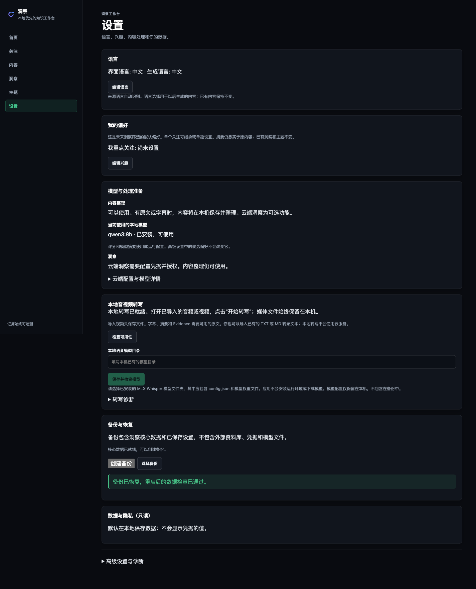

> 2026-10-25最终工程复验：完整后端6003、最终完整前端1026、TS/build/Ruff/strict121/compile/diff PASS；真实双WAIT取消/正常重启/GUI恢复79表25DATA精确一致；配置3catalog实际恢复、原生小文件导入与无残留错误PASS，ASR完整tuple/seal及原17回执SHA再次有效，D2六绑定不变复用2GiB APFS；手册79图17章渲染PASS。最终root真实served D665EVVu等独审构建；所有6类Intelligence仍NOT_QUALIFIED，正向Save/Topic未证明，正式main73ee7e7未动/5488-5489离线，当前THREE_AGENT_ADOPTION_BLOCKED。

> 2026-10-25 00:41续作：root固定6ed完整后端 **6003PASS/0FAIL/2既有warnings/2512.09s**，完整前端1017/39、TS/build/Ruff/strict121/compile/diff全PASS，547源全程不变（FULL_REGRESSION_6003_2026_10_25.json）。真实headful GUI又发现model setup仍拒后端3catalog，窄UI有限3修复作者ffa95fa、独审5233d46 APPROVE；完整作者前端1026/39、独立19/TS/build通过，已用独审真实构建D665EVVu+不变root backend实测3候选/匹配0409应用/重启。root等待原冻结全仓结束后才整合，未覆盖测试源。真实macOS Native失败过长→有效TXT、切页清提示；两项真WAIT0、取消一项另一项仍closed、两项取消ready、正常UI代理重复200且全表不变、独立正常PID重启、真实GUI ZIP预览/RESTORE/重新连接全部79SQL+25DATA+机器选择精确相等，见FINAL_GUI_CANCEL_BACKUP_RESTORE_2026_10_25.json。当前ASR完整tuple/seal/17原raw SHA再次PASS，0新解码；中文手册补3张已目检的原始viewport图。Q3原300秒timeout仍FAIL_STOP；没有合格Intelligence正向/Save/Topic，main/owner未动，不能采用或说全部可用。下一步仅整合已审UI、最终前端/build复验及对应served资产核对，模型真阻塞保留。

# 当前验收摘要（2026-10-23，候选未发布）

以下当前摘要优先；下方保留历史失败、修复和当时门禁。整体 Goal 尚未完成，不能交付为“所有链路已通”。

| 链路 | 最新已验证结果 | 仍需完成 |
|---|---|---|
| WAITING_MODEL 安全取消 | 已审acc0f989/R7、root b08e1bf整合；真实长114Evidence/2406cue与短任务分别取消，另一任务仍阻塞，重启不复活 | 新执行闭包完成后最终回归 |
| Backup/Restore | 同候选真实macOS原生选择与一次RESTORE确认，79表全部行、19及24物理DATA逐项一致；重连真实反馈已验证 | 真实洞察结果加入后的最终全量一致性 |
| 转写设置与本地导入 | Whisper原17声学例有效；真实Native视频转写4cue/摘要/5Evidence；时长超限现场反馈可关闭、不跨路由残留 | 22:36完整当前tuple/原seal/audit复核PASS（14+3），最终若12绑定改变须原标准重验 |
| 新用户入口与设置引导 | 空Content新增现有添加入口独立APPROVE6954973，真实系统picker→TXT→4行号Evidence、深链reload、Following无残留；English320px亦通过；root10/TS/diff整合检查通过 | root完整前端1008/39文件及TS再次PASS；本项窄工程DONE |
| 图文手册 | 统一中文MD/HTML76真实图片、17章、实际headfulChrome零坏图/锚点；新截图及hash见EMPTY_CONTENT_ENTRY_MANUAL_*_2026_10_23.json | 合格洞察正向真实截图 |
| 长内容执行 | 独立WT已分片完成原子三结果/真实用量/双向恢复闭包及有限当前profile/纯native count/host/资格；当前唯一writer补session与公用service接线 | 固定最终源、完整影响组、独立review、root整合与真实容量/质量验收 |
| 模型资格、保存/主题 | records=[]，未因安装或合成工程结果开放资格；旧失败仍保留 | 原标准资格/未见样例/LOCAL8、真实正向保存→主题→Evidence→重启恢复 |
| 正式采用 | 正式WT只读仍73ee7e7 clean，owner未触；D2实现不变既有2GiB/APFS证据可复用 | 最终完整backend/frontend/static/build、实际远端拓扑、条件ff-only/push/launcher/served revision/startup |

最新资源只读22:28约6.71GiB可用RAM，仍低于8.101GiB最低门槛；没有加载9b。工程先继续，不能沿用旧快照加载或降低门槛。证据见ROOT_CONTINUATION_CHECKPOINT_2026_10_23_2230.json、ASR_COMPLETE_TUPLE_RECHECK_2026_10_23_2236.json、EMPTY_CONTENT_ENTRY_ROOT_INTEGRATION_2026_10_23.json、WAIT_LIFECYCLE_ROOT_INTEGRATION_2026_10_23.json与各真实GUI报告。

---

> 2026-10-21当前：long WAIT/CANCEL/恢复工程 b3546ff 获R3独立APPROVE2f3a8e8（120关键+53旧风险、静态PASS）；root真实headful/正常worker GUI发现旧8b配置→提炼422→Settings只读死路，未接受/整合。79表19DATA保持不变、零模型调用。原作者正在串行补最小固定9b设置/真实应用/admission及操作前置；详见LOCAL_INTELLIGENCE_SETTINGS_COMPLETION_PLAN.md。新完整v3副本已准备，40/77表/19DATA全部相同，未启动。真实资格/正向、最终完整回归、图文手册、采用仍待，不把此前历史绿或工程APPROVE当Goal完成。

> 2026-10-21 00:52历史：R14已独立APPROVE7bb947e并整合root d861349/871ccf9/8a6d0f8；独立396PASS、root100PASS和静态通过。v2生成关闭、records=[]。之后已在隔离候选增加41且完成上述R3工程审查；此旧快照不代表当前还未实施。main/owner未动。

> 2026-10-21 00:32续作：已确认root4f1824f与R14独立WT b3410a4均clean，旧派发尚未产品写入；现由 /root/local_fixed_runtime 在原独立WT实施同一精确任务，唯一产品writer。root已6b7e67b更新归属；另 /root/long_protocol_preflight 仅只读准备后续持久化切片，不能并行写核心。最新只读RAM4.985GiB/disk204.723GiB，继续0load/0generation；Jev仍HTTP451，采用原强推理+独立审查。R13已接受整合且无需重跑，正式main73ee7e7 clean/owner未触及。

> 2026-10-20 19:50最新：R13已独立APPROVE e807c6b并整合root91b7f8c/418d7d5/b94f13f；root44PASS/38.77s、compile/Ruff/strict117/diff、三份已审SHA全等。详见LOCAL_REJECTION_ACCOUNTING_ROOT_INTEGRATION_2026_10_20.json。该窄任务DONE仅指候选工程，不是模型资格或Goal完成。下一串行R14固定新profile；最新只读RAM6.521GiB/disk193.375GiB，仍0load/0generation，资格records=[]，无main/owner变更。

# 2026-10-20 19:43 OpenCode接管增量（候选未发布）

旧LOCAL8不满足资格链：案例1仅NO_NEW，不能算六个正向之一；原资格/holdout前置未证明，升级包term-sheet一项hash漂移。旧6144两次截断和失败收尾崩溃属实，全部原件保留、不续旧permit。详见 `OPENCODE_LOCAL_HANDOVER_AUDIT_2026_10_20.md` 和独立handoff。

R13固定候选62ed430（core ac2ea9d）已提交并cleanSTOP，独立代码审查进行，尚未整合。已知拒绝保留真实model/可靠成对用量；无身份走既有AMBIGUOUS/1，不允许取消或重发；修复诊断串案与signed64溢出。作者原固定15文件506PASS/423.33s；最小整数上界增量后37新增+7旧例共44PASS/40.45s，strict117/Ruff/compile/diff通过。两组源SHA有区别，不能声称最终源码已完整506。0真实模型/云端/外网/正式数据访问，无Schema/预算/资格变更。

下一串行任务为新不可变fixed-runtime-v2 profile（显式batch512/8192输出/原300秒与字节上限），必须先接受R13；新profile无资格，旧v1与历史不改。当前RAM6.213GiB低于真实模型资源门，继续0load/0generation。ASR已有14+3回执经只读当前tuple/策略/seal及17raw hash复验有效（`ASR_EXISTING_RECEIPT_RECHECK_2026_10_20.json`），不代替普通GUI。长输入持久化/执行/双向闭包尚未实现，真正合格洞察保存/主题/证据回跳、最终回归/恢复和采用仍待，不能说普通用户所有链路已通。

下方为保留的此前证据与历史，冲突以本段和最新核验文档为准。

# 2026-10-20 混合候选独立P1修复与整合增量
mixed字幕结清候选d9226ff被独立审查REJECT（P1：字幕成功刷新经inputRefresh清除未知云投递保护，App.tsx 2186 effect）。隔离修复分支作者ec6dabb以最小两行拆分effect：只有videoId变化清除dispatchBlocked，inputRefresh仅清除过期preflight/费用确认并GET重读；原reviewer反例逐字保RED→GREEN。新增4例覆盖残留preflight失效、相同成功token不循环、导航隔离；968前端/37文件全绿、TS/build/diff通过；后端源码与既有审内容字节全等。目标性delta复审b8bceaf APPROVE（root整合暴露1处顺序敏感同步断言→waitFor等价硬化，无产品变化）。root无冲突merge 96c9ffa整合全套候选、9927324/19d8107/d9226ff/ec6dabb/b8bceaf进入root；root整合检查968/TS/build/diff、compileall/strict mypy116/Ruff/194后端closure全PASS（.var/mixed-integration日志）。real macO**S GUI 备份恢复与无刷新 Evidence 复验、长协议 request 冻结校验：全部已 CLOSED（见下）。**

# 2026-10-20 最终候选真实 GUI 恢复与长协议冻结复现（证据 MIXED_FINAL_GUI_RESTORE_LONG_FREEZE_2026_10_20.json）
在 root f6e0034 最终候选上完成真实 GUI 全链：隔离 stock mixed-gui-final-20261020（clone 74表/19DATA 全等→迁移 77 表）→真实 wk worker 首启维护结清写三笔 FAILED_RETRYABLE→FAILED_FINAL（2×v1/429 RATE_LIMITED + 1×v2/LOCAL_RESOURCE）+ retained_subtitle_derivations 留存证明 COMPLETION_PERSISTENCE_FAILED_WITH_VERIFIED_SUCCESSOR（时间戳 13:00:37，先于任何 GUI 点击）→真实 Chrome 155（QA profile，正式 942/943 未触碰）GUI 创建备份 1829e1eb…（严格预览渲染）→HTTP attachment 真实下载（SHA e4762249… 与源字节全等）→真实原生 Open 面板用户选择（首次误选旧文件 82dec160… 已 cancel 未confirm、未触数据，重选 BU-KA 副本 SHA 全等）→严格 stage abe0cb34…→GUI 输入 RESTORE→确认恢复并重启→harness 重启→last_restore APPLIED 05:50:54Z 正常就绪→全量校验 77 表 75/77 行列一致、2 差异表均为 13:00:37 结清落账（restore 未新增变化）、19 DATA path/size/SHA 全等、integrity ok、无 FK 违规；重启后 hash 路由 Settings→Content→detail 无刷新渲染 Evidence（147 行终值相等、控制台零错误）。长协议在最终候选复现：request/schema/freeze/semantic/profile/messages/snapshot 全 hash 与既有 receipt 相等、114 Evidence/2406 cues、源文件不变，0 模型/tokenizer/http。模型资格仍由用户资源门关闭（RAM 实测 closed）。

# 2026-10-20 当前增量外证
tracked钟修复独立c314bdb APPROVE并整合；固定完整后端5334PASS/1既有SKIP/2warnings，root407src/tests全等、60专项/strict115/Ruff/diff通过。原失败stock真实GUI新command成功29cue/4Evidence/确定性摘要，实际重启77表/37DATA全等，原19DATA及原终态/模型权威全保留。Backup仍按旧unindexed文件安全阻塞；mixed修复进行。成功时Evidence需reload的真实UI缺口已分配，不能计作无刷新通过。模型/ASR最终资格与长执行/完整最终恢复和采用仍待。证据TRACKED_FIXED_REAL_GUI_2026_10_20.json。

# 当前验收状态（2026-10-19，候选未发布）
完成条件不变：普通入口真实可操作、无未处置P0/P1、模型严格资格、完整回归/恢复与安全main拓扑同时满足。用户持续授权覆盖必要实现及全部门禁后的采用，不重复逐方法审批。

| 当前关键项 | 最新外部证据 | 当前剩余 |
|---|---|---|
| 兴趣逐条保真/CAS/轮询 | 独立dd260de/d012c48，整合2134a30；root896/TSbuild；真实编辑/双页冲突/GET新command/刷新/进程重启，74表87DATA一致 | 最终完整回归 |
| 9b端口与容量工程 | 独立aee4e07/bed638f/868d2da通过，整合88161aa；root232/strict106/Ruff通过；固定双manifest/v2引用/六payload/三binary身份修复 | 磁盘197.955GiB已通过；10月19日09:08真实RAM4.639<8.101GiB仍closed，0load/0生成；实际合法prepare/slot/统一freeze/原案例+holdouts语义与LOCAL8正向未完成 |
| 精确能力及物理计数 | 独立d775b0c，整合6fa6a07；root79backend/929front/TSbuild；真实Settings六scope/lang全false、LOCAL_TEXT真实route/设置回跳；新备份100artifact引用显示96physical，全部96归档hash相同 | 模型资格仍false；后续新核心完整回归 |
| TXT/MD与等待取消恢复 | 真实Native Picker/WAIT0分别取消/剩余任务仍阻塞；实际重启及GUI恢复74表84DATA一致 | 真实合格模型正向尚无；Schema39未在正式main迁移；最终核心SHA变化后ASR也须按原17例新tuple重验，旧receipt不可沿用 |
| 新字幕及失败重试 | 原生29cue/摘要/4Evidence真实恢复74表87DATA；VIDEO_URL重试/恢复74表3DATA保留旧job/provider；最终候选 77表19DATA 全量恢复全等＋无刷新Evidence复验通过（MIXED_FINAL_GUI_RESTORE_LONG_FREEZE_2026_10_20.json） | Schema40累计166ab392独立76ad28f APPROVE并整合89cca38；root478后端/956前端/strict113/TSbuild/Ruff/diff全通过。真旧72表18DATA普通factory迁移40，GUI排队→取消→重启不复活/旧job与provider/attempt不变、新command准入通过；LOCAL_FINALIZATION_FAILED 混合结清已在最终候选真实消除（三笔终态+留存证明）；真成功合格模型正向仍待资源门 |
| 真实旧失败派生归档 | 全量旧37库正常迁移39；真实公开字幕受控completion fault→新明确命令成功；旧Iwgl真实GUI Retry成功，74表19DATA/原8DATA与Evidence完整，0新模型；最终候选真实结清生效：13:00:37 三笔 FAILED_RETRYABLE→FAILED_FINAL（2×v1/429 RATE_LIMITED+1×v2/LOCAL_RESOURCE）+留存证明 COMPLETION_PERSISTENCE_FAILED_WITH_VERIFIED_SUCCESSOR（MIXED_FINAL_GUI_RESTORE_LONG_FREEZE_2026_10_20.json），混合维护互阻消除，恢复 proof exact 版本2026.07.04与历史parent政策pair已独立定位；仅内存两处补正完整23字段114Evidence证明PASS、21文件SHA不变 | 既有七项manifest反控另需保留ZipInfo+同构正控以真正抵达语义校验，不用诊断PASS或空归档恢复替代；合格模型正向仍待资源门 |
| Backup及原生选择 | 最终候选真实全链：GUI create/HTTP 下载字节全等/真实原生 Open 面板选择/strict stage/RESTORE 一次确认/实际重启 abe0cb34… APPLIED，77表(75/77 行一致+2结清解释)与19DATA逐行/SHA一致、FK/integrity正常、无刷新Evidence复验（MIXED_FINAL_GUI_RESTORE_LONG_FREEZE_2026_10_20.json） | Chrome154 custom filter拒选问题已修复223de10；真实默认native直接选ZIP/strictstage/取消PASS，74表96DATA原样；root36/TSbuild通过 |
| 研究证据回跳/手册 | 真实刷新定位focus指定Evidence；10月19日前真实Chrome复验统一中文手册64/64真图加载，1312宽无横溢 | 最终新Retry与合格洞察截图 |
| 其余验收与采用 | 10月19日只读实查D2四文件与73ee7e7逐字不变；main/actualorigin/served均73ee7e7 clean，4资产SHA相等，main仍候选祖先；不读写owner DB/config | 长内容纯无损codec独立APPROVE已整合，root110/strict106+真实2406cue114 Evidence roundtrip通过；纯模型投影59194ad已整合，独立291/真实字节边界和root68/strict107/真实2406cue114 Evidence展开通过；显式完整planning ChatML22494 tokens，0权重/context/生成，尚无执行接线；最终候选长request冻结9项hash复现全部相等（MIXED_FINAL_GUI_RESTORE_LONG_FREEZE_2026_10_20.json）；带模型的长协议执行、合格洞察收藏/主题/原证据GUI、最终完整backend/front/静态/恢复/topology/served及条件采用仍OPEN |

以下为历史检查点，保留原失败与当时状态；不能将其中旧的“待批/未实施/OPEN”当作上述最新状态：

# 普通用户链路验收矩阵（候选，未发布）

2026-10-15 当前结论：**未完成，暂不交用户作为全部可用版本测试。** 正式main/真实远端仍73ee7e7，本轮未改owner数据、配置或凭据。Schema39及Native目录v2已独立接受并整合；真实39 TXT/MD导入→WAIT0取消→重启→GUI恢复74表84DATA全等，剩余关注CAS及模型正向仍在整改；下方历史检查点保留，不代表当前完成状态。

| 用户操作 | 当前外部证据 | 剩余门禁 |
|---|---|---|
| 首次使用及跳过后设置 | 真实macOS引导可到设置；最新ZH/EN明确安装身份≠洞察资格、Cloud可选逐次授权 | 合格能力正式配置/最终回跳采用仍待 |
| 多文件导入及过长视频 | 前轮已发布真实Native Picker/D2-01/D2-02/2GiB APFS通过；本轮实现不变，失败当时反馈可关闭、不跨页面残留 | 最终完整回归，复用未变实现证据 |
| 本地视频/音频转写与声学负控 | 普通factory隔离固定tuple PASSED，真实UI转写4cue/Summary5Evidence；17任务14正向、3静音噪声负控失败无假文本 | 正式配置另批；不保证任意录音准确率 |
| 本地转写后取消等待 | 真实WAITING_MODEL0→明确用户取消→无洞察，全部78DATA及authority保持，Backup重新ready | 新合格模型正向仍未通过 |
| 公开频道关注/暂停/恢复/自动检查 | 真正HEALTHY与后来NOT_FOUND保留；新真实关注后发布OYp5j2RihPE由following-auto持久ENROLLED/单video单link、SourceRun完成，GUI可读 | 一例真实新发现PASS；该内容TRANSCRIPT目录INVALID_RESPONSE/FAILED_FINAL，没有字幕/Summary/Evidence；当前来源NOT_FOUND风险保留 |
| 原生字幕与已有plain补全 | 同源原生VTT补全、字幕/摘要/Evidence真实可读；firstplain/winner持久capture独立接受；fresh RAW真实恢复71表4DATA精确PASS | 老DATA4→3FAIL保留；另旧失败derived归档仍OPEN |
| 旧失败请求+成功child安全归档 | Schema38第三独立ff43 APPROVE已整合74ac5c2；root176专项/静态PASS，普通Schema38真实GUI恢复72表78DATA精确PASS | 23字段保持；genuine失败derived归档真实GUI仍待网络条件，不用空表38恢复冒充；最终完整回归待 |
| 当前Content转写/深度分析读取 | 真实有限GET延迟复现假待转写/假尚未运行；作者fff9bf中性加载430全前端自测 | 047/ba524返修独立接受整合；root441/TSbuild及真实ZH/EN loading、abort禁用、GET恢复/lateID隔离PASS；旧REJECT留存 |
| 本地洞察真实资格 | 8b停止；9b nonthinking首例4语义P1 FAIL，native thinking首例4096length正文空FAIL，后3及LOCAL8未调用 | 6144原EN唯一调用完成，native stop/912输入4638输出/218.923s；协议PASS但独立fbd1035语义REJECT/P1，18DATA/输入hash不变；全部调用STOP、正式资格false |
| LOCAL TXT/MD提炼与真实字符来源 | b79候选333后端/446前端通过但独立3b562c6 REJECT两P1；原摘要损坏/missing-card反证保留 | 15字段Schema39独立00d66a APPROVE已整合ce3beaa，root97/strict103通过；真实TXT/MD WAIT0/取消/重启/39 GUI恢复74表84DATA一致；正向模型0调用 |
| 已生成洞察收藏/主题/原证据回跳 | 既有逻辑回归保留，没有合格模型正向GUI支撑 | 真正admitted Intelligence后全链路操作/恢复，不用fixture冒充 |
| 本地资料研究 | 真实已转写Content收集3Evidence/0Intelligence、回读/初次定位原文、重新收集/两版本无实质变化对比PASS；明确无模型结论 | 刷新丢Evidence定位OPEN，纳入已批LOCAL深链UI |
| 研究后的备份/恢复 | 真实创建/下载/选择ZIP/预览/RESTORE/重启；71表全部行和78DATA精确SHA6bf70daa…，当前与历史研究可读/readinessready | 不覆盖Schema38归档验收；旧恢复成功提示在新预览仍展示P2真实复现；741自测461通过但独立c348 REJECT连续新ZIP失败残留，原作者呈现返修 |
| 页面读失败与窄窗 | 实际自有API暂停→GET重试恢复、Source neutral loading/失败单GET重试、四宽六导航正反Tab/Enter/鼠标PASS | 最终候选复核，未知状态仍不得误放行 |
| 关注继承兴趣配置 | ExistingSourceForm失败GET/重试/草稿保护组件通过；tracked creator普通详情没有编辑入口 | 专用interest-only CAS及入口已具体获批；待LOCAL_TEXT state/App接受后串行，未实测采用 |
| 旧v1明确429取消阻塞 | 独立返修接受/真正idle worker持久终止并保留错误/history；另一WAIT0仍正确阻塞，用户取消后ready | 不扩大到当前未知/活跃执行 |
| Deep Analysis/Cloud/Bilibili | 未合格Deep保持禁用，Cloud0调用无凭据；Bilibili Creator明确不可用、公开单视频原路径保留 | 不造资格、不以付费云替代本地，不绕Cookie或安全规则 |
| 长内容/rolling字幕 | Sasha114Evidence真实422、单长cue需完整token预算准入；原生rolling重复真实可读但质量不佳 | OPEN新精确政策；不截20项/扩大窗口/改历史Evidence，未实施 |
| 最终回归/采用 | 最新已接受root441前端/TSbuild PASS；fb067完整后端4445通过/7失败/1既有skip/2警告，1303.93秒；7项因测试import捕获租约钟超10min，专用test-only修复排队，原生产保护不改 | 新core/UI接受后完整backend/front/TS/build/Ruff/mypy/diff；无P0/P1、真实恢复与另批正式采用 |

本轮 Native Picker 不可用新的电脑控制工具，未改实现的前次真实原生选择器与2GiB APFS验收证据复用。新转写样本经普通导入API建立，再从实际UI点击转写；两者明确区分。没有通过截图或fixture宣称真实模型合格。

2026-10-13续作：ASR文案与最小CSS均独立审查整合，真实中英文反馈/Retry Tab及四窗口document几何PASS；完整backend4220 PASS/1既有skip/2warning，frontend386 PASS/TS/build。六导航完整可见键盘检查另发现部分遮挡，NARROW_WINDOW_GUI_EVIDENCE.json如实PARTIAL/FAIL，独立返修中；不能说小屏全通过。LOCAL_TIMED候选39新专项等通过独立审查中未整合，真实LOCAL新资格仍因9b原语义FAIL而BLOCKED，不复制旧YTreceipt或授普通factory权力。Schema38旧失败归档仅精确待批提案，未实施。fresh RAW GUI恢复71表/4物理DATA精确PASS不覆盖旧失败恢复OPEN。

夜间最新状态优先：键盘返修已独立整合且四宽六项正反Tab/Enter/鼠标真实PASS（新NARROW_KEYBOARD_GUI_EVIDENCE，旧FAIL留存）。LOCAL_TIMED已独立整合/root78PASS，真实Whisper视频WAIT0→取消→Backupready与全部78DATA/authority保持PASS，正向模型仍BLOCKED。Source详情中性加载/失败GET重试独立整合，406前端/TS/build以及真实1GET/0命令重放PASS，见SOURCE_DETAIL_GUI_EVIDENCE。Schema38和同固定9b新thinking模式均已获精确隔离批准，但尚未完成实现/独立验收；不能将批准当PASS。当前4220后端只是此前RAW/UI检查点，最终候选完整回归仍等待核心新变更。
