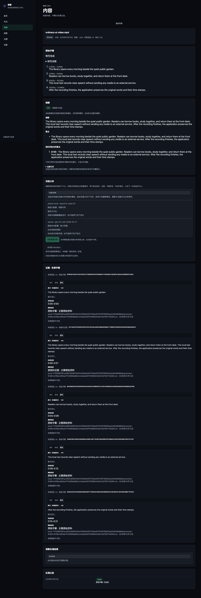

# 当前验收状态（2026-10-19，候选未发布）
完成条件不变：普通入口真实可操作、无未处置P0/P1、模型严格资格、完整回归/恢复与安全main拓扑同时满足。用户持续授权覆盖必要实现及全部门禁后的采用，不重复逐方法审批。

| 当前关键项 | 最新外部证据 | 当前剩余 |
|---|---|---|
| 兴趣逐条保真/CAS/轮询 | 独立dd260de/d012c48，整合2134a30；root896/TSbuild；真实编辑/双页冲突/GET新command/刷新/进程重启，74表87DATA一致 | 最终完整回归 |
| 9b端口与容量工程 | 独立aee4e07/bed638f/868d2da通过，整合88161aa；root232/strict106/Ruff通过；固定双manifest/v2引用/六payload/三binary身份修复 | 磁盘197.955GiB已通过；10月19日09:08真实RAM4.639<8.101GiB仍closed，0load/0生成；实际合法prepare/slot/统一freeze/原案例+holdouts语义与LOCAL8正向未完成 |
| 精确能力及物理计数 | 独立d775b0c，整合6fa6a07；root79backend/929front/TSbuild；真实Settings六scope/lang全false、LOCAL_TEXT真实route/设置回跳；新备份100artifact引用显示96physical，全部96归档hash相同 | 模型资格仍false；后续新核心完整回归 |
| TXT/MD与等待取消恢复 | 真实Native Picker/WAIT0分别取消/剩余任务仍阻塞；实际重启及GUI恢复74表84DATA一致 | 真实合格模型正向尚无；Schema39未在正式main迁移；最终核心SHA变化后ASR也须按原17例新tuple重验，旧receipt不可沿用 |
| 新字幕及失败重试 | 原生29cue/摘要/4Evidence真实恢复74表87DATA；VIDEO_URL重试/恢复74表3DATA保留旧job/provider | Schema40累计166ab392独立76ad28f APPROVE并整合89cca38；root478后端/956前端/strict113/TSbuild/Ruff/diff全通过。真旧72表18DATA普通factory迁移40，GUI排队→取消→重启不复活/旧job与provider/attempt不变、新command准入通过；新真实字幕读取LOCAL_FINALIZATION_FAILED未成功，完整77表19DATA已冻结，原作者只读定位中。旧2 unindexed DATA与新增有VERIFIED证明capture分开，不把Backup拒绝误归新capture。此任务未DONE，真成功/完整恢复仍待 |
| 真实旧失败派生归档 | 全量旧37库正常迁移39；真实公开字幕受控completion fault→新明确命令成功；旧Iwgl真实GUI Retry成功，74表19DATA/原8DATA与Evidence完整，0新模型 | 新真实P1：v1/429+v2/LOCAL_RESOURCE混合维护互阻；恢复proof的exact版本2026.07.04与历史parent政策pair均已独立定位；仅内存两处补正完整23字段114Evidence证明PASS、21文件SHA不变，产品/混合原子结清及GUI Restore仍未修；既有七项manifest反控另需保留ZipInfo+同构正控以真正抵达语义校验，不用诊断PASS或空归档恢复替代 |
| Backup及原生选择 | 真create/native choose/strict stage/RESTORE一次确认/实际重启689d0de7，74表96DATA逐行/hash一致、FK/integrity正常 | Chrome154 custom filter拒选问题已修复223de10；真实默认native直接选ZIP/strictstage/取消PASS，74表96DATA原样；root36/TSbuild通过 |
| 研究证据回跳/手册 | 真实刷新定位focus指定Evidence；10月19日前真实Chrome复验统一中文手册64/64真图加载，1312宽无横溢 | 最终新Retry与合格洞察截图 |
| 其余验收与采用 | 10月19日只读实查D2四文件与73ee7e7逐字不变；main/actualorigin/served均73ee7e7 clean，4资产SHA相等，main仍候选祖先；不读写owner DB/config | 长内容纯无损codec独立APPROVE已整合，root110/strict106+真实2406cue114 Evidence roundtrip通过；纯模型投影59194ad已整合，独立291/真实字节边界和root68/strict107/真实2406cue114 Evidence展开通过；显式完整planning ChatML22494 tokens，0权重/context/生成，尚无执行接线；完整长协议、旧failed-derived归档genuinepositive、合格洞察收藏/主题/原证据GUI、最终完整backend/front/静态/恢复/topology/served及条件采用仍OPEN |

以下为历史检查点，保留原失败与当时状态；不能将其中旧的“待批/未实施/OPEN”当作上述最新状态：

# 普通用户链路验收矩阵（候选，未发布）

2026-10-15 当前结论：**未完成，暂不交用户作为全部可用版本测试。** 正式main/真实远端仍73ee7e7，本轮未改owner数据、配置或凭据。Schema39及Native目录v2已独立接受并整合；真实39 TXT/MD导入→WAIT0取消→重启→GUI恢复74表84DATA全等，剩余关注CAS及模型正向仍在整改；下方历史检查点保留，不代表当前完成状态。

| 用户操作 | 当前外部证据 | 剩余门禁 |
|---|---|---|
| 首次使用及跳过后设置 | 真实macOS引导可到设置；最新ZH/EN明确安装身份≠洞察资格、Cloud可选逐次授权 | 合格能力正式配置/最终回跳采用仍待 |
| 多文件导入及过长视频 | 前轮已发布真实Native Picker/D2-01/D2-02/2GiB APFS通过；本轮实现不变，失败当时反馈可关闭、不跨页面残留 | 最终完整回归，复用未变实现证据 |
| 本地视频/音频转写与声学负控 | 普通factory隔离固定tuple PASSED，真实UI转写4cue/Summary5Evidence；17任务14正向、3静音噪声负控失败无假文本 | 正式配置另批；不保证任意录音准确率 |
| 本地转写后取消等待 | 真实WAITING_MODEL0→明确用户取消→无洞察，全部78DATA及authority保持，Backup重新ready | 新合格模型正向仍未通过 |
| 公开频道关注/暂停/恢复/自动检查 | 真正HEALTHY与后来NOT_FOUND保留；新真实关注后发布OYp5j2RihPE由following-auto持久ENROLLED/单video单link、SourceRun完成，GUI可读 | 一例真实新发现PASS；该内容TRANSCRIPT目录INVALID_RESPONSE/FAILED_FINAL，没有字幕/Summary/Evidence；当前来源NOT_FOUND风险保留 |
| 原生字幕与已有plain补全 | 同源原生VTT补全、字幕/摘要/Evidence真实可读；firstplain/winner持久capture独立接受；fresh RAW真实恢复71表4DATA精确PASS | 老DATA4→3FAIL保留；另旧失败derived归档仍OPEN |
| 旧失败请求+成功child安全归档 | Schema38第三独立ff43 APPROVE已整合74ac5c2；root176专项/静态PASS，普通Schema38真实GUI恢复72表78DATA精确PASS | 23字段保持；genuine失败derived归档真实GUI仍待网络条件，不用空表38恢复冒充；最终完整回归待 |
| 当前Content转写/深度分析读取 | 真实有限GET延迟复现假待转写/假尚未运行；作者fff9bf中性加载430全前端自测 | 047/ba524返修独立接受整合；root441/TSbuild及真实ZH/EN loading、abort禁用、GET恢复/lateID隔离PASS；旧REJECT留存 |
| 本地洞察真实资格 | 8b停止；9b nonthinking首例4语义P1 FAIL，native thinking首例4096length正文空FAIL，后3及LOCAL8未调用 | 6144原EN唯一调用完成，native stop/912输入4638输出/218.923s；协议PASS但独立fbd1035语义REJECT/P1，18DATA/输入hash不变；全部调用STOP、正式资格false |
| LOCAL TXT/MD提炼与真实字符来源 | b79候选333后端/446前端通过但独立3b562c6 REJECT两P1；原摘要损坏/missing-card反证保留 | 15字段Schema39独立00d66a APPROVE已整合ce3beaa，root97/strict103通过；真实TXT/MD WAIT0/取消/重启/39 GUI恢复74表84DATA一致；正向模型0调用 |
| 已生成洞察收藏/主题/原证据回跳 | 既有逻辑回归保留，没有合格模型正向GUI支撑 | 真正admitted Intelligence后全链路操作/恢复，不用fixture冒充 |
| 本地资料研究 | 真实已转写Content收集3Evidence/0Intelligence、回读/初次定位原文、重新收集/两版本无实质变化对比PASS；明确无模型结论 | 刷新丢Evidence定位OPEN，纳入已批LOCAL深链UI |
| 研究后的备份/恢复 | 真实创建/下载/选择ZIP/预览/RESTORE/重启；71表全部行和78DATA精确SHA6bf70daa…，当前与历史研究可读/readinessready | 不覆盖Schema38归档验收；旧恢复成功提示在新预览仍展示P2真实复现；741自测461通过但独立c348 REJECT连续新ZIP失败残留，原作者呈现返修 |
| 页面读失败与窄窗 | 实际自有API暂停→GET重试恢复、Source neutral loading/失败单GET重试、四宽六导航正反Tab/Enter/鼠标PASS | 最终候选复核，未知状态仍不得误放行 |
| 关注继承兴趣配置 | ExistingSourceForm失败GET/重试/草稿保护组件通过；tracked creator普通详情没有编辑入口 | 专用interest-only CAS及入口已具体获批；待LOCAL_TEXT state/App接受后串行，未实测采用 |
| 旧v1明确429取消阻塞 | 独立返修接受/真正idle worker持久终止并保留错误/history；另一WAIT0仍正确阻塞，用户取消后ready | 不扩大到当前未知/活跃执行 |
| Deep Analysis/Cloud/Bilibili | 未合格Deep保持禁用，Cloud0调用无凭据；Bilibili Creator明确不可用、公开单视频原路径保留 | 不造资格、不以付费云替代本地，不绕Cookie或安全规则 |
| 长内容/rolling字幕 | Sasha114Evidence真实422、单长cue需完整token预算准入；原生rolling重复真实可读但质量不佳 | OPEN新精确政策；不截20项/扩大窗口/改历史Evidence，未实施 |
| 最终回归/采用 | 最新已接受root441前端/TSbuild PASS；fb067完整后端4445通过/7失败/1既有skip/2警告，1303.93秒；7项因测试import捕获租约钟超10min，专用test-only修复排队，原生产保护不改 | 新core/UI接受后完整backend/front/TS/build/Ruff/mypy/diff；无P0/P1、真实恢复与另批正式采用 |

本轮 Native Picker 不可用新的电脑控制工具，未改实现的前次真实原生选择器与2GiB APFS验收证据复用。新转写样本经普通导入API建立，再从实际UI点击转写；两者明确区分。没有通过截图或fixture宣称真实模型合格。

2026-10-13续作：ASR文案与最小CSS均独立审查整合，真实中英文反馈/Retry Tab及四窗口document几何PASS；完整backend4220 PASS/1既有skip/2warning，frontend386 PASS/TS/build。六导航完整可见键盘检查另发现部分遮挡，NARROW_WINDOW_GUI_EVIDENCE.json如实PARTIAL/FAIL，独立返修中；不能说小屏全通过。LOCAL_TIMED候选39新专项等通过独立审查中未整合，真实LOCAL新资格仍因9b原语义FAIL而BLOCKED，不复制旧YTreceipt或授普通factory权力。Schema38旧失败归档仅精确待批提案，未实施。fresh RAW GUI恢复71表/4物理DATA精确PASS不覆盖旧失败恢复OPEN。

夜间最新状态优先：键盘返修已独立整合且四宽六项正反Tab/Enter/鼠标真实PASS（新NARROW_KEYBOARD_GUI_EVIDENCE，旧FAIL留存）。LOCAL_TIMED已独立整合/root78PASS，真实Whisper视频WAIT0→取消→Backupready与全部78DATA/authority保持PASS，正向模型仍BLOCKED。Source详情中性加载/失败GET重试独立整合，406前端/TS/build以及真实1GET/0命令重放PASS，见SOURCE_DETAIL_GUI_EVIDENCE。Schema38和同固定9b新thinking模式均已获精确隔离批准，但尚未完成实现/独立验收；不能将批准当PASS。当前4220后端只是此前RAW/UI检查点，最终候选完整回归仍等待核心新变更。
