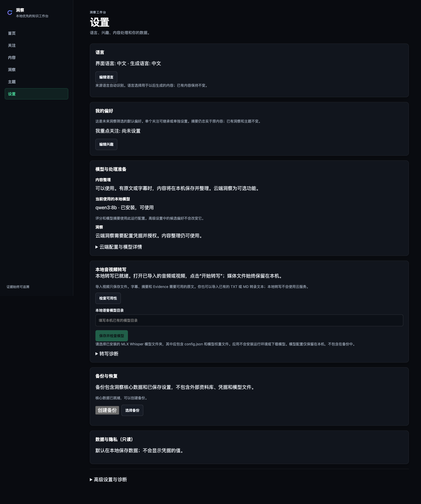

# 普通用户链路验收矩阵（候选，未发布）

当前结论：**未完成，不能交用户作为已可用版本。** 正式产品/main仍 73ee7e7，本轮未改正式数据、配置或凭据。

| 用户操作 | 当前真实结果 | 仍需完成 |
|---|---|---|
| 首次使用、跳过后去设置 | 真正 headful UI 引导可到设置，缺模型有具体说明 | 合格能力最终正式配置与回跳验收 |
| 本地多文件导入，含过长媒体 | 前轮已发布的真实 macOS GUI通过，失败仅当时提示，可关闭，不跨页面长期残留 | 本轮相关实现不变，复用 D2-01/D2-02；完整回归 |
| 选择模型、检查本地转写 | 当前普通 factory 在隔离机器精确 tuple 获 PASSED，并显示已就绪 | 正式配置须最后具体批准，不能复制布尔值 |
| 本地真实视频开始转写 | 实际 UI 开始转写，Whisper READY；4 timed cues、1 Summary、5 Evidence | 当前样本是公开测试语音，不代表任意录音准确率 |
| 中长/混合/停顿/弱声/静音/噪声 | 17真实产品任务全符合原门槛：14正向可信，3负控FAILED/零decoder无authority | 完整结果、失败研究记录已保留 |
| 转写后 Backup/Restore | 实际UI创建/下载/预览/RESTORE/重启，71表78文件精确相同 | 最终整合候选再验收关键影响 |
| 真正公开频道关注、暂停/恢复、自动检查 | 曾获得 HEALTHY 基线；最新真实检查再出现 NOT_FOUND，已保留内容并明确显示不可用 | OPEN 外部复发；此窗口无新发布，不能宣称真实新内容发现正向通过 |
| YouTube已有字幕内容 | 3Blue1Brown 231 cues及摘要/Evidence；DeepMind真实18 cues | 不等于视频声学转写或模型摘要 |
| 已完成但无时间轴的旧字幕补全 | 原生 VTT 补全独立审查并整合；真实 Sasha/Iwgl 用户重试均 ORGANIZED，字幕/摘要/Evidence 已可读 | 原 DATA4→3 FAIL保留；经raw修复的fresh真实GUI恢复71表/全部4DATA精确一致，见NATIVE_RAW_CAPTURE_GUI_RESTORE_EVIDENCE.json；失败后新child的另一路径仍OPEN |
| 字幕完成事务回滚后恢复 | 原实现未知 VTT 无 durable hash；原测试要求成功且无重复 body 读取 | firstplain/winner capture已独立APPROVE并整合，零重复读取和unknown拒绝相关188 PASS；旧current-policy失败ledger+derived orphan仍阻塞，另提精确Schema归档方案待批 |
| 真正本地提炼 Intelligence | qwen3:8b v3–v11 未通过冻结语义门槛，停止调参；批准的固定9b权重已全部哈希校验 | 9b首例真实1调用、协议SUCCEEDED，但独立语义FAIL（4个P1），停止其余3例/不reroll，生产false；QWEN35_REAL_QUALIFICATION_FAILURE.json |
| 无新洞察、注入、零调用等待取消 | 原模型基线负控与真实WAITING_MODEL取消/恢复已通过 | 新合格profile需重新实际模型负控验收 |
| Intelligence保存、主题、真实来源回跳 | 既有逻辑回归通过，但本轮还没有合格本地正向支撑 | 真正 admitted Intelligence后全链路UI验收 |
| Deep Analysis | 未合格模型保持禁用，摘要/Evidence可读 | 本轮指定模型范围不能冒充该能力已合格 |
| Bilibili UP持续关注 | 已验证外部风险拒绝，普通UX明确不可用 | 不绕过Cookie/安全门禁，不冒充支持 |
| 付费云 | 本轮0调用、无凭据，不影响既有明确授权流程 | 不以付费云替代未合格本地模型 |
| 页面读取失败恢复 | 真实隔离 API 停止后明确服务不可用；重启后点击重新加载数据恢复原内容，全部GET，零提交重放 | 真实截图 PAGE_READ_REAL_GUI_EVIDENCE.json；正式未采用 |
| 读取关注继承偏好失败 | 独立完整379前端/TS/build PASS；显示错误、手动GET重试、草稿保留、未知继承阻止提交 | 普通用户真实可达入口仍待验证，不把组件测试称GUI验收 |
| 已退休旧字幕429阻塞备份 | 精确终止实现经独立返修APPROVE并整合；真实worker保留旧错误/history，无调用或费用，readiness恢复 | 另一个真实WAITING_MODEL0仍阻塞；用户取消后才ready，负控截图/持久化校验已通过 |
| 长内容提炼 | Sasha114条Evidence真实422；≤20但长单cue也需完整ctx准入保护 | OPEN，不能静默截断或扩大窗口；诚实readiness及安全完整处理方案待决策 |
| rolling原生VTT阅读与摘要 | 原始文件含滚动重复，当前 canonical/Evidence/摘录仍重复 | OPEN normalization政策；不篡改原始文件、时间或历史Evidence |

本轮 Native Picker 不可用新的电脑控制工具，未改实现的前次真实原生选择器与2GiB APFS验收证据复用。新转写样本经普通导入API建立，再从实际UI点击转写；两者明确区分。没有通过截图或fixture宣称真实模型合格。

2026-10-13续作：ASR文案与最小CSS均独立审查整合，真实中英文反馈/Retry Tab及四窗口document几何PASS；完整backend4220 PASS/1既有skip/2warning，frontend386 PASS/TS/build。六导航完整可见键盘检查另发现部分遮挡，NARROW_WINDOW_GUI_EVIDENCE.json如实PARTIAL/FAIL，独立返修中；不能说小屏全通过。LOCAL_TIMED候选39新专项等通过独立审查中未整合，真实LOCAL新资格仍因9b原语义FAIL而BLOCKED，不复制旧YTreceipt或授普通factory权力。Schema38旧失败归档仅精确待批提案，未实施。fresh RAW GUI恢复71表/4物理DATA精确PASS不覆盖旧失败恢复OPEN。
