# Intelligence 用户使用手册

> 简体中文 · 面向完全不懂编程的普通用户
> 版本：0.1.0 · macOS · 2026-10-15 · 本轮候选手册，尚未发布
> 图示来自实际产品界面；部分未变化页面沿用上一版图示。请留意页面上真实的处理状态。
> 正式产品目前仍为上一版。本轮隔离环境已实测本地转写和字幕备份恢复；本地洞察模型仍未通过质量验收，不能视为全部流程已可用。

---

## 目录

1. [Intelligence 是什么](#1-intelligence-是什么)
2. [第一次使用](#2-第一次使用)
3. [添加 YouTube 视频](#3-添加-youtube-视频)
4. [关注 YouTube 频道](#4-关注-youtube-频道)
5. [导入 Bilibili 视频](#5-导入-bilibili-视频)
6. [导入本地文件](#6-导入本地文件)
7. [查看 Content（内容）](#7-查看-content内容)
8. [查看字幕与摘要](#8-查看字幕与摘要)
9. [理解 Evidence（证据）](#9-理解-evidence证据)
10. [提炼 Intelligence（洞察）](#10-提炼-intelligence洞察)
11. [使用 Topic（主题）](#11-使用-topic主题)
12. [配置本地模型](#12-配置本地模型)
13. [配置云端模型](#13-配置云端模型)
14. [修改语言](#14-修改语言)
15. [备份与恢复](#15-备份与恢复)
16. [常见问题](#16-常见问题)
17. [当前已知限制](#17-当前已知限制)

---

## 1. Intelligence 是什么

**Intelligence 是一个"本地优先"的个人智能知识工作台**。它帮助你：

- **持续关注**你感兴趣的信息来源（如 YouTube 频道）；
- **采集内容**（视频、字幕、本地文件）；有可用原文时整理摘要与证据，本地音视频转写还需具备合格语音模型；
- 从内容中**提炼长期有价值的洞察**；
- 围绕主题**持续积累和演化认知**。

它的四个核心概念：

| 概念 | 作用 | 通俗解释 |
|------|------|----------|
| **Following（关注）** | 持续关注的信息来源 | 就像订阅一个频道 |
| **Content（内容）** | 采集、转写、摘要和证据 | 整理好的素材库 |
| **Intelligence（洞察）** | 从内容中提炼的长期价值 | 值得记住的结论 |
| **Topic（主题）** | 围绕主题积累认知 | 按主题归档洞察 |

**产品原则**：
- Following → Content 是**基础能力**：默认帮你整理内容。
- Content → Intelligence 是**可选能力**：你可以选择进一步提炼洞察。
- **默认本地处理**：你的数据保存在本机，不会未经授权调用付费云端模型。

**最重要的承诺：证据始终可追溯。** 每一条内容、每一个摘要、每一条洞察，都能找到它来自哪段原始材料。

---

## 2. 第一次使用

第一次打开 Intelligence，你会看到三步引导，说明这个工具的核心用途。

准备导入音视频前，可以先打开 **设置 → 本地音视频转写** 检查可用性；跳过引导后也能随时回来配置。设置中的“已安装，身份已核对”只说明发现了对应模型，**不代表它能合格地生成洞察**。本地洞察尚未通过验收时，页面会明确说明；已有内容、摘要和 Evidence 仍能阅读。云端洞察是可选方案，每次执行都要单独授权。

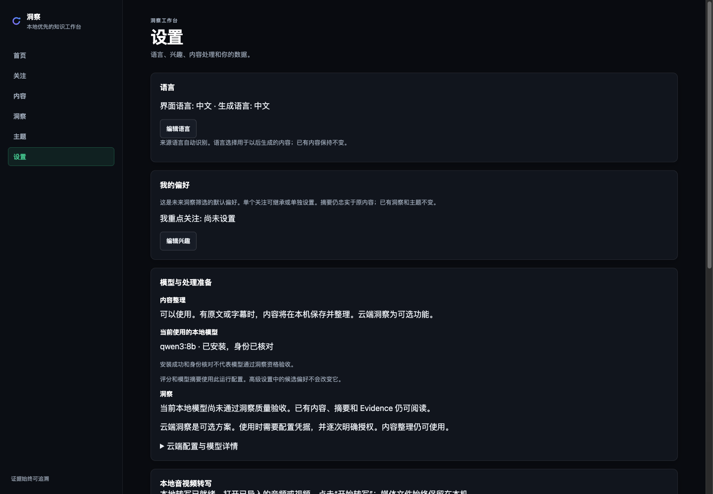

**第 1 步：欢迎与定位**

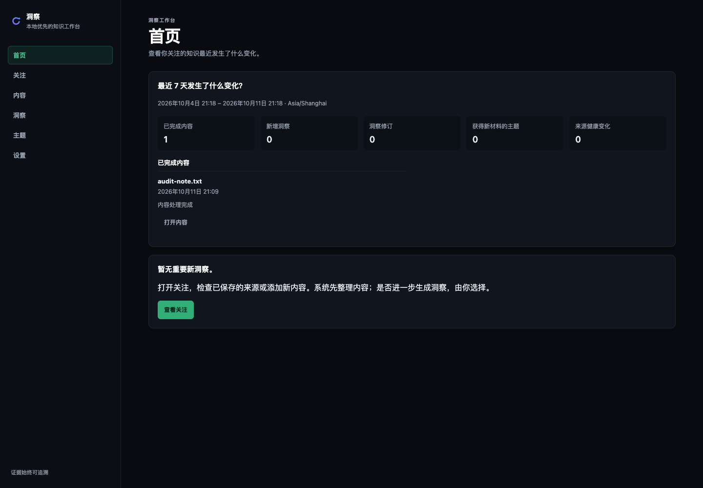

页面上说明了这是一款"本地优先的知识工作台"，点击 **继续** 进入下一步。

**第 2 步：理解"关注 → 内容 → 洞察"**

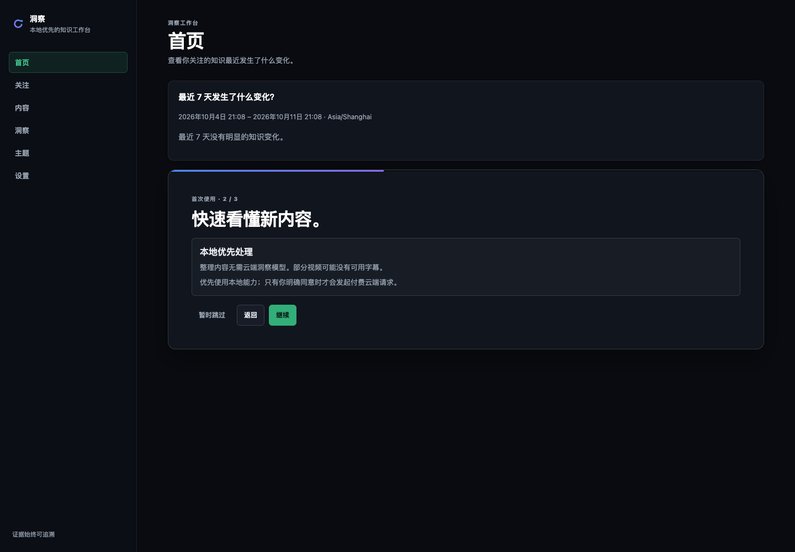

**第 3 步：了解"证据始终可追溯"**

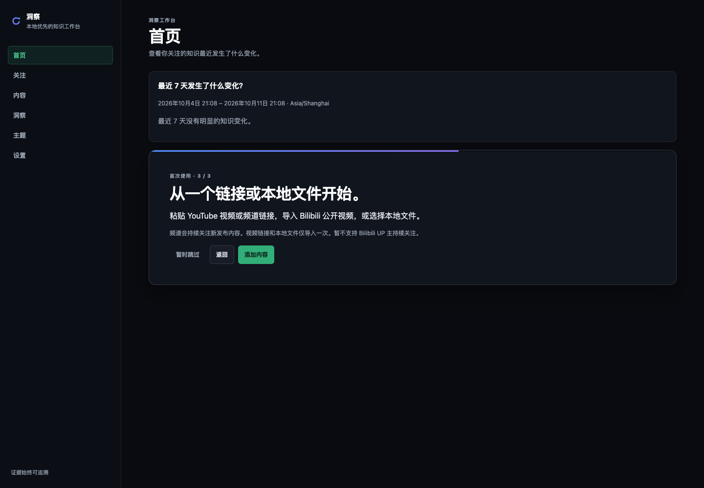

**完成引导**

点击 **添加内容** 完成引导，进入"关注"页面。

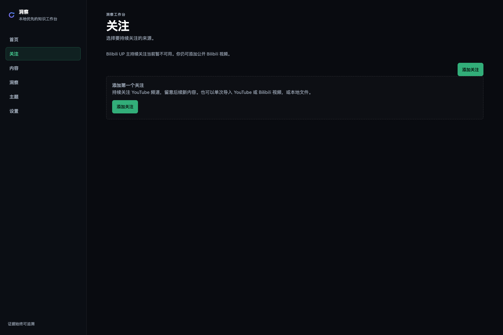

此时页面还是空的，提示你"选择要持续关注的来源"。左侧是导航栏：

| 导航 | 功能 |
|------|------|
| 首页 | 最近 7 天你关注的知识发生了什么变化 |
| 关注 | 管理你持续关注的来源 |
| 内容 | 阅读已采集的内容、字幕与处理记录 |
| 洞察 | 查看提炼出的长期洞察 |
| 主题 | 按主题归档和浏览洞察 |
| 设置 | 语言、兴趣、模型、备份等 |

**重新打开后的状态**：关闭浏览器再打开，你的关注、内容、设置都会保留（数据保存在本机）。

> 说明：本手册演示环境已添加了示例关注与内容；你首次使用时会看到类似的空状态页面。

---

## 3. 添加 YouTube 视频

可以**单次导入**一条 YouTube 视频，不关注频道。

**操作步骤**：

1. 点击右上角 **添加关注**（或关注页的 **添加关注** 按钮），打开添加对话框。

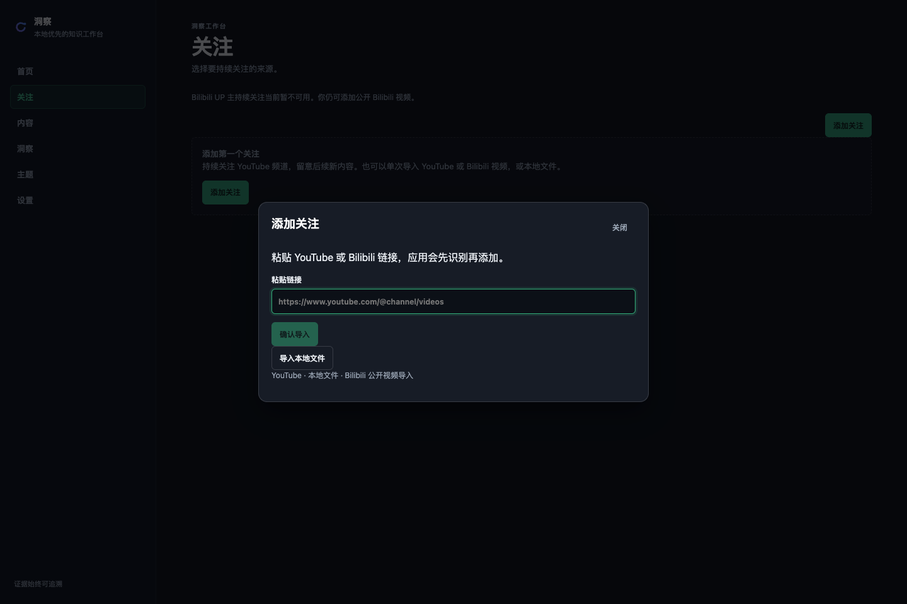

2. 在输入框中粘贴 **YouTube 视频链接**，例如：
   `https://www.youtube.com/watch?v=aircAruvnKk`

3. 系统会先识别这是单条视频链接。标题等来源信息会在导入后显示。

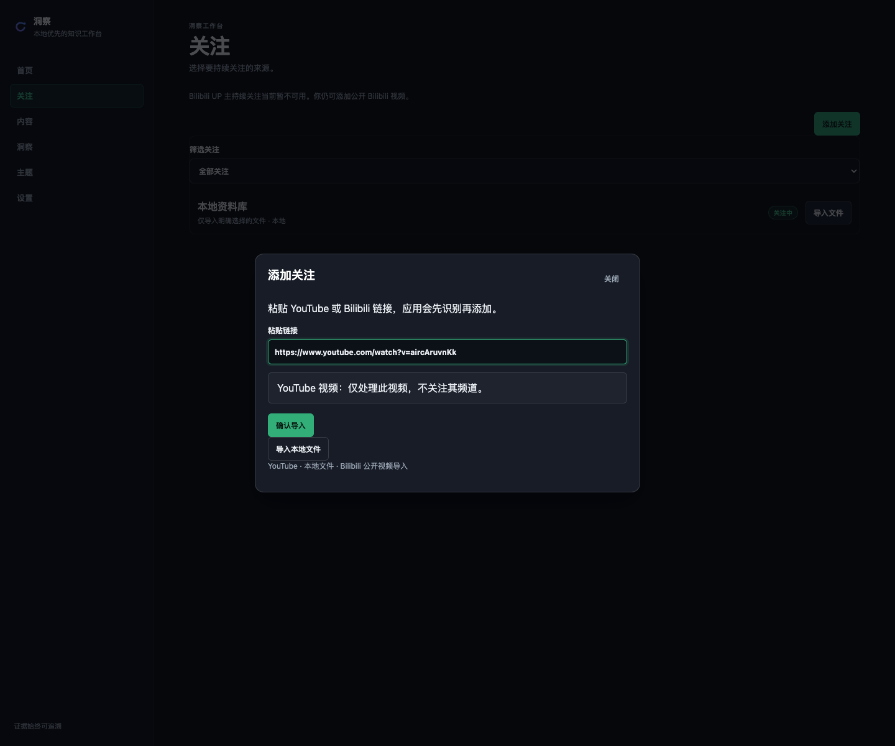

4. 点击 **确认导入** 开始导入。导入成功后，点击 **打开内容** 查看处理状态，或点击 **完成** 关闭对话框。系统继续整理内容；没有字幕或所需模型时，会显示对应原因。

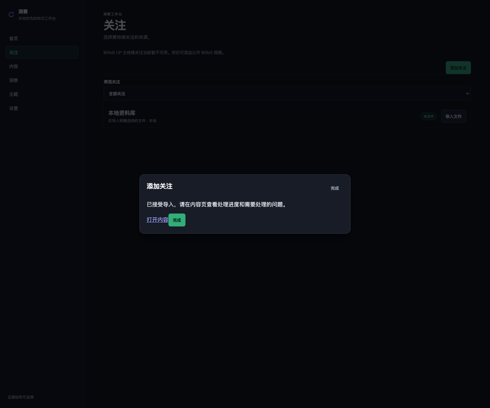

**预期结果**：
- 视频出现在 **内容** 列表中；
- 处理完成后显示"已完成"；
- 打开详情页可以看到字幕、摘要和证据。

---

## 4. 关注 YouTube 频道

持续关注一个频道，之后自动检查该频道的新视频。

**操作步骤**：

1. 打开 **添加关注** 对话框，粘贴 **YouTube 频道主页链接**，例如：
   `https://www.youtube.com/@Veritasium`

2. 系统先识别这是频道链接。名称会在成功关注后显示。

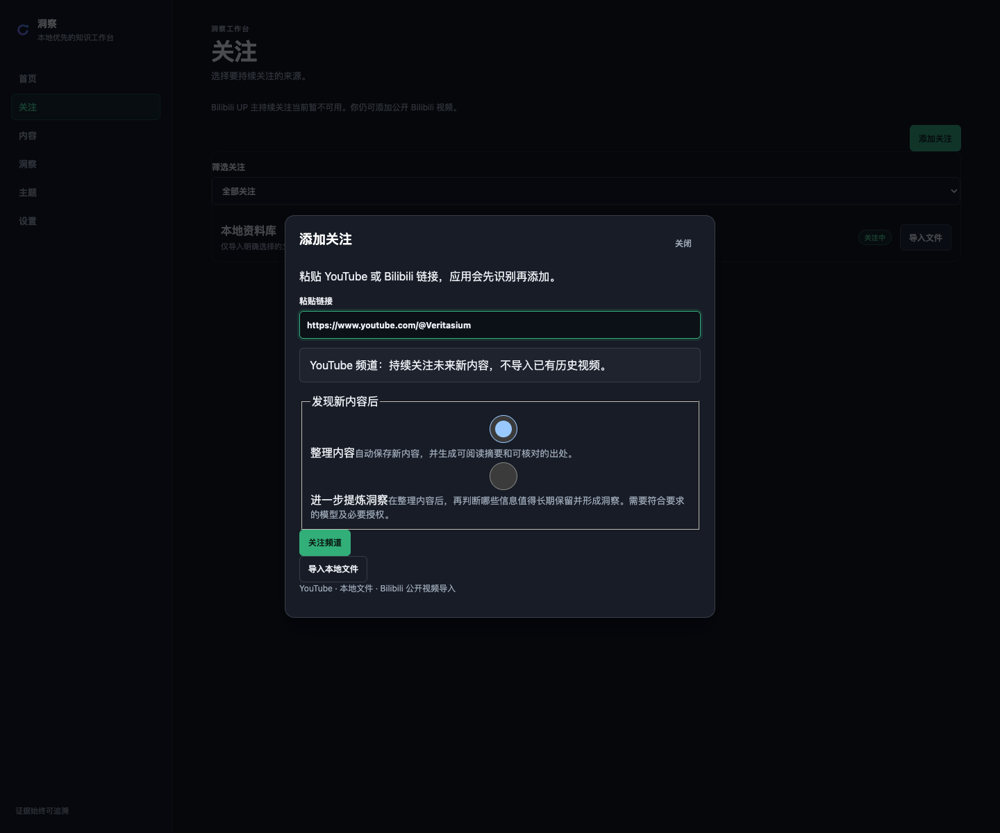

3. 点击 **关注频道**，确认成功后点击 **完成**。频道出现在"关注"列表，状态为"正在关注新视频 · YouTube"。

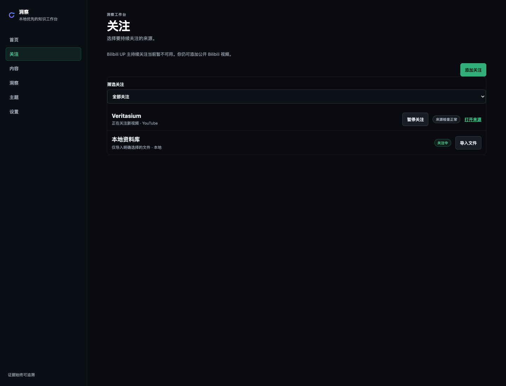

**关注后的操作**：

- **暂停关注**：点击频道卡片上的 **暂停关注**，频道状态变为"关注已暂停"，已有内容仍然保留。

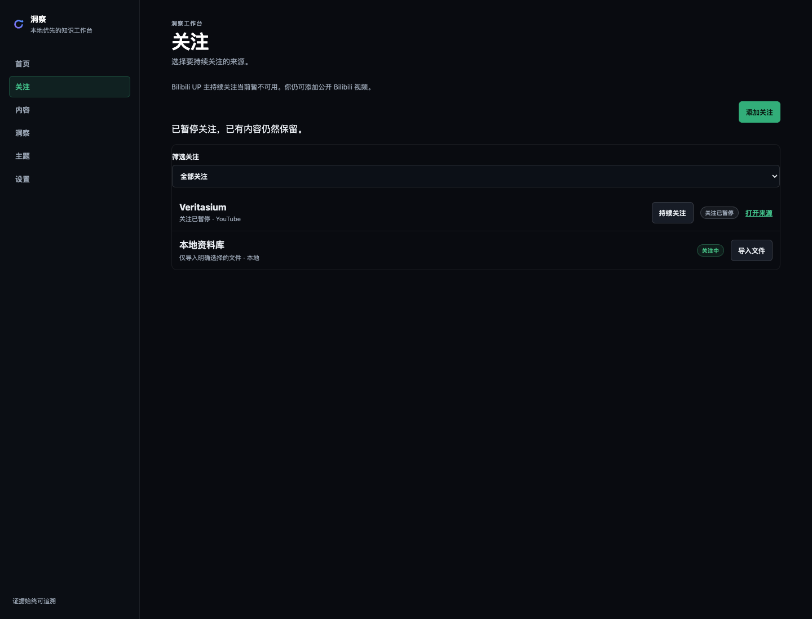

- **恢复关注**：点击 **持续关注**，频道恢复"正在关注新视频"。

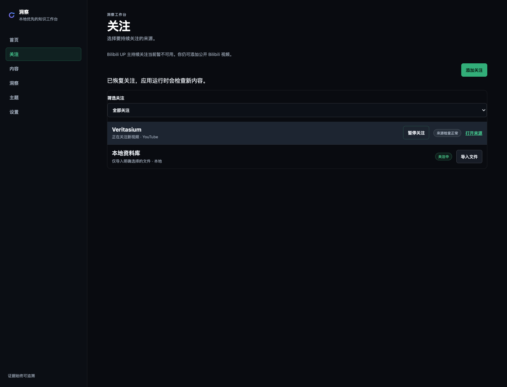

**自动检查**：应用会定期自动检查已关注的频道是否有新视频。应用运行时会检查更新；两次检查至少间隔 15 分钟。

> 提示：如果某个公开来源暂时不可访问，页面会如实提示"此公开来源不可用，已保留存储的内容"，不会删除你已有的内容。

点击频道名称可查看关注详情。加载期间显示中性的“关注”，不会把尚未读取的 YouTube 来源误标成 Bilibili 不可用。如果提示 **未能加载来源详情**，点击 **重试加载来源详情**；这只重新读取，不会重复提交来源检查或修改关注设置，已保存的内容保留。

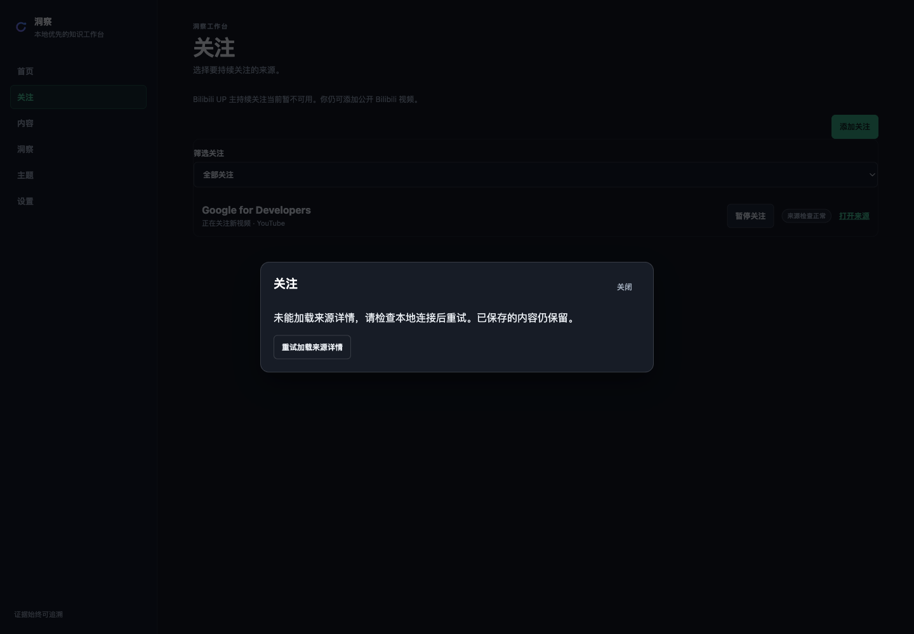

**编辑单个关注的兴趣**：点击频道名称 → **编辑兴趣**。关注重点、忽略词和提炼方式都可选择继承全局或单独设置。每个文本框是一条规则，规则中的逗号、换行和制表符会保留；开头或结尾有空白时会提示修改。点击 **保存兴趣**，出现“兴趣已保存”即完成。后台检查和列表刷新不会清掉正在编辑的草稿。

如果另一页面已修改同一兴趣，保存会提示冲突并保留你的草稿。点击 **重新读取当前兴趣**，核对后再保存；系统不会自动覆盖另一页的新版本。修改只影响后续处理，已有内容、证据和处理设置保留。

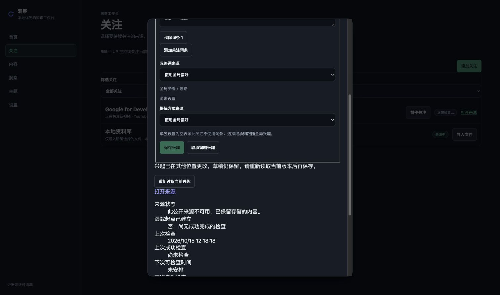

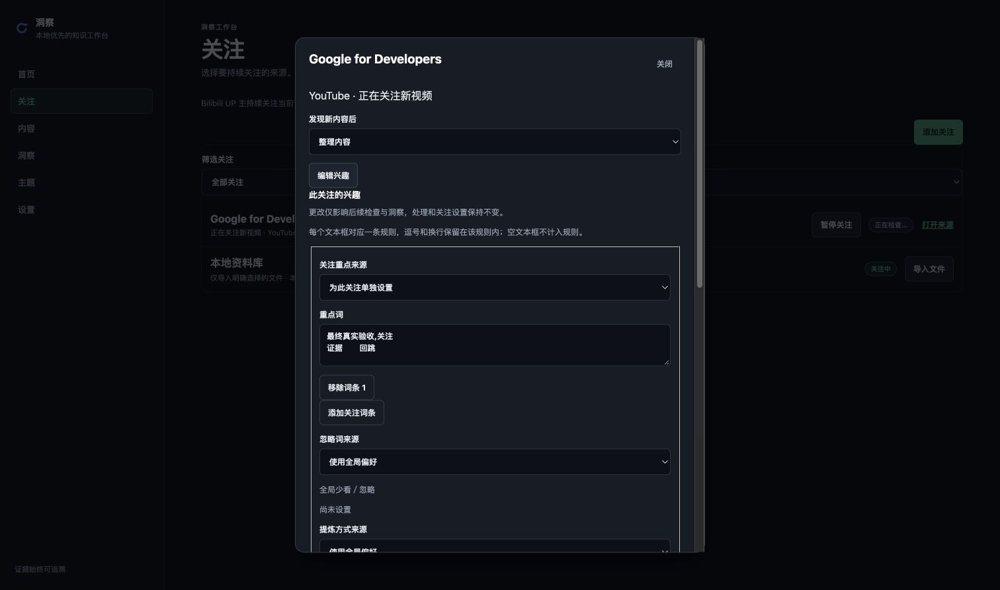

---

## 5. 导入 Bilibili 视频

可以**单次导入**一条公开的 Bilibili 视频。

**操作步骤**：

1. 打开 **添加关注** 对话框，粘贴 Bilibili 视频链接，例如：
   `https://www.bilibili.com/video/BV1GJ411x7h7`

2. 点击 **确认导入** 导入。

**预期结果**：
- 视频出现在 **内容** 列表中；
- 如果该视频没有可用的字幕，状态会如实显示"字幕不可用"，而不会编造内容。

> 注意：当前版本**不支持持续关注 Bilibili UP 主**（添加对话框中有明确提示）。你可以添加公开 Bilibili 视频，但无法自动跟踪 UP 主的新视频。
> 本手册撰写时，部分 Bilibili 视频的字幕获取受源站限制，导入后可能显示"字幕不可用"。

---

## 6. 导入本地文件

可以导入本机的文本、音频或视频文件。

**支持的格式**：
- 文本：`.txt`、`.md`（Markdown）
- 音频：`.mp3`、`.m4a`、`.wav`
- 视频：`.mp4`、`.mov`、`.m4v`

**操作步骤**：

1. 在 **关注** 页面找到 **本地资料库**，点击 **导入文件**。

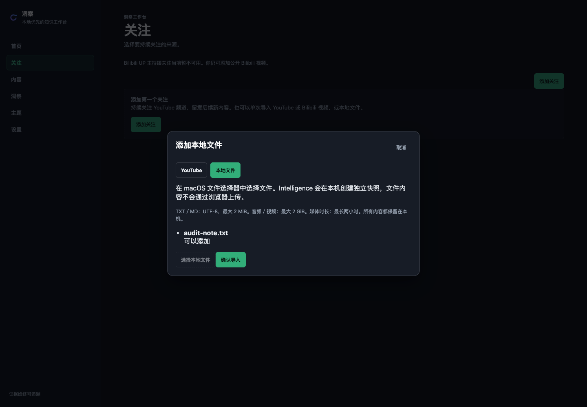

2. 点击 **选择本地文件**，在系统文件选择窗口选取文件并点击 **打开**。返回应用后检查名称和大小，再点击 **确认导入**。导入完成会自动打开保存的内容。

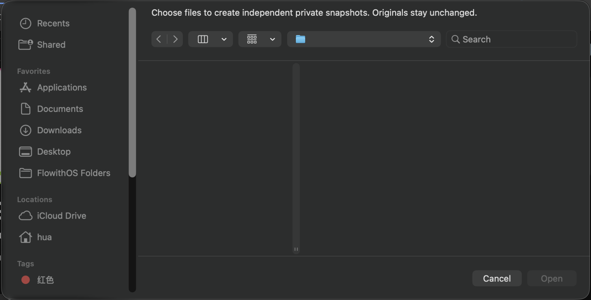

对话框中说明了文件格式与大小限制：**TXT/MD 最大 2 MiB，音频/视频最大 2 GiB，媒体时长最长两小时**。选择不支持的文件时，系统会显示明确的错误提示并拒绝导入。

**导入后的状态**：

- **文本文件**（TXT/MD）：直接整理为内容，可阅读原文。
- **音频/视频文件**：先保存独立文件快照。打开详情查看转写准备情况；没有合格语音模型时不会生成字幕、摘要或假洞察。

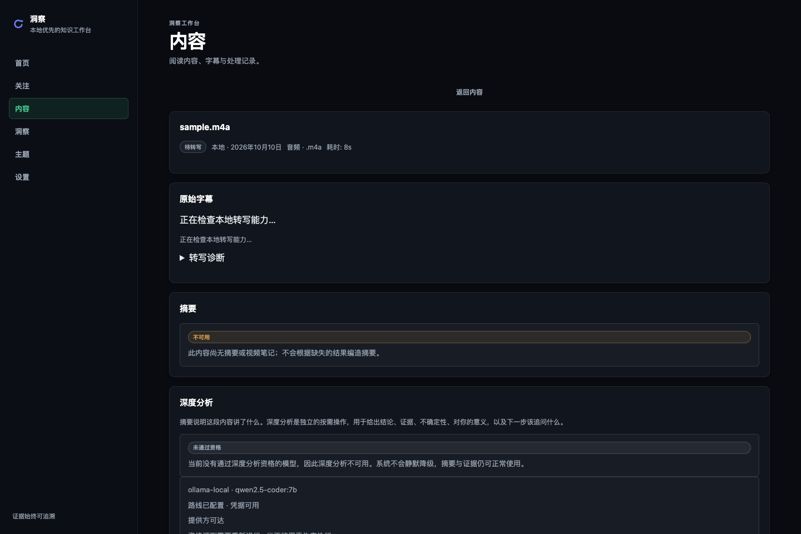

**一批文件可以有不同结果**：超过两小时的媒体会显示失败原因；同批次其他有效文件仍能保存。查看当次结果后可打开成功的内容。历史失败不会一直出现在关注或内容页；后台完成提示可点击 **关闭导入提示**，也会自动消失。切换页面会清掉已结束任务的提示，仍在运行的导入保持可见，历史记录与原文件不删除。

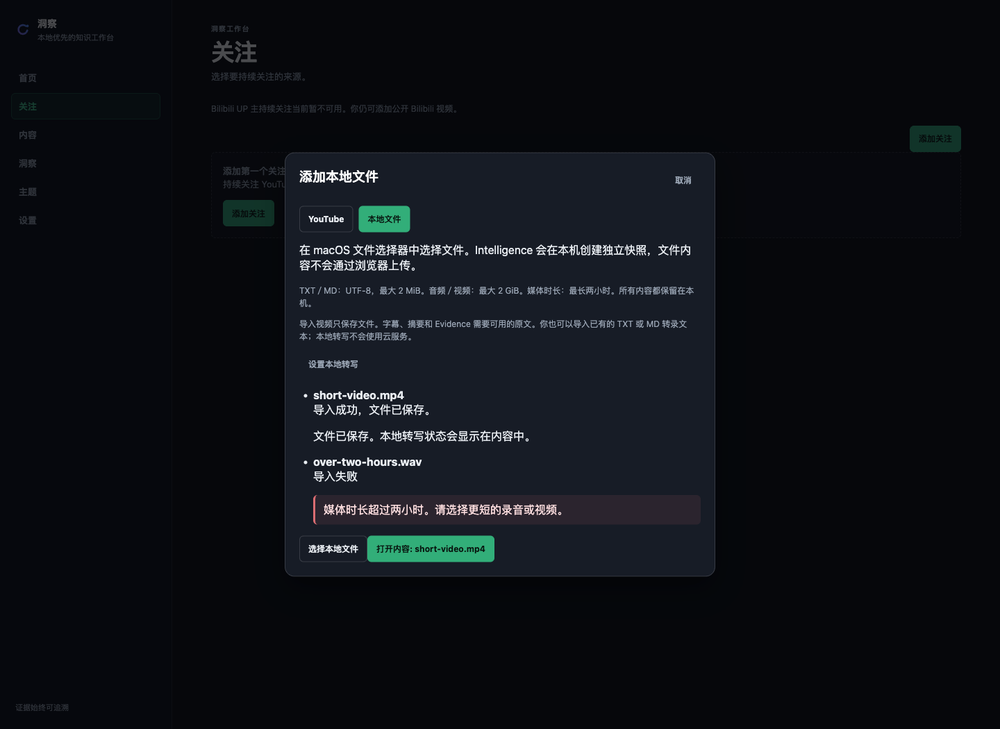

**文件已保存不等于转写完成**。打开内容详情查看当前状态：未准备模型时，点击 **设置本地转写**；就绪后可以点击 **开始转写**。首次跳过设置不会关闭后续设置入口。

**转写失败时**，原音频或视频仍保留。若提示“未获得可用字幕”，确认录音包含清晰语音后再点击 **重试转写**。没有有效结果时，系统不会编造字幕、摘要或 Evidence；列表和详情显示当前任务失败，不把一次文件失败说成模型一直不可用。

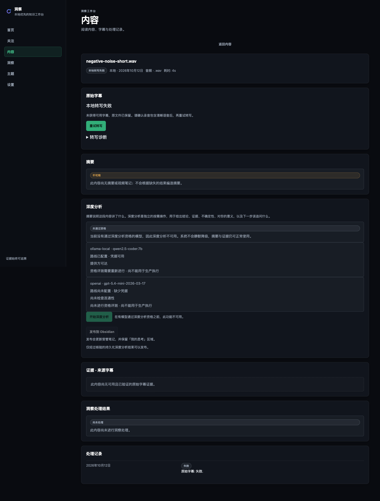

**大文件**：导入有明确的大小上限（文本与媒体文件各有上限），超过限制会拒绝并提示。

---

## 7. 查看 Content（内容）

所有采集到的内容都汇总在 **内容** 页面。

**列表**：每条内容显示标题、来源（频道/本地文件）、时间和处理状态。

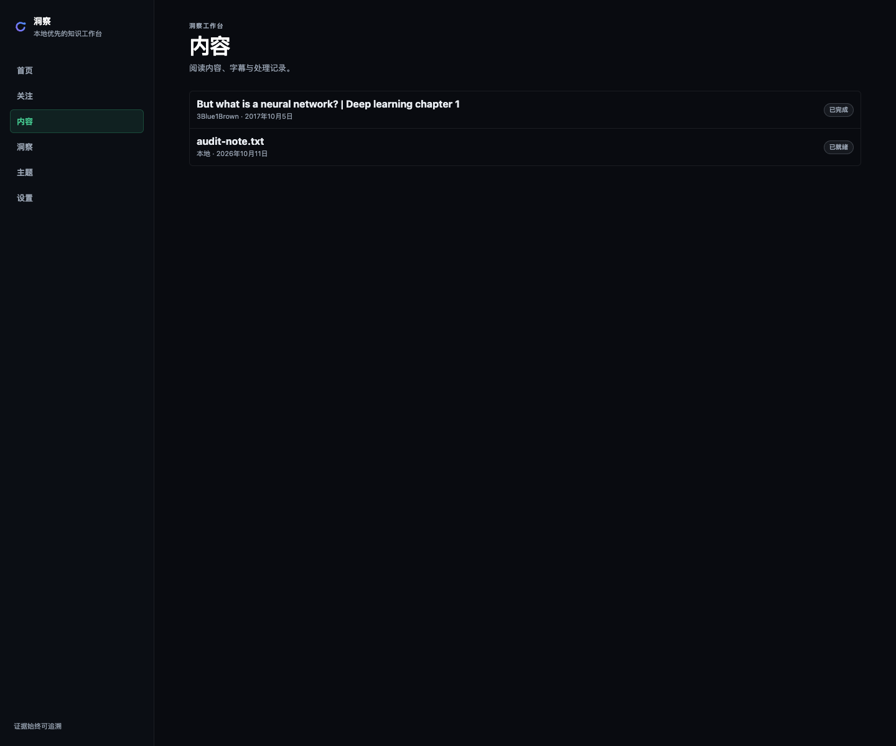

**处理状态说明**：

| 状态 | 含义 |
|------|------|
| 已完成 | 字幕与摘要已整理完成 |
| 待转写 | 音频/视频正在等待转写（或转写能力不可用） |
| 字幕不可用 | 源没有可用字幕，如实提示 |
| 处理中 | 正在获取字幕或生成摘要 |

**打开详情**：点击任意内容条目，进入详情页。

详情地址会包含该内容标识。刷新、浏览器后退和前进都保留对应位置；点击 **返回内容** 回到列表。

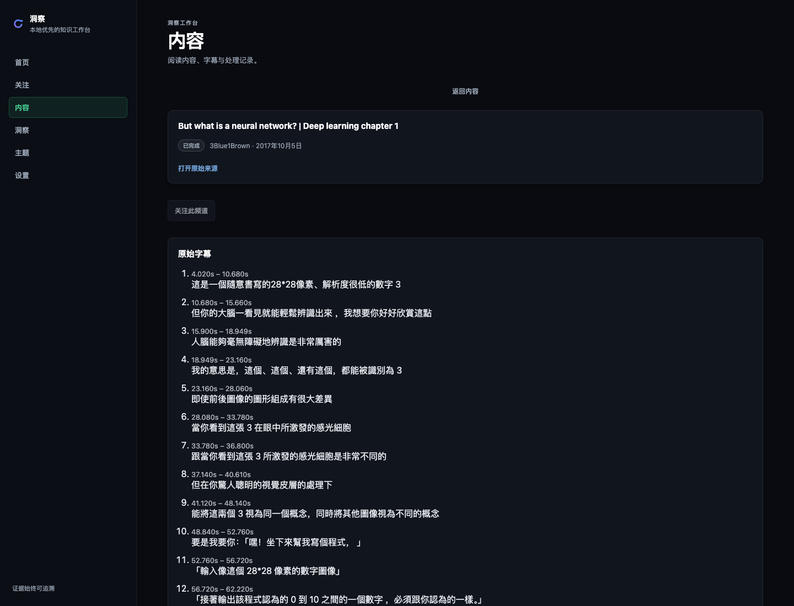

详情页包含：视频信息（标题、频道、发布时间）、**打开原始来源** 链接、**关注此频道** 快捷入口、**原始字幕**、**来源位置/溯源信息**（证据）等。

---

### 读取状态与恢复

打开详情后，**正在读取转写状态…** 或 **正在读取深度分析状态…** 表示状态仍在读取，不代表任务未执行，也不代表模型缺失。已有原文、摘要和证据仍可阅读。

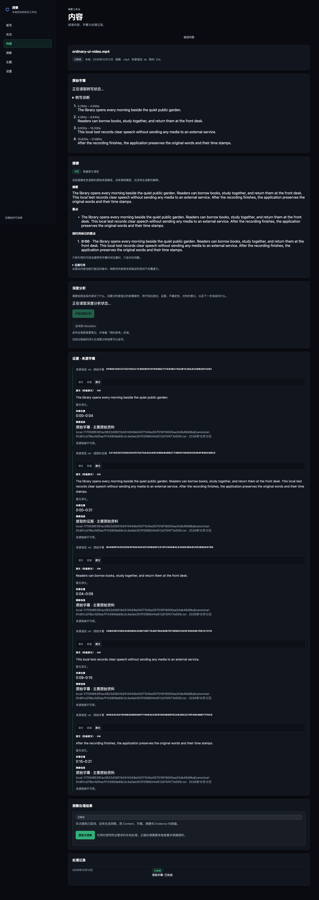

若读取失败，点击 **重新读取转写状态** 或对应面板的 **重试**。这只重新读取状态，不会重新转写、调用模型或重复发布。状态未明确前，执行和配置操作保持禁用。

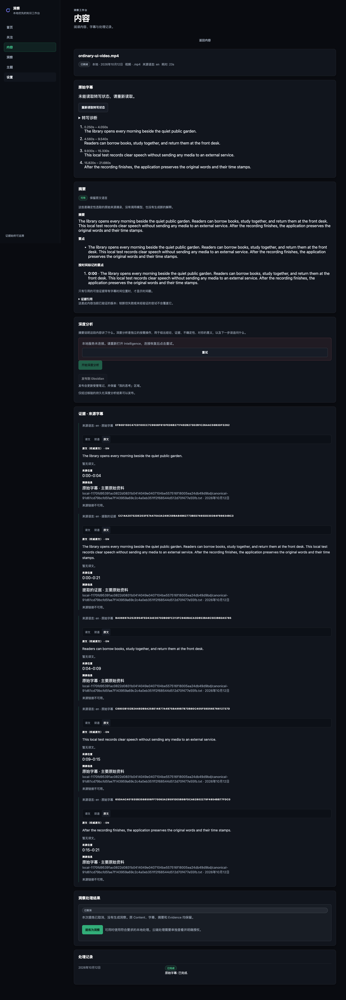

## 8. 查看字幕与摘要

在内容详情页可以查看**原始字幕**与**摘要**。

**原始字幕**：逐段显示带时间戳的字幕文本，对应视频的具体时间段。

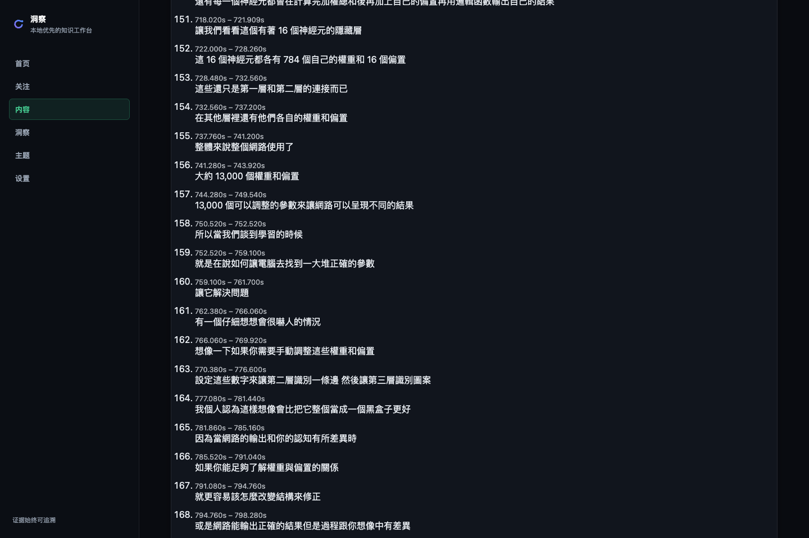

**来源位置与溯源信息**：每段字幕都标明它在视频中的时间位置，并显示对应的证据文件哈希与日期——这就是"证据始终可追溯"的体现。

**摘要**：系统可以基于字幕整理摘要和关键点，也可能直接选取原文摘录。原文摘录保留原始语言，不是翻译或新的解释；页面会注明处理方式。

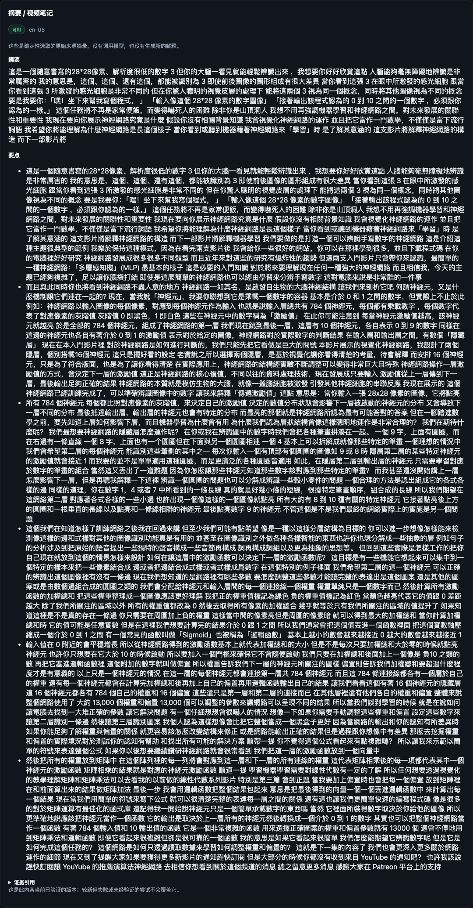

如果内容没有字幕或尚未整理完成，摘要区域会如实显示"不可用"，并说明"此内容尚无摘要或视频笔记；不会根据缺失的结果编造摘要"。

**处理记录**：详情页底部显示该内容的处理历史（例如"原始字幕：已完成""来源信息：已完成"）。

---

## 9. 理解 Evidence（证据）

**Evidence（证据）是 Intelligence 的核心信任机制**：任何结论都能追溯到原始材料。

在内容详情页，你会看到：

- **来源位置**：证据在原始视频中的时间段（例如 `16:53-18:26`）；
- **溯源信息**：证据文件的哈希值与日期；
- **打开原始来源对应时间点**：点击可直接跳转到原视频对应的时间。

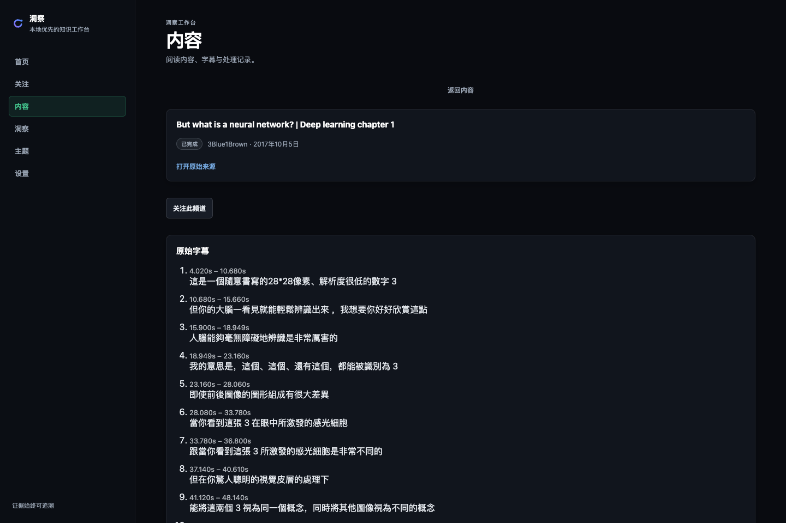

证据的意义：
- **不编造**：系统不会根据缺失的内容编造摘要或洞察；
- **可核验**：每条洞察都引用原始证据，你可以回看原文验证；
- **可追溯**：从洞察 → 证据 → 原始材料，链路完整。

---

## 10. 提炼 Intelligence（洞察）

在内容详情页的"洞察处理结果"区域，可以手动触发提炼：点击 **提炼为洞察**。

**开始前**：洞察提炼需要具备对应能力并获允许的模型。当前示例本地模型 `qwen3:8b` 可用于评分与摘要，尚不能用于洞察提炼。仅显示“已安装，可使用”不表示可以提炼洞察。

没有合格的洞察模型时，页面明确显示 **“当前没有合格的洞察模型。”**，任务等待模型，不会偷偷转为付费云端处理。

**取消尚未执行的等待任务**：

1. 在该 Content 的 **洞察处理结果** 区域，点击 **取消本次提炼**。
2. 等待明确反馈：**“本次提炼已取消，没有生成洞察。原 Content、字幕、摘要和 Evidence 均保留。”**
3. 可以继续阅读原文、摘要和证据。取消结果重启后仍保留；恢复包含该结果的备份，也不会重新执行这次任务。

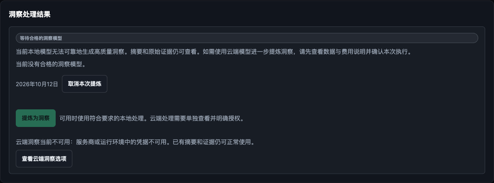

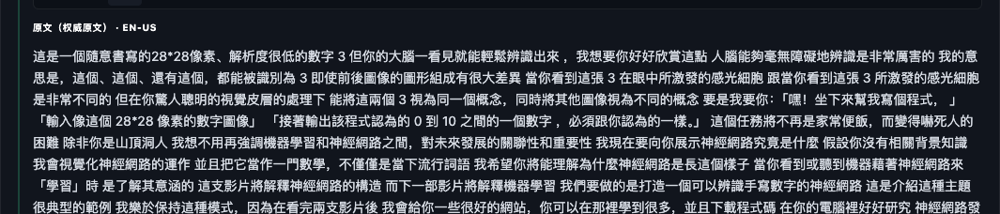

只有系统能证明确实尚未调用本地模型的等待任务才提供取消入口；云端等待保持原有安全规则。若提示不能安全取消，或还有别的等待任务，请按页面原因处理；不要删除任务记录。已执行、执行状态不明或等待预算的任务不能通过此操作解除。

本轮隔离候选也已实际验证：真实本地视频经转写得到字幕、摘要和 Evidence 后，点击提炼会在没有合格模型时安全等待；取消后全部原文件和证据保持一致，备份页面重新检查并恢复可用。这证明等待与取消链路，不代表本地洞察模型已合格或已经生成洞察。

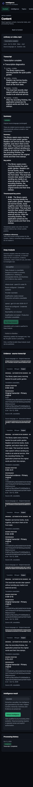

**模型满足条件后**：系统基于可信证据分析内容，判断是否有值得长期保留的新洞察。

**两种结果**：

1. **发现新洞察**：生成洞察条目，可在 **洞察** 页面查看，并关联到主题。
2. **无新洞察**：如实显示"已完成，未产生新洞察"——说明分析已完成，但本次内容没有形成值得长期保留的新结论。

当一个获允许的模型实际完成分析后，“已完成，未产生新洞察”是正常结果；等待模型不是这个结果。

**洞察页面**：所有提炼出的洞察汇总在这里。

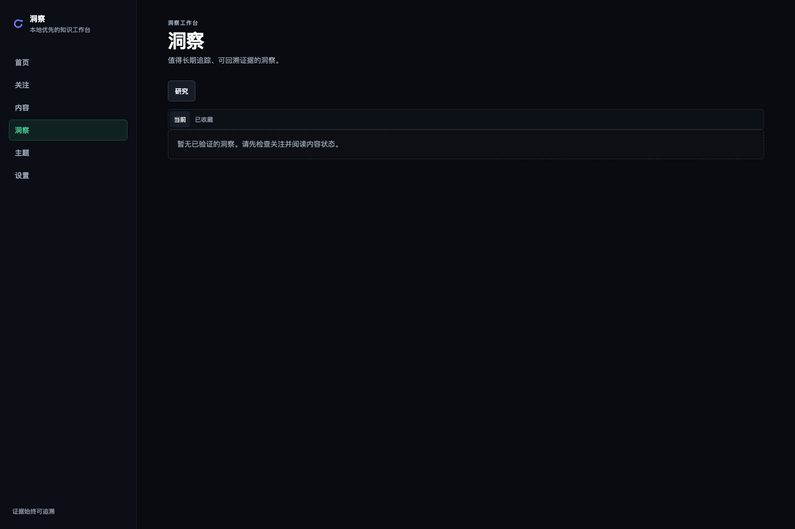

**洞察处理进度**：如果内容正在分析，洞察页面会显示"分析尚未得到可信的最终结果"，可点击"打开内容"回到详情页查看。

> 提示：提炼洞察是**可选**操作。不提炼也不影响内容整理。设置页会分别显示安装身份、本地洞察资格和可选云端方案；安装成功不代表洞察合格，系统不会偷偷使用付费服务。

### 已有资料库的研究

在 **洞察 → 研究** 点击 **新建研究**，输入问题，再选择 1–20 个已有 Content，点击 **收集资料库证据包**。这个入口仅从所选本地资料中按词语检索、核验并整理已有证据，不探索外网，也不调用模型或产生新的结论。

本轮隔离候选的真实录音案例得到 3 条原始证据、0 条已有洞察解释。证据保留原文和真实时间位置；点击 **打开内容与证据** 可回到原始 Content。没有相关材料时仍需你判断，不把空结果编成答案。

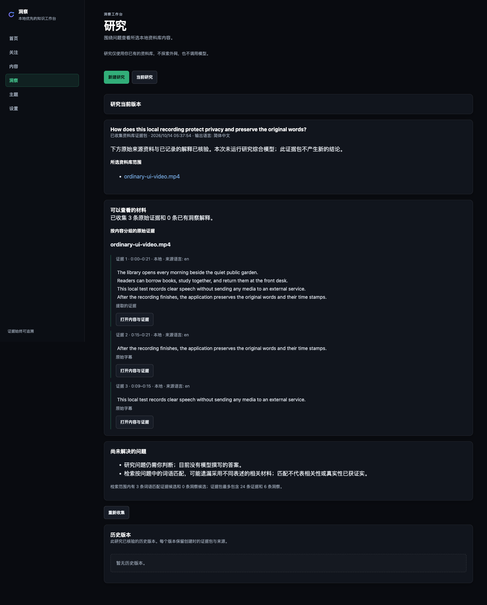

**重新收集**会保留历史证据包。点击 **与上一版本对比**查看所选内容、证据和已有解释的引用变化；“无实质变化”不代表进行过新的模型分析，也不表示证据更强。

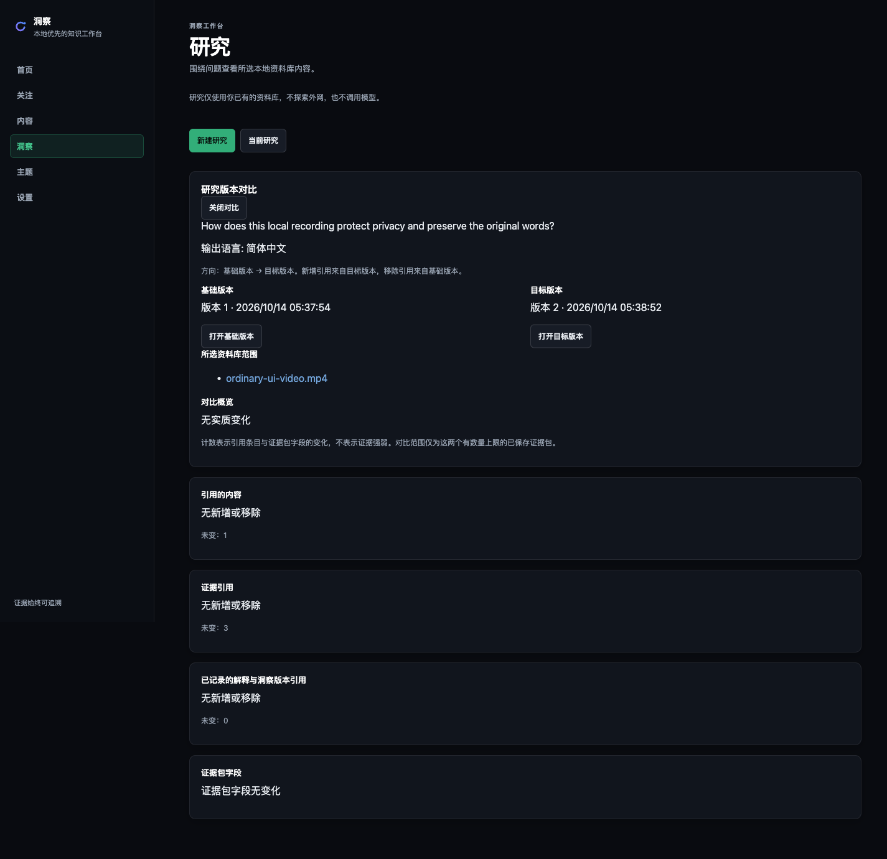

研究当前版本与历史包会随备份保留。本轮实际恢复并重启后，全部数据库表和原文件均一致，研究与历史仍可阅读。

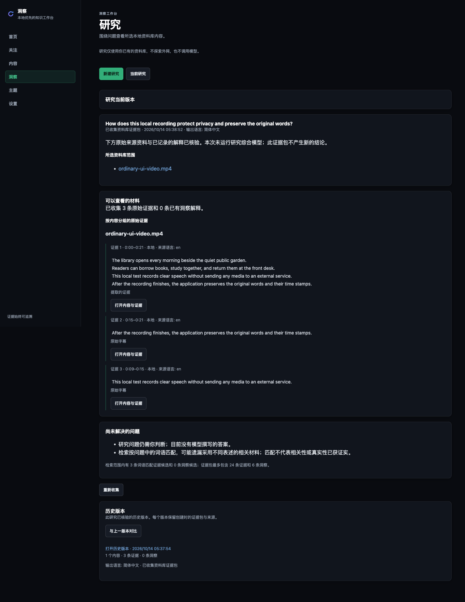

点击“打开内容与证据”后，地址保留所选证据的位置。2026-10-15 的真实隔离验收已确认刷新后仍定位并高亮对应证据；这不表示洞察模型已经通过验收。

---

## 11. 使用 Topic（主题）

**主题**用于把洞察按主题归档，持续积累认知。

- **主题列表**：在 **主题** 页面查看所有主题。

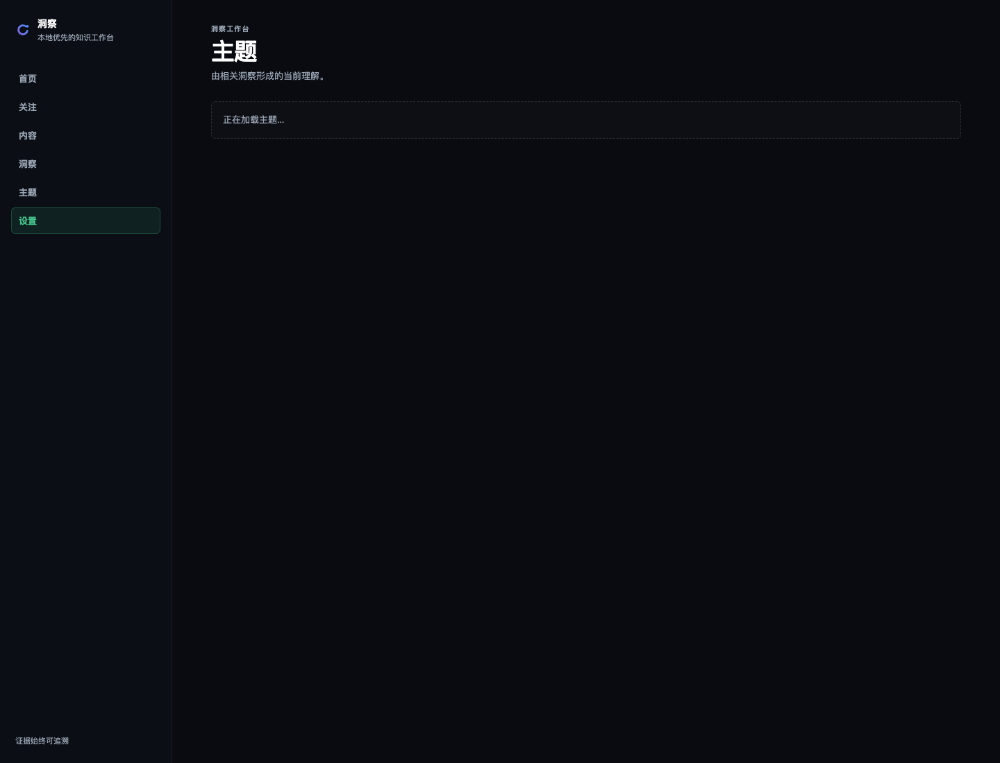

- **主题详情**：点击主题进入详情，可以看到该主题下关联的洞察与可信证据。

> 说明：主题关联的是**已提炼的洞察**。在产生第一条洞察之前，主题页面会保持空状态，这是正常现象。本手册撰写时演示环境尚未产生可关联的洞察，因此主题详情暂以空状态呈现。

---

## 12. 配置本地模型

Intelligence 优先在本机整理内容。部分内容可直接从原文提取摘要；评分与其他摘要方式需要已就绪的本地模型。**洞察提炼是另一个可选步骤**，需要专门具备洞察能力的模型。

**查看当前模型**：打开 **设置 → 模型与处理准备**。

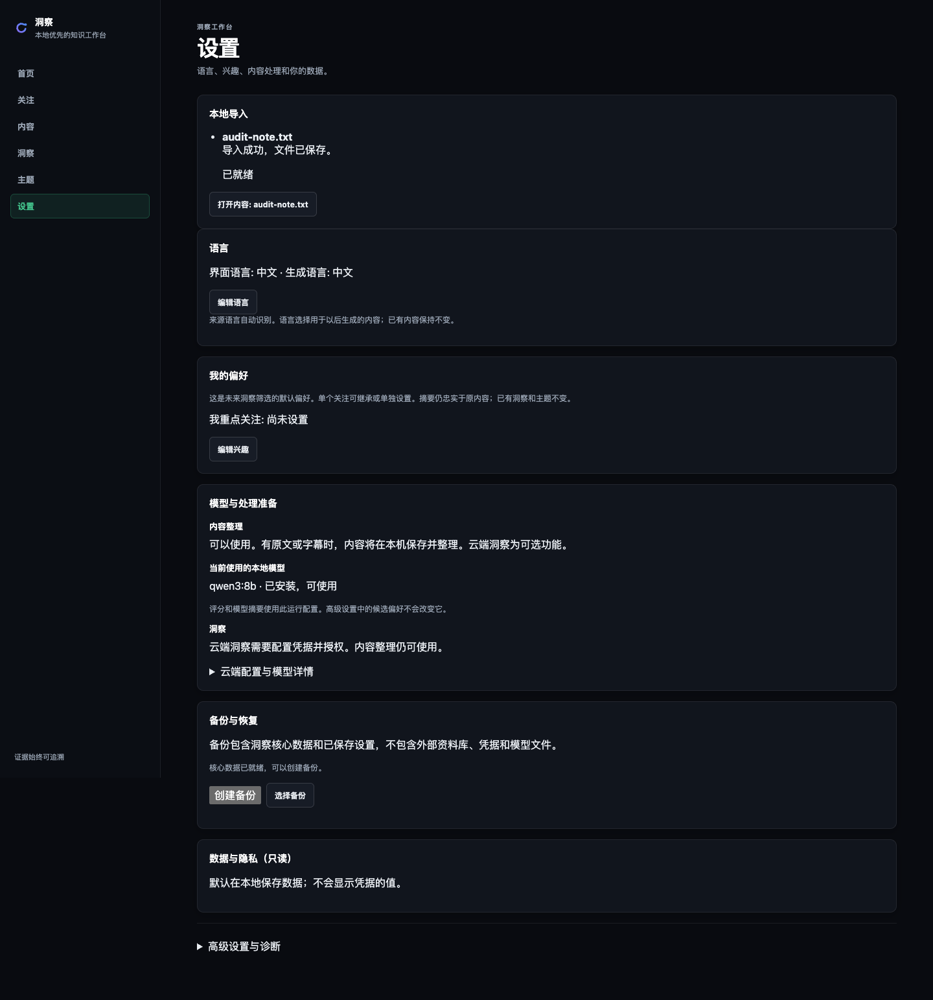

**当前使用的本地模型**区域显示：
- 模型名称（例如 `qwen3:8b`）；
- 状态（"已安装，可使用" 或 "就绪需要关注"）。

**配置要求**：
- 本地模型通过 Ollama 等本机服务提供；
- 系统会校验模型的**精确标识（digest）**，只使用匹配的模型——这是安全机制，防止意外使用其他模型处理你的数据；
- 连接正常、模型已安装和可以整理内容，不等于可以提炼洞察；
- 当前 `qwen3:8b` 的可用范围为评分与摘要。洞察能力尚不可用；
- 模型未就绪时，页面会如实提示，不会静默改用其他模型。

**在设置页的"模型与处理准备"中展开"云端配置与模型详情"**，可以看到模型连接状态与可用模型列表（只读）。

> 提示：安装本地模型需要一定的技术准备（安装 Ollama 并拉取指定模型）。未配置模型时仍可导入和阅读原文；是否能生成摘要取决于内容与页面显示的处理方式。

---

### 本地音视频的语音模型

语音转写模型与上面的 Ollama 评分/摘要模型是两种能力。“本地模型已安装”不能证明语音转写可用。

1. 首次使用的处理说明页，或者导入对话框/视频详情，点击 **设置本地转写**。
2. 在 **设置 → 本地音视频转写** 查看原因。点击 **检查可用性** 可重新检测当前环境。
3. 如果你已经有应用兼容的 MLX Whisper 模型，输入其文件夹的完整路径。文件夹需包含 `config.json` 和模型权重；点击 **保存并检查模型**。应用不会自动安装运行环境或下载模型。
4. 保存路径只记录选择，不代表模型通过质量验证。未测试、验证失败或验证结果过期时仍不能启动转写，配置不会解除限制。等页面明确显示转写已就绪后，再返回已导入的音视频，点击 **开始转写**。
5. 从内容详情进入设置时，点击 **返回内容** 回到原文件。路径错误会显示可改正的提示并保留输入；有检查或转写在运行时不能修改模型。

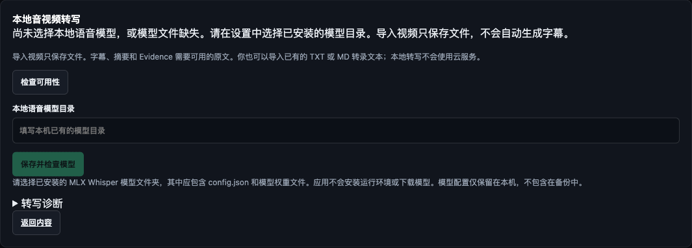

本轮隔离验收中，已通过质量验证的固定语音模型实际完成了视频转写。界面显示“本地转写已就绪”后，正常点击 **开始转写** 即可处理；以下是实际结果，不是示意图。资格和模型设置属于当前机器，恢复备份不会在另一台机器上自动变成可用。正式产品尚未采用本轮配置。

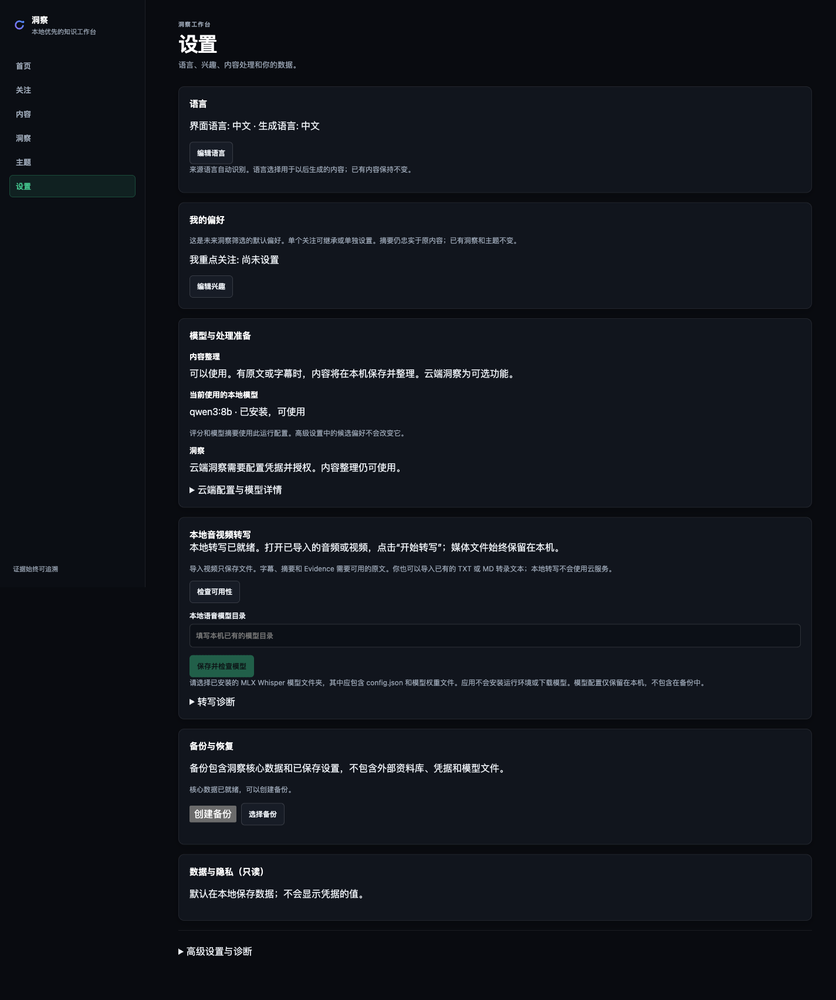

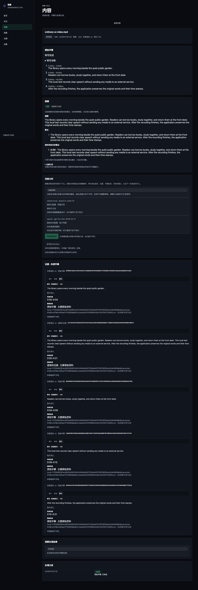

**尚无合格语音模型时可以继续做什么**：保留已导入音视频，先导入自己已有的 UTF-8 TXT/MD 转录文本，直接阅读来源文本、摘要摘录与 Evidence。系统不会自动改用付费云模型。当前版本没有面向普通用户的一键安装及质量验证流程，因此仅填写目录无法保证转写可用；没有兼容且已通过验证的模型时需要应用维护者先完成资格验证。

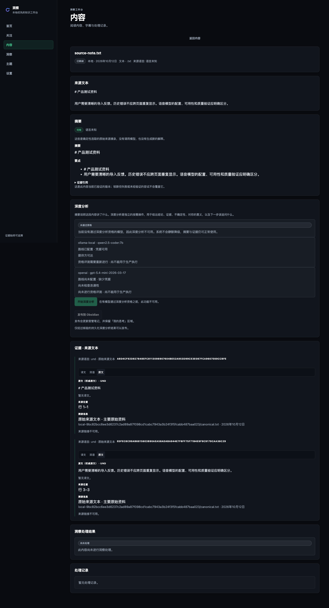

## 13. 配置云端模型

云端模型是**可选**能力，用于更高质量的洞察提炼。

**在设置页的"洞察"区域**，当前状态会明确说明：

- 未配置凭据时：**"云端洞察需要配置凭据并授权。内容整理仍可使用。"**

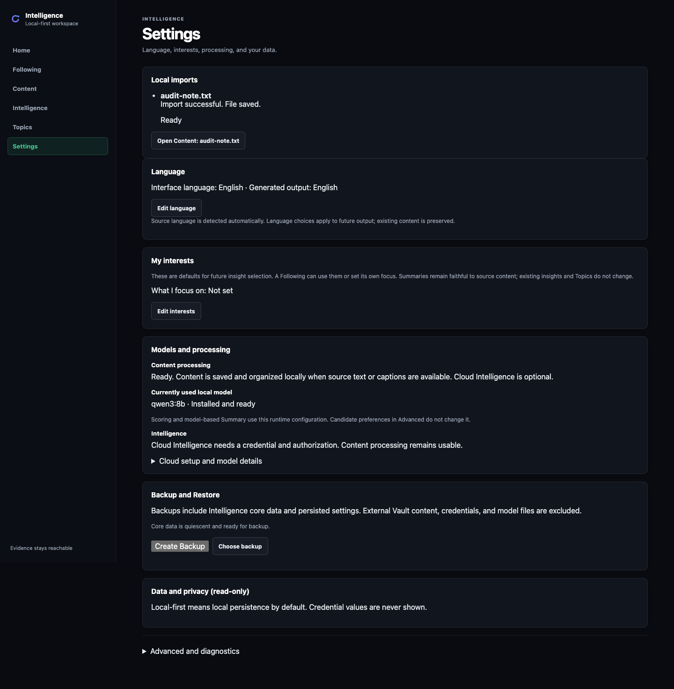 *（英文界面示例）*

**使用规则**：
- 云端处理**需要你为每一次请求明确授权**（产品原则：不得未经授权自动调用付费云模型）；
- 凭据值**永远不会**在界面中显示；
- 不配置云端模型仍可使用本地导入、原文和可用的内容整理方式；本地转写与模型摘要仍取决于各自的准备情况。

> 本手册撰写时，演示环境未配置云端凭据，因此云端洞察显示"需要配置凭据并授权"是正常的诚实反馈。

---

## 14. 修改语言

可以修改**界面语言**与**生成内容的语言**（中文或英文）。

编辑后点击 **保存语言** 才应用；点击 **取消** 保留当前语言，未保存的选择不会写入设置。

**操作步骤**：

1. 打开 **设置** 页面，找到 **语言** 区域。

2. 点击 **编辑语言**。

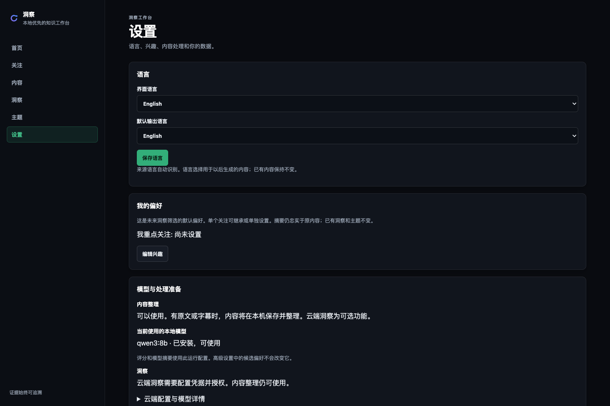

3. 选择 **界面语言** 与 **默认输出语言**（默认输出语言影响以后生成的摘要/洞察的语言）。

4. 点击 **保存语言**。

**切换为英文后的设置页**：

**切回中文**：再次点击 **编辑语言（Edit language）**，选择中文并保存。

**说明**：
- 来源语言自动识别；
- 语言选择只影响**以后**生成的内容，已有内容保持不变；
- 界面语言保存在当前浏览器配置中，重启应用后仍有效。

---

## 15. 备份与恢复

**备份内容**：备份包含洞察核心数据与已保存设置；不包含外部资料库、凭据和模型文件。

**创建备份**：

1. 打开 **设置 → 备份与恢复**。

2. 点击 **创建备份**，系统生成一个备份文件（`.zip`），列出备份中的内容统计（关注数、内容数、证据数等）。

**备份前检查**：如果有内容正在处理（例如提炼任务仍在执行），页面会提示"以下工作尚未结束，暂时无法备份"，普通运行任务结束后即可备份。对于尚未调用模型的等待任务，可先到对应 Content 点击 **取消本次提炼**；页面会重新检查全部工作，其他任务未结束时仍不能备份。这是为了保证备份数据的一致性。

**保存备份**：创建后点击 **保存备份文件**，将 ZIP 文件保存到你选定的位置。

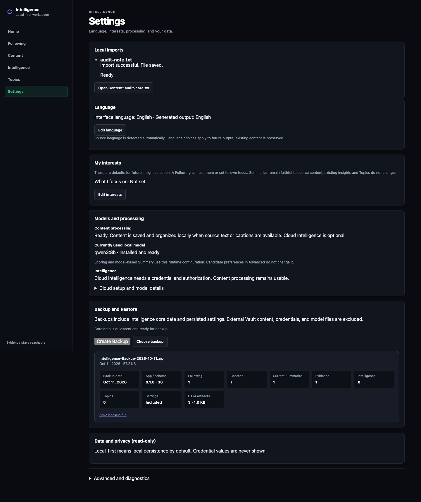

**恢复备份**：

1. 点击 **选择备份**，选取已保存的 ZIP 文件。
2. 查看检查结果与内容数量。此时当前数据尚未改变。
3. 点击 **恢复此备份…**，在确认框输入 `RESTORE`。
4. 点击 **确认恢复并重启**。恢复会替换当前核心数据和本地内容快照；外部资料库不被覆盖。
5. 重启应用，确认恢复完成，再打开内容检查原文与证据。

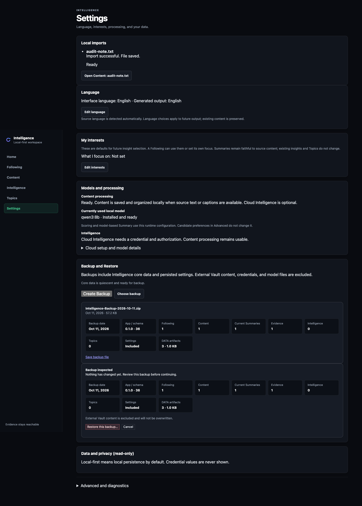

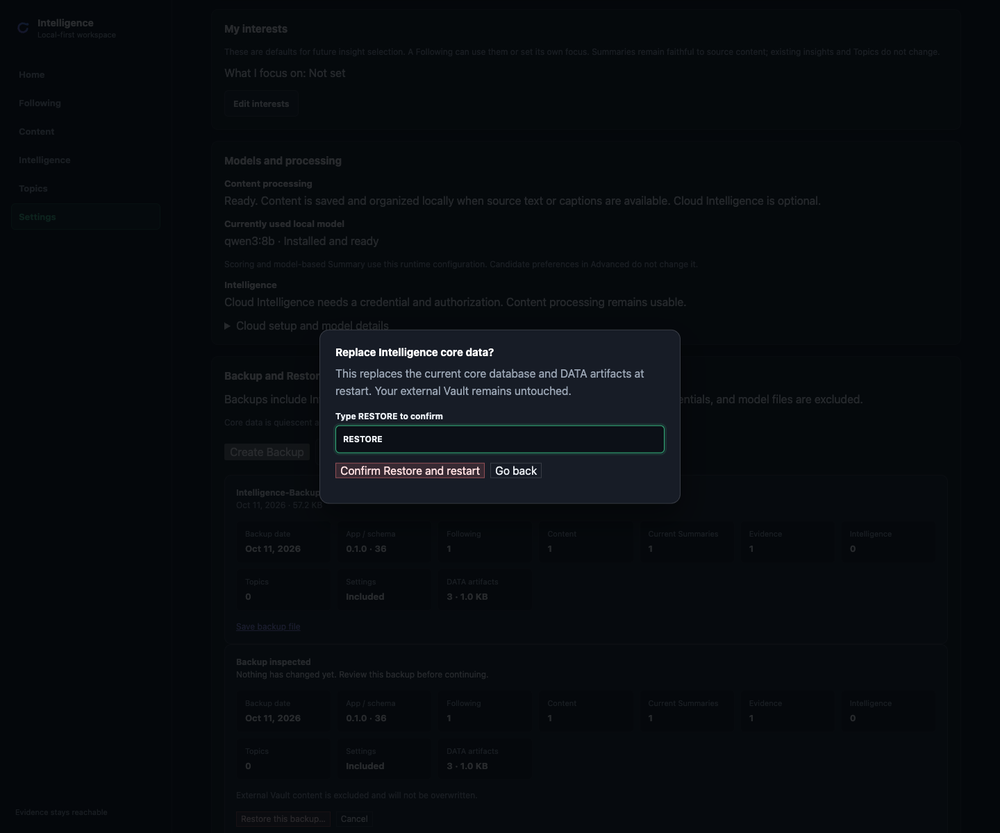

本轮候选在真实字幕导入后，通过本页面创建、下载、选择、确认恢复并重启，原始字幕文件、摘要、证据和全部核心历史都与恢复前相同。失败任务的某些历史恢复情况仍在整改，不能把一次正常恢复视为所有情况已通过。

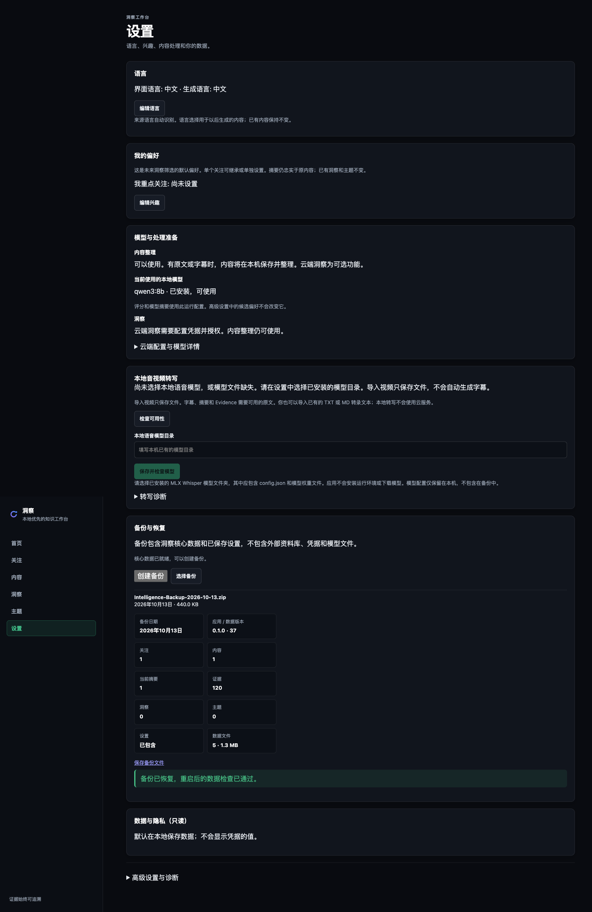

新数据版本也已在隔离环境通过本页面恢复并重启：全部数据表和 78 个文件与恢复前一致。这不表示所有外部字幕来源都可用，也不改变模型资格。

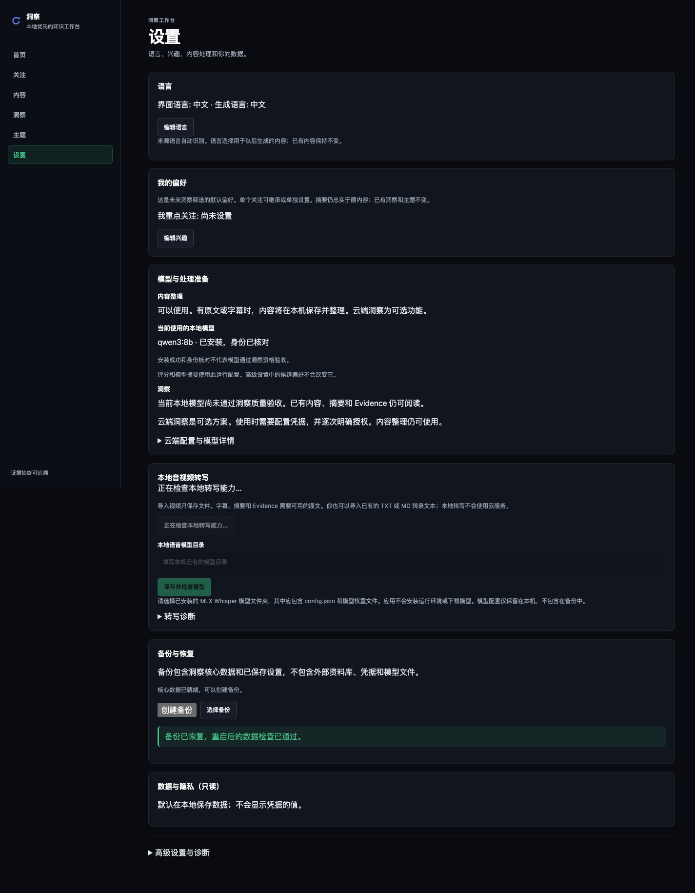

页面会把历史成功标为“上一次恢复已完成”并显示日期。选择新的备份时，预览只表示检查通过，当前数据还没有改变；只有确认恢复、重启并检查通过后，才显示本次恢复成功。新备份检查失败时会显示失败原因，不把上次成功当成本次完成。

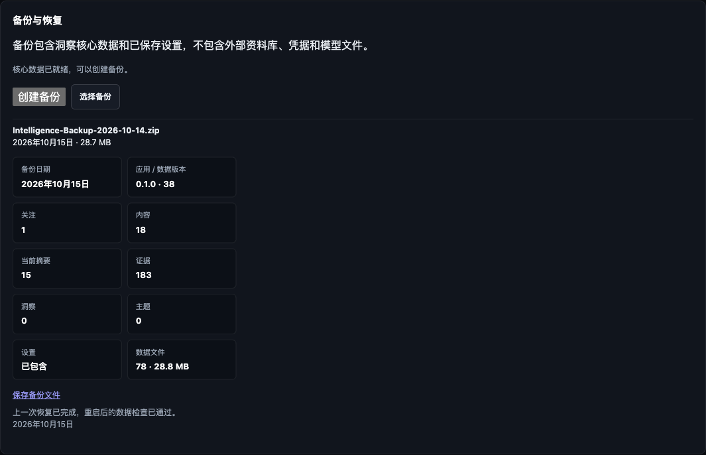

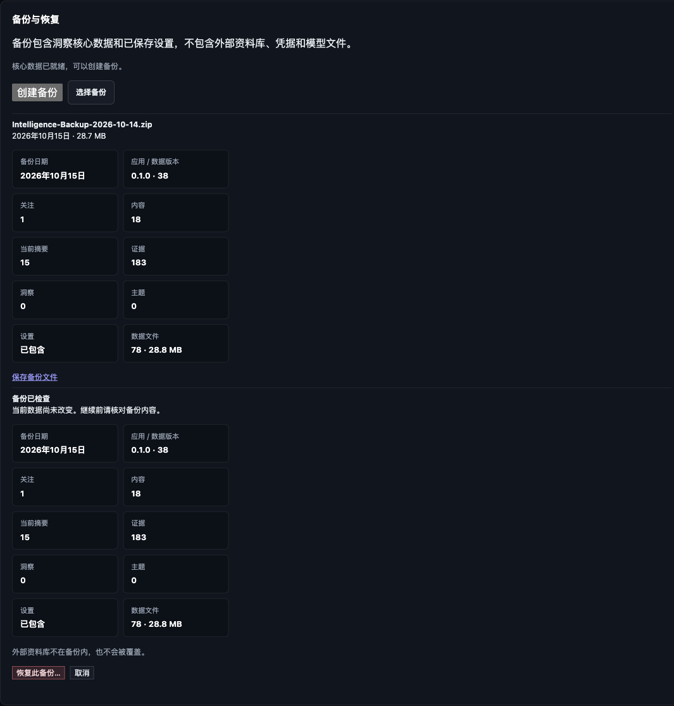

损坏或不符合要求的备份不会覆盖当前数据。等待模型、等待预算或尚未完成的工作可能阻止备份。安全取消只终止所选的未执行等待任务；如果仍有其他工作，页面继续显示真实阻塞原因。

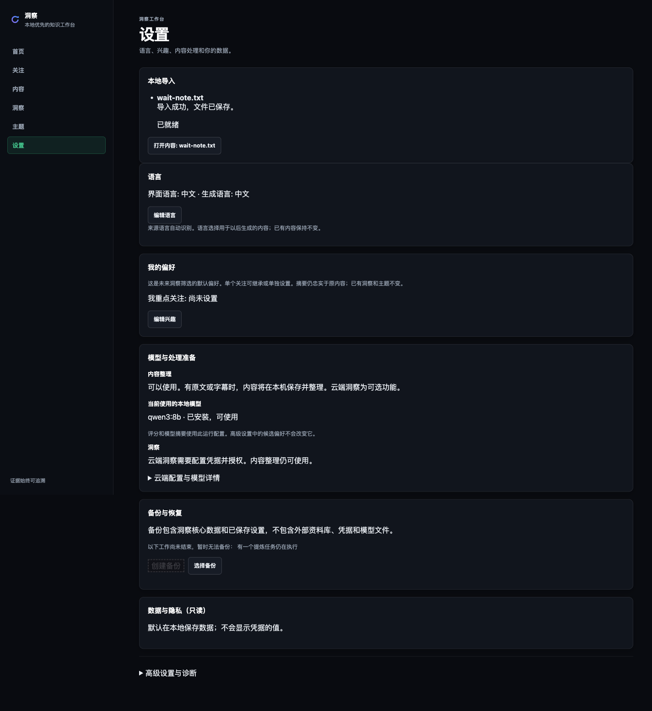

无法证明确实未执行的任务仍会阻止备份，请保留数据并联系维护者，不要删除 checkpoint 或调用记录。

2026-10-15 隔离验收：TXT 与 MD 均经真实 macOS 文件选择器导入。分别取消未执行的提炼后，重启和恢复仍保留取消结果、摘要与 Evidence；还有其他等待任务时，备份仍会阻塞。此次真实恢复逐项核对 74 张表和 84 个数据文件一致，不表示洞察模型已合格。

> 上图是隔离示例数据的真实备份与恢复界面；你的条目数量和文件大小会不同。

---

## 16. 常见问题

**Q1：我的数据存在哪里？**
A：默认保存在你本机的数据目录中（本地优先）。凭据值永远不会被显示。

**Q2：添加的视频一直没有字幕/摘要？**
A：检查内容详情页的状态提示。如果显示"字幕不可用"或"待转写"，说明源没有可用字幕，或本地转写模型尚未配置。系统不会编造内容，这是如实反馈。

**Q3：点击"提炼为洞察"后一直显示处理中？**
A：洞察需要具备对应能力的模型。当前本地 `qwen3:8b` 尚不能提炼洞察，即使显示已安装，也可能处于等待状态。云端洞察需要合格模型、凭据和明确授权。等待状态并不表示已完成。尚未调用模型时，可以点击 **取消本次提炼**，已有内容与证据保留。

**Q4：浏览器后退/前进按钮没有反应？**
A：旧版本存在此问题，本手册对应版本已修复：点击浏览器后退/前进按钮，或直接在地址栏修改 # 后的路径，都会正确切换页面。

**Q5：为什么不能持续关注 Bilibili UP 主？**
A：当前版本暂不支持 Bilibili UP 主持续关注，但可以单次导入公开 Bilibili 视频。这是当前已知限制，界面中有明确提示。

**Q6：如何修改语言？**
A：设置 → 语言 → 编辑语言，选择界面语言与输出语言并保存。

**Q7：备份时提示"暂时无法备份"？**
A：有未结束或未决的工作。已完成的“无新洞察”结果不会阻止备份；等待模型或预算仍可能阻止。尚未调用模型的等待任务可在对应 Content 安全取消。系统会重新检查全部任务；已执行、状态不明或等待预算的工作仍遵守原安全规则。

**Q8：可以删除内容吗？**
A：当前版本不提供删除已保存内容的操作。导入失败提示可以关闭，也会自动消失；这与删除已保存内容不同。已保存的原文件快照与历史会继续保留。

---

## 17. 当前已知限制

以下是本轮候选（2026-10-15）的已知限制：

| 限制 | 表现 | 说明 |
|------|------|------|
| **本地音频/视频转写依赖模型** | 导入的音频/视频显示"待转写" | 需要约 1.6 GB 的本地语音识别模型（mlx-whisper）。模型未配置时，转写能力检查会如实报告"暂不可用" |
| **Bilibili 字幕可能不可用** | 导入的 Bilibili 视频显示"字幕不可用" | 部分 Bilibili 视频无公开网页字幕，或受源站访问限制 |
| **Bilibili UP 主持续关注暂不可用** | 添加对话框明确提示 | 当前版本支持单次导入公开 Bilibili 视频，不支持持续关注 UP 主 |
| **云端洞察需要凭据与逐次授权** | 设置页明确提示"需要配置凭据并授权" | 产品原则：不自动调用付费云模型 |
| **媒体导入上限 2 GiB** | 超过上限时拒绝导入 | macOS 原生快速快照有既有验收；大文件仍需校验，不能把确认接收理解为已经处理完成 |
| **主题需先有洞察** | 主题页面为空 | 主题归档的是已提炼的洞察；产生第一条洞察前主题为空是正常现象 |
| **本地洞察当前不可用** | 可能显示等待模型 | 当前本地模型仅用于评分与摘要，不能仅凭安装状态启用洞察 |
| **其他未结束或未决任务仍阻止备份** | 暂时无法备份 | 零调用的等待模型任务可安全取消；等待预算、已执行或状态不明的任务仍需按原因处理 |

---

## 图示与使用范围

本手册保留 17 章操作结构。图示包含本次实际界面及未变化页面的上一版图示，不是设计稿。示例条目不代表你的资料已经导入。

YouTube 单视频与频道添加、关注暂停与恢复、本地文本导入、内容导航、中英文设置、备份及恢复已实际操作。本轮隔离普通服务还完成真实 Whisper 视频转写、字幕/摘要/Evidence、71表78文件恢复，以及本地视频零调用等待→安全取消→备份重新可用；关注详情读取故障的重试只发GET。截图来自真实 macOS Chrome 和隔离服务，未接触正式用户数据；不把隔离模型设置复制成正式资格。当前本地洞察正向生成、保存及真实主题完整链路仍受模型语义失败阻塞，新的获批模式尚未实测通过；没有合格洞察模型时，继续使用内容整理与原文阅读。本轮候选尚未正式采用。
