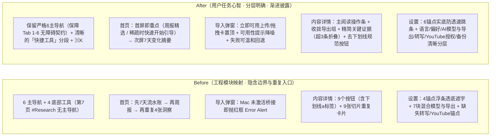
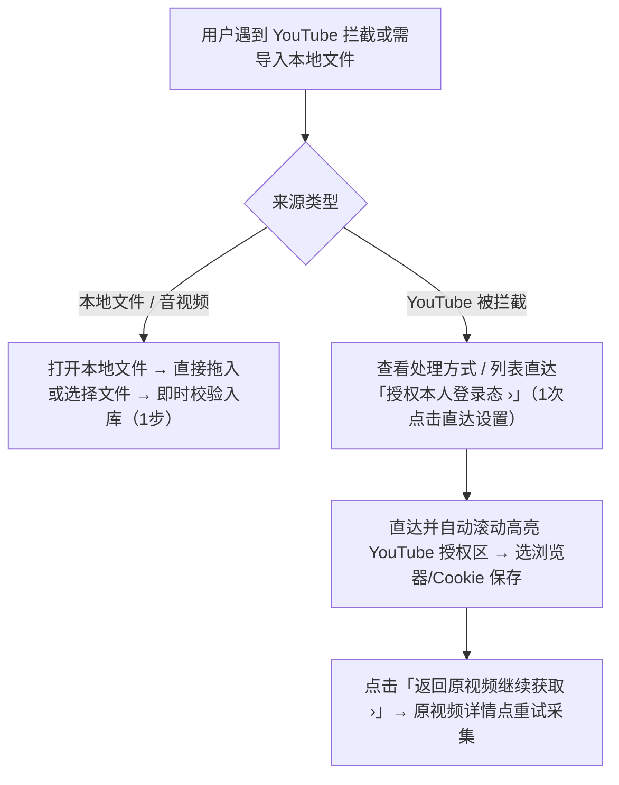

# 第三至七阶段：信息架构、核心流程、文案规范与 UI 设计系统

---

## 一、第三阶段：信息架构（IA）重构方案

### 1.1 功能分级盘点
- **核心高频功能（默认首屏/主操作直达）**：内容导入（YouTube / Bilibili / 本地拖拽与上传）、首页「本周精选」与待处理指引、内容库搜索与分诊（未读/必看/收藏）、纯净阅读器（摘要 + 核心结论 + 可核验引用）、跨视频 AI 问答。
- **次级高频功能（主导航直达，清晰轻量）**：关注源管理（频道健康状态与按需检查）、洞察列表（长期可信观点沉淀）、主题脉络（跨视频聚合专题）。
- **低频功能（设置主视图内分组直达）**：界面与输出语言、我的内容偏好（少看/重点关注）、默认 AI 模型选择、语音转写模型下载、YouTube 按需登录兜底、数据备份与 Obsidian 导出包。
- **高级专业与工程能力（渐进式披露，默认折叠）**：底层离线模型资格校验、实验性多模型深度对照、传统无 AI 手动证据包组装器、底层诊断数据与历史。
- **冗余消除清单**：
  1. 消除内容列表对「正在待处理」手工单视频的双重渲染（横幅已突出展示并提供“查看处理方式 / 授权”）。
  2. 消除详情页将同一段 3 句字幕反复切出 9 张重复卡片占满首屏的问题（首屏默认展示精简关键证据，其余可一键折叠展开）。
  3. 消除设置页「模型设置」卡片里混入的跨系统导出按钮冲突（改为明确分组并始终保留清晰出口，不因展开编辑而消失）。

### 1.2 优化前后信息架构对比

---

## 二、第四阶段：核心操作流程重构与复杂度对比

### 2.1 关键设计选型比较（以导入与异常恢复为例）
- **方案 A（彻底移除 macOS 原生文件选择提示）**：最简但违背桌面安全授权回归测试与大文件（2 GiB APFS 克隆）能力保留。
- **方案 B（保留桌面原生文件桥契约与状态感知，但将“浏览器一键选文件 / 拖拽上传”视觉升格为当桌面桥不可用时的第一可用主动作，提示从红框报错改为温和中性引导）**：**选中**。零破坏桌面权限语义，同时彻底消除命令行用户一进弹窗就被红色报错劝退的惊吓，支持直接拖拽文件一次完成导入。

### 2.2 优化前后核心任务流

| 核心流程指标对比目标 | 当前基线 | 目标优化后 | 核心手段 |
|---|---:|---:|---|
| 本地文件导入产生困惑/报错次数 | 1 次首屏红错 | **0 次报错**（柔和说明 + 拖拽区直接可用） | 优先级倒置纠偏 + Dropzone |
| 内容详情首屏非阅读按钮/冗余切片密度 | 9 按钮 + 9 卡片 | 头部两层清晰收拢 + 证据默认 ≤3 条（可展开） | 层级重组 + 渐进折叠 |
| 设置页速跳覆盖率 | 4/6 核心块（4 锚点） | **6/6 核心块（6 锚点 + 实底防重影）** | 增补转写与授权锚点 + 实底粘性条 |
| 首页稀疏/待处理误导跳转 | 错误引导去「关注」 | 精确引导回处理方式 + 空态直给「导入」主按钮 | 状态精准分流 |

---

## 三、第五阶段：全局产品文案、术语表与 UX 写作规范

### 3.1 核心产品术语统一表

| 概念 | 统一中文标准命名 | 禁止再混用 / 需清理的场景 | 说明 |
|---|---|---|---|
| Topic 聚合簇 | **主题** | 在同一上下文中与「专题」混写（保留已有组件兼容词外，新文案统一优先用「主题」） | 与一级导航「主题」对齐 |
| 频道/关注来源 | 外部频道用**频道**，本地文件统称**本地资料库** | 本地资料库不得显示「问此频道」等频道措辞 | 遵循真实实体心智 |
| 跨视频问答 | 界面内统一优先用**跨视频问答**（页面标题保持已有测试锚点不变） | 避免在同一弹窗/提示里互相矛盾引用不同按钮名 | 如：问答提示文字与导出按钮名称严格一一对应 |
| 失败与异常反馈 | NN/g 三段式：**发生了什么 · 为什么 · 下一步怎么做** | 纯英文内部错误码、责备用户、“查看关注详情”（当来源不在关注页时） | 先安抚并保留当前状态，再给可操作主按钮 |

---

## 四、第六与七阶段：UI 设计系统与交互状态规范

### 4.1 色彩与双主题系统（沿用并精炼现有 Obsidian Dark / Warm Paper Light）
- **Obsidian Dark（默认，适合专注研究）**：画布 `#090c12`、侧边栏 `#0c1017`、面板 `#101620`、正文 `#e6ecf4`、次级文字 `#94a3b8`（确保对比度 `>= 4.5:1`）、唯一功能主强调色翡翠绿 `--accent: #2fb37c`。
- **Warm Paper Light（日间纸感阅读）**：画布 `#f6f5f1`、侧边栏 `#efede7`、纯白阅读卡 `#ffffff`、主文字 `#1f2937`、主强调色 `#147a52`。
- **禁止 AI 模板套壳特征**：禁用紫色渐变、禁止无交互文字套按钮级圆角边框胶囊、禁止 `<a class="button">` 残留蓝色默认下划线、禁止悬浮栏透明透字重影。

### 4.2 排版与阅读尺度
- 正文阅读区（摘要、问答正文、核心洞察）约束最佳阅读行宽 `max-width: 68ch`；行高 `1.65`；数字指标强制 `tabular-nums` 对齐。
- 图标系统统一采用 `PhosphorIcon`（`256×256` 矢量），面板标题内图标与标题文本固定 `8px` 间距。
- 无障碍与键盘纪律：严格保留侧边栏 `<nav aria-label="Primary navigation">` 前 6 个一级 `<button>` 作为全站前 6 个 Tab 焦点，全按钮具备清晰的 `:focus-visible` 焦点环与状态反馈。

### 4.3 移动端与交互状态覆盖
- `320px–900px` 响应式顶栏：修复品牌标题与右侧工具栏垂直定位，保证所有操作按钮完整落入视口（`y >= 0`）且横向筛选条自动留白或平稳换行，禁止文字半截裁切。
- 全量状态覆盖：默认态、初次使用态、空态、加载态、处理中、成功反馈、温和降级提示（非阻断错误）、网络/权限异常恢复、焦点迁移与深度链接抵达高亮。
