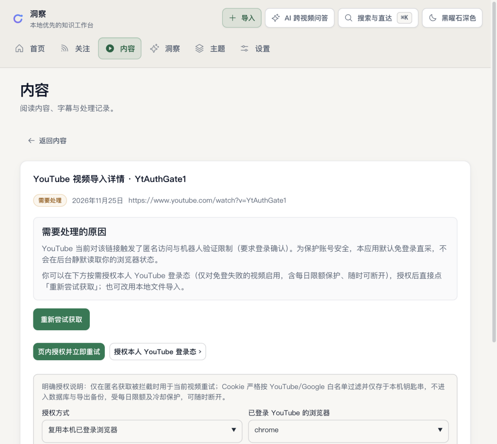
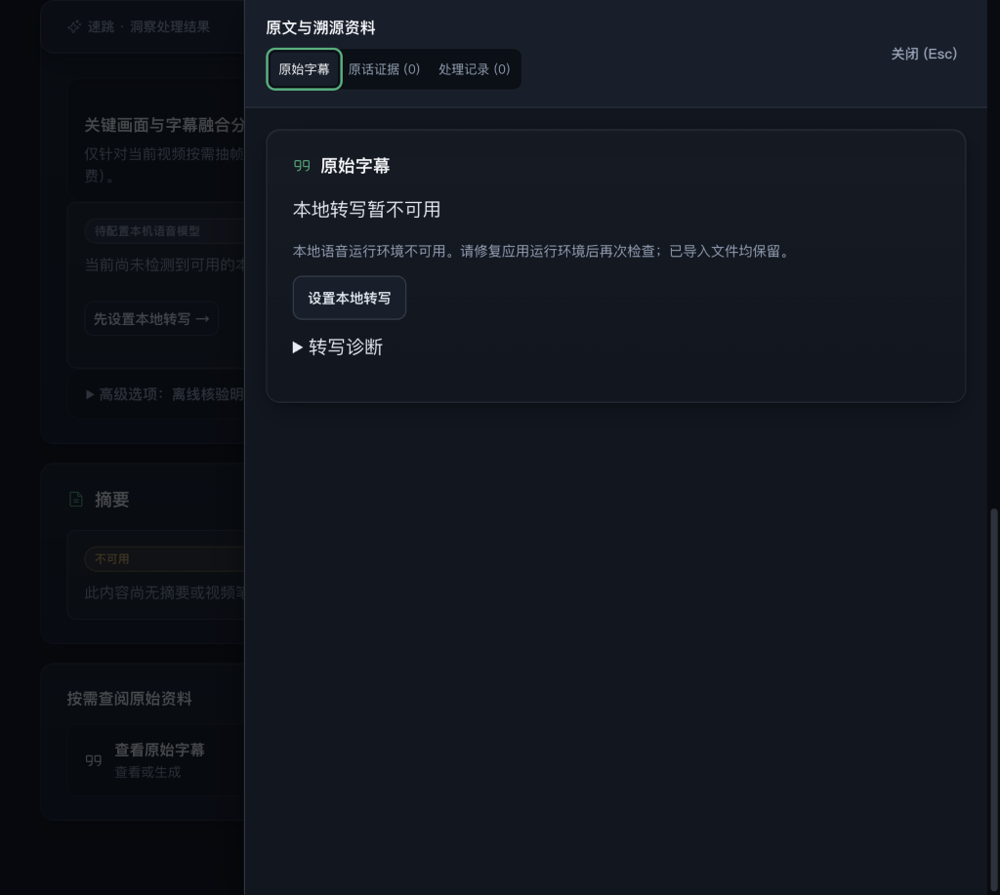
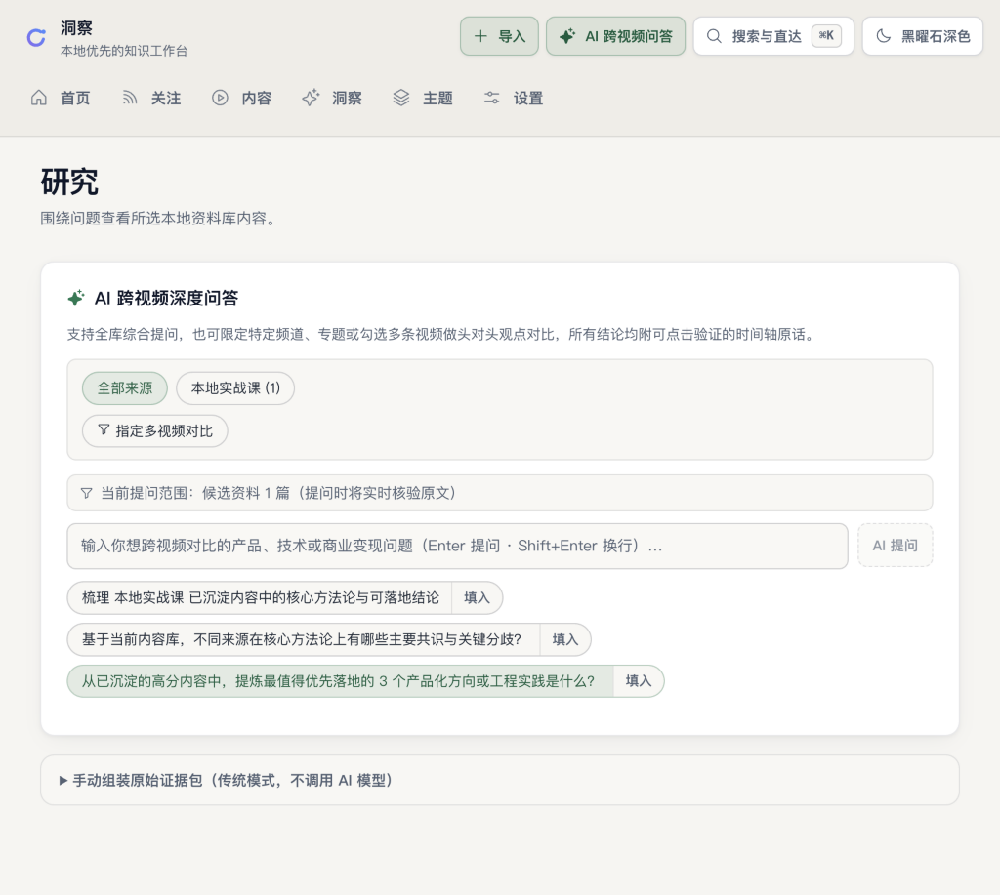
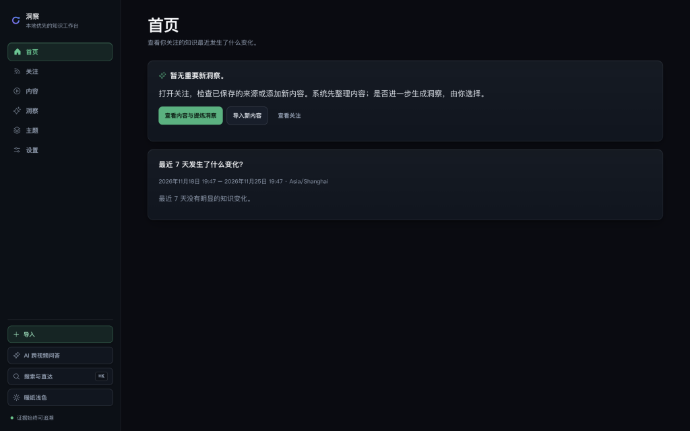
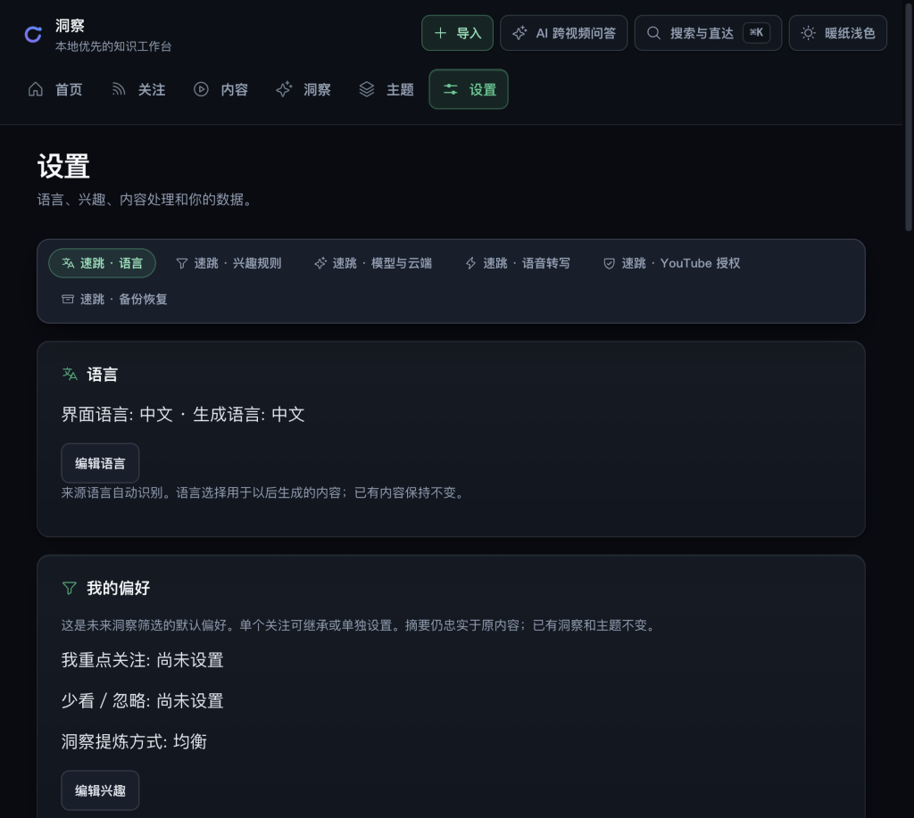

# Intelligence｜独立二次代码复审、精准整改与合流放行任务书

- 日期：2026-11-25
- 审查角色：Senior Staff Engineer + 产品总监，独立静态复审
- 裁决：**结论 B / HOLD — 暂缓合并 main**
- 仓库：huangbuqubunao-alt/intelligence
- 工作分支：`antigravity/remediation-20261125`
- 已复审代码基准：[913b2c06](/huangbuqubunao-alt/intelligence/commit/913b2c06030caf7fa9a69e5f07737cc5269e57f2)
- 已复审交付基准：[9a8444e6](/huangbuqubunao-alt/intelligence/commit/9a8444e61858a73eaad1a0c05d8bf9093756fede)
- main 基准：`d1b58f731adc4185fe78cc5538e9e211b8a0e211`
- 原任务书：[04_INDEPENDENT_CODE_REVIEW_AND_AGY_REMEDIATION.md](04_INDEPENDENT_CODE_REVIEW_AND_AGY_REMEDIATION.md)
- AGY 本轮验收报告：[05_INTEGRATION_REMEDIATION_ACCEPTANCE_REPORT.md](05_INTEGRATION_REMEDIATION_ACCEPTANCE_REPORT.md)

> 这是独立复审结论及下一轮唯一整改主线，不是已经完成整改的验收报告。未授权合并 main。保留上一轮有效成果，禁止再次全面重构。
> 源码证据固定在 913b2c06，后续行号变化按函数名定位。示意图为审查者绘制；已有截图来自 AGY 的 9a8444e6，不是审查者新运行获得。

## 1. 总体裁决与已核实证据

**HOLD。7 PASS / 7 PARTIAL / 1 FAIL（共 15 项）。无已证实新增 P0；三项新增或未闭环 P1，以及完整 CI 证据阻塞。** 上一轮媒体路径、Host、SQLite 原子配额、抽屉焦点等有效修复必须保留。放行不要求完美理解所有自然语言，但不能把未检测到矛盾等同于已核验事实。

独立通过 GitHub 实际读取七个整改提交 Diff（812d638a、0a778a07、69dd2858、192847d6、e7118b2b、1d97f61d、913b2c06）、关键源码与对应测试、任务书、验收报告、检查点、授权截图。未独立 checkout、运行测试、穷尽审查相对 main 全部改动或逐张验证全部截图；以下反例为源码推导，AGY 必须先复现并记录结果，不得当成已执行的测试。GitHub Compare 全量文件列表返回上限 300，不能用于宣称全仓改动已穷尽审查。

### 1.1 拓扑与交付证据（已独立确认）

- [main...9a8444e6](https://github.com/huangbuqubunao-alt/intelligence/compare/d1b58f73...9a8444e6)：共同祖先为 main@d1b58f73，ahead 25 / behind 0，返回的 25 个提交逐个检查均为单父提交。区间 beea3a53..913b2c06 实际还包含集成阶段 75da5130；七个整改代码提交在其后。
- [913b2c06...9a8444e6](https://github.com/huangbuqubunao-alt/intelligence/compare/913b2c06...9a8444e6)：ahead 1 / behind 0，文件清单恰为两份 Markdown 和七张 PNG，未变更代码。
- 目标分支 HEAD 为 9a8444e6，main 为 d1b58f73（复审时）。创建本文前再次确认目标分支 HEAD 未变化。本文为新文档提交，不会使已有代码验证 SHA 自动失效，但后续任何代码变更都需重新绑定验证 SHA。
- GitHub 查得 Delivery SHA Check Runs 0、Commit Status pending 且 statuses 为空、该分支 Actions Runs 0；这是未获 CI 通过证据，不是 CI 运行失败。
- 原 AGY 报告还称重放起点 tree parity、git diff --check 通过；这是其本地报告记录，本轮未独立运行相应 Git 命令。

~~~mermaid
flowchart TD
  A["main d1b58f73"] --> B["线性重放 16 个提交至 beea3a53"]
  B --> C["75da5130 集成阶段"]
  C --> D["七个整改代码提交至 913b2c06"]
  D --> E["9a8444e6 纯文档 + 7 PNG"]
  E --> F["06 二次复审文档（新增）"]
  F --> G["下一轮小批整改"]
  G --> H["Draft PR / 全量 CI"]
  H --> I["独立复审 + 用户批准"]
~~~

### 1.2 独立复核矩阵（PASS 是静态实现认可，非独立运行通过）

| ID | 判定 | 依据及剩余事项 |
|---|---|---|
| P1-01 | PASS | [src/youtube_intel/local_api.py:4331–4415](https://github.com/huangbuqubunao-alt/intelligence/blob/913b2c06030caf7fa9a69e5f07737cc5269e57f2/src/youtube_intel/local_api.py#L4331-L4415)：Host 白名单、Sec-Fetch-Site、Origin 在文件读取前检查，[src/youtube_intel/local_api.py:4152–4168](https://github.com/huangbuqubunao-alt/intelligence/blob/913b2c06030caf7fa9a69e5f07737cc5269e57f2/src/youtube_intel/local_api.py#L4152-L4168) CORP same-origin；正常本机读取契约保留。 |
| P1-02 | PASS | [src/youtube_intel/fast_read_api.py:2048–2229](https://github.com/huangbuqubunao-alt/intelligence/blob/913b2c06030caf7fa9a69e5f07737cc5269e57f2/src/youtube_intel/fast_read_api.py#L2048-L2229)：白名单 SOURCE_DATA/DATA，保留 root + relative path，SHA-256 与 dev/ino/size/mtime/ctime 缓存；[src/youtube_intel/source_authority.py:96–189](https://github.com/huangbuqubunao-alt/intelligence/blob/913b2c06030caf7fa9a69e5f07737cc5269e57f2/src/youtube_intel/source_authority.py#L96-L189)：根目录及后续组件 O_NOFOLLOW、普通文件及大小上限；[src/youtube_intel/local_api.py:4207–4277](https://github.com/huangbuqubunao-alt/intelligence/blob/913b2c06030caf7fa9a69e5f07737cc5269e57f2/src/youtube_intel/local_api.py#L4207-L4277) 二次打开对比 stat。此处认可原始根因整改，非对任意磁盘并发修改或缺失历史完整性元数据的全面保证。 |
| P1-03 | FAIL | [src/youtube_intel/workspace_intelligence_hub.py:1019–1162](https://github.com/huangbuqubunao-alt/intelligence/blob/913b2c06030caf7fa9a69e5f07737cc5269e57f2/src/youtube_intel/workspace_intelligence_hub.py#L1019-L1162)：数值集合、宽松跨类型匹配及极性词匹配不等于原文支持关系；详见 P1-R01。 |
| P1-04 | PARTIAL | [src/youtube_intel/youtube_auth_fallback.py:647–731](https://github.com/huangbuqubunao-alt/intelligence/blob/913b2c06030caf7fa9a69e5f07737cc5269e57f2/src/youtube_intel/youtube_auth_fallback.py#L647-L731)：BEGIN IMMEDIATE 事务占位及保守扣额成立；[src/youtube_intel/youtube_auth_fallback.py:539–563](https://github.com/huangbuqubunao-alt/intelligence/blob/913b2c06030caf7fa9a69e5f07737cc5269e57f2/src/youtube_intel/youtube_auth_fallback.py#L539-L563)：普通更新清除熔断，详见 P1-R02。 |
| P1-05 | PASS | [frontend/src/workspace/ReaderReferenceDrawer.tsx:13–167](https://github.com/huangbuqubunao-alt/intelligence/blob/913b2c06030caf7fa9a69e5f07737cc5269e57f2/frontend/src/workspace/ReaderReferenceDrawer.tsx#L13-L167)：关闭态 inert、收起 details 后代过滤、方向键 Tab 和 Esc 回焦；[frontend/src/workspace/ReaderReferenceDrawer.tsx:190–281](https://github.com/huangbuqubunao-alt/intelligence/blob/913b2c06030caf7fa9a69e5f07737cc5269e57f2/frontend/src/workspace/ReaderReferenceDrawer.tsx#L190-L281) dialog/tabpanel 语义。背景焦点补充见 P2-R05。 |
| P1-06 | PASS | [src/youtube_intel/local_api.py:4152–4324](https://github.com/huangbuqubunao-alt/intelligence/blob/913b2c06030caf7fa9a69e5f07737cc5269e57f2/src/youtube_intel/local_api.py#L4152-L4324)：HEAD 不写正文、发送前错误码/发送后断流；Range 语义剩余见 P2-R01/R02。 |
| P1-07 | PARTIAL | 拓扑与纯文档交付独立证实；完整 Python CI 与最终独立放行证据未满足。 |
| P2-01 | PARTIAL | [src/youtube_intel/local_api.py:4170–4205](https://github.com/huangbuqubunao-alt/intelligence/blob/913b2c06030caf7fa9a69e5f07737cc5269e57f2/src/youtube_intel/local_api.py#L4170-L4205)：ASCII 范围校验、拒绝多区间、后缀/尾端逻辑；极长数字和 HEAD Range 语义未收口。 |
| P2-02 | PARTIAL | [src/youtube_intel/youtube_auth_fallback.py:126–184](https://github.com/huangbuqubunao-alt/intelligence/blob/913b2c06030caf7fa9a69e5f07737cc5269e57f2/src/youtube_intel/youtube_auth_fallback.py#L126-L184) 新导入域过滤；[src/youtube_intel/youtube_auth_fallback.py:257–264](https://github.com/huangbuqubunao-alt/intelligence/blob/913b2c06030caf7fa9a69e5f07737cc5269e57f2/src/youtube_intel/youtube_auth_fallback.py#L257-L264) 旧凭据与 [src/youtube_intel/youtube_auth_fallback.py:744–815](https://github.com/huangbuqubunao-alt/intelligence/blob/913b2c06030caf7fa9a69e5f07737cc5269e57f2/src/youtube_intel/youtube_auth_fallback.py#L744-L815) 浏览器提取未采用同一过滤保证。无已证实泄漏。 |
| P2-03 | PASS | [src/youtube_intel/workspace_intelligence_hub.py:7187–7328](https://github.com/huangbuqubunao-alt/intelligence/blob/913b2c06030caf7fa9a69e5f07737cc5269e57f2/src/youtube_intel/workspace_intelligence_hub.py#L7187-L7328)：候选快照来源 verify_source；[frontend/src/workspace/WorkspaceAiWidgets.tsx:4052](https://github.com/huangbuqubunao-alt/intelligence/blob/913b2c06030caf7fa9a69e5f07737cc5269e57f2/frontend/src/workspace/WorkspaceAiWidgets.tsx#L4052) 候选表述，[frontend/src/workspace/WorkspaceAiWidgets.tsx:4288](https://github.com/huangbuqubunao-alt/intelligence/blob/913b2c06030caf7fa9a69e5f07737cc5269e57f2/frontend/src/workspace/WorkspaceAiWidgets.tsx#L4288) 实际引用/覆盖展示；热缓存篡改测试已有。 |
| P2-04 | PASS | [frontend/src/workspace/ReaderMediaStage.tsx:12–72](https://github.com/huangbuqubunao-alt/intelligence/blob/913b2c06030caf7fa9a69e5f07737cc5269e57f2/frontend/src/workspace/ReaderMediaStage.tsx#L12-L72)：MediaError 1–4 分类；[frontend/src/workspace/ReaderMediaStage.tsx:117–208](https://github.com/huangbuqubunao-alt/intelligence/blob/913b2c06030caf7fa9a69e5f07737cc5269e57f2/frontend/src/workspace/ReaderMediaStage.tsx#L117-L208) 重试重新挂载、字幕兜底。 |
| P2-05 | PASS | ReaderMediaStage、ReaderReferenceDrawer、ReaderRecoveryPanel 三个独立组件已拆分，保持渐进式重构，不要求全盘拆 App。 |
| TOP 1 | PARTIAL | [frontend/src/workspace/ReaderRecoveryPanel.tsx:34–61](https://github.com/huangbuqubunao-alt/intelligence/blob/913b2c06030caf7fa9a69e5f07737cc5269e57f2/frontend/src/workspace/ReaderRecoveryPanel.tsx#L34-L61) 页内明确确认、取消零授权请求的交互已实现；全局持久化与文案不一致（P1-R03）。 |
| TOP 2 | PARTIAL | 排序分与原文事实核验区别及媒体/辅助抽屉渐进展示有进展，未证明全部决策任务闭环。 |
| TOP 3 | PARTIAL | 原任务书要求用户任务导航，05 报告却以移动端阅读器与抽屉验收替代；不能判定原 TOP 3 已完成。 |

## 2. P1-R01｜事实关系与证据一致性仍可绕过（阻断 S3）

### 2.1 根因与实据

[src/youtube_intel/workspace_intelligence_hub.py:921–1162](https://github.com/huangbuqubunao-alt/intelligence/blob/913b2c06030caf7fa9a69e5f07737cc5269e57f2/src/youtube_intel/workspace_intelligence_hub.py#L921-L1162)：`_extract_quant_signatures` 提取 pct/cur/yr/num 的集合；`_check_clause_against_cited_evidence` 合并所有证据数字，允许通用 num 和 pct/cur/yr 跨类别匹配。货币签名忽略币种，数值未绑定主体、指标、比较方向和时间。极性校验只有在词项重叠足够时比较否定词，且任一同极性句即可避免冲突。无匹配也默认通过。中文习惯用语与 # 编号免检范围太宽。

[src/youtube_intel/workspace_intelligence_hub.py:7680–7768](https://github.com/huangbuqubunao-alt/intelligence/blob/913b2c06030caf7fa9a69e5f07737cc5269e57f2/src/youtube_intel/workspace_intelligence_hub.py#L7680-L7768)：实时问答依赖剪裁后剩余回答与有效标签决定 GROUNDED；[src/youtube_intel/workspace_intelligence_hub.py:8140–8190](https://github.com/huangbuqubunao-alt/intelligence/blob/913b2c06030caf7fa9a69e5f07737cc5269e57f2/src/youtube_intel/workspace_intelligence_hub.py#L8140-L8190) 历史会话调用同一校验；[src/youtube_intel/workspace_intelligence_hub.py:10851–10906](https://github.com/huangbuqubunao-alt/intelligence/blob/913b2c06030caf7fa9a69e5f07737cc5269e57f2/src/youtube_intel/workspace_intelligence_hub.py#L10851-L10906) 备份恢复使用同一校验。Obsidian 导出通过历史 DTO 等路径继承该判断（应核查全部生成/复制/导出路径）。加了统一入口不代表算法根因已闭合。

### 2.2 必须新增的反例测试

使用合成资料、已绑定候选 E1/E2 和假模型返回；每例先调用底层判定函数再走完整业务 API。以下例子均为最小源码推导，未独立运行，实际结果以复现为准。

| 用例 | 原文证据 | 错误回答（均附真实 E1 或相关 E2） | 预期 |
|---|---|---|---|
| G01 指标错配 | 营收增长 5%，利润增长 30% | 营收增长 30% | 不得标 GROUNDED |
| G02 单位错配 | 共销售 50 件 | 销售额为 50 美元 | 不得标 GROUNDED |
| G03 方向错配 | 收入同比增长 5% | 收入同比下降 5% | 明确矛盾，拒答或删除错误事实 |
| G04 币种错配 | 产品售价 $50（美元） | 产品售价 €50（欧元） | 不得通过 |
| G05 中文计数免检 | 参与人数为三人 | 参与人数为一人 | 明确矛盾；补一家/一所/一次等 |
| G06 主体错配 | 甲公司增长 5%，乙公司增长 30% | 甲公司增长 30% | 不得通过 |
| G07 多来源集合污染 | E1 甲公司增长 5%；E2 乙公司增长 30% | 甲公司增长 30% [E1][E2] | 不能把来源无条件合并成数字池 |
| G08 无关事实 | 原文只讨论检索功能 | 产品已经支持多人协作 | 标未核验/推断，不标已核实 |
| G09 # 前缀 | 产品型号 #102 | 产品型号 #999 | 正文型号/真实编号不可用 # 免检；合法列表编号不误杀 |
| G10 日期时间 | 2025 年 6 月 10 日 | 2025 年 10 月 6 日 | 月/日关联不交换，时间戳免检限于明确的媒体定位 |
| G11 混合句 | 有依据事实 + 一条错误事实 | 合法和矛盾句混合 | 删除/隔离错误句，状态准确，所有出口一致 |
| G12 回归正确事实 | 营收上涨 5% / 七件 / 不支持协作 | 同义表述、7 件、否定同义 | 保持可用，不能靠全拒答实现安全 |

现有测试 [tests/integration/test_codex_round3_remediation.py:606–819](https://github.com/huangbuqubunao-alt/intelligence/blob/913b2c06030caf7fa9a69e5f07737cc5269e57f2/tests/integration/test_codex_round3_remediation.py#L606-L819) 已覆盖简单 300%、年份、金额、中文计数、否定翻转、历史/ZIP 及候选篡改；保留现有用例，同时补主体/单位/方向/币种/日期/排序及跨 E 标签反例，不能只改正则让新测试碰巧变绿。

### 2.3 最小修复目标

- 将关键事实绑定到引用的原子陈述，而不是跨所有引用的数值并集。保留主体、指标、期间、比较方向、精确单位/币种、否定与定量值。定量解析使用安全精确表示；无法可靠提取时不得声称已事实核验。
- 区分 “引用原文可定位且完整性通过” 与 “结论得到原文支持” 两个维度。明确冲突返回 CITATION_FACT_CONFLICT；无法确定支持关系时标待核验或明确推断；只有支持才显示为有依据事实。允许保留合法、真实的部分回答并说明删减；不能把纯推断或全部证据不足的回答标 GROUNDED。
- # 编号、时间戳、中文习惯用语仅在明确结构上下文内豁免，严禁无条件忽略数量、产品型号和排序事实。避免任意数值/货币/日期类型互换。
- 对自然语言无法验证的情况采用保守、可用的呈现：用户能读原文、知道推断和未核实部分。不要宣称能完美判断所有自然语言；不依赖额外付费模型或只靠 prompt 约束；不得让自报模型置信度充当核验证据。
- 统一实时问答、历史重读、备份恢复、Markdown/Obsidian ZIP、前端复制与导出状态；旧 GROUNDED 会话重新校验，错误事实不通过旧缓存/存档返回。新增混合结果和温缓存篡改测试；保留数据兼容性，禁止删除用户旧会话。
- 必须给出 G01–G12 的修复前复现、修复后结果及反证；真实失败才修，若某个反例已有其他层拦截，附准确代码和可重现测试。

~~~mermaid
flowchart TD
  A["模型回答 + 证据编号"] --> B["原文来源真实性与完整性"]
  B -->|失败| R["拒答或待核验"]
  B -->|通过| C["主体 / 指标 / 数值 / 单位 / 时间 / 方向"]
  C --> D{"证据是否支持此原子陈述"}
  D -->|支持| E["有依据的陈述"]
  D -->|不确定| F["推断 / 待核验"]
  D -->|明确冲突| R
  E --> G["统一 DTO / 历史 / 备份 / 导出"]
  F --> G
  R --> G
~~~

## 3. P1-R02｜配置保存提前解除熔断（阻断 S2）

证据：[src/youtube_intel/youtube_auth_fallback.py:539–563](https://github.com/huangbuqubunao-alt/intelligence/blob/913b2c06030caf7fa9a69e5f07737cc5269e57f2/src/youtube_intel/youtube_auth_fallback.py#L539-L563) `update_config` 的 UPSERT 明确设 `circuit_open_until = ''`；[src/youtube_intel/youtube_auth_fallback.py:621–635](https://github.com/huangbuqubunao-alt/intelligence/blob/913b2c06030caf7fa9a69e5f07737cc5269e57f2/src/youtube_intel/youtube_auth_fallback.py#L621-L635) 检查熔断；[src/youtube_intel/youtube_auth_fallback.py:647–731](https://github.com/huangbuqubunao-alt/intelligence/blob/913b2c06030caf7fa9a69e5f07737cc5269e57f2/src/youtube_intel/youtube_auth_fallback.py#L647-L731) 原子占位与 finalize。配额竞态已修，不要推翻 SQLite 实现。该熔断清空行为为原有缺陷，新增页内授权放大触发机会。

最小复现：使用假 429/认证失败让 A 实例写入 30 分钟熔断，保留每日剩余额度，时间推进超过普通冷却但不足熔断期；B 实例重新保存不变配置；C 实例检查/请求备用提取。期望始终拒绝且无新网络调用。不得访问真实 YouTube 账户。

整改：
- 普通保存配置不得隐式清空有效熔断；明确退出、重新授权等安全恢复策略，避免用户无意绕开服务方限流；不能以重新登录等方式规避第三方限制。
- 配置更新、配额预留、熔断结束、断开、凭据状态之间的跨实例一致性；必要时在 SQLite 事务内读取最新配置并合并字段，避免旧快照覆盖新状态；明确在途请求不可撤销时的行为。
- 原子保留最晚有效熔断时间；考虑并发失败与更新顺序，避免较早时间覆盖较晚熔断。
- 增加重复保存、变更无关设置、跨实例、重启、429、401/403、并发 finalize、每日剩余、冷却与断开测试。保留原有 barrier/RESERVED 异常扣额测试（tests/unit/test_manual_ux_remediation.py）。
- 只允许明确授权的安全恢复行为，仍遵守每日配额和平台访问限制。

~~~mermaid
sequenceDiagram
  participant A as 授权实例 A
  participant DB as SQLite
  participant B as 实例 B
  A->>DB: 429 / 认证异常，写入熔断期限
  B->>DB: 普通设置保存
  DB-->>B: 保留尚有效的熔断
  B->>DB: 原子尝试预留配额
  DB-->>B: 拒绝（熔断尚未结束）
  Note over A,B: 在合法恢复条件满足前不发送新的备用授权请求
~~~

## 4. P1-R03｜页内授权披露与全局持久化不一致（阻断 U2/S2）

证据：[frontend/src/workspace/ReaderRecoveryPanel.tsx:34–61](https://github.com/huangbuqubunao-alt/intelligence/blob/913b2c06030caf7fa9a69e5f07737cc5269e57f2/frontend/src/workspace/ReaderRecoveryPanel.tsx#L34-L61)，[frontend/src/workspace/ReaderRecoveryPanel.tsx:104–107](https://github.com/huangbuqubunao-alt/intelligence/blob/913b2c06030caf7fa9a69e5f07737cc5269e57f2/frontend/src/workspace/ReaderRecoveryPanel.tsx#L104-L107)，[src/youtube_intel/youtube_auth_fallback.py:539–563](https://github.com/huangbuqubunao-alt/intelligence/blob/913b2c06030caf7fa9a69e5f07737cc5269e57f2/src/youtube_intel/youtube_auth_fallback.py#L539-L563)；[frontend/src/workspace/App.tsx:6045–6054](https://github.com/huangbuqubunao-alt/intelligence/blob/913b2c06030caf7fa9a69e5f07737cc5269e57f2/frontend/src/workspace/App.tsx#L6045-L6054) 与 [frontend/src/workspace/App.tsx:6638–6646](https://github.com/huangbuqubunao-alt/intelligence/blob/913b2c06030caf7fa9a69e5f07737cc5269e57f2/frontend/src/workspace/App.tsx#L6638-L6646) 两处接入。明确确认才 PUT + POST，取消不发授权请求的测试 [frontend/src/workspace/ManualUxRemediation.test.tsx:1411–1430](https://github.com/huangbuqubunao-alt/intelligence/blob/913b2c06030caf7fa9a69e5f07737cc5269e57f2/frontend/src/workspace/ManualUxRemediation.test.tsx#L1411-L1430) 值得保留。实际 PUT 设置全局 enabled=true 单例，没有绑定当前视频/单次授权时限，而界面称“用于当前视频重试”。

**截图解释**：界面存在匿名获取、需要处理、页内授权与跳设置等入口；实际披露“仅在匿名获取被拦截时用于当前视频重试”。此截图证明文案与界面存在，不能证明后台的运行行为。真实 Cookie/外部副作用未实测。

复现：
1. A 视频受阻，选择假浏览器授权，明确确认；成功写全局配置。
2. 在 B 视频触发相同条件，检查是否使用 A 的授权（无真实网络/凭据，用假 adapter 和请求计数）。
3. 模拟 PUT 成功、POST /sources/.../check 失败；验证用户能否准确得知授权已持久化、重试失败，以及如何撤销。
4. 模拟缺失 sourceId，不能提示已立即重试却未发请求。
5. 取消、重开表单与切换视频，检查临时 cookiesText 是否清理，不发 PUT/POST。前端并发/重复确认不产生额外任务。

首选：默认“仅本次视频”授权，绑定视频/任务、显式同意、到期失效，不开启全局备用授权；高级“持续备用授权”由用户主动选择，明确后续其他受阻视频也可能使用、具体范围/每日额度/冷却/撤销位置。若此轮不适合新增一次性后端协议，最低放行要求是纠正文案、全局授权必须明确同意，并单独展示配置已成功但本次重试失败，给出可操作的断开入口；不得无提示扩大权限，不得假称当前视频独占授权。

如需在产品上选择一次性 vs 全局模式的大范围兼容迁移，先评估旧配置/API/并发安全，用户决定；未经授权不得将真实凭据写入或提交仓库。

~~~mermaid
flowchart TD
  A["当前视频访问受限"] --> B["明确解释授权用途及范围"]
  B --> C["仅本次任务（首选）"]
  B --> D["持续备用授权（主动选择）"]
  B --> X["取消：零授权请求、清除临时敏感输入"]
  C --> E["绑定任务与生命周期"]
  D --> F["全局持久配置 + 明确断开入口"]
  E --> G["发起本次重试并展示真实状态"]
  F --> G
  G -->|重试失败| H["单独说明授权状态 / 重试或撤销"]
  G -->|成功| I["当前内容刷新"]
~~~

## 5. P2-R01 ~ R05｜边界收口（与对应 P1 同批，非独立阻断）

| ID | 源码与复现 | 修复及验收 |
|---|---|---|
| P2-R01 | [src/youtube_intel/local_api.py:4183–4204](https://github.com/huangbuqubunao-alt/intelligence/blob/913b2c06030caf7fa9a69e5f07737cc5269e57f2/src/youtube_intel/local_api.py#L4183-L4204)：向合法 GET Range 传入数千位 ASCII 数字，在 Python 默认整数长度限制下 int 可能抛 ValueError，落入 409 通用错误映射。 | 按文件大小有界比较/解析，处理极长起止和后缀、未知 unit、非法语法、重复/多区间；行为与协议一致，不崩溃、不泄漏。 |
| P2-R02 | [src/youtube_intel/local_api.py:4237–4269](https://github.com/huangbuqubunao-alt/intelligence/blob/913b2c06030caf7fa9a69e5f07737cc5269e57f2/src/youtube_intel/local_api.py#L4237-L4269)：HEAD 也进入 Range 处理；旧新增测试要求 HEAD 无效 Range 416。 | 遵循 [RFC 9110 §14.2](https://www.rfc-editor.org/rfc/rfc9110.html#section-14.2)：未定义 Range 处理的请求方法忽略 Range；HEAD 返回对应完整 GET 的元数据且零正文（不存在文件仍正常 404）。补真实 HTTP 原始响应体测试；HTTP 客户端可能自行丢弃 HEAD body，不能仅凭 resp.read()==b'' 证明服务端没有写。 |
| P2-R03 | [src/youtube_intel/youtube_auth_fallback.py:257–264](https://github.com/huangbuqubunao-alt/intelligence/blob/913b2c06030caf7fa9a69e5f07737cc5269e57f2/src/youtube_intel/youtube_auth_fallback.py#L257-L264) 旧 Keychain 数据直接返回；[src/youtube_intel/youtube_auth_fallback.py:744–815](https://github.com/huangbuqubunao-alt/intelligence/blob/913b2c06030caf7fa9a69e5f07737cc5269e57f2/src/youtube_intel/youtube_auth_fallback.py#L744-L815) 浏览器模式 cookiesfrombrowser/CookieJar 未显式使用同一域白名单；新导入仍保留普通注释行。 | 使用前重新过滤或安全迁移旧 Cookie；只保留必要格式头和允许域，测试第三方行、HttpOnly、伪后缀、异常注释；浏览器模式限制可访问范围或准确披露实际行为。对旧版假凭据扫描 Keychain 模拟、SQLite/ZIP/日志/错误响应；无已证实外泄，不使用真实 Cookie。 |
| P2-R04 | [frontend/src/workspace/ReaderRecoveryPanel.tsx:27–32](https://github.com/huangbuqubunao-alt/intelligence/blob/913b2c06030caf7fa9a69e5f07737cc5269e57f2/frontend/src/workspace/ReaderRecoveryPanel.tsx#L27-L32)、[frontend/src/workspace/ReaderRecoveryPanel.tsx:176–179](https://github.com/huangbuqubunao-alt/intelligence/blob/913b2c06030caf7fa9a69e5f07737cc5269e57f2/frontend/src/workspace/ReaderRecoveryPanel.tsx#L176-L179)：取消未清空 cookiesText。 | 取消/成功/切换模式或视频/卸载时清除临时敏感输入，不能将敏感内容写入日志、URL、localStorage；确认用户取消时零授权请求。 |
| P2-R05 | [frontend/src/workspace/ReaderReferenceDrawer.tsx:121–147](https://github.com/huangbuqubunao-alt/intelligence/blob/913b2c06030caf7fa9a69e5f07737cc5269e57f2/frontend/src/workspace/ReaderReferenceDrawer.tsx#L121-L147) 焦点陷阱仅在抽屉内部监听，程序化移焦或动态删除焦点元素未充分覆盖；背景并未明确 inert。 | 保持现有关闭态 inert、details 过滤、Esc/方向键；补背景不可交互及动态焦点恢复，必要时使用原生 modal dialog 或成熟组件。真实浏览器 Tab/Shift+Tab、动态状态和深链检查。 |

媒体原有安全保证不可退化：根目录白名单、逐级 O_NOFOLLOW、同一文件 stat 身份、bounded hash cache、正常 200/206/HEAD/404/413、断流和脱敏。针对 P1-02 的 PASS 限于原始根因，顺手检查旧媒体缺失哈希元数据的兼容/可信状态和播放时并发修改，若发现真实新阻断，单独编号并报告，不盲目扩大范围。

## 6. 产品体验：下一步只做高价值收口

TOP 1 以 P1-R03 为本轮硬门槛。TOP 2/3 是必要可见性与后续优化，不要求因导航重构再度拖延稳定性合流。评估并记录未做项，用户接受后可作为非阻断 backlog。

- TOP 2：用户进入阅读器优先看到值不值得看、核心观点、能做什么、原文依据。排序分不是核验分；避免重复 CTA、重复摘要。保留视频/字幕/历史的渐进式披露。验证“导入 → 判断价值 → 阅读 → 标已读/保存 → 下一条”的最短闭环。不得虚构阅读时长或价值客观置信度。
- TOP 3：按原 04 任务书 193–194 行对照首页、内容、关注、洞察、主题、AI 问答的任务导航。当前授权截图顶部已有明显 AI 跨视频问答入口，属于正面证据；但不能以 390px 阅读器无溢出来替代导航验证。先做用户任务走查，最小化命名/入口调整，保留原有路由，验收常见任务入口、回退、键盘、深链。
- 合流后再考虑长期主题知识沉淀、观点变化与冲突证据，不是本轮扩功能授权。

### 现有实机截图参考（AGY 交付，非本轮新拍）

以下使用 9a8444e6 已存在的图片相对路径，不新增虚构截图。独立 Reviewer 确认七个 PNG 在交付提交内，并实际读取第 04 张；其余六张的视觉与运行真实性未独立逐张复核。AGY 下轮必须在最新代码基准复拍受影响界面，给出真实浏览器日志和验证步骤，保留旧证据。

展开：上一轮阅读器、候选范围、首页及设置截图

## 7. CI 与报告诚实度：合流硬门槛 E1/R1

### 7.1 已披露的本地结果，不等于独立复验

05 报告声称前端 58 files/1276 passed、核心 Python 205 passed、补充 Python 290 passed（1 warning）、Ruff/mypy/manifest 通过；Python 代码自 1d97f61d 至 913b2c06 不变的提交文件清单支持其基线解释。独立 Reviewer 未重跑，不能称已独立证实所有结果。495 为两组报告计数之和，不保证测试 ID 完全不重叠；不得简单用减法当精确未测数。

报告披露收集 7388、可运行 7177，排除 190 GOV-001 + 21 容量夹具。[.github/workflows/ci.yml:55–83](https://github.com/huangbuqubunao-alt/intelligence/blob/913b2c06030caf7fa9a69e5f07737cc5269e57f2/.github/workflows/ci.yml#L55-L83) 的注释支持存在政策性排除；精确数目为 AGY 报告，下一轮重新运行 manifest verify 并逐类核对；不得更改排除清单来掩盖失败。未使用真实 Cookie、真实付费模型、真实 Vault 写入、外部真人测试的披露合理且必须继续保留。

### 7.2 为什么仅推送不触发 CI

独立读取 [.github/workflows/ci.yml:1–7](https://github.com/huangbuqubunao-alt/intelligence/blob/913b2c06030caf7fa9a69e5f07737cc5269e57f2/.github/workflows/ci.yml#L1-L7)：`push.branches: [main]`、`pull_request:`。因此仅推送整改分支不会自动运行该工作流；05 报告第 76 行“分支推送后自动跑齐”需更正。当前未查询到远端 run/check，不能将 E1/R1 标 PASS。

操作：
1. 优先检查是否已有指向 main 的 PR，避免重复创建。用户明确允许 AGY 在整改分支工作；建议创建 Draft PR（仅限用户已授予相应权限），不得合并、启用 auto-merge、修改 main 或规避保护规则。如果没有 PR 权限，报告 BLOCKED 并请求用户创建/批准。
2. 确认实际 pull_request CI 触发（Draft 不等于无需 CI）。核对 workflow/job、head SHA、PR merge SHA 与 main 基线；本地命令不能替代全量远端 CI。
3. Python 4 unit + 8 integration 分片及工作流其他必需 job（依实际配置，例如 lockfile、核心公测、lint/type/frontend/build）全部成功。不得修改测试、工作流或清单以隐藏问题，不允许用局部测试取代完整门禁。
4. 若远端因权限、额度、平台或网络无法执行，明确 BLOCKED/NOT_TESTED；不得宣称成功，也不主动产生付费费用。修复失败用例，任何后续源码修改都重跑受影响测试与最终候选 CI。
5. 记录 PR URL、各 Actions run URL、jobs、conclusion、head SHA、准确代码 SHA、实际排除项与计数。若基线 main 移动，更新集成并重验。用户批准之前保持 HOLD。

~~~mermaid
flowchart LR
  A["整改代码 SHA"] --> B["小批测试与全量前端"]
  B --> C["提交候选 / Draft PR"]
  C --> D["全量远端 CI 4 + 8 分片及其他 job"]
  D -->|失败或未运行| E["HOLD / 修复或报告阻塞"]
  E --> A
  D -->|全部成功| F["独立复审"]
  F --> G["用户批准后才允许合入"]
~~~

## 8. /goal — AGY 下一轮执行指令（唯一目标）

将 antigravity/remediation-20261125 从当前 HOLD 状态收口至证据充分的合流候选。只围绕本文三个 P1、相关 P2、CI 与产品高价值小改动，不新增大功能，不进行全局 UI 重构，不自动合并 main。

### Phase 0：只读预检与复现
- 自行定位本地 Intelligence 项目与 worktree，核对 remote、git status、HEAD、main、分支、未提交工作。fetch 并读本文最新文档提交。不要 reset --hard、force push、删除或覆盖用户本地数据。
- 保留原任务分支、原 913b2c06 和 9a8444e6 作为审查证据。优先继续当前整改分支或独立 worktree，若分支已有其他工作先核验归属，不盲目覆盖。
- 逐项复核 P1-R01~03、P2-R01~05，标 CONFIRMED / DISPROVED / ALREADY_FIXED / BLOCKED，附固定 SHA 源码/测试。对有实据反证的项不做无意义修复。
- 先记录测试失败或反证，再修改。只使用合成原文、合成媒体、假凭据、mock adapter 和本地环境；不触及用户真实资料、浏览器真实 Cookie、付费模型、真实 Vault 或真人测试。

### Phase 1：核心信任与授权
- P1-R01：事实核验状态、G01–G12、所有入口/导出/历史/恢复一致性；检查现有 grounding/refusal 测试、禁止全拒答。提交一组可独立回滚的逻辑与测试。
- P1-R02 + P2-R03：原子配额与熔断状态不退化，普通保存不可提前解除，凭据读取/过滤与并发测试。
- P1-R03 + P2-R04：授权范围与 UI 文案一致、失败后的状态可见、取消零授权请求、临时敏感输入清除；若调整协议，先评估兼容性并完成安全测试。用 mock 实现明确同意，不使用真实浏览器 Cookie。

### Phase 2：边界与 UX 收口
- P2-R01/R02：HTTP Range/HEAD 边界、超长数字、无响应体检查；保留合法播放、Host、安全响应头、文件完整性等回归。
- P2-R05：抽屉焦点动态与背景可交互性；保持 913b2c06 已验的收起 details 修复。
- TOP 2/3：按原任务定义走查真实任务，最小调整，不以新增面板冒充解决；未完成项列 backlog 与接受条件。
- 真实 Chromium/Playwright 验证桌面/390px、深浅主题、媒体播放与 seek、抽屉焦点、授权取消与失败状态（假凭据）、Research 候选与事实冲突/推断、历史、导出。截图只用脱敏合成数据，归档至新一轮证据子目录。

### Phase 3：最终候选、CI 与独立复审
- 运行仓库真实支持的完整验证：Ruff、mypy、manifest verify、pytest 受影响及核心测试、全量前端 tsc/build/Vitest、git diff --check。记录具体命令、退出码、数量、环境、SHA 与日志。
- 推送整改代码，按第 7 节获取 Draft PR 和全部远端 CI；不自动合并。无法触发/通过为阻塞，不能跳过。
- 输出新验收报告（建议 `07_RE_REVIEW_REMEDIATION_ACCEPTANCE_REPORT.md`），包含每项修复前后证据、P2 风险接受情况、实际代码 SHA/纯文档交付 SHA、真实截图索引、PR/CI 链接、实际未测范围、剩余风险。
- 重新核查 main 未变动；如已变动则从新基线重验。交给独立 Reviewer 与用户做最终放行裁决。AGY 不得自行标记最终 R1 已 PASS，仅可标候选验收完成、等待独立复审/用户批准。

### SSE EOF / 网络中断 / 任务恢复纪律
- 一个小批次一个目标；每批复现、修改、回归、提交并记录下一步。检查点至少包含分支、HEAD、git status、上一个安全 commit、复现 ID、测试结果、下一步命令、BLOCKED 项。建议新建 `RE_REVIEW_CHECKPOINT.md`，保留旧检查点。
- 断流恢复前检查 HEAD / git status / remote / checkpoint / last tested SHA；仅继续首个未完成批次；不得重复可能有副作用的请求，不重复已经验证并提交的步骤，不误清理用户文件。
- 外部操作有限重试，无法恢复报告 BLOCKED；明确区分未运行、跳过、mock、实测与 PASS。
- 每阶段汇报；跨日则每天汇报一次（分支/SHA、P1/P2 结果、证据、失败、下一步、需用户决定），不要声称未配置的后台任务在运行。
- 无需用户逐项批准普通低风险本地代码修复；真实费用、扩大权限、真实用户测试、真实凭据访问、产品定位或重大数据迁移必须先获用户明确批准。不得使用测试数据以外的隐私信息。

## 9. 门禁与最终验收表（当前独立状态）

| 门禁 | 当前 | 再次放行需要 |
|---|---|---|
| M1 分支 | PASS（拓扑） | 最终 main 基线祖先、无未审冲突，双 SHA 差异核实 |
| S1 媒体 | PASS（原根因静态） | 所有既有边界保持，Range/HEAD 补测 |
| S2 授权 | HOLD | P1-R02/R03 闭环，P2-R03/R04 风险可控，明确授权与取消 |
| S3 Grounding | FAIL | G01–G12 与历史/备份/导出一致性测试通过，事实/推断/未核验区分 |
| U1 阅读器 | PASS（静态） | 动态焦点补测与实机记录，不回归已验行为 |
| U2 核心体验 | HOLD | 页内授权安全闭环，TOP 2/3 真实状态与后续计划 |
| E1 工程 | PENDING | 当前候选完整本地与远端 CI，准确 SHA 和日志 |
| E2 实机 | PARTIAL | 最新候选真实浏览器与脱敏截图，明确未测范围 |
| R1 合入 | HOLD | 三个 P1 已复现修复/实证反证，无新 P0/P1；P2 完成或明确接受；CI 全绿；独立复审和用户同意 |

**合流候选最终清单：**
- [ ] P1-R01：关系、单位、方向、币种、中文数量、# 编号、历史与导出反例通过
- [ ] P1-R02：普通保存不可解除尚有效熔断，跨实例安全
- [ ] P1-R03：权限范围与同意/披露一致，失败可撤销，取消零授权请求
- [ ] P2-R01~R05：已修复或有证据与明确风险接受，不存在升级为 P1 的缺陷
- [ ] 最新候选完整远端 CI 通过，有真实 job/run URL 与 SHA
- [ ] 完整验收报告、真实截图、独立复审与用户放行

**最终裁决仍为 B / HOLD。任何人不得以本任务书代替完成验收，也不得擅自合并 main。**
