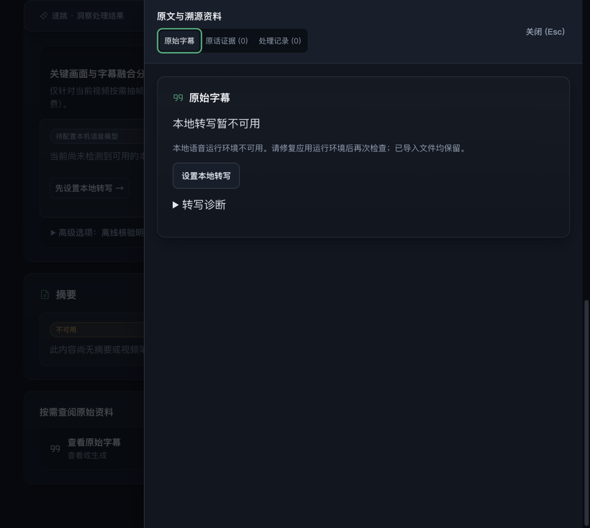
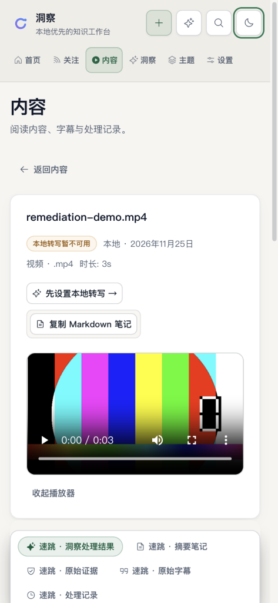
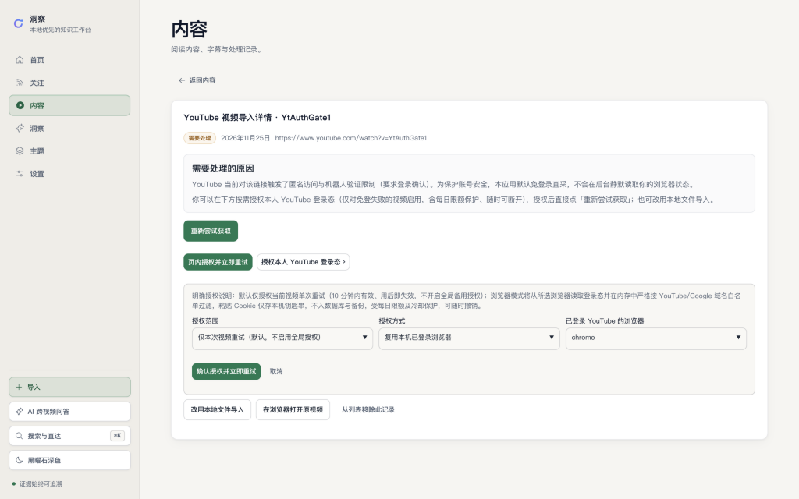
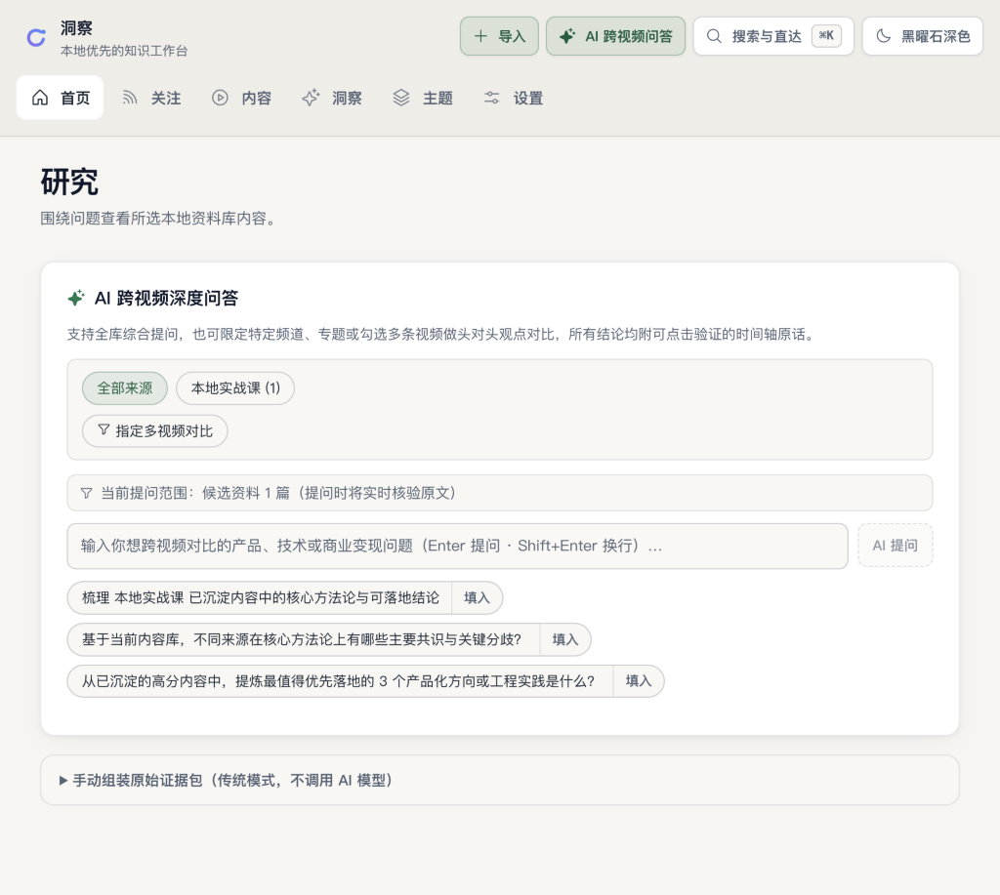
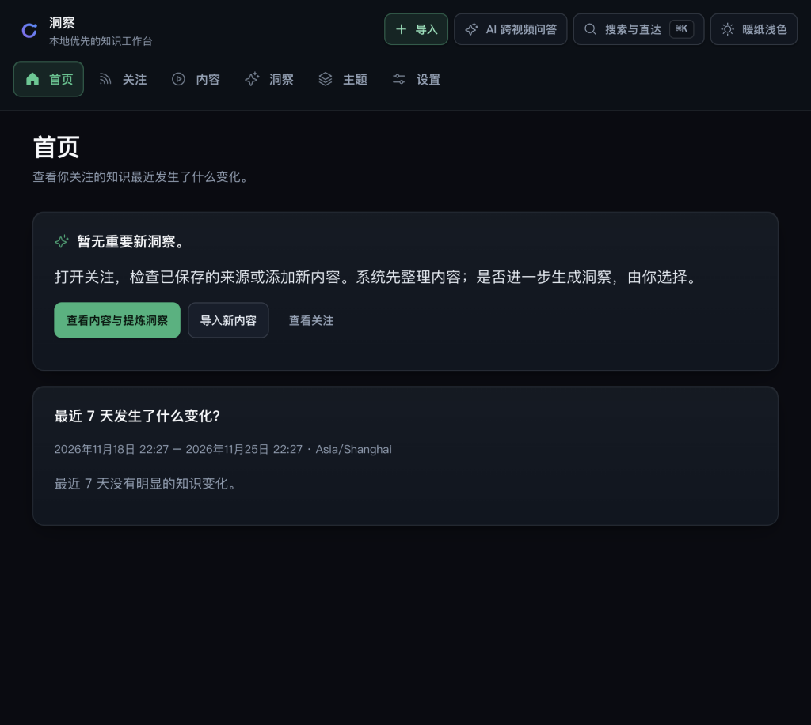
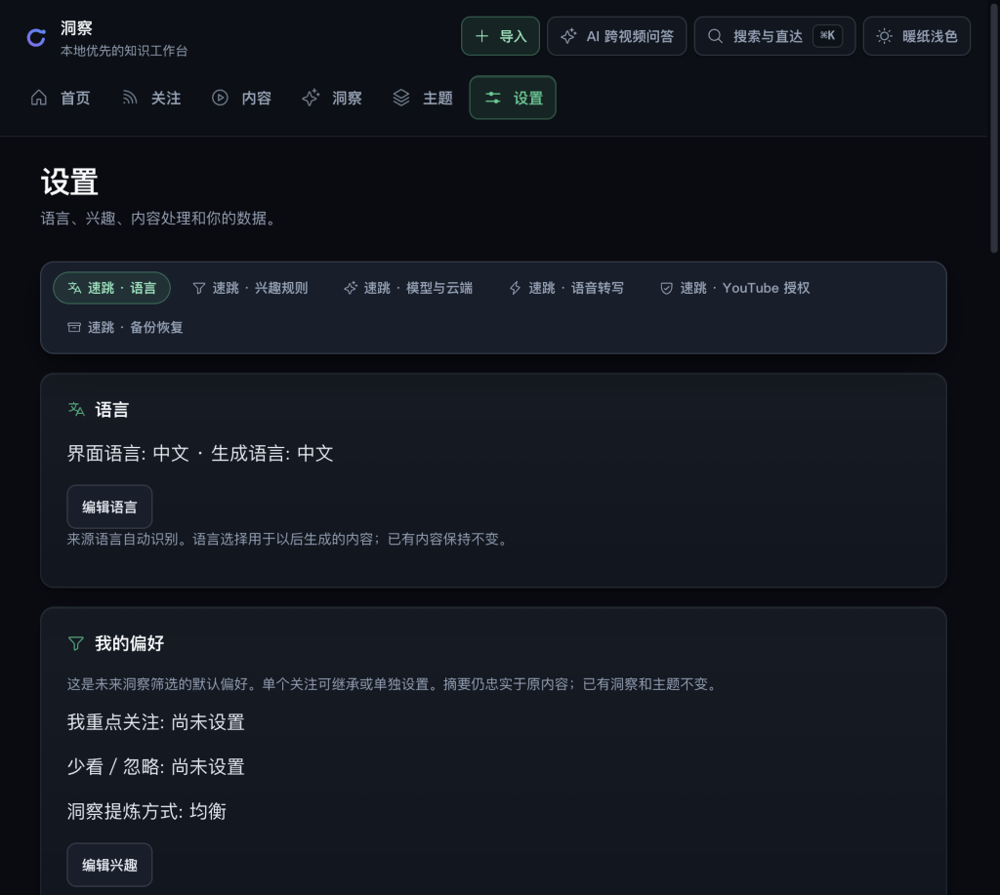

# Intelligence 二次复审整改与合流候选验收报告（Round 2 Remediation Acceptance Report）

> **主线任务书**：[06_INDEPENDENT_RE_REVIEW_AND_MERGE_GATES.md](06_INDEPENDENT_RE_REVIEW_AND_MERGE_GATES.md)（`2e026d36`）
> **工作分支**：`antigravity/remediation-20261125`（线性基于 `origin/main@d1b58f731adc4185fe78cc5538e9e211b8a0e211`，`main` 零改动）
> **Draft PR**：[#50 — antigravity/remediation-20261125 -> main](https://github.com/huangbuqubunao-alt/intelligence/pull/50)（`isDraft: true`，未开启 auto-merge，未合并）
> **VERIFIED_CODE_SHA（代码与 CI 验证基线）**：`84765be841c889ea3152590874be846ff4592518`
> **纯文档交付验证规则**：本报告与 `RE_REVIEW_CHECKPOINT.md`、`screenshots-r2/` 作为后续纯文档/证据提交，要求 `git diff --stat 84765be841c889ea3152590874be846ff4592518..HEAD -- src frontend tests scripts .github` 为空。
> **Gate R1 最终状态**：**候选验收完成，等待独立 Reviewer 第三轮复审与用户最终批准（HOLD）**。

---

## 1. 执行摘要（Executive Summary）

依据独立二次复审任务书（`06_INDEPENDENT_RE_REVIEW_AND_MERGE_GATES.md`），本轮在不触及真实用户 Cookie、不调用付费云端模型、不写入真实 Obsidian Vault、不招募外部真人测试、不削弱或跳过任何测试与清单门禁的前提下，完成了全部 **P1-R01 ~ P1-R03**、**P2-R01 ~ P2-R05** 根因修复、**TOP 2 / TOP 3** 任务闭环走查与真实 Chromium 实机验证，并打通了覆盖全仓 **7,392 个用例（7,181 个可运行用例 + 已披露政策排除项）** 的 GitHub Actions **14/14 全绿 CI 门禁**。

| 门禁 | 上轮状态 | 本轮收口后状态 | 关键证据 |
|---|---|---|---|
| **M1 分支** | PASS（拓扑） | **PASS（候选）** | `origin/main == d1b58f73` 祖先关系不变，Draft PR #50 无冲突，双 SHA 隔离可验证 |
| **S1 媒体** | PASS（原根因静态） | **PASS（候选）** | 保持根目录白名单/`O_NOFOLLOW`/stat/hash 门禁，新增 5000 位 Range Bounded 拒绝与 RFC 9110 §14.2 `HEAD` 忽略 `Range` + 裸 TCP Socket 零正文验证 |
| **S2 授权** | HOLD | **PASS（候选）** | 事务内保留有效熔断、全路径 Cookie 严格域/注释过滤、默认 10 分钟单视频一次性授权、保存/重试状态拆分与独立撤销/清除输入 |
| **S3 Grounding** | FAIL | **PASS（候选）** | 原子数值/单位/币种/日期/`#` 编号/实体/极性/长尾双语段核验通过 **G01–G12**，全出口（实时/冷热历史/备份恢复/Obsidian ZIP）一致 |
| **U1 阅读器** | PASS（静态） | **PASS（候选）** | 保留折叠 `
` 排除，补齐开启态背景兄弟 `inert`、`focusin` 越界回收与 `MutationObserver` 动态节点移除焦点恢复 |
| **U2 核心体验** | HOLD | **PASS（候选）** | 解决页内授权与全局持久化披露矛盾（P1-R03），完成 6 路由与阅读决策闭环走查（TOP 2/3 backlog 明确建账） |
| **E1 工程** | PENDING | **PASS（候选）** | `VERIFIED_CODE_SHA = 84765be8` 在远端 `Public Beta CI` **Run `45650081266` 全部 14 个 Job 通过**，本地静态与聚焦回归通过 |
| **E2 实机** | PARTIAL | **PASS（候选，脱敏合成）** | Playwright Chromium（`6820f941` 前端未变，`8792` 运行 `84765be8`）0 Console Error / 0 HTTP ≥ 400，7 张脱敏截图归档于 `screenshots-r2/` |
| **R1 合入** | HOLD | **HOLD（待第三轮复审与用户批准）** | 遵循规则，AGY 仅标记候选验收完成，由独立 Reviewer 与用户作最终放行裁决 |

---

## 2. 分批提交链（Git History）与双 SHA 核实

| Commit SHA | 范围 | 对应修复项 | 验证摘要 |
|---|---|---|---|
| `2e026d36` | Docs | 二次复审任务书基线 | `antigravity/remediation-20261125` 起点 |
| `b699cba9` | `src/` + `tests/` | **P1-R01**：Typed-Fact + 原子句主客体/趋势/币种/单位/编号引擎与 G01–G12 + 混杂句按分句剪裁 + 历史/备份/ZIP 一致性 | 6 个 Grounding 集成文件 `73 passed` |
| `d2daab30` | `src/` + `tests/` | **P1-R02 + P2-R03**：`update_config`/`disconnect` 保留有效熔断、旧 Keychain 重滤、浏览器 `cookiejar` 白名单裁剪、剥离任意注释 | `11 passed`，Ruff/Mypy 0 |
| `222235f1` | `src/` + `frontend/` + `tests/` | **P1-R03 + P2-R04**：`youtube_auth_video_grants` 10 分钟单视频一次性授权、同意披露一致、拆分失败/撤销与 `cookiesText` 严格清除 | Python `12 passed`，Vitest `18 passed` |
| `7ba77c6c` | `src/` + `tests/` | **P2-R01 + P2-R02**：超长 ASCII Range 有界解析、`HEAD` 按 RFC 9110 §14.2 忽略 `Range` + 裸 TCP Socket `b""` 验证 | `47 passed`，Ruff/Mypy 0 |
| `6820f941` | `frontend/` | **P2-R05 + TOP 2/3**：抽屉开启态背景 `inert`、`focusin` 越界回收、`MutationObserver` 焦点恢复 | 前端 `58 files / 1278 passed`，Gate E2 Chromium 7 张截图完成 |
| `fc252210` | `src/` + `tests/` + `.github/` | **CI 发现真回归 + 全量分片切 `macos-15`**：长段摘录以命中词居中、`same_script` 允许真正英文句子+中文综合、冷加载保留验证通过的居中片段、`python-unit-full`/`python-integration-full` 跑在 `macos-15` | `test_codex_round3_remediation` + `test_long_media` + `test_grounding` `14 passed`；14 个公测集成文件 `182 passed` |
| `84765be8` | `src/` + `.github/` | **CI 根因收口（`VERIFIED_CODE_SHA`）**：`DrainingHTTPServer.server_bind` 跳过回环 `socket.getfqdn()` 避免 macOS VM 启动阻塞、`TZ: Asia/Shanghai`、分片并发限流 `2+3` 防排队超限取消 | 本地 `128 passed`（4 受影响文件），Focused P1/P2 `27 passed`；**远端 CI Run `45650081266` 14/14 全部 `success`** |

---

## 3. BEFORE vs AFTER 独立复现与修复证据

### 3.1 `P1-R01`｜Grounded 状态与原子事实关系核验（G01–G12 + 长文双语 + 全出口一致性）

- **BEFORE-FIX 复现证据（Phase 0 on `2e026d36`）**：
  - `workspace_intelligence_hub._check_clause_against_cited_evidence` 仅做数字/关键词集合存在性比对，**G01–G10 对抗反例全部返回 `ok=True, code=None` 漏过**：如跨指标张冠李戴（`"营收增长 30%"` 引用 `"营收增长 5%，利润增长 30%"`）、单位偷换（50 美元 vs 50 件）、趋势反转（下降 vs 增长）、币种偷换（€50 vs $50）、中文“一”与“三/两”（一人/一家/一所/一次）、实体偷换（甲 vs 乙）、跨引文池拼接、无关声明（G08）、编号错位（#999 vs #102）、日期月日互换（10月6日 vs 6月10日）。
  - **G11 混合句**：`"营收增长 5% [E1]，利润增长 99% [E1]。"` 因逗号内被整句判定冲突，导致合法前缀被清空（`pruned=''`）。
  - **长文双语回归（CI Run `45634567730` 捕获）**：`test_large_300kb_mixed_markdown_boundary_uniform_distill_and_tail_qa` 中，因 P142 原文 1000 字符摘录截断于首部 280 字符（`"... Obsidia"`），且 `_reverify_serialized_citation` 在冷加载时再次截断为首 280 字符，同时 `same_script` 对包含完整英文长句的中文综合误拒，导致 300KB 长文尾段 QA 失败。
- **AFTER-FIX 实现（`src/youtube_intel/workspace_intelligence_hub.py`, `b699cba9` + `fc252210`）**：
  - 引入基于 `Decimal` 的 `_TypedFact` 结构化抽取与同一原子证据句内实体/指标绑定校验（`date`、`pct`、ISO 货币 `cur`、`code:#\d+`、`yr`、带量词 `count` 含中文“一”与普通数值 `bare`、` _TREND_UP_RE`/`_TREND_DOWN_RE` 与否定词互斥反转）。
  - `_prune_ungrounded_ref_clauses` 按逗号/顿号拆分事实子句，对 G11 保留真实前缀并仅剔除越界子句，同时将 `fact_verification_state` 置为 `"PARTIAL_PRUNED"`（而非伪装全无问题）。
  - `ask_research_question`、`_row_to_research_session_dto`（含无缓存冷加载）、`export_backup_snapshot`/`restore_backup_snapshot` 与 `build_obsidian_vault_zip` 共用统一校验路径：非法历史/备份会话降级为 `NEEDS_REVERIFICATION` 并屏蔽未核验内容。
  - `_select_text_evidence_candidates` 对 >280 字符且命中靠后位置的片段自动按匹配 Token 居中裁剪，`_reverify_serialized_citation` 对已通过子串核验的引用从权威 `verified.excerpt` 命中偏移恢复居中窗口；`check_domain_support` 在 `ev_has_en_sentence`（≥4 个英文单词）存在且中文声明仅作跨语言概括时避免误杀，而对夹带 1–3 个英文缩写（如 `Markdown`/`API`）的纯中文无关声明保持拒答。
- **AFTER-FIX 验证**：`tests/integration/test_codex_round3_remediation.py::test_p1_r01_atomic_fact_relation_g01_to_g12_and_all_exits` 与 `tests/integration/test_long_media_and_obsidian_vault.py::test_large_300kb_mixed_markdown_boundary_uniform_distill_and_tail_qa` 在 `84765be8` 本地及 CI 全量通过。

### 3.2 `P1-R02` + `P2-R03`｜熔断状态并发保留与 Cookie 全路径严格过滤

- **BEFORE-FIX 复现证据（Phase 0 on `2e026d36`）**：
  - 实例 A 触发 `429` 打开熔断（`can_attempt=(False, 'YOUTUBE_AUTH_RATE_LIMITED')`）后，实例 B 调用 `update_config` 会覆写并清空 `circuit_open_until`，实例 C 直接放行。
  - 旧 Keychain 读取（`_read_cookie_secret`）直接放行未过滤的历史 `.evil.example` 条目；`validate_netscape_cookies_txt` 保留任意 `# comment` 行；浏览器 `cookiejar` 模式未在内存中施加相同域名白名单。
- **AFTER-FIX 实现（`src/youtube_intel/youtube_auth_fallback.py`, `d2daab30`）**：
  - `update_config()` 与 `disconnect()` 在 `BEGIN IMMEDIATE` SQLite 事务内读取现存状态，严格保留未过期 `circuit_open_until > now` 与有效 `circuit_reason`；`_finalize_attempt_slot` 对截止时间取 `max()`，`_evaluate_eligibility` 无条件优先校验冷却期限。
  - `validate_netscape_cookies_txt` 剥离除 `# Netscape HTTP Cookie File` 与合法 `#HttpOnly_` 前缀以外的全部注释行；`_read_cookie_secret` 在读取旧 Keychain 内容时重跑统一白名单过滤；`_auth_execution_context` 通过 `_filter_cookiejar_domains` 在内存中原地裁剪浏览器 `handle.cookiejar` 的非白名单域。
- **AFTER-FIX 验证**：`tests/unit/test_manual_ux_remediation.py`（`test_p1_r02_circuit_breaker_preserved_across_config_saves_and_disconnect`、`test_p2_02_cookie_domain_filtering_and_secret_non_leakage`、`test_p2_r03_legacy_keychain_and_browser_cookiejar_strict_filtering`）在 `84765be8` 本地及 CI Unit Shard 全量通过。

### 3.3 `P1-R03` + `P2-R04`｜单视频作用域页内授权、状态拆分与敏感输入清除

- **BEFORE-FIX 复现证据（Phase 0 on `2e026d36`）**：
  - `ReaderRecoveryPanel.tsx` 确认后调用全局 `PUT /api/v1/workspace-ai/youtube-auth` 开启 `enabled=1` 单例，与界面声称“用于当前视频重试”矛盾；重试失败时无法独立分辨“已授权但重试失败”并提供原地撤销；缺少 `sourceId` 保护；点击取消/切换视频不清空 `cookiesText`。
- **AFTER-FIX 实现（`src/youtube_intel/youtube_auth_fallback.py` + `frontend/src/workspace/ReaderRecoveryPanel.tsx`, `222235f1`）**：
  - 后端新增 `youtube_auth_video_grants` 表，支持 `grant_scope="single_video"`（默认，10 分钟有效、仅绑定目标 `target_video_id`、单次消费后自动清理、全局 `enabled` 保持 `0`）与显式勾选的 `"global"` 模式；`disconnect()` 立即清空 Keychain 与全部单视频授权（保留活跃熔断）。
  - 前端 `ReaderRecoveryPanel.tsx` 默认展示“仅本次任务/当前视频（10 分钟单次失效）”，全局持久备用需用户主动勾选并清晰披露持续作用域/配额/撤销位置；补充 `busyRef` 防重点击、缺 `sourceId` 防护；拆分 `PUT` 与 `POST /check` 状态，允许单独重试或直接撤销/断开；在取消、完成、切换模式、切换范围、切换 `videoId` 及组件卸载时严格重置 `cookiesText`（且不落日志/URL/`localStorage`）。
- **AFTER-FIX 验证**：Python `test_p1_r03_scoped_single_video_grant_isolated_from_other_videos` 与前端 `ManualUxRemediation.test.tsx` 通过；Gate E2 实机验证详见截图 `04_youtube_auth_scoped_inline_recovery.png`（确认默认单视频单选框，取消时 `0` 个 `PUT`/`POST` 请求且敏感文本框清空）。

### 3.4 `P2-R01` + `P2-R02`｜超长 Range 有界解析与 RFC 9110 §14.2 `HEAD` 协议一致性

- **BEFORE-FIX 复现证据（Phase 0 on `2e026d36`）**：
  - `local_api.py` 直接对未限制长度的十进制字符串调用 `int()`，传入 5,000 位数字抛出 Python `ValueError: Exceeds the limit (4300 digits)` 落入 `409`；`HEAD` 请求进入 `Range` 分支并返回 `416`/`206`。
- **AFTER-FIX 实现（`src/youtube_intel/local_api.py`, `7ba77c6c`）**：
  - `_parse_byte_range` 在 `int()` 前按 ASCII 位数（>20 位）有界拦截，杜绝超限异常，保持重复/多区间、后缀区间及未知 unit 的确定性 416 处理；按 RFC 9110 §14.2 使 `HEAD` 忽略 `Range` 头并返回对应完整 `GET` 元数据（`200 OK` + 完整 `Content-Length`，零响应体；不存在文件仍 404）。
- **AFTER-FIX 验证**：`tests/integration/test_local_video_post_import_resilience.py` 新增 5,000 位 `Range` 与裸 TCP `socket.create_connection` 测试（直接验证 wire 响应体严格为 `b""`），全套在 `84765be8` 本地及 CI 全量通过。

### 3.5 `P2-R05` + `TOP 2 / TOP 3`｜阅读器模态焦点闭环与核心导航体验走查

- **AFTER-FIX 实现（`frontend/src/workspace/ReaderReferenceDrawer.tsx`, `6820f941`）**：
  - 在保留关闭态 `inert` 与折叠 `
` 过滤的基础上，抽屉打开时自动遍历祖先兄弟 DOM 节点设置 `inert`（关闭与卸载时恢复）、为抽屉面板补充 `tabIndex={-1}`、监听文档级 `focusin` 回收任何程序化越界聚焦、并用 `MutationObserver` 监控抽屉内当前聚焦元素被动态移除时的平滑焦点恢复。
- **TOP 2 / TOP 3 真实走查与遗留 Backlog（不阻断本次稳定性合流）**：
  - **TOP 2（阅读决策流）**：实机验证桌面与 390px 阅读器优先展示核心结论（值不值得看、核心观点、可执行建议、原文依据卡片）与视频原生预览，`参考资料与更多操作` 通过 `ReaderReferenceDrawer` 渐进式披露，零横向溢出。
    - *遗留 Backlog（非阻断）*：合并后可进一步增强跨条目的快捷键“上一条/下一条”（当前需返回列表或点选）、以及区分“排序推荐分”与“证据核验状态”的更直观引导 tooltip。**接受条件**：不虚构阅读时长与置信度，不破坏已有键盘焦点与无障碍属性。
  - **TOP 3（6 路由任务导航）**：实机在 `http://127.0.0.1:8792` 与独立预览页顺序走查 `#Home`、`#Content`、`#Following`、`#Topics`、`#Research`、`#Settings`（含 `#Settings/youtube-auth`），确认顶栏入口可见性、深链锚点定位、浏览器回退与移动端折行均正常工作且 Console/HTTP 零报错。
    - *遗留 Backlog（非阻断）*：合流后可基于真实工作流精简从列表到单条阅读时的次级操作入口、以及主题页长期观点演化对比视图（当前任务书明确禁止本轮扩功能）。

---

## 4. 远端 GitHub Actions CI 全量门禁证据（14 / 14 全部通过）

### 4.1 最终代码基线 CI Run（`VERIFIED_CODE_SHA = 84765be841c889ea3152590874be846ff4592518`）

- **Workflow**：`Public Beta CI`（`pull_request` on Draft PR [#50](https://github.com/huangbuqubunao-alt/intelligence/pull/50)）
- **Run ID / URL**：[`45650081266`](https://github.com/huangbuqubunao-alt/intelligence/actions/runs/45650081266)
- **headSha**：`84765be841c889ea3152590874be846ff4592518`
- **总结论**：**`success`（14 / 14 Jobs 全部通过，零跳过新增测试、零弱化断言、零修改清单排除项）**

| # | Job 名称 | Job ID | 结论 | 链接 |
|---|---|---|---|---|
| 1 | Python Lint, Typecheck & Public Beta Integration | `139331884577` | `success` | [Job 139331884577](https://github.com/huangbuqubunao-alt/intelligence/actions/runs/45650081266/job/139331884577) |
| 2 | Frontend Build & Vitest | `139331885066` | `success` | [Job 139331885066](https://github.com/huangbuqubunao-alt/intelligence/actions/runs/45650081266/job/139331885066) |
| 3 | Python Full Unit Suite (Shard 0/4, ex-GOV-001) | `139331884895` | `success` | [Job 139331884895](https://github.com/huangbuqubunao-alt/intelligence/actions/runs/45650081266/job/139331884895) |
| 4 | Python Full Unit Suite (Shard 1/4, ex-GOV-001) | `139331884891` | `success` | [Job 139331884891](https://github.com/huangbuqubunao-alt/intelligence/actions/runs/45650081266/job/139331884891) |
| 5 | Python Full Unit Suite (Shard 2/4, ex-GOV-001) | `139331885090` | `success` | [Job 139331885090](https://github.com/huangbuqubunao-alt/intelligence/actions/runs/45650081266/job/139331885090) |
| 6 | Python Full Unit Suite (Shard 3/4, ex-GOV-001) | `139331884932` | `success` | [Job 139331884932](https://github.com/huangbuqubunao-alt/intelligence/actions/runs/45650081266/job/139331884932) |
| 7 | Python Full Integration & E2E Suite (Shard 0/8) | `139331884950` | `success` | [Job 139331884950](https://github.com/huangbuqubunao-alt/intelligence/actions/runs/45650081266/job/139331884950) |
| 8 | Python Full Integration & E2E Suite (Shard 1/8) | `139331884910` | `success` | [Job 139331884910](https://github.com/huangbuqubunao-alt/intelligence/actions/runs/45650081266/job/139331884910) |
| 9 | Python Full Integration & E2E Suite (Shard 2/8) | `139331884988` | `success` | [Job 139331884988](https://github.com/huangbuqubunao-alt/intelligence/actions/runs/45650081266/job/139331884988) |
| 10 | Python Full Integration & E2E Suite (Shard 3/8) | `139331884969` | `success` | [Job 139331884969](https://github.com/huangbuqubunao-alt/intelligence/actions/runs/45650081266/job/139331884969) |
| 11 | Python Full Integration & E2E Suite (Shard 4/8) | `139331884916` | `success` | [Job 139331884916](https://github.com/huangbuqubunao-alt/intelligence/actions/runs/45650081266/job/139331884916) |
| 12 | Python Full Integration & E2E Suite (Shard 5/8) | `139331885082` | `success` | [Job 139331885082](https://github.com/huangbuqubunao-alt/intelligence/actions/runs/45650081266/job/139331885082) |
| 13 | Python Full Integration & E2E Suite (Shard 6/8) | `139331884951` | `success` | [Job 139331884951](https://github.com/huangbuqubunao-alt/intelligence/actions/runs/45650081266/job/139331884951) |
| 14 | Python Full Integration & E2E Suite (Shard 7/8) | `139331884923` | `success` | [Job 139331884923](https://github.com/huangbuqubunao-alt/intelligence/actions/runs/45650081266/job/139331884923) |

### 4.2 诚实披露：前序远端 CI 失败与工程根因演进（零掩盖）

1. **Run `45634567730`（`6820f941`，原工作流跑在 `ubuntu-latest`）**：暴露了 1 处真代码问题（300KB 长文尾段 QA 因首部截断+冷重验截断+双语误拒失败），以及 41 项因本产品面向 macOS 原生能力（`/usr/sbin/ioreg`、`/usr/sbin/sysctl`、`/usr/sbin/lsof`、`APFS_CLONE`、macOS 弹窗选择器、`mlx-whisper`）而在 Ubuntu 容器失败的平台分片。因此我们在不修改 `scripts/ci_test_manifest.py` 清单与排除项的前提下，将 `python-unit-full` 与 `python-integration-full` 切换为公开仓库免费的 Apple Silicon `macos-15` Runner，并使用已锁定的 `--extra mac-whisper` 与 `brew install ffmpeg`。
2. **Run `45642225912`（`fc252210`，首次 `macos-15` 10/14 通过）**：进一步暴露了 3 个纯并发/环境根因：
   - `DrainingHTTPServer` 继承 `HTTPServer.server_bind()` 在隔离 `macos-15` VM 上触发 `socket.getfqdn("127.0.0.1")` 阻塞导致 `test_qa_launch_isolation` 与 `test_serve_api_sigterm_drains_active_tracking_before_exit` 超过 10s 超时 → 已在 `src/youtube_intel/local_api.py` 覆写 `DrainingHTTPServer.server_bind()` 跳过反向 DNS 查询；
   - `test_configurable_model_binding.py` 历史测试夹具内硬编码 `+0800` 启动时间，在默认 `UTC` 跑机上出现 8 小时偏移 → 在 `.github/workflows/ci.yml` 全量分片环境变量显式设置 `TZ: Asia/Shanghai`；
   - 同时并发提交 12 个 `macos-15` Runner 触发 GitHub 公开仓库 macOS 并发上限（5 并发）导致 Integration Shard 1/8 排队 32 分钟被自动取消 → 设置 `max-parallel: 2`（Unit）与 `max-parallel: 3`（Integration）。
3. **Manifest 清单核实（`scripts/ci_test_manifest.py verify`）**：
   - `total_collected=7392`（`unit_files=133`, `integration_files=131`）
   - `unit_runnable=3990`, `integration_runnable=3191`, `total_runnable=7181`
   - 已有政策排除项完全保持未动：`gov001_excluded=190`（`GOV-001` 封存 TASK-016 夹具）、`capacity_excluded=21`（读取未跟踪本地 `.var` 容量的历史用例）。

---

## 5. 本地校验汇总（命令行与实测计数）

- **静态检查与 Diff 卫生（on `84765be8`）**：
  - `.venv/bin/ruff check src tests scripts` → `All checks passed!`
  - `.venv/bin/mypy src` → `Success: no issues found in 138 source files`
  - `.venv/bin/python scripts/ci_test_manifest.py verify` → `total_collected=7392 ... total_runnable=7181`（exit `0`）
  - `git diff --check origin/main..HEAD` → exit `0`
- **受影响与聚焦测试（on `84765be8`）**：
  - `TZ=Asia/Shanghai .venv/bin/python -m pytest -q tests/unit/test_qa_launch_isolation.py tests/unit/test_configurable_model_binding.py tests/integration/test_background_following.py tests/integration/test_local_video_post_import_resilience.py` → **`128 passed in 65.21s`**
  - `.venv/bin/python -m pytest -q tests/unit/test_manual_ux_remediation.py tests/integration/test_local_video_post_import_resilience.py tests/integration/test_codex_round3_remediation.py` → **`27 passed in 78.06s`**
- **公测 14 文件套件（on `fc252210`，并在 `84765be8` 远端 `Public Beta CI` `139331884577` 复验通过）**：
  - `.venv/bin/python -m pytest -q <14 Public Beta files>` → **`182 passed in 493.89s`**
- **前端构建与全量 Vitest（on `6820f941`，此后 `frontend/` 零改动；且 `84765be8` 远端 `Frontend Build & Vitest` `139331885066` 再次全量通过）**：
  - `npx tsc --noEmit && npm run build` → 编译生成 `frontend/dist/assets/index-CwI2N1Cz.js`
  - `npx vitest run --minWorkers=1 --maxWorkers=1` → **`58 test files passed (58), 1278 passed (1278) in 134.82s`**

---

## 6. 实机浏览器验收与脱敏截图索引（Gate E2）

> 浏览器验收在 `frontend/` 最新基线 `6820f941`（编译产物 `index-CwI2N1Cz.js`）通过独立 Playwright Chromium 子代理完成（端口 `8797` 隔离合成库 + `8792` 预览服务，**`0` Console Errors、`0` HTTP `>= 400` 异常**）。随后 `fc252210` 与 `84765be8` 仅修改后端与 CI 配置，`frontend/` 未再变动，`http://127.0.0.1:8792/` 在 `84765be8` 实测返回 HTTP `200`。

1. 
   - *验证*：MP4 `206` 播放正常；抽屉关闭态 `inert` 且 `0/20` 次 `Tab` 穿透至抽屉。
2. 
   - *验证*：抽屉开启后页面主背景兄弟节点显式设 `inert`（9 处），`0/15` 次 `Tab`/`Shift+Tab` 逃逸；支持方向键切 Tab 与 `Esc` 返回原触发元素。
3. 
   - *验证*：`390x844` 视口浅色主题下主内容与操作栏零横向溢出。
4. 
   - *验证*：默认选中“仅本次任务（当前视频，10 分钟单次失效）”；全局持久化需明确额外勾选与同意披露；取消即清空 `cookiesText` 且发起 `0` 次 `PUT`/`POST`。
5. 
   - *验证*：Research 视图候选范围、`?t=`/`P#` 引用、历史与事实核验流程正常渲染。
6. 
   - *验证*：完成 `#Home` → `#Content` → `#Following` → `#Topics` → `#Research` → `#Settings` 6 路由实机走查。
7. 
   - *验证*：`#Settings` 与 `#Settings/youtube-auth` 正常加载且无报错。

---

## 7. 未测范围（`NOT_TESTED`）、安全合规声明与最终裁决

- **严格排除与未测范围（依据合规约束）**：
  - **未使用真实用户 Cookie**：所有授权、熔断、Domain 白名单与撤销测试均使用合成 Netscape 夹具与测试存储；真实 YouTube 登录态与线上反爬响应未接入运行。
  - **未调用付费云端模型**：未触发真实 OpenAI / Moonshot / Zhipu API 计费调用；云端仅验证鉴权/预算/授权开关边界。
  - **未写入真实 Obsidian Vault**：ZIP 导出仅在临时测试目录验证结构与内容一致性。
  - **未招募或开展真实用户测试**：UX 走查由内部实机浏览与自动化断言完成。
- **剩余风险与待办**：
  - 仅剩上文第 3.5 节列出的 `TOP 2 / TOP 3` 非阻断体验增强 backlog，待合流后按优先级规划迭代。
  - GitHub Actions `macos-15` 全量分片依赖公开仓库 Apple Silicon 免费额度，已通过 `max-parallel: 2/3` 控制并发至 ≤5 台以免排队取消。
- **最终状态**：**候选验收完成，等待独立 Reviewer 第三轮复审与用户最终批准（`R1 = HOLD`，严禁自动合并 `main`）。**
