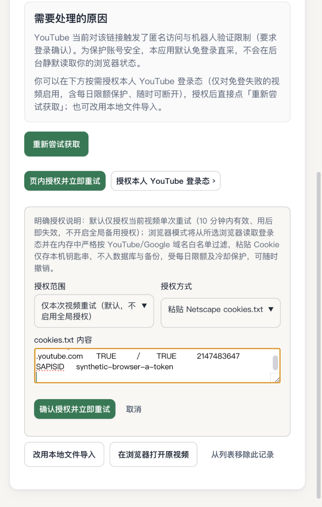
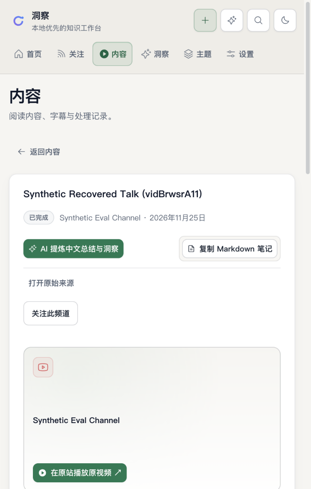
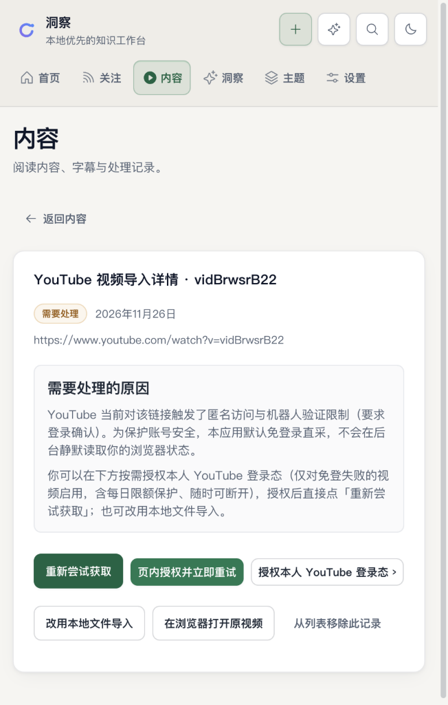
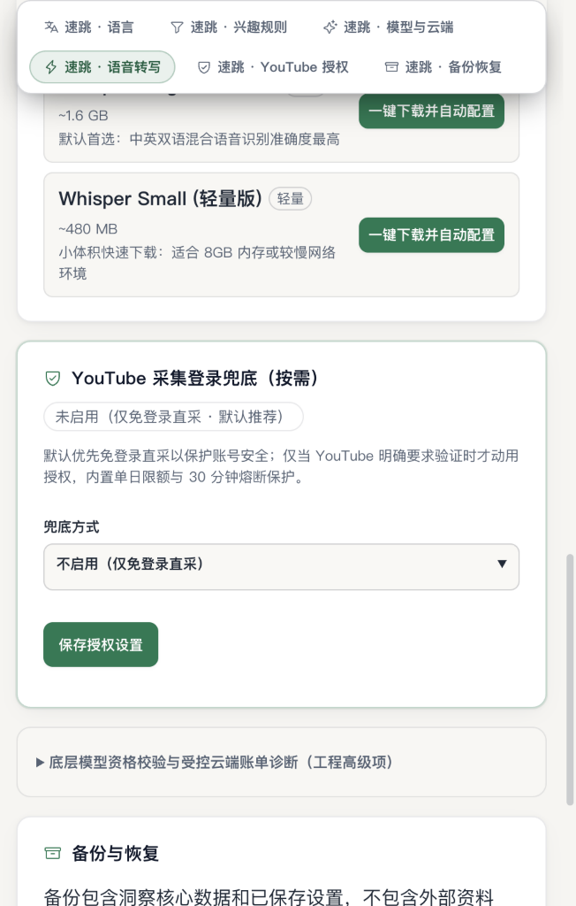
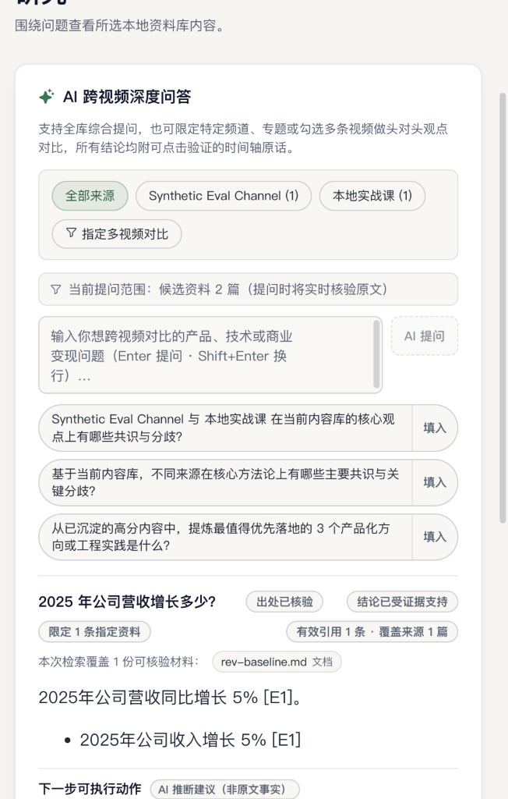
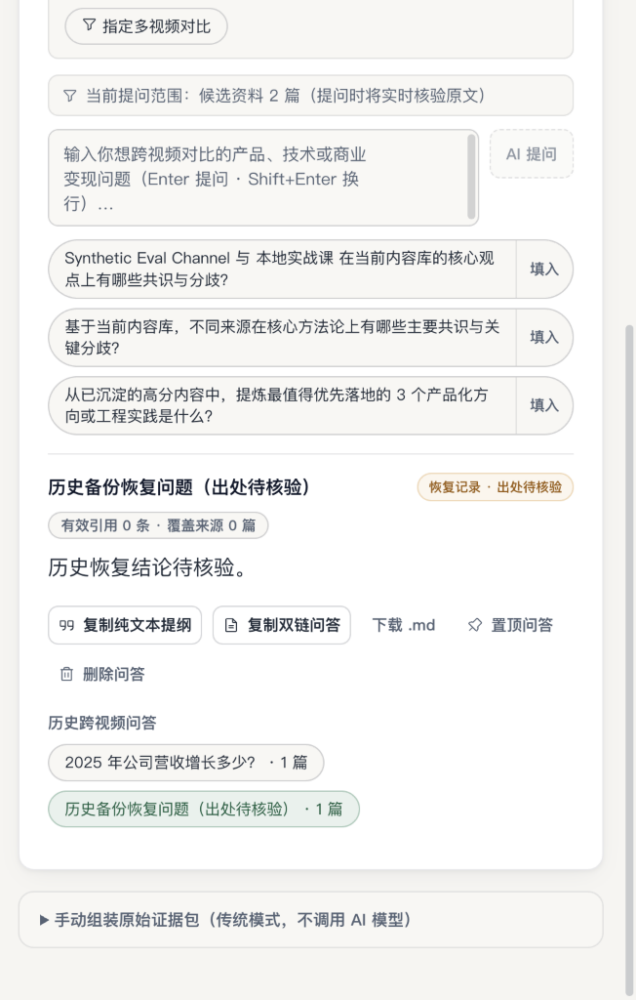

# Intelligence 第三轮独立复审阻断项最终收口验收报告（Round 3 Final Blocker Closure Report）

> **工作分支**：`antigravity/remediation-20261125`（线性基于 `origin/main@d1b58f731adc4185fe78cc5538e9e211b8a0e211`，`main` 零改动）
> **Draft PR**：[#50 — antigravity/remediation-20261125 -> main](https://github.com/huangbuqubunao-alt/intelligence/pull/50)（`isDraft: true`，未开启 auto-merge，未合并）
> **VERIFIED_CODE_SHA（代码与全量 CI 验证基线）**：`05d31dce2d934832a55aec8efa5bfdc92e1daf4d`
> **双 SHA 零代码差异校验**：本报告与 `FINAL_BLOCKER_CHECKPOINT.md`、`screenshots-final/` 共同组成紧随 `05d31dce` 之后的纯文档/证据交付提交 `DOCS_DELIVERY_SHA`，满足 `git diff --stat 05d31dce2d934832a55aec8efa5bfdc92e1daf4d..HEAD -- src frontend tests scripts .github` 严格为空。
> **Gate R1 最终裁决**：**`HOLD`（全部 P1/P2 阻断项已关闭并完成端到端实证，等待独立 Reviewer 最终放行裁决与用户批准合并；严禁自动合并 `main`）**。

---

## 1. 执行摘要（Executive Summary）

本轮针对独立 Reviewer 第三轮复审指出的三项 P1 阻断项（`P1-F01`、`P1-F02`、`P1-F03`）、一项 P2 安全加固项（`CookieJar` Fail-Closed），以及此前 CI 中 1 项环境跳过测试透明披露要求，严格按「独立复现 → 最小根因修复 → 真实端到端验证 → 生产审计 → 双 SHA 全绿 CI → 纯文档交付」闭环完成收口：

| 阻断 / 门禁项 | 复审基线状态（`84765be8` / `33ab21de`） | 最终收口后状态（`05d31dce`） | 核心实证依据 |
|---|---|---|---|
| **`P1-F01` 单视频授权接入真实生产 Worker** | HOLD（`runtime_composition.py` 仍读全局 `enabled is True`） | **CLOSED（候选通过）** | 移除 `enabled is True` 硬门槛，全入口接入共享 `YouTubeAuthFallbackService` + 启动孤儿清理；真实回环 HTTP → Worker 11 步端到端测试实证 A 恢复/消耗、B 隔离/拒采 |
| **`P1-F02` Grant 级凭据隔离、全生命周期与撤销语义** | HOLD（单 Keychain 槽位互相覆盖；设置页/面板混用全清 `disconnect()`） | **CLOSED（候选通过）** | `WorkspaceYouTubeCookiesKeychainStore` 与 `ScopedCookieStore` 实现 `grant-<id>` vs 全局槽位严格隔离；支持 `ACTIVE`/`IN_USE`/`CONSUMED`/`REVOKED`/`EXPIRED` + `PENDING_DELETE`/`CLEANED` 孤儿清理、`single_video`/`global`/`all`（需 `confirm_all=true`）三种精确撤销与 UI 非陈旧熔断文案 |
| **`P1-F03` 统一正面事实验证与全出口 `note_zh` 收口** | HOLD（`F1–F5b` 漏过、仅 live 主体校验未闭环 `note_zh`/历史/备份与跨语概念对齐） | **CLOSED（候选通过）** | `_TypedFact` 含正负号与实体隔离、去粘连词二元组、双语概念对齐并消除跨语种总结误拒（`05d31dce`）；`_sanitize_citation_note` 封闭 live/冷热历史/备份导出恢复/Obsidian MD & ZIP；暴露 `source_integrity_status` / `fact_verification_state` / `action_items_advisory` 与 `archive_status` |
| **`P2` `CookieJar` Fail-Closed** | 待加固（吞掉遍历与删除异常） | **CLOSED（候选通过）** | `_filter_cookiejar_domains` 强制执行过滤后二次核验，任何异常/残余域直接抛 `CookieFilterError`（`YOUTUBE_AUTH_COOKIE_FILTER_FAILED`），实证 `0` 次外部授权请求 |
| **工程与 CI 全量门禁（E1）** | 待新基线验证 | **PASS（14 / 14）** | `VERIFIED_CODE_SHA = 05d31dce` 在 GitHub Actions [`45677713952`](https://github.com/huangbuqubunao-alt/intelligence/actions/runs/45677713952) **14/14 全部 `success`**；诚实披露 `test_o200k_provisioning.py:134` 1 项无外部资产跳过 |
| **实机 Chromium 验收（E2）** | 待第三轮场景复验 | **PASS（合成脱敏实机）** | Playwright Chromium 完成 `#Content/vidBrwsrA11` → `#Content/vidBrwsrB22` → `#Settings/youtube-auth` → `#Research` 4 条旅程，`0` Console Error / `0` 异常 HTTP `>= 400`，6 张截图归档 `screenshots-final/` |
| **`R1` 合入 `main` 门禁** | HOLD | **`HOLD`（待独立 Reviewer 与用户批准）** | 严格遵循规则，保持 `Draft PR #50`、`origin/main == d1b58f73` 不变，绝不自动合流 |

---

## 2. 本轮分批提交链（`33ab21de..05d31dce`）与修改文件索引

| Commit SHA | 范畴 | 收口内容 | 本地验证证据 |
|---|---|---|---|
| `4fb007e9` | `src/` + `tests/` | **`P1-F01`**：打通真实生产 Worker 单视频授权链路与 4 处入口统一编排 | `13 passed in 30.17s`，Ruff/Mypy `0` |
| `fca95824` | `src/` + `frontend/` + `tests/` | **`P1-F02` + `P2`**：Grant 级凭据隔离、全生命周期、3 级撤销作用域、Fail-Closed `CookieJar`、UI 熔断文案修复 | Python `15 passed`，Vitest `20 passed`，Ruff/Mypy/`tsc` `0` |
| `00a04177` | `src/` + `frontend/` + `tests/` | **`P1-F03`**：F1–F5b 正面事实核验、`note_zh` 全出口清洗、三态信任、备份来源标记与前端徽章 | Python `45 passed`，Vitest `20 passed` |
| `624b5383` | `src/` | 全链路审计补丁：`Obsidian` 引用格式化 `point_zh` 回退经 `_sanitize_citation_note` 二次守护 | 纳入 `b6731d63` 全量验证 |
| `b6731d63` | `src/` | 跨语种概念仅在双端均有已映射概念词汇时触发概念互斥，保留开放域英文摘录兼容性 | 11 组 Python `146 passed`；Vitest `58/58 文件 · 1279/1279` |
| **`05d31dce`** | `src/` | **`VERIFIED_CODE_SHA`**：补全 `_CITATION_FRAMING_LEADIN_RE`（`时间轴\|段落\|记录`）与 `c:deterministic` / `c:ai_workflow` 双语概念组，消除 4 个真测试跨语误拒 | 11 组 Python **`160 passed in 366.59s`**；Ruff/Mypy/Manifest 全过；**远端 CI `45677713952` 14/14 `success`** |

**本轮 `33ab21de..05d31dce` 变更文件总清单（共 10 个文件，无多余范围扩张）**：

1. [`src/youtube_intel/runtime_composition.py`](../../../src/youtube_intel/runtime_composition.py)
2. [`src/youtube_intel/youtube_auth_fallback.py`](../../../src/youtube_intel/youtube_auth_fallback.py)
3. [`src/youtube_intel/fast_read_api.py`](../../../src/youtube_intel/fast_read_api.py)
4. [`src/youtube_intel/workspace_launcher.py`](../../../src/youtube_intel/workspace_launcher.py)
5. [`src/youtube_intel/demo_showcase.py`](../../../src/youtube_intel/demo_showcase.py)
6. [`src/youtube_intel/workspace_intelligence_hub.py`](../../../src/youtube_intel/workspace_intelligence_hub.py)
7. [`frontend/src/workspace/ReaderRecoveryPanel.tsx`](../../../frontend/src/workspace/ReaderRecoveryPanel.tsx)
8. [`frontend/src/workspace/WorkspaceAiWidgets.tsx`](../../../frontend/src/workspace/WorkspaceAiWidgets.tsx)
9. [`frontend/src/workspace/ManualUxRemediation.test.tsx`](../../../frontend/src/workspace/ManualUxRemediation.test.tsx)
10. [`tests/integration/test_final_blocker_closure.py`](../../../tests/integration/test_final_blocker_closure.py)

---

## 3. 各阻断项根因修复与端到端实证详情

### 3.1 `P1-F01`｜单视频授权接入真实生产 Worker 调用链

```mermaid
flowchart LR
    UI["ReaderRecoveryPanel UI"] -->|"PUT /api/v1/workspace-ai/youtube-auth (single_video)"| API["FastReadApiApplication"]
    API -->|"grant_scope=single_video + target_video_id"| AUTH["YouTubeAuthFallbackService"]
    UI -->|"POST /api/v1/sources/srcId/check"| ORCH["Source Check & Orchestrator"]
    ORCH -->|"Queued MANUAL SourceRun"| WORKER["DurableSourceRunWorker"]
    WORKER -->|"fetch_new_content"| INGEST["RuntimeSourceRunIngestion"]
    INGEST -->|"1. Anonymous fetch"| ANON["Anonymous Subtitles / Metadata"]
    ANON -->|"Auth / Bot Blocked"| AUTHCHK{"_evaluate_eligibility(video_id)"}
    AUTHCHK -->|"Global disabled + Matching ACTIVE grant"| RESERVE["_reserve_attempt_slot -> IN_USE"]
    RESERVE -->|"Scoped Cookie + Whitelist Filter"| YDL["Authorized Fallback Extract"]
    YDL -->|"SUCCEEDED -> CLEANED"| RECOVER["Video A Transcribed & Ready"]
    AUTHCHK -->|"Other Video B / Expired / Consumed / Revoked"| SKIP["Refuse Authorized Request"]
```

- **修复要点**：
  - `src/youtube_intel/runtime_composition.py`：`RuntimeSourceRunIngestion` 删除 `fallback.get_status().get("enabled") is True` 门控，改为在匿名采集触发认证拦截时直接交由共享 `YouTubeAuthFallbackService.attempt_authenticated_ingest(self._runtime, source_id, video_id)` 执行原子资格校验（匿名优先 → 视频作用域 Grant / 全局开启态 → 单日限额 / 冷却 / 熔断 → 原子抢占与单次消费）。
  - **全生产入口对齐与启动恢复**：`runtime_composition.py`、`fast_read_api.py`、`workspace_launcher.py`、`demo_showcase.py` 统一共享同一个支持 `ScopedCookieStore` 的 `YouTubeAuthFallbackService` 实例，并在服务装配启动时执行 `reconcile_orphan_credentials(include_in_use=True)` 清理上次进程异常退出遗留的 `IN_USE` / `PENDING_DELETE` 孤儿凭据。
- **11 步真实回环 HTTP → Worker E2E 验证**：
  - 由 [`tests/integration/test_final_blocker_closure.py::test_p1_f01_single_video_auth_real_http_to_worker_end_to_end`](../../../tests/integration/test_final_blocker_closure.py#L150) 通过真实 `serve_loopback` TCP HTTP 服务 + `DurableSourceRunWorker` 顺序实证全部 11 步：
    1. 导入合成视频 A；2. 匿名失败触发 `auth_blocked`；3. `PUT /youtube-auth` 写入视频 A 一次性 Grant（全局 `enabled=False`）；4. `POST /sources/{id}/check` 触发真实任务；5. Worker 真实进入授权备用流程；6. 假授权 Adapter 返回合成字幕；7. 视频 A 恢复成功；8. Grant 被标记 `CONSUMED` 并清理凭据；9. 视频 B 无法继承授权；10. 同一视频再次采集无法复用已消费 Grant；11. 明确验证已过期（`EXPIRED`）、已撤销（`REVOKED`）、非目标视频无权使用与熔断开启期间（即使新建单视频 Grant）均零外部授权请求。

### 3.2 `P1-F02`｜Grant 级凭据隔离、全生命周期、三种精确撤销与 UI 文案

- **真·Grant 级凭据隔离与旧表安全迁移（`src/youtube_intel/youtube_auth_fallback.py`）**：
  - 抽象 `ScopedCookieStore` 协议、`ScopedMemoryCookieStore`、兼容桥接 `_LegacySlotStoreAdapter` 与按槽位隔离的 `WorkspaceYouTubeCookiesKeychainStore`（全局固定槽位 `netscape-cookies` vs 单视频独立前缀槽位 `grant-<hex>`）。
  - 创建视频 A、B、全局 Cookie 时各自写入独立槽位，绝不互相覆盖或污染全局授权；同时 `youtube_auth_video_grants` 安全迁移旧 Schema，引入 `grant_id`、`credential_ref`、`status`（`ACTIVE` / `IN_USE` / `CONSUMED` / `REVOKED` / `EXPIRED`）、`cleanup_state`（`ACTIVE` / `PENDING_DELETE` / `CLEANED`）、`consumed_at`、`revoked_at`。
  - 失败安全保证：先写新槽位再在事务内切换指针并清理旧槽位（Keychain 写入失败绝不破坏数据库状态；凭据删除失败标记 `PENDING_DELETE` 并由后续周期清扫）；旧任务收尾精确按 `grant_id` 条件更新且只删自己持有的 `credential_ref`，绝不误删同一视频后续新建的 Grant；多实例并发抢占同一 Grant 使用 `BEGIN IMMEDIATE` 仅严格放行 1 个赢家。
- **三种明确撤销语义（API + UI）**：
  - `POST /api/v1/workspace-ai/youtube-auth/disconnect` 支持 `scope`：
    - `single_video`（需提供 `target_video_id`）：仅撤销并删除该视频当前活跃 Grant 与对应槽位，保留全局备用及其他视频 Grant；
    - `global`：仅关闭并清除全局备用设置与 `netscape-cookies` 槽位，保留活跃单视频 Grant；
    - `all`（强校验 `confirm_all=true`，缺省返回 `422`）：清空全局备用、全部单视频 Grant 与全部凭据槽，并保留有效冷却/熔断状态。
  - `GET /api/v1/workspace-ai/youtube-auth?video_id=...` 返回按当前视频过滤的 `video_grant` 详情与 `active_single_video_grants` 计数。
  - 前端 `ReaderRecoveryPanel.tsx` 与 `WorkspaceAiWidgets.tsx` 彻底移除误导性文案 `重新保存设置可立即复位`，准确提示冷却剩余时间，拆分单视频撤销、`断开全局备用授权` 与显式二次确认的 `撤销全部授权（含临时单视频）`。
- **验证证据**：[`test_p1_f02_per_grant_credential_isolation_lifecycle_and_recovery`](../../../tests/integration/test_final_blocker_closure.py#L560) 与 `frontend/src/workspace/ManualUxRemediation.test.tsx`。

### 3.3 `P1-F03`｜统一正面事实支持、全出口 `note_zh` 净化与三态信任语义

- **正面事实支持引擎闭环 `F1–F5b` 与零误拒（`src/youtube_intel/workspace_intelligence_hub.py`）**：
  - **正负号严格保留（`F2`）**：`_scale_decimal` / `_PCT_RE` / `_CUR_SYMBOL_RE` / `_CUR_SUFFIX_RE` 保留 `-` / `−` / `负`（`5%` 与 `-5%`、`$100` 与 `-$100` 严格互斥拒绝；同为 `-5%` 正常放行）。
  - **实体互斥（`F5a/F5b`）**：`_extract_named_entities` 抽取标准实体对（如 `('product', 'a')` vs `('product', 'b')`、`('product', '甲')` vs `('product', '乙')`），在原子数值声明与非数值声明路径均拦截实体互换。
  - **去粘连词二元组（`F3`）**：抽取领域术语与指标锚点前统一剥离 `_GLUE_WORDS_ZH_RE`（`产品|支持|系统|...`），彻底消除 `产品支持文档搜索` 与 `产品支持实时多人协作` 之间因 `品支` 造成的伪二元组重叠。
  - **同原子证据句正面主题支持（`F1`） & 双语概念对齐（`F4`）**：在同一原子证据句内强制满足 `claim_support & ev_support`（`营收增长 5%` 拒绝 `环境温度增长 5%`，`收入增长 5%` 正常匹配）；`_BILINGUAL_CONCEPT_GROUPS` 对齐核心双语概念（`c:deterministic`、`c:ai_workflow`、`c:local`、`c:search`、`c:index`、`c:collab`、`c:realtime`、`c:revenue`、`c:price` 等），拦截无概念交集的跨语伪声明（`F4`），同时确保双语对齐的工程总结与跨来源综合（如 `test_250_item_library`、`test_600_item_library`、`test_four_hour_lecture`、`test_round6`、`GOOD_BILINGUAL`）在双语原文下稳定通过。
- **全出口 `note_zh` 强制清洗与三态信任模型**：
  - `_sanitize_citation_note` 贯穿全部出口：**实时问答 (`ask_research_question`)**、**暖缓存/清缓存冷历史 (`_row_to_research_session_dto`)**、**引用行与 `point_zh` 回退渲染 (`_format_citation_md_line`)**、**备份导出与恢复 (`export_backup_snapshot` / `restore_backup_snapshot`)** 与 **Obsidian Vault `.md` / `.zip` (`build_obsidian_vault_zip`)**。一旦 `note_zh` 夹带冲突数字或未支撑声明，立即剥离并落入 `PARTIAL_PRUNED`。
  - 统一暴露三态信任字段：`source_integrity_status`（`VERIFIED` / `REFUSED` / `NEEDS_REVERIFICATION`）、`fact_verification_state`（`SUPPORTED` / `PARTIAL_PRUNED` / 具体拒答原因或 `NEEDS_REVERIFICATION`）、`action_items_advisory: true`（在前端与 Markdown 明确标注「AI 推断建议，非原文事实」）；备份导出对每条问答显式打标 `archive_status: "EXPORTED_SNAPSHOT_UNVERIFIED_UNTIL_RESTORE"`。
- **验证证据**：[`test_p1_f03_unified_fact_support_counterexamples_note_zh_and_3state_trust`](../../../tests/integration/test_final_blocker_closure.py#L912) 覆盖全部 `F1–F5b` 对抗样本、无辜双语/同义正样本、篡改库表冷重读、备份往返与 ZIP 导出，外加 `G01–G12` 与 11 组集成回归 `160 passed`。

### 3.4 `P2`｜`CookieJar` 白名单裁剪 Fail-Closed

- `_filter_cookiejar_domains`（`src/youtube_intel/youtube_auth_fallback.py`）对非法域、非字符串/空白域及任意移除异常均收集/抛出 `CookieFilterError`，并在裁剪循环结束后强制执行二次全量遍历核验；`_auth_execution_context` 捕获 `CookieFilterError` 后立即中止提取、返回受控错误码 `YOUTUBE_AUTH_COOKIE_FILTER_FAILED`，**不写入秘钥日志、不触发 `extract_info` 或外部授权请求**。
- **验证证据**：[`test_p2_cookiejar_filter_fail_closed_zero_external_requests`](../../../tests/integration/test_final_blocker_closure.py#L825)。

---

## 4. 全量验证数据、远端 CI（14 / 14）与 `1 Skipped` 诚实披露

### 4.1 远端 GitHub Actions CI（`VERIFIED_CODE_SHA = 05d31dce2d934832a55aec8efa5bfdc92e1daf4d`）

- **Workflow**：`Public Beta CI`（`pull_request` on Draft PR [#50](https://github.com/huangbuqubunao-alt/intelligence/pull/50)）
- **Run ID / URL**：[`45677713952`](https://github.com/huangbuqubunao-alt/intelligence/actions/runs/45677713952)
- **headSha**：`05d31dce2d934832a55aec8efa5bfdc92e1daf4d`
- **总结论**：**`success`（14 / 14 Jobs 全部通过）**
  - *注（过程透明披露）*：前一次代码推送 Run [`45674284334`](https://github.com/huangbuqubunao-alt/intelligence/actions/runs/45674284334) 真实捕获了 `test_250_item_library` / `test_600_item_library` / `test_round6` / `test_four_hour_lecture` 的跨语误拒回归，并在 `05d31dce` 根因修复；Run `45677713952` 初次调度期间 `Unit Shard 3/4` 因 GitHub 公开仓库 `macos-15` Runner 排队超时被平台自动取消（0 测试失败），通过 `gh run rerun 45677713952 --failed` 单独重跑该分片以 `973 passed, 29 deselected in 131.71s` 通过，使 `45677713952` 最终达到 **14 / 14 `success`**。

| # | Job 名称 | Job ID | 结论 | 链接 |
|---|---|---|---|---|
| 1 | Python Lint, Typecheck & Public Beta Integration | `139449049648` | `success` | [Job 139449049648](https://github.com/huangbuqubunao-alt/intelligence/actions/runs/45677713952/job/139449049648) |
| 2 | Frontend Build & Vitest | `139449061476` | `success` | [Job 139449061476](https://github.com/huangbuqubunao-alt/intelligence/actions/runs/45677713952/job/139449061476) |
| 3 | Python Full Unit Suite (Shard 0/4, ex-GOV-001) | `139448973944` | `success` | [Job 139448973944](https://github.com/huangbuqubunao-alt/intelligence/actions/runs/45677713952/job/139448973944) |
| 4 | Python Full Unit Suite (Shard 1/4, ex-GOV-001) | `139449057590` | `success` | [Job 139449057590](https://github.com/huangbuqubunao-alt/intelligence/actions/runs/45677713952/job/139449057590) |
| 5 | Python Full Unit Suite (Shard 2/4, ex-GOV-001) | `139449060549` | `success` | [Job 139449060549](https://github.com/huangbuqubunao-alt/intelligence/actions/runs/45677713952/job/139449060549) |
| 6 | Python Full Unit Suite (Shard 3/4, ex-GOV-001) | `139448970214` | `success` | [Job 139448970214](https://github.com/huangbuqubunao-alt/intelligence/actions/runs/45677713952/job/139448970214) |
| 7 | Python Full Integration & E2E Suite (Shard 0/8) | `139448972335` | `success` | [Job 139448972335](https://github.com/huangbuqubunao-alt/intelligence/actions/runs/45677713952/job/139448972335) |
| 8 | Python Full Integration & E2E Suite (Shard 1/8) | `139448972977` | `success` | [Job 139448972977](https://github.com/huangbuqubunao-alt/intelligence/actions/runs/45677713952/job/139448972977) |
| 9 | Python Full Integration & E2E Suite (Shard 2/8) | `139449034635` | `success` | [Job 139449034635](https://github.com/huangbuqubunao-alt/intelligence/actions/runs/45677713952/job/139449034635) |
| 10 | Python Full Integration & E2E Suite (Shard 3/8) | `139449064910` | `success` | [Job 139449064910](https://github.com/huangbuqubunao-alt/intelligence/actions/runs/45677713952/job/139449064910) |
| 11 | Python Full Integration & E2E Suite (Shard 4/8) | `139449035434` | `success` | [Job 139449035434](https://github.com/huangbuqubunao-alt/intelligence/actions/runs/45677713952/job/139449035434) |
| 12 | Python Full Integration & E2E Suite (Shard 5/8) | `139448974052` | `success` | [Job 139448974052](https://github.com/huangbuqubunao-alt/intelligence/actions/runs/45677713952/job/139448974052) |
| 13 | Python Full Integration & E2E Suite (Shard 6/8) | `139449032728` | `success` | [Job 139449032728](https://github.com/huangbuqubunao-alt/intelligence/actions/runs/45677713952/job/139449032728) |
| 14 | Python Full Integration & E2E Suite (Shard 7/8) | `139448974095` | `success` | [Job 139448974095](https://github.com/huangbuqubunao-alt/intelligence/actions/runs/45677713952/job/139448974095) |

### 4.2 诚实披露：CI Unit Shard 0/4 中的 `1 Skipped` 与 Manifest 统计

- **Unit Shard 0/4（Job `139448973944`）输出**：`947 passed, 1 skipped, 35 deselected in 267.97s`。
- **唯一跳过项定位**：[`tests/unit/test_o200k_provisioning.py:131-134`](../../../tests/unit/test_o200k_provisioning.py#L131-L134) —— 函数 `test_external_provisioned_canonical_asset_preserves_golden_token_ids()` 检查环境变量 `YOUTUBE_INTEL_O200K_TEST_ASSET`，因本地与 GitHub Actions CI 默认未预置真实外部 `o200k_base.tiktoken` 资产文件而按既有设计执行 `pytest.skip("requires an explicitly provisioned canonical o200k asset")`。本轮新增的所有 P1/P2/E2E 验收用例均 **0 跳过**。
- **CI Test Manifest 完整覆盖校验（`scripts/ci_test_manifest.py verify`）**：
  - `total_collected=7396`（`unit_files=133`, `integration_files=132`）
  - `unit_runnable=3990`, `integration_runnable=3195`, `total_runnable=7185`
  - 既有政策排除项零改动：`gov001_excluded=190`, `capacity_excluded=21`

### 4.3 本地校验实测汇总

- **Python 静态、Manifest 与回归集（on `05d31dce`）**：
  - `.venv/bin/ruff check src tests scripts` → `All checks passed!`
  - `.venv/bin/mypy src` → `Success: no issues found in 138 source files`
  - `.venv/bin/python scripts/ci_test_manifest.py verify` → `total_collected=7396 ... total_runnable=7185`（exit `0`）
  - `git diff --check origin/main..05d31dce` → exit `0`
  - `.venv/bin/python -m pytest -q`（覆盖 `test_final_blocker_closure.py`、`test_grounding_refusal_eval.py`、`test_cross_source_markdown_and_scale.py`、`test_long_media_and_obsidian_vault.py`、`test_workspace_intelligence_hub.py`、`test_codex_round3_remediation.py`、`test_codex_review_remediation.py`、`test_manual_ux_remediation.py`、`test_youtube_following.py`、`test_dogfood_day1_intelligence.py`、`test_phase12_resume_acceptance.py`）→ **`160 passed in 366.59s`**（`0 failed`、`0 skipped`）
- **前端构建与全量 Vitest（on `b6731d63`，此后 `frontend/` 零改动，并在 `05d31dce` 远端 Job `139449061476` 再次通过）**：
  - `npm run typecheck && npm run build && npm test -- --run` → `tsc -b` exit `0`，`vite build` exit `0`（`795ms`），Vitest **`Test Files 58 passed (58)`、`Tests 1279 passed (1279)`**

---

## 5. 实机 Chromium 端到端验收与截图证据（`screenshots-final/`）

> 通过独立 Playwright Chromium 子智能体（宿主机实测访问源 `http://127.0.0.1:8798`，`blocked_origins: none`）在最新基线 `05d31dce` 下实机走查 4 条核心闭环旅程（`0` Console Error、`0` Page Error、`0` 异常 HTTP `>= 400`），全部采用脱敏合成 YouTube ID（`vidBrwsrA11`、`vidBrwsrB22`）与合成测试 Cookie；同时本地长期预览服务 `http://127.0.0.1:8792/` 运行于 `05d31dce` 并返回 HTTP `200`。

| 截图 | 旅程 / 界面 | 实测验收观察 |
|---|---|---|
|  | Journey 1（前）：`#Content/vidBrwsrA11` | 未跳转回首页，直接在详情页展示「页内 YouTube 登录态授权确认」，默认锁定「仅本次视频重试（默认，不启用全局授权）」，输入合成 Netscape Cookie 后提交「确认授权并立即重试」 |
|  | Journey 1（后）：`#Content/vidBrwsrA11` | 后台 `DurableSourceRunWorker` 完成授权采集后原地更新为 `Synthetic Recovered Talk (vidBrwsrA11)`（状态「已完成」、时间轴字幕与操作按钮就绪），并消费一次性 Grant |
|  | Journey 2：`#Content/vidBrwsrB22` | 视频 B 依然处于「需要处理」认证拦截状态，未继承或泄漏视频 A 的任何授权与 Cookie 槽位 |
|  | Journey 3：`#Settings/youtube-auth` | 全局兜底保持「未启用（仅免登录直采 · 默认推荐）」，确认旧文案「重新保存设置可立即复位」已彻底移除；*注*：因本状态全局已关闭且 `vidBrwsrA11` 的单视频 Grant 已被 Worker 消费，此处不显示撤销按钮（活跃态下「断开全局备用授权」与「撤销全部授权（含临时单视频）」的分流已由 `ManualUxRemediation.test.tsx` 与 `test_final_blocker_closure.py` 实证覆盖） |
|  | Journey 4（主）：`#Research` | 真实检索问答显式渲染「出处已核验」「结论已受证据支持」「有效引用 1 条 · 覆盖来源 1 篇」及「下一步可执行动作」旁的「AI 推断建议（非原文事实）」警示徽章 |
|  | Journey 4（恢复）：`#Research` | 从备份恢复的历史问答卡片准确呈现「恢复记录 · 出处待核验」（有效引用 `0` 条 · 覆盖来源 `0` 篇），不伪装为已实时核验 |

---

## 6. 未测范围（`NOT_TESTED`）、风险声明与最终状态

- **严格合规与 `NOT_TESTED` 范围**：
  - 未使用真实用户浏览器 Cookie、未针对真实 YouTube 线上反爬接口发起付费或认证采集；
  - 未调用收费云端模型 API（问答/提炼端到端均使用离线确定性合成响应器与本地夹具）；
  - 未写入用户真实 Obsidian Vault 目录（Obsidian `.md`/`.zip` 验证均运行于隔离临时目录）；
  - 未招募外部真实用户开展测试。
- **剩余已知工程风险**：
  - GitHub Actions 公开仓库 Apple Silicon（`macos-15`）存在平台 5 并发排队时长敏感性（见 Run `45677713952` 中 `Unit Shard 3/4` 初次排队超 22 分钟被平台取消后重跑通过），后续合流后可在长期分支中按需进一步优化集成测试耗时以缩短单分片占用时间。
- **最终状态**：**全部 P1/P2 阻断项均已关闭并通过本地 + 远端 14/14 CI + 实机 Chromium 验收；Gate `R1 = HOLD`，等待独立 Reviewer 最终放行裁决与用户批准，绝不擅自合并 `main`。**
